# 宾夕法尼亚州立大学【中英⚡数据库管理系统｜CMPSC431 Fall 2015, Database Management Systems】 p31 P32 索引：基于哈希的索引 -BV1N76CBwEXb_p31-

Good morning， guys。So I was going to give a quiz。On Friday。But judging by this。

 that we all doing it today。You guys feel more rewarded？All right， before we get started。

 just want to quickly show you。little bit of changes I did for the schedule。かとか。

I took out chapter 16 so other then for the finals it will be accumulative and other than the materials covered in return1 and two。

 you will only have additionally chapter 8 and 12 because I figure if we rush through 16。

 we won't be able to finish it。And also， I moved homework too。To December 2nd， as I said last time。

 so it will be due。嗯。The week after。When。After a break。And also this time I also put an extra credit。

 you can do it if you're interested， it will be two points maximum， and that will be on。

Implementing with any programming language of the structure we talk about。

So it's actually not too hard， and you just have to replicate。An exact same example shown。

And also don't forget the project demonstration is the week after the break as well。

 and I think the T I will send out an email today to ask you guys for，The time to schedule it。Okay。

And so today we will continue chapter8 and also what's going to happen for Friday will be I will return midterm two。

 both part one and part two， I think part one will uplift the grades and also we will。

We turn project phase two。7。That's it。And I think I'll do a quiz today。

You might have to do it on the paper or。II'll let you guys know later。Allright。

 so let's get started with Cha 8。With'ch today's lecture。All right。

 so review a little bit from last time。Last time， near the end of the lecture。

 we were talking about three alternatives for data entry。

And if you don't remember data answer is basically what direct you to the data record。

So with the actual data itself， okay， we didote that with the case stuff。

And if you remember if you recall last time we talk about these three alternatives。

 the first one is the actual data record with key value K and the second one is k along with the RID RD is the record IDD so it's 1 K1 RD。

 1 K1 RID and the third one is a little bit different from the second one which is we have a pair of k and then a list of RIDs so last time we also showed you。

It's Victoriactorial representation of that。And this is the first alternative where the data entry itself is actually the data record。

 so the datas actually sit here and here the notes are the internal index node。

So this is the first alternative and last time on your slide I made mistake that I fixed it this time which is Al2 at that time you look at the slide I also I forgot to take out data entry equals data record but actually in Al two we have data record already separate from data entry and data entry maps to the data record here stays the same。

And you can see here is still a one to one mapping。Okay。

 so there's no like one data entry pointing to multiple data records。

 so here you can imagine these all to be the RID。However， for alternative free。

A tiny bit different are the arrows。So we can point to for one data entry。

 we can point to more than one data record， so that's why we say in alternative3。

 one data entry K can map to the list of our IDD。Okay， so this is for alternative three。

 and last thing we talked about the comparison。basically。

 you can say alternative three is a bit more compact。对啊。去。So that's where we were at last time。

And this time， we are going to talk about a little bit on indexing。

So don't get confused between the data entry and the index， I'll show you the difference later。

But let's talk about index classification first。😔，So there are two kind of comparisons we will want to do。

The first is primary versus secondary， and the second one will be closed。Versus on costs。

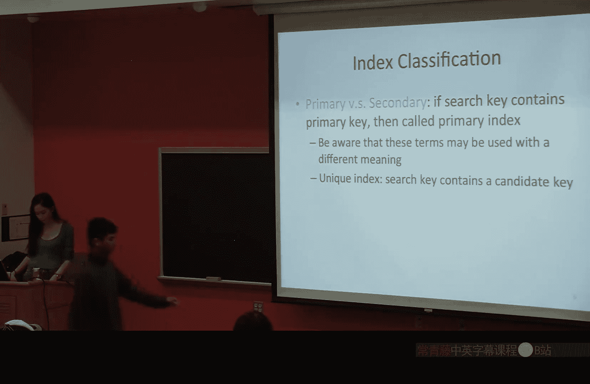

So let's start from prim versus。So when we talk about index and we say it's a primary indexing。

 we're just basically saying。😔，Thank。We are doing primary。

So when' indexing the data and you are using the primary key design in your data model。

 and we say this is a primary indexing， other than that， everything else。Nothing fancy。

So just in this lecture， we made primary related to the primary key we talked about。

The previous is chapter， but be aware that actually a lot of times people will talk about primary indexing with another meaning behind it。

 but we won't talk about it right here， just keep in mind the primaries here refer to the exact same primary key。

We talked about the book。Okay。So we say。And indexing is unique。

If today the search key don't have any duplicates。Okay， so in other words。

 if the search can contains can is it。So by default， primary indexing will be。Inding right。

 because no one。A bit different from unique indexing。

 but sometimes there actually are duplicates indexing。

 which is not ideal because maybe you choose an attribute to do the indexing， but there are some。

But also sometimes you don't really mind if it's not unique indexing because last thing we actually talked about when you have a data set。

 you can do the indexing maybe based on age， maybe that's what you care about and then age。

Go to have a lot of。そ it'sのユ。Another way of classifying the indexventing is cluster。

 versus just unclluster， which we' put quite a lot of emphasis on。

So we say if order of data records is the same as or close to order of data entry。

 then we call it a cluster in。Okay， so what do we mean by that when you see order。

 you can think of one of the approaches we talked about for indexing earlier last lecture？

We were actually talking about we can actually have the data stored in the sorted way。

I we started from heat and then sorted and an index thing right so each one of them gets more and more sophisticated but based on the previous one so here we say we care about the order and it cluster。

So you can say。Alternative one implies cost。Why do we say this because in alternative one。

 we aret going to sort。Based on whatever。Okay， however。嗯。

This is actually really rare in practice because in practice。

 not a lot of systems takes care of the data in a way that they actually sorted it based on a certain attribute because that's very extensive to maintain。

 but just remember。Alternative one actually implies the indexing is closed。

And here I say a file can be clustered on at most one search key and I missed this par at most one search key with alternative one。

 So here what I want to say is actually a system， you can have different ways of indexing in the data model itself okay you can mix different kind of alternatives but you only want at most one alternative one that's this because when we talked about alternative one。

 we say it actually stores the data record itself we say it just directly storing the data record and when you have a system where you have alternative one for more than one times then it means you are storing the data record for more than one times and that's what you wouldnt want to do because data records are the real data itself so you can have different kind of mechanism for doing indexing and you can have different alternatives then that's all right because indexing itself is so much smaller than the data record。

 So if you store alternatives one more than once， then you are just basically storing a lot of redundancy。

so that's why we only want that。You can have your system without alternative one， but if you want it。

 it's best to have just no more。And then we say cost of retrieving data。

Records through index varies greatly， which I'll show you later or in the next lecture。

When we retrieve data based on different kind of index。

 it gives us different cost based on the design of your index。For example， for a R search query。

Like last time we did， if you are searching employees based on the salaries and if your data is already sorted based on the salaries。

 then the range crew itself。Just pick the range。So a bit more on cluster versus on cluster。

Let's take a look， so suppose that we have alternative to use for data entries in that then the data records are stored in a heat fund。

OkayI won't put too much emphasis on here， but that's what the design should be。

 so to build the cluster index first we will sort the heat file with some free space on each page for future insert。

And also， here's the important part。Whenever you want to use alternative2。

 it might be potentially happening is the overflow pages。

So if some of you have learned about data structure before when you store data in the structure。

 a lot of times we already assume that the whole space is going to fit。

 okay maybe you have 100 records and then your data is just going to design for 100 records but here what overflow pages mean is that maybe your design initially didn't plan to store that more than 100 and then later on if you do some insertion and you figure out maybe you build a tree and it's not going to fit so what would you do。

When we learn about other。Let mean think other data structure， for example， other trees。

 a lot of times if you enter and the structure is going to be broken。

 then you actually rearrange the whole tree again right but right here in database a lot of times instead of rearranging the whole data structure they just append the overflow pages okay so imagine it。

For example， later on， you'll see if your data structure looks by somehow like a achieve。

Maybe it's like this， so they keep a。Initially， you only。

出中です。Original maybe you only plan。And then you insert meal coming theta。And。Instead of saying。

 let's be original。So then it keeps whatever odor you want to keep for the data structure。

 people the pen。P them here。So then not the structure。AndMaybe when you run a big algorithm。

 they all have to be complete from the left side。Eever based on rules。家で。It just made say。

And it is continuing。Insering data， maybe we keep going。我め justす。Okay。

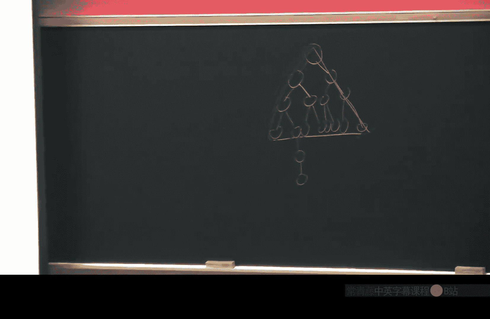

So the next week， I'll show you how cluster versus on cluster index will。

But if you look at your slide and you actually see there the identical thing。

So the thing is I forgot to mess up the arrows on this slide so you can just point at your own slide and say。

 remember to mess it up okay I think that was because after I drew this I copy and paste it。

 maybe someone knocked on the door and I forgot to mess it up。But anyway， here's the cluster version。

 and that's the uncllued version。 The big the main difference I want to show you is unclued version。

 like you can see， the order from data entries to data records is actually following some sort of order。

 So that's why we say it's cluster。Okay， but on the uncoed part。

 so remember to say you have to mess it up。 it doesn't matter。 Okay， it's not following any。

Or any costs。That's why we say if today your indexing is based on kind of sorting of the attributes。

变告理。However， E you have learned about hashing your。And today。

 let's say imagine we put the data records based on whatever attributes order。

 then if you do hashing， then it might not follow the structure anymore because if you do hashing a lot of times the value will keep going different way based on your hashing function。

If you're not familiar with hashing， let's quickly talk about what we mean next。😔，や。嗯哼。我 byは。

If someone。Applies a cr。And then。好的。Oh how would it go from here to here。

 so it's possible that we already store some kind of mapping。Okay， so yeah。

 these arrows indicate the mapping from data entry， data records， so they are already stored。

 but the way they are messed up， maybe your mapping based on hash function。Okay。

 so from here to here， it's not going to follow any order like that。

So who has learned about Haing before？Half of you， Okay， so let's talk about has。为了客。

So what do we mean by hashing？Whenever we talked about hashing， we will have。A hash function。 Okay。

 you take in the parameter and then your output。A value okay and you can design the hash function however you want。

 but there's always like。More ideal hashing function that would make the distribution。

your data better。So when doing hashing， we use a hash function to determine where a data entry is stored。

 and whenever we talk about hashing， the place that we store the data quite often。

 we just call it the data bucket。

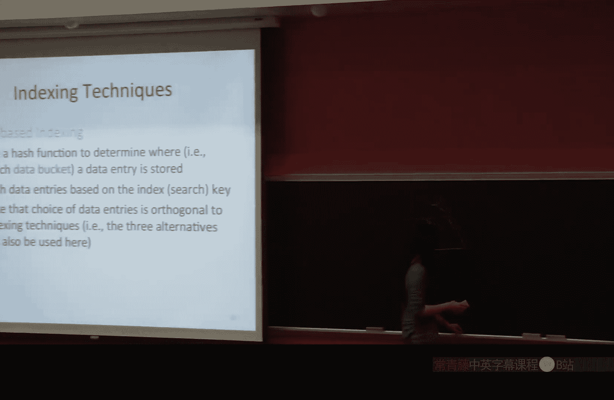

For example， we can try out。枕头。Okay， here we have。说吧。And now we have。はね。Each bucket。

 we're going to give it a number， So you can think of it as like a room number or。走。This isせよ。Okay。

We are gonna have cash。So you can design your hat。Equal to y。

 So the way you're going to design the hash function is where you get an x。

It's going to return the result， the value that would determine which bucket。平是X is what you want。

so here we can say the one to be equal to。Maybe。Taking one。Re when we have X over。All right。

 for example today we have next。看。AndWhere should we go。其始 that's。Second one， if we have this equal。

お緒にか。听咩。And if we have。So this does not have to be this way。Designing。

You can design your high function。Transform X into the binary first in the base。で just。

to show you how hacking。So what's important for hatchhing is， first of all。That's a tricky part。

If you want to design a hi function， that would distribute your data as even as possible because sometimes we actually have limits itself。

Okay， and if your。the worst hasphone you can ever think of。一分钟。0，1。And mean you actually have。ま。Okay。

 then。全てな。terrible choice。Or today， for some reason， you think it'll be a great idea。連略をす。

So you want to make the happen。在那航里。How many bucket you have？So this will be one why。

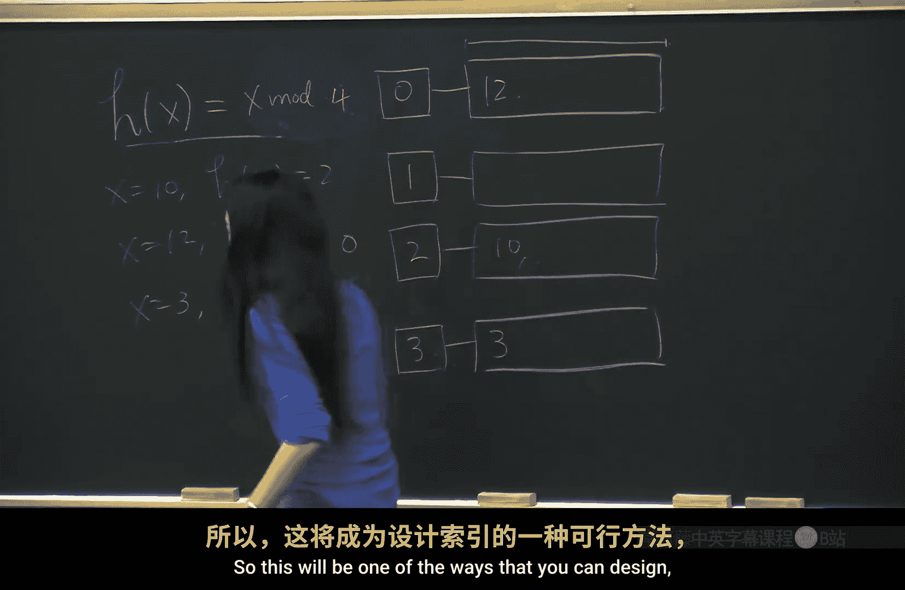

One of the ways that we can do indexing。And theは。

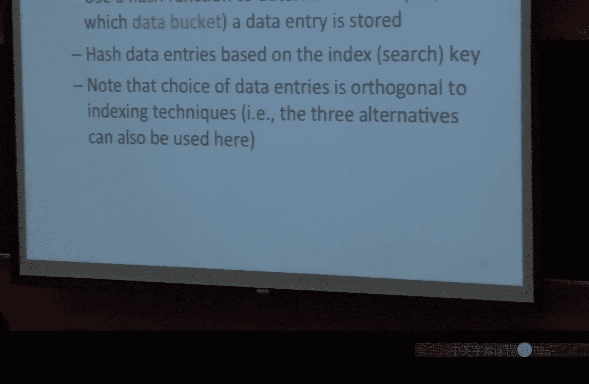

おのされた。What's the point of。こで。Exporting them because data records don't have links to each right。

 So if they reach a record。とに。This 어 응。Remember last time we were talking about we have different kinds of way of storing and the first one is just random them like heap。

 and the second one is salted。The third one is indexing。

 so this is just having an assumption if things are already sorted。

Then from the mapping of data entry to data records。

 maybe you have some really neat clustering mapping of it。Okay， so from the data entries here。

 every one of them is just near these。This area， but you cannot create right。

 you cannot reach any direct， like if you have this one director。acsing the other one。

 you'd possibly fall onto the same data entry like for the bunch of them。

And then again you go the director。So if it's even it's like that。

 like Chrisisss they don't have point to I see what you mean So here in the sort if you remember there were point it wasnt。

这す。One is there。 One is blue。They don't have the links Yeah， yeah， yeah， but。Let me so data entry。

 not only because you said they have the chain， right， the pointer chain。

 but when you have pointer chain and you actually want like a middle range。

But then you still have to go through all the chain。

 old previous chain to go to the range in the middle of the whole data set。きな古大き。without it。

 but for the closing end to do like five recordss and that wont access the third one。Yeah嗯。

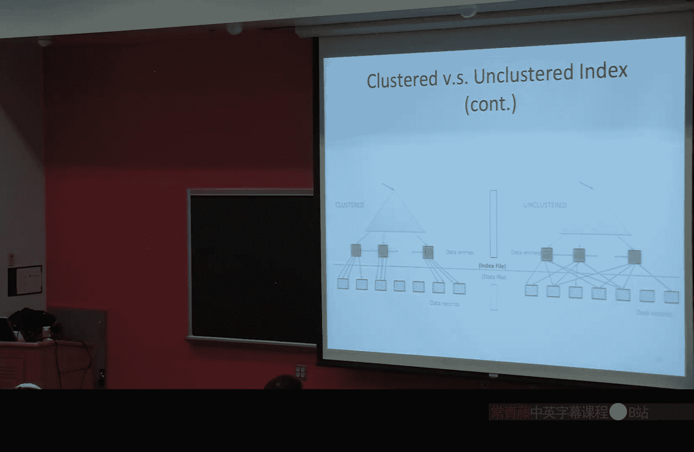

You can see here。

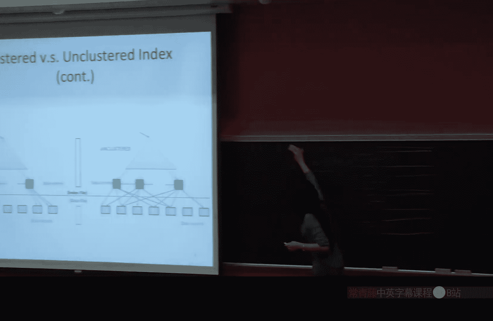

The last thing。We talked about。非常厉下。Let's say not without this。

And we have data that is already installed for。他那个听什么。And today， if your for long。

And we want something from the middle。You still have to travel。But today we're back。

The thinging is an possible way of designing anti mapping。We have some sort of data。And here。受けが現地。

So what you can actually say is maybe from here， I store everything that's between those。

In here I school everything。や。くらやす。かなかもで。Yeahや。你这。一方。问题。あの。一目あ。0ロ。I mean。那 sorry人。觉得。そ啊。

Then this is not supposed to me。実て？不是。面白い。Not just yeah。間りで。知你哋系咩有啲。あそうヘル関面。他的的。我。Oh。

 that's actually when your data gets a lot bigger。This takes a lot of cost。

A lot of light off because here we have to keep track。こい dataだけ bigger takesした。But here。

 maybe you can have that little。😊，Or maybe you just need to separate。

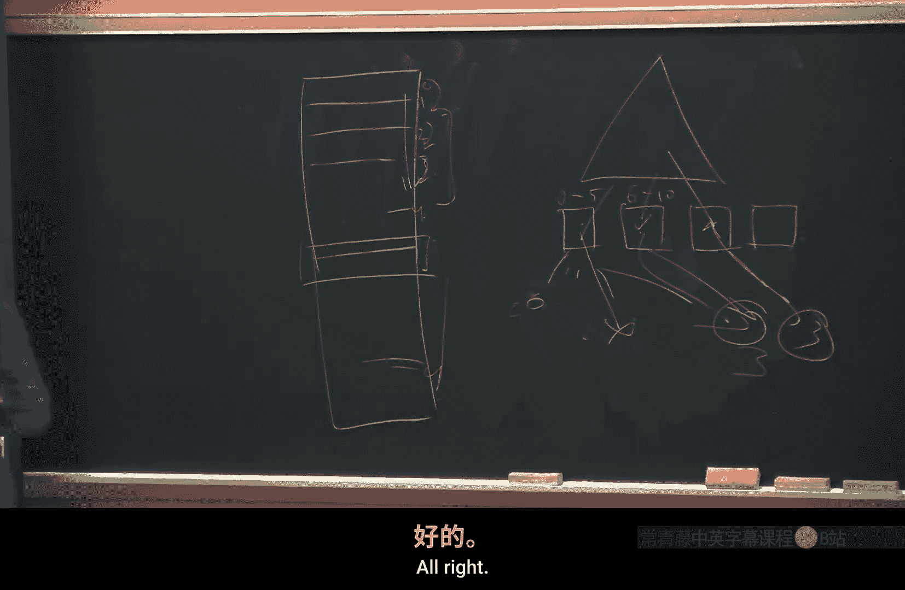

All right， where were we？

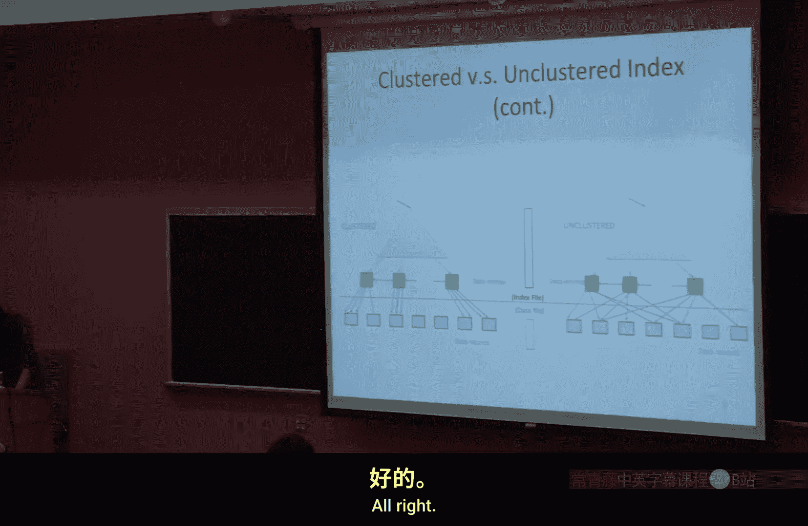

这个保险。Okay， so let's go back to hashing。Okay， so earlier， as I showed you， what passion is like。

Like different data buckets。And here I want to make a correction of last time what I talked about。

 so last time remember I say the choice of data entries is related to indexing techniques。

 but here I want to think of them as orthogonal。SoIt's got to be different Last time I say all that the way you choose the data entries might be somehow related to your indexing techniques。

 but it's actually not in that case， because the way you want to think of it maybe is data entry is one part of the design and you can combine them with different kind of meaning。

Okay， so last time I made it confusing， but just remember here we have different indexing later I'll show you besides the hash space。

 we also have tree indexing， and then they can do different kind of combinations with。

With the three alternatives we talked about last time， so it's not like oh if we have hashing。

 then we should do alternative one， if we have three bases， we should do alternative two Okay。

 so that was。A mistake I made last。So other than hash based， let's show you the tree based。

So tree is going to be similar of what I was just randomly drawing it with aia。

 so that's going to be something like a hierarchy。ok所以。For tree based indexing。

 we organize data records in a hierarchical data structure。

And the data entries are arranged in sorted order。Search keep。And I want to talk about these。

I'll show you what the hashbs are like。3被じ。And also later。

 maybe you want to pay more attention to the hash space because I' not pay attention to both。

 but I will work through。The hash rate indexing， and that's what you want to implement for。theかも。

So for hash based。Earlily， I showed you what hashing is like。

 we can have a hash function and that direct you to whatever data market you have。

 and we say it's good for equality selection。Why is that because as we saw early。

 you just take like it only takes constant time。Ideally to compute the function and then get you the output and then output directly directly you to which button to go。

But it might not be ideal for being ranked。Because we are not making sure the hash function itself has any relations with。

Al range。Right。So we say index is a collection。ちっばけす。大しが。So traditionally。We will have I erased it。

 but traditionally like I showed you earlier， the buckets a lot of times are just fixed size。

 so a lot of times it's not allowed that you have data over appending to a bucket that's already full。

Say we already have 10 elements in the bucket in the bucket specify， it can only have 10 elements。

 then you should not add the 11th one or some mechanism behind you will say we can replace the old one。

However here we will assume for this kind of bucket that we want to use。

 the earlier I show you the one with a limit， we call it a primary page。

 the primary age paid part of the bucket， and we can actually add more and which will be similar to the idea I just talked about。

 which is the overflow page。Okay。So。よビさ点。

We have。Like the index for。And it brings to the bucket。And this the book full。A lot of times。

 there are different ways you can do it。The first is just to。And we already have。

If we have limit a full。We already have thought about it。

A lot of times the way to do it is you can just add a bucket， not the same size。Who will。かけ構。

I'll just have。One 걸 같。With the same size。That's where。Adding the overflow。

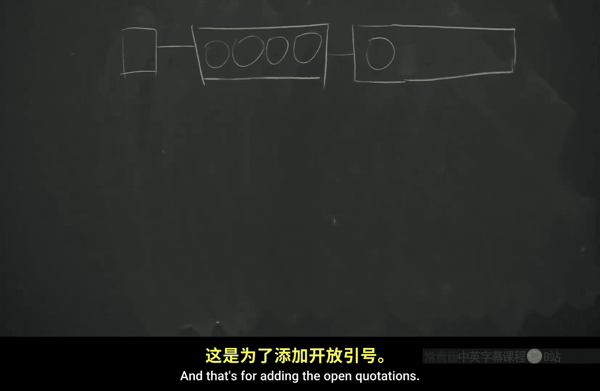

So hasing function。Like I showed you earlier， we were taking in the parameter R， okay。

 and that would direct you to the bucket in which Rick a the most。

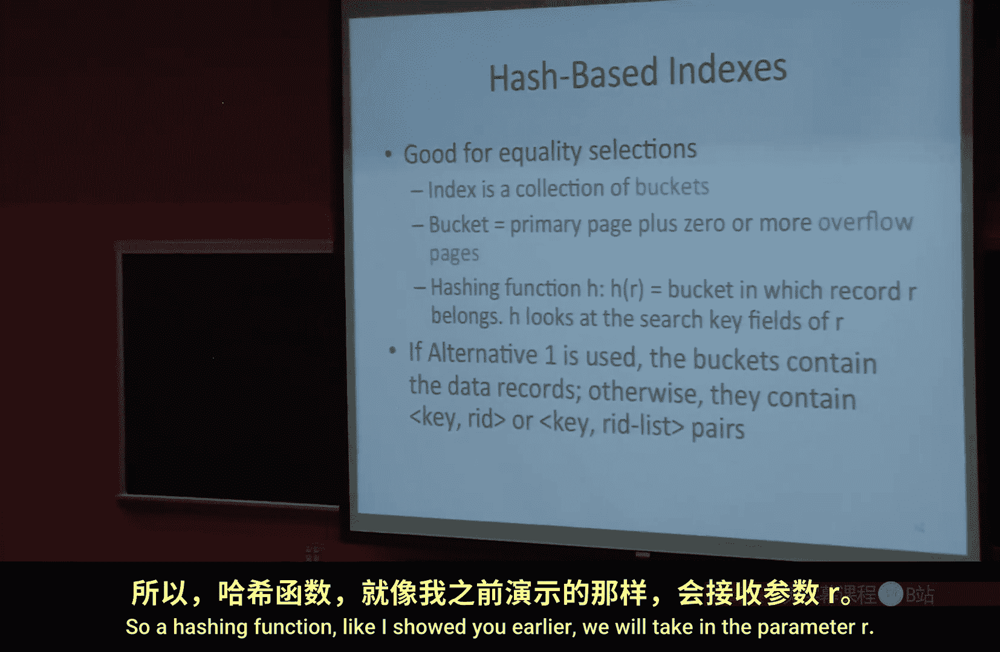

嗯。It quarters at1。我。Oh yeah， you can also do that。You mean we have。19 or。好这。Yeahや对。とがも。三。大 think。回头。

I think个。I'm not sure that let's take you one。It's possible that all of the if we have。然后等一会。

Or we can。你白我。に奥。

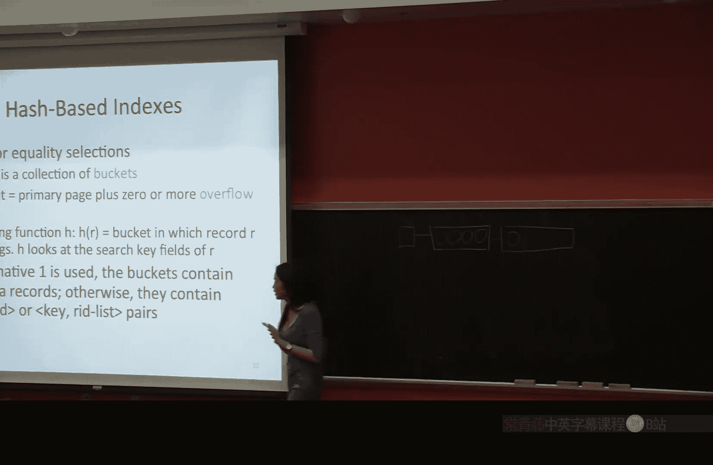

Okay， so we recall the different alternatives we talked about before。

 if we are using alternative one， then what store in the bucket will be the actual data records but if we are using alternative two or three。

 then those values we store can just be the RID okay so we don't have to put。

The complete did have records。So a pictorial view of how the hash place indexing will be like this。

So if you go to textbook， there will be more detailed。もって？Of this example。But since。

This will be one of the thing you might want to implement if you are interested in the bonus。

I think I'll work through the example super quick with you。

Because you can map that to。The the structure you have on the slides。 Okay。

 here we are just going to have。Some super simple data， that's exact same on the。

So let's say we have a really simple。Relation。just storing basically。

 the name of name and ages and salary of employees。Okay。And I'm a bit laziier。

 so for the names I'm just going to put。A b c。Okay， so these are' the because they're kind of long。

 I don't want to write them， so I just write。Like this。こ。

And later because of the design of the hash function， their salaries looks a bit weird。

 the first one is 3K， that's all right。Second person。$600 or3。

 that's basically the data we want't use。So there are different ways of designing hashing for your system。

 you might be only having one hash function or you can have two。这怎么？So， let's say。これってささ。

We designed it this way。Okay， we have a hash function right here。

And this one would take care of assigning data in one way。And let's say we have three buckets。

And each bucket， we have。と拍手。呃 three。Okay， capities。

And the hash function is designed this way for hand hash function number one。

The parametermeter we want to take in。Is the age of the employee？Okay。

And the way we are going to assign the employees based on the age is this way。

 we're taking the age and we actually convert the age into binary， and then we see whether。

The least significant two digits。A 0，0。Or。Number one。Okay。This is the first。

So we're just going to go through a few of them。What's 44 in binaryry。Why am I doing this to myself？

😀呵呵。😊，Anyway会。😊，The answer， I think A goes here or something like that， okay。

 I think it's A VC and keeps going。😊，I come work with the binary on。Then for the first way。

 you will have different employees based on this function， Okay， assign to different buckets。

And then we have the second bucket。And for this bucket。The way we want to do it。

So here I'm just following everything and said on it's not necessarily the best as design just one way you can design。

 so there's a lot of variety you can do， for example you can specify how many buckets you want and for each bucket。

 what's the capacity you can even change up the hand function。So for example， for this pot。

 the way you want to do it， the way that we want to。We have another hacking。

And this high function also directs the data。你直接算 copy。And this function actually takes。

And same thing， we will want to cook sal by again。He may be the least significant almost。

So on that example， when you take a look at the text would actually say it on the left hand side。

 we want to use alternative one。So instead of just storing the record ID， the RIDs。

 we actually store the whole data of records in there， so what you can see。

 let's say assuming the first employee goes in here， we have a and then。こしそ。

Three0 the whole thing stored in here。Okay， and for here。Instead of using Al one。

 we only store maybe just the RID。Okay， and let's say if this one based on the salary。

 if salary with 3，000 gos here。Then we also wanted to do a mapping from this one saying， and we mean。

This employee， because there are different employees possibly with the same salary。Okay。

So here's I think this one。Here we have a。So it's possible later on， you will also see。3000 within。

Okay， what if we use alternatives？Here these alternative freedom them for 3，000 what only show once。

Right。And this one might potentially go to another。加 me。let's say maybe。Employee D with。い拜。どうし？

Salaries。So what I want you to do for the bonus。

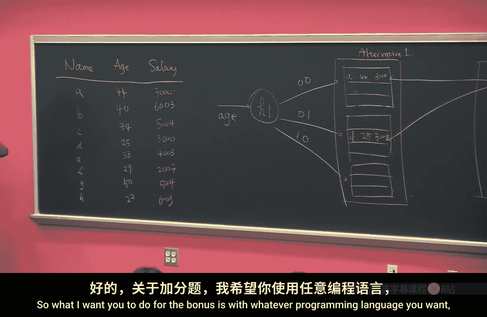

Is with whatever programming and language you want。嗯。You write up the data structure。不开。Okay。

 do in the exact data。And then just replicate it， show me。With that， you can assign them correctly。

And then you can relate from that alternative to this alternative。下午。Yeah， extra。Pfer。2。No。

 by the whole。But but this plus another data structure I'll talk about later。

So if you can implement too。And then you can show you totally replicate how the data is going to assign in a data structure。

Okay oh yeah。For the first action。We do ages？Oh yeah。 so because of that。That design。

 so it just doesn't have any more。Okay， I think it takes the。

Be significant and that's because in the data， they don't have any that after binary will be more。

But yeah， so just follow this and then see whether you can completely replicate it and then if you do the hash one totally it correctly and tree you want told it correctly。

And I don't limit to whatever program we need。Turning together。如刚说的。And the final。Yes。

 sounds tempting。Yeah。😊，Along with homeworkmo5， so that's the Wednesday after the break。

 two weeks from。Sooping more than enough， yeah I have a break。

You can work on it so yeah I don't really limit whatever language you want to use I think python is really really really easy to work on this。

 but just make sure。Yeah， not only you have to。 not only you can't do them separately。 Okay。

 I also need to see you show。This part leads came to that part because if you do exactly actually reasons。

You need to。Explain how you design the data structure。You can， for example， in Python might。pa okay。

粤 you c咁 structure。More like an object oriented。哦。すが。Okay。

 and then I quickly talk about tree bays and remind me。as I promise I'll give you a quiz。

 everyone has some。Paper。Or you can just tear off like later later we'll talk about the three things。

Really quickly。就超市包。会嘿。Allright。So super quickly， I just talk about three bases for three minutes and we will continue next time Okay so what do we mean by three bases？

So earlier， Adti and I worked on that and that hierarchy looking thing。Its the big picture。Tre。

But the detailed design varies。 so two days unlike hashtakes， when we talk about hasht。

 we say it's good for equality。Because format mapping。

 the value directly is through the hash function， we get an output and then it's quick。

 we can just directly go to the bucket that we want for the data。However， for tree based。

 we say it's actually more suitable for rain。In because how the key is actually structured。

Looking prefer tree basic for ranges。嗯。So we say if the data is already sorted。

 then we can actually do binary search， so regardless of whether they are being chain with points we can do binary research saying if it's bigger than this value we go。

Above certain RIDs， Okay， if it's lower， then maybe go below a certain R。

But actually binary research。The cost can be still high。 Okay， the complexity of such。

Such way of accessing things。So other than directly use it on sort of file doing binary research。

 we can do three indexs。Okay， so this。Big picture is how tree indexing will look like if we only have one level。

So。Next time I'll show you a more sophisticated one。But right here， the big idea is we have a key K1。

 okay， the one way you can design it is for everything in page one。Okay。A certain value。

 a certain attribute， is gonna be smaller than K1。Okay， and then for page two， a certain attributes。

 all of the values， all of the records here have attributes within the values of K1 and K2。唔受啊，有皮。

Okay， so that's one way you can store data。And actually the tree base can get way more sophisticated than that。

 as we saw earlier， it does not have to be just one level because actually it doesn't serve the purpose of making the search faster。

The only way that the time that will make it faster is when we have different levels， okay。

 and we traverse them based on however we design it， and that would totally be double to traverse。

All right， so now take out a piece of paper。quickly think about what to test。

Okay take on a piece of paper。I'll test on what you learned from today。Write your name on。

If you don't have paper， use the very last。Sheet of todays life。🤧。は。So。You need to write two answers。

The first one。Earlier when we talk about hashing。Okay。And we say data are assigned to what。

 like what's this？Look through the hash function。They determine which what to go to。对。All right。

 I going get that point。You stop bro answer， all right？All right。哎不啥呢。就。OK可以，天天玩。嗯。对。我系咩啊。Okay。Oh。

 okay， so we say like right here， we say we have a bucket in a lot of times。判体。we still want to back。

O be。You can at work。我。Should we just like the answer。

What is this has function determine which water to？I said here。Have this。你还出差。

And then if you want to。来。昨年今ね十円。

組み？And I'll see you on Friday and Friday I will turn it term too。

