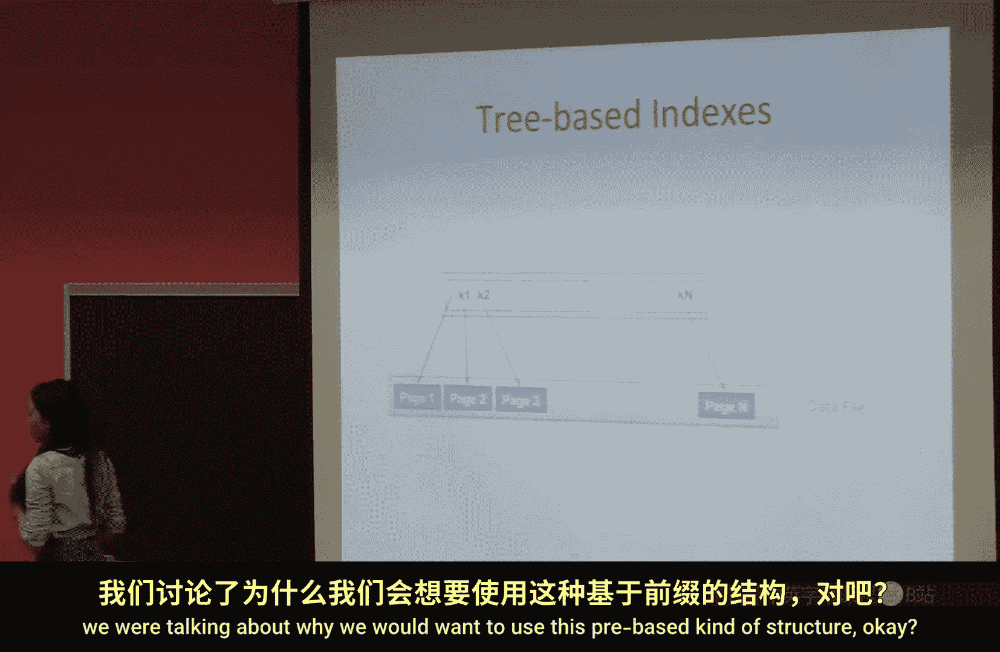
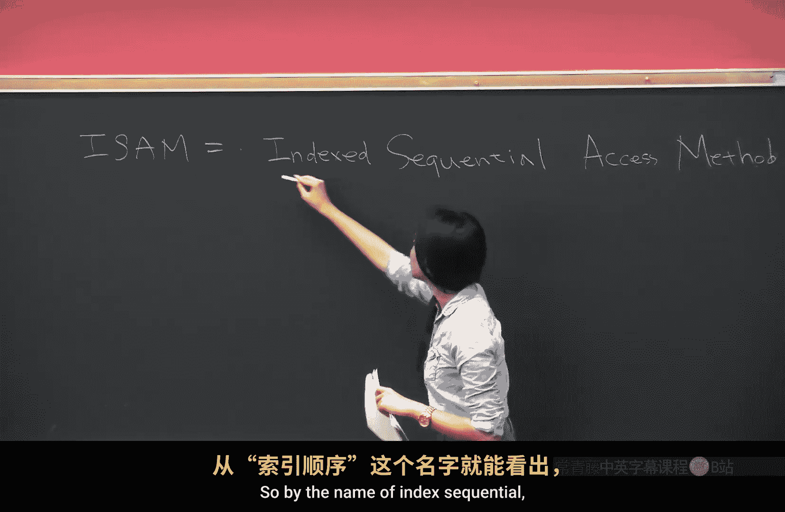
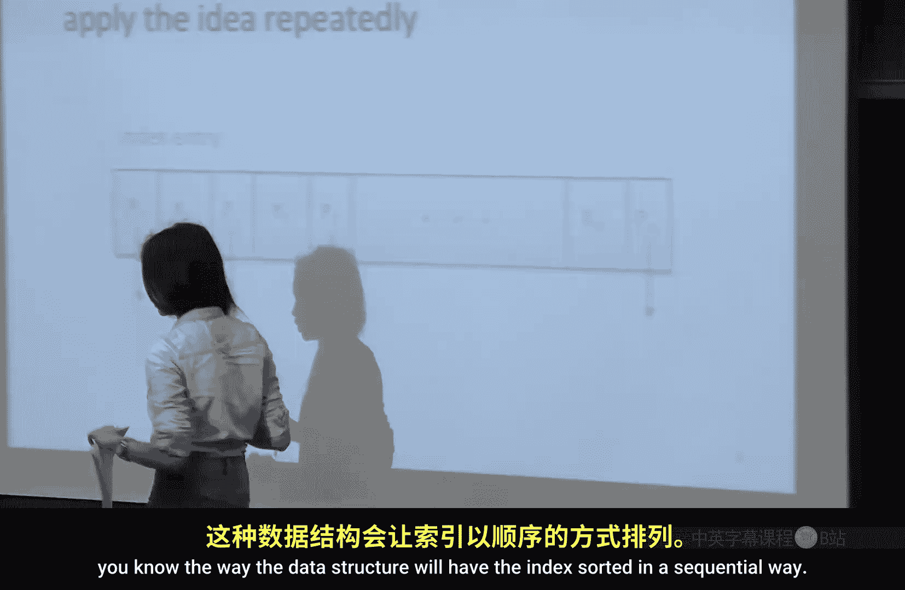
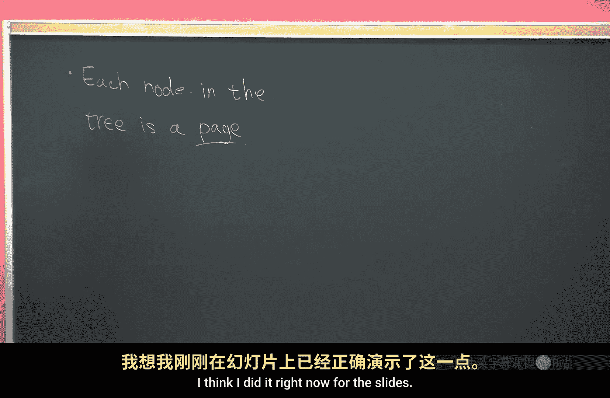
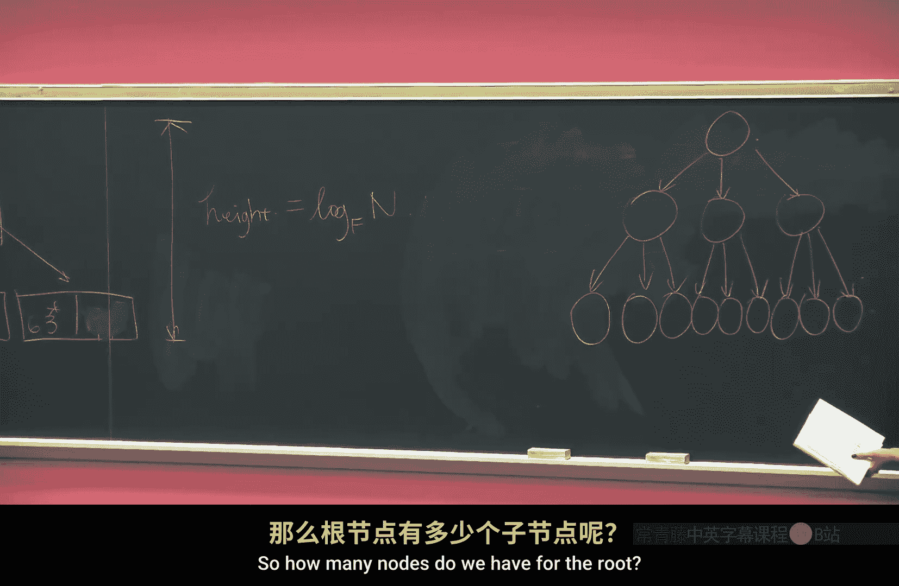

# 宾夕法尼亚州立大学【中英⚡数据库管理系统｜CMPSC431 Fall 2015, Database Management Systems】 p32 P33 索引：基于树的索引，ISAM -BV1N76CBwEXb_p32-

啊持。大。Okay， good morning， class。So couple of things that we will do today。

I will continue the lecture from last time and talk a bit more about organization。

And today we'll introduce different data structures。

Okay and thank you guys for being here and a lot of people。Arange。else right help。So， yeah， good job。

嗯。And let me see， just want to remind you， so Homo5 has already posted。

And it's due the way to they after and I will post from War six soon like today。You can work over it。

 but it's due the week after。And also。I think the TA hasn't sent out an email for Schul。

I'll tell her again。You guys only need too。Settle that down by。The Wednesday afternoon。

So this demo what happened Thursday and Friday。All right。And then。

For our final prison he can exactly coming really soon and I plan it this time to do it in class Okay。

 so you don't have to go out for the。Other other than class times。本耽我2。あま。

So that would be for the final week of lecture， so the week before final week。

The we day Friday will be doing。哦。Psation， final things。And today， the lecture will be a a short to。

I want to give you back in midim two part。I was going to give you back part one but he is still grading it。

 okay， so I'll give you the part two。And。If we finish the lecture early， you can talk to me。

And I also show you。What your performance is。We you hat。class。はSo startedれ。

The last time you remember， we were talking about different kind of file organizations。

And if you lectures follow your talking。たで。For index for。Data entry to your data record。

So yield is a available last time we talked about hash。So basically for hashtag indexes。

 which will be part of the。mentation you need to do for your bonus for homework five you very interesting。

So hash face indexes basically this is just one example of it。

 it's not like every hash indexes is this structure。

 but you can take a function that we call it a hash function。

 taking the parameter and then output different results directs you to different buckets in the hashing based on your hashing function so last time we're working through the example where we took the parameter or whatever input we say and then we convert it into binary and we look at the least two significant digits and then that directs to different buckets。

So for bucket， we say that are the location where either the data entries are stored or you can directly put data records if you're using alternative one。

And for buckets， every one of them has their own capacity okay and last time we talked about what will happen if the capacity are exceeded and we do want to put in more data。

So last time before we finish the quiz， remember the first question I asked is what is this and that's the bucket。

 okay， someone heads today， and we say if we want to add a bit more into that。

We put over four pages if you remember that。 Allright， so in this example。

 we walked through on the black hole last time we say， so the data are not shown not shown on here。

 but we say for right here， we can use alternative one。

 So which is the actual data record our store in here。 But for this one。

 we can just put alternative2 or three， if it's alternative2， we only put， for example。

 the R ID that are directed directing to the data record， in RD， if it's alternative 2。

 then it's one RD mapping。To a one key mapping to a one RID， and if we use Alt three。

 then it's one key mapping to listify。Okay， and if you recall last time we actually say in this whole structure when you're designing it。

 So again， this is not the only way of doing it。 Okay， so when you're designing it， remember。

If we only already have one alternative one， you don't want to have another one。And the reason being。

 alternative one already have a data records stored there。 So you don't want any redundancy。

 If you have more than one copies of alternative one。

 then you're actually just storing duplicates data records。So that was for the hashley。One。

 is the two parts。Oh。And last。ically talked about what what happened。So tree based。

Last time we just quickly brush through， there's this one structure right here。

 we can use an index file file that would direct that data file and data file are broken down into different pages and we use the key to tell us which data file we want to go to and last time at the end of the lecture we say。

 for example， in this example for K1， it means，The pointer on the left side of K1 it points to the pages where a certain attributes are all smaller than K1 and for the pointer this is actually between K1 and K2 for the pointer between K1 and K2。

 it points to the page2 where a certain attributes is between the range of K1 and K2 and then for here page3 we're saying then it's greater than K2。

And lastly， we were talking about why do you want？

F based kind of。And structureture。Another note is here。

 we are already assuming that certain attributes that we want to compare against with the keys are insert sorted。

So why would we want to use？Any name。I did。The treeb can make you kind of relate to this order of the attributes right。

 like I said here， maybe we have a certain key， a certain attribute which is usually to compare with the key。

 so if you think of it compared to the hash phase in hash based because of the hashing function so a lot of times when you want to do a range query it will be a lot harder because even though we say doing a hash function。

 the complexity of doing so is just constant。Comp it and then you go to the direct bucket you want to go。

 But today if you want to say I want to get all of the data where the attributes are within a range。

 then working through the hash function actually won't be efficient because instead of just saying I find a starting point and then I go to the endpoint you actually have to compute every possible values with the hash functions Okay either hash functions cannot relate to any range of information So this is why treebase will come in handy。

And right here， we only show where this is just one level。

So it will actually really come in handy when we。Put this in the repeated way when we build up levels。

So it really looks like a tree okay I'm the。So if you take a look at next slide for this kind of one type of the tree based structure。

 we actually call it isO。So I sometimes stands full， I forgot to put it on。結構。In。

So by the name of index sequential， you。

The way they structured。The data structure will have the debt index sorted。

So what exactly？This。So later on I'll come back to this。

 but just like we said earlier in the previous graph you see different keys right the K1 and K2 are the keys and on there both sides they actually have pointas that point to the pages Okay key on let's a point to the pages and on the right side also have point pointing to the pages and that's the basic building one of such three so let's see how we can actually construct。

哦。So one the very important concept in ISE is that。You wanted to think。Did know。Later。

 I want to talk about the note in the tree， each note in the tree。呃， each know。In the tree。Okay。

 I didn't， I think I didt right now。

But later on， you see in a tree structure， we will want to view them as the unit it。To say today。

We have a bunch of data that we want to store， and we want to。

Store them， access them based on certain attributes。ok。SoI think these will be shown。

 So I'll just show you how they're actually constructed。 But the example is actually。On 12， no， no。

 no， page 8。Okay， so that's what were going to construct。So say today， we already have bunch of。

Entries that we will use to enter the data record。And now we just saw the entries by their values。

 So if you look at this slide on the very bottom top。下说。He so they are already put in book。

So just remember again， these are the data entries and they' are actually used to direct to data records。

 Okay， data records are actually where the informations are， but entries are what is used to refer。

To the data right。Okay， so can anyone tell me why the right top right position of each baggy。

 we have a stock？왜 뭔가 거。If you recall， I think two lectures ago， we talked about if we put start。

It just means this data entry。Okay， so that's why we have that。

Differentiate between just normal values or maybe that is used。Again， data entry what they are for。

 What are they for。 They are for going to deliberate。O。And so in this example。

 now we have all these data entries right here， we sort them Okay so remember the thing we're doing now。

Fil the tree。 It's a fire creation。Okay， and the assumption made here is。pay。暂听。

You can say two values。Okay， so here we have the page unit。Capacitating too。

So what you want to do because here we want to construct no what we want to do with bo and up。

 so we pair them up。To achieve together。Okay。That that' how themSo now you can view each pair as a node。

And so once this part is done。We call them relief leave。Inmery。

if you have learned about it structure before， actually the roots are at the top。

 the leaves are at the bottom。Okay。That's the first thing we will do。

Okay you start up by sorting the data entries， pair them update based on unit you have for your page。

 okay， and then here's the leaf part。さ。So then now you will see the tree actually has two more levels。

 on the slide。 So what are they， what they are for。

So let's say today we already have the fact that each P contains two values。 So earlier， you see。

 we have this structure of。Poining to。Poiner。point okay。So what this is。

Just the building blocks of how the key employment that I used to get up。So when we have a key K1。

Then the point up he0 on the left。Points to the pages where the values are all。K1。One。

 it means the values between。可关。And没有说。It meansans all the valley pointed upward。Okay。

So right here you'll see we also want to add in on another level， on top of the leaf level。

 other pages， which is other node， okay？So we take a look at here if we each page can only contain two values。

If Conttu virus， how many pages can a pairPo？3， right， because one。So right here。It just happens。

 We also have six pages。LeaveSo we know for this upper level， we need two pages。So you draw that out。

The center one I will use is a pointer and then use the key。Okay。And what you're going to do first。

 before we seal out the value， we know for this page， it takes care of planting。2，3。

In the second page。T2。Okay。So how are we going to fill out this values？

So we want to say for everything that this point is pointing to we can think of it as the P0。😔。

It means it's smaller than values here。Okay。So the easiest way for you to do it it just take。

Its valid。And then put it up there。And for sure， all of them。Itll be smaller so you can pick 20。O。

How about this one。It has to be between the range of these values。In these values。What did。

It's an easiest way。Okay。So we can keep this one goes up。Okay， how about here。Then again。

 the same thing。The one right here。有没厉害。Okay， so for the second level， now we can see。

Really easy to see。The reason we have them is for indexing。

 so the points at points to here are all smaller than 20。

 so if you want to find a values that are smaller than 20，You will go here at first。Okay。

And every tree starts with the root。 But now for this level， we still have two pages。

 so we want to go up even further to build one more level to make it the root of the tree。

And because this time， we only have。Two pages in this level。 So we only need one。For the upper level。

 and actually， we won't use all of the pointers because we actually have three pointers。We we only。

We only need to so for a point， we'll fill out this evaluationator。Po up here。And this point。你同一下。O。

So how about this time， what do you think the values of that should be？😔，What。51。we put 51。

And you go look at the subree of this side。40ties smaller。3 51。So why should we put。In some sense。

We find the tree on the right side。And the minimum of it。You see， we have his value。没有。So。

不来 how we get。So， let's see。Here we have。The file created。

 so we call it the file creation process for isenttry。

What if today we want to insert new values So one of the very important concepts of IO is that one that's created。

 the index won't change at all okay and the number of leaves are fixed。So if today I want to add in。

 let's say 23。Okay， where do you think 23 will go？ so instead of saying maybe we should expand the page or whatever。

 that's where we do over。So that we are。Okay。的蝴啲。Yeah， on the next next slide， slide 9。开个 four诶。

The4 a go。Here。You also。打进。Another page， which we call the office。Okay。他个夫妻关。对。Right。Should be。

Right here。Right right here， and just remember， when we add it， we actually don't rearrange， okay。

 we see a spot which puts him。Finally， how about 42。stillせ是吧。So are these pointers that are。Yeah。

 they chain them together。 so they are appointed as well。So here we have 42 and we chain them again。

 sorry， this is really low。Okay。So that's what we can observe right now if we add in new values and we have no spots left。

😔，We directly append overflow page。Okay， so right here， a couple of。

Importanted terms that we want to use， so for these that are originally created。

 we call them the primary page。I think it's on your site and for these that we added added in later。

 we code them middle。はい just。Okay。So for deleting， it's also very simple。For example。

 today we start by deleting 42， you can see on slide 10。

 we then try to delete 42 and we see it just here just。But when it's actually being implemented。

 it might not be it' easy because you want to find 42 first， right。

 So the way to find 42 is you go up here first and then say 42 is greater than 40。

 So you travel here。 and then you know， 42 is less than 51 and then you travel here。

 So that's how you find 42。Okay。And then we can also try to delete 51。Okay。

And then you keep going and then。After you deleted these values that are indicated on slide 10。

We will be left with some MP spots in the primary pages。Again， for ISE， it doesn't fill the back。ok。

So that's this simple implementation for ISI。So anyone think of。What is。One of the biggest drawbacks。

A five。One of it， when we were earlier looking at， if we keep adding values and it keeps being aggregated right here。

 the chains can get really long， right， So actually， even though the beginning。

 the intention and motivation of IO， which I'll show you later。

 like it' it's supposed to be efficient for you to find certain values。 But if you chain long enough。

 then you actually spend a lot of time traveling down to the chains to find a certain values。 Okay。

 then the efficiency is not that obvious anymore。But before we get into what are the other alternatives。

 let's take a look。哎。嗯。The normal or common cost are most frequent cost。We're traveling to the leaf。

So every cost， we view it as an IO。😔，So when you travel from one page。

 traverse say traverses from one page to another。 That's one I O。 and we call it cost of one。

 which is called one unit。系。So what do you think would be the cost？Of going from top to bottom。

 if we ignore the overflow pages。In the紧。昨と？Ignore。就喂。So from top to bottom。

 the most we need to travel is just too， right， So we call that。The height。Of the tree， okay。

So how can we generalize this if we have different。Sa。If today we change up the size of the page。

And we change up the number of these at the bottom。 Do you think it was sta state2？The height varies。

 right， depends on the tree。 So how can we compute the heights。快地方。If you have grand about。

Algothm before。Anyone remember。How you can compute the height。Okay。

 so you can take a look at slide si。There， I put two。One ist path。And one is in。

So I want you to change for if， I took a number of an。Yeah， that's true Okay， so for F。

 I I put number of entries per index page， okay？So I think that's not a very good way of putting it。

 maybe think of it as number of children per index page， so for example。

 right here in the F will be three。You can point to3。Okay。So。

We want to represent the height in terms of F and N， where the n is number of lean pages。

Can you think of how。She me is。So， it。喂。Exactly， okay， so let's work through again。 So for that one。

Remember I said earlier， this tree itself， actually we didn't use the most of the root， right。

 So if we try to recover it back， say for the starting from the root。We already point out。

so this will be a bigger three， and then for the second level。

 other than having just two pages that we have three。AndThen we keep expanding。

Every meal leads to three children。So how many node is kind of ugly but how many nodes do we have for the rear？

😊。

We have only one。And for the second level， we have three， and for this level we have nine。

 so you can actually think of one。3。There。And this one why。So how do you get？Taking lock， right。

 because if we even expand even more， then it's going on。见。Okay， so right here。

 let's say we don' care about here how many levels we have of what's the height of it then？

We take a lot。没异。Right， this is 32。So that's why。はい。Okay， but you can take a look at there。

 you say but for the second level， we only have two pages。Okay。

 then you want to think of this week from the complete tree right here。We removed this top。

That's the part that we didn't think of。Okay。Too passionate that what happened。

We ignore this little trigger here right for the second level， we only use two pages。

 even though each page are capable of pointing to three trigger。给。

So the fact that we take out the substrate， do you think it actually affect the height？Does't。

 so the height still doesn't change。 So when you want to compute， it would stay the same。

 So even though earlier we say， okay， the height will be locked。F then。So in our scenario。

 that will be lost。3。6。Actually not all the way to two， so you want to skin of。这边。Allright。

That how you can get the height of the truth。Okay any question for this one？Soあれも。Don't be。

All we don't comes so for ISO keep adding it。IO has this robot， okay you just keep changing。

 changing changing so a lot of times in the end it gets super imbalanced and every time you want to go to that point。

So you lose the point of having the hype beam too， which is really fast。😔，So， I'll show you。

So I some role。Give the design as well， and if something that both distributed。

 than we can see earlier。The height is so small。Everything。It's really small。

But if it's not so well designed， then the chain will be really long。The point of the short。

So that's what these are the thing I basically just said。And for this part just fill out。

 that's the plank there that's locked。Costly close to walking。And I also showed Judy okay。

So this is what I'll talk about next time， which is the B plus tree。Okay， before we get into that。

I'll do next time， but just。Take a look at the difference。

 So there's not a big difference right here。 Okay， but you can think of IO as something static because the whole structure got fixed beside the overflow pages when it's created。

 But for B plus it's trying to compensate the drawback of IO。 So instead of adding overflow pages。

 it actually keeps the tree dynamic。And between the leave pages， they can communicate。Okay。

 so next time I'll show you like if we have some empty spots。

 then they can actually exchange the balance between them。

 So instead of having that awkward end result of ice we saw earlier， B plus。

and the goal of it is try to keep it balance。はい。Okay， so that's for。情况。And I。第一本。

I'll give you back leave there。I'll show you。I'm not sure I don't really think we have time to。

It the only page what we be constructed。How much I value to the people then point。

ly so they keep everything。Why did Google how many of these space amenities。Let me。Yeah。

 so that would be stilleffient。とあるて。O。The next deal。Okay， but that will be the last result when you。

But it really doesn't have to happen。Then they just come in the gate。But holiday going。

The first construction of Italy， based on rain。哦领口嗰啲几得咩。So that will be the construction will be。大かて。

你发俾意。But they're the link maintenance。Okay， I'll just quickly show you how it's going to be right later when you get。

So don't worry， we look like maximum is so low， but that's what。Just remember part two。

 the mag is 65。Okay， part two the maximum 65， and I don't know what when it renders。

 it goes all the way up to 70， but basically those blocks means you 65 points。😊，Okay。

 so we do have some people like Op points。好的。我么都要解定。Definitely not as easy as the first。Time。

I think it's not that back。I think the average is 52。

So hopefully the part one will be out today so you can act them together and see what your Powerpoint from mid term to is。

So we have three parts in movementement。And the positive performance to the best type is the no sQl which problem。

I didn't really ask any too。Or difficult stuff， so everyone performeds really well for that。

And a lot of people lose flying to problem one， which I thing is kind of changed because those things。

On that tricky。And if you lose point in problem three， you can understand a bit more。

Like why why why you didn。So for problem。One， the first question。I think。Maybe 90。

 80% of the people got a right so the against intosa。But if you put API。

 then I give you that one point。But I think there are other really creative questions super long answer。

😊，Then that was I don't。黑色。I know you're trying， but yeah the end is because。

 so that's we're taking care of the mis。😊，And the second one。We are asking about HTTK。

 so if we want to teachers just briefly tell me what stateless means， okay， I think everyone gets it。

some people will put it super simple， but I still give， you just basically say doesn't remember。

And'm like， okay， you get the phone okay？And for me， what are the two remedies of this drawback？

So I think some people might have misunderstood what I was asking。

 so this question is asking basically。😔，Since HBTP is stateless， what can we do to compensate that？

就嗯。Some of you might have with something that is actually correct that I gave you wrong。

The answer will be using cookies or a dynamic name of URL。And the third one。

Quite a lot of you might have gotten it just slightly off。

 so basically just asking you for these three major what。

Which one is which ones are document oriented， when which ones are scheme oriented。

 when we talk about document oriented， we're talking about when it's getting rendered。

It's being random and what with format focus on that home， and for schema oriented。

 we take care of the the structure。The relation。So if we're document oriented。

 that would be HTML and the rest of them， XML and JO。Sma。Can some of youかも。And for number 4。

I actually。Yeah， I think I made a mistake when I made the question so I put JSP but I think it did put the enough in the on JSP during the lecture so some of you raised the hand during the exam asked what is JSC and I was like did I have P you not Okay so for this one actually if you've got a wrong。

 I won't take off any。Okay， so you feel free to put Jason wherever。Okay。

 but it's course we go to meet。The one in presentation here。The only one will be jobvascript。

And the other one in middle tier is Apache web server， a lot of them put them at data management。

 but it's a web server。There's a code to go toations here and some data management here that will in my people database store。

So for these questions to make sure you can get them all right because for the final and might。

We out of time to make new questions， so a lot it will come from the old thing。And this paw。

 I think most people got to write， so basically。Some people picked out some mistakes that are pretty funny。

 so for the first one， the mistake I made， no one told me about it during England。

It's not supposed to be a pe racist。The press to be a rack。

And another one I got picked is statistics for Tonynie's not for Jimmymies。

But you won't get point by picking that up。 I just realized when I was gra is there but no one told me。

But yeah， it's a for。Okay， and if there are two mistakes in the6M out， the first one will be。

Not having publish。It's required。And another one will be not having formating。

Some people will take class say oh a genre should be under the book no， right genre？谢 action。

And so this is correct， having in life。Okay， and some people take， oh， there's no first thing。

 but take a look at here， we have a question mark here and you regular expression question mark。交以中卡。

Necessarily have。So that's the only two。Okay， for no SQL。

 what does No SQL stand for just could not only。That' it， I'm just asking you what in store。嗯。

Time from here。And it4。The first one， one of the major drawbacks of most equalql is its low scalability。

In Sitoo office， that's the total with advantage。Okay， and these two are both。for this one。

It just keep that， okay？When I was picking the graph to test you。

 I was just picking the one that showed the best on the paper and I brings them。

 I think whoji home it just right here is the keyback okay。😊，This is the key event title data model。

And then right here， actually I won't be too picky about it because there are so many reasons that people are changing to MexicoQL。

 so if I think your reasons make sense，😊，いうポイバイテかポイけ済の。Understand what you're talking about。Explain。

In this part。I think， because。Everyone had worked on a homework so most of you got it al right。Okay。

 so for the first part， which is this part， I think number everything that。

 so for the first part we basically say the projection， we were saying what field do want to keep。

Name you one to be weight。And then。Id in what we don't。Okay。So some people would just say。

 you're just doing prediction， I'll give it right， but if you start saying， we。

We want to keep the name， we want to keep the weight。

 and we want to keep the ID even that's the part you're get。we don't want to keep value。

 the negative one means that's the one we。And sorting， I think everyone's got the right。

 sorting just basically sort by weight in decreasing order and limit we only want two records。

And then get speak the first one。And for this one， correct answer to be。Administstrration。If we do a。

 then that will replace the whole in information with just weight equal。That不能。7。Right down。Okay。

 for the first question。I think everyone who ever worked on it at right do need to draw the arrows。

 pointing the function dependence。But some people， I think missed the whole question。

 even though its at one point， they just broke up to draw out。And then， the second one。

Second one is based on sensitivity and almost wrong， is it right？And then this one， it's true。

you can go back and take a look at the theorem and there's one。You can check， okay。

 when you have a dependent。And then you break it down based on dependence then you can check whether。

Number4， the answer is B DE。If you have any questions， we can get through。And number five。

 minimal cover。The answer is C determines A and then A determines B。 if you could C determines B。

 then that's wrong， because we can infer from C determines A and then a determines B to C。移动。

Then that lose the pole point of minimum。哎。To the final one。Okay。

 I I to quickly tell through you'll let you go。Some people get one point。O for each part。

 that's because。Right here is supposed to include bump with pinchs。喂。

Like if the composition is right。Then you get all right。So a lot of people。

Make mistakes at the second normalization， So you also break it down of the phone determining app。

Okay， to that is the part you really have to do。えとあの。Think about。

Okay so I'll post this solution later on India， I worked through it during the break。

 but just remember for initial design to pick table。

 second normalization willll get two tables and then in the third one， normalization well get three。

Which are opposed posted on。So you can check if I read anything wrong。诶。So that would be it。

 see if you have to break and you'll get。我他号。Let say okay。

