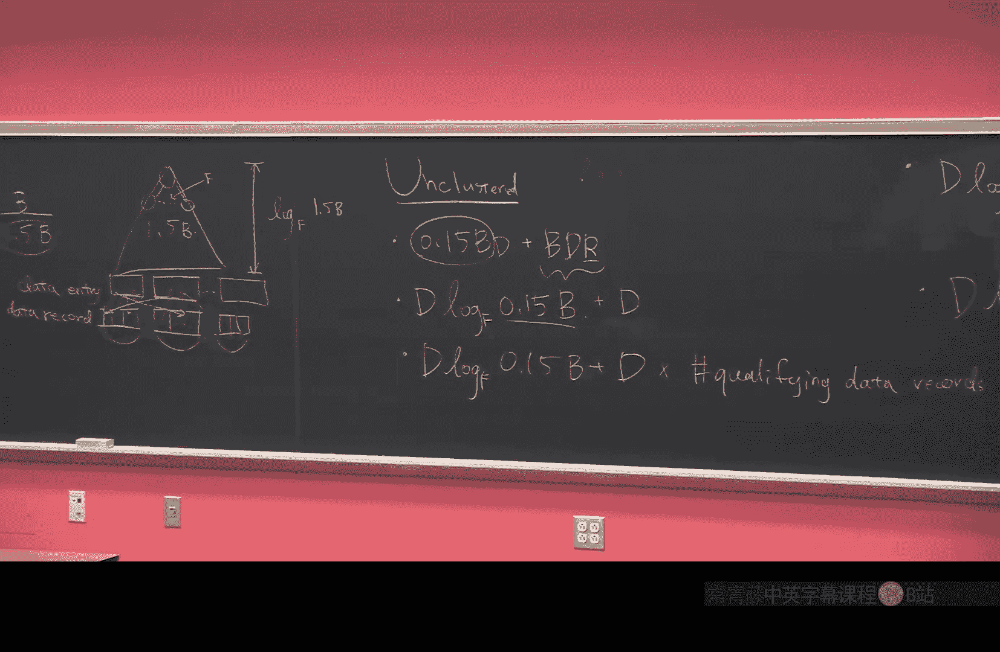
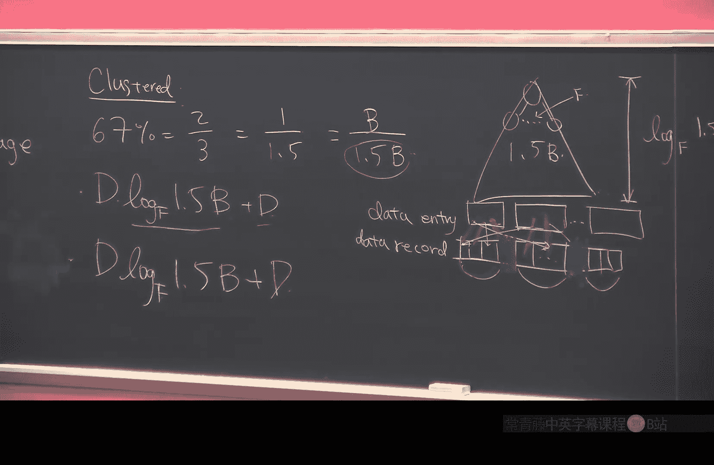
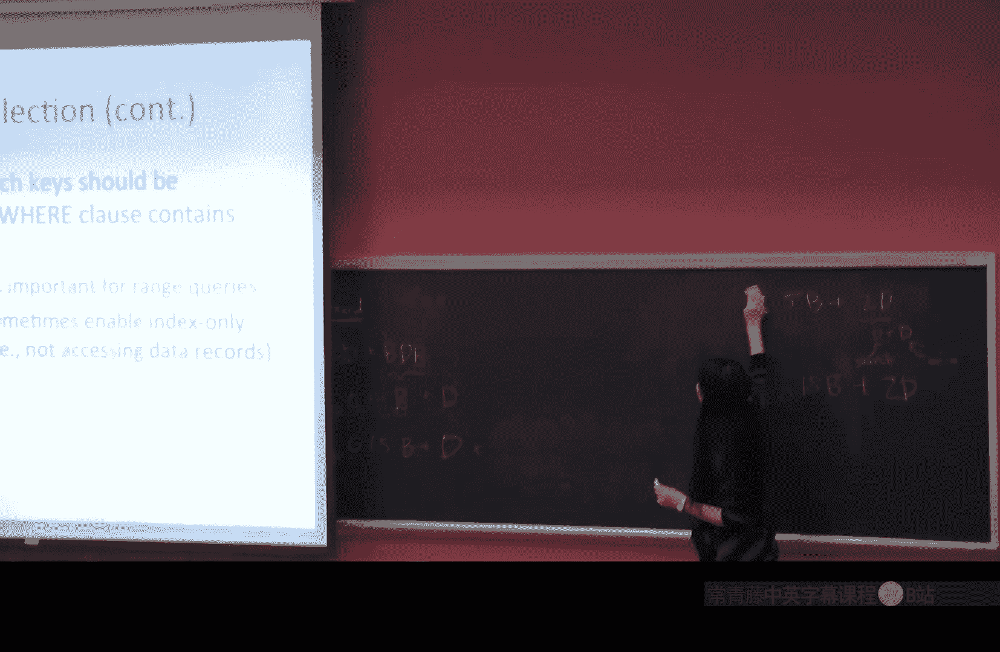
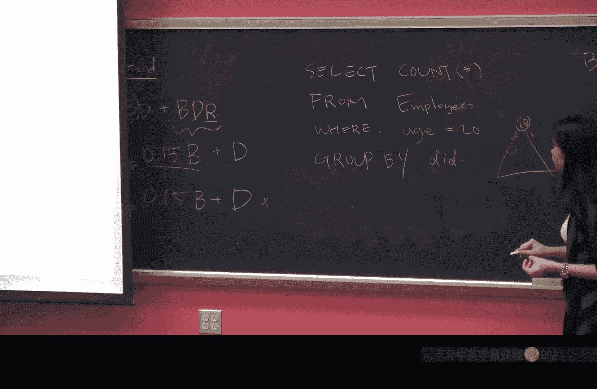
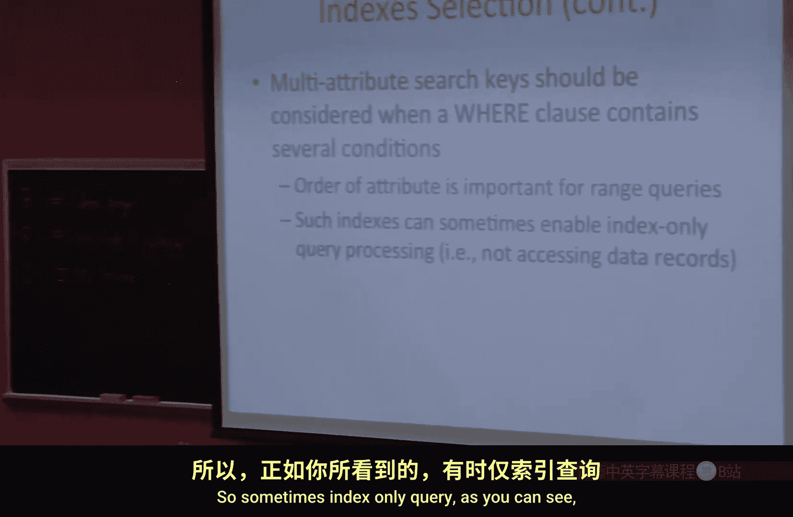
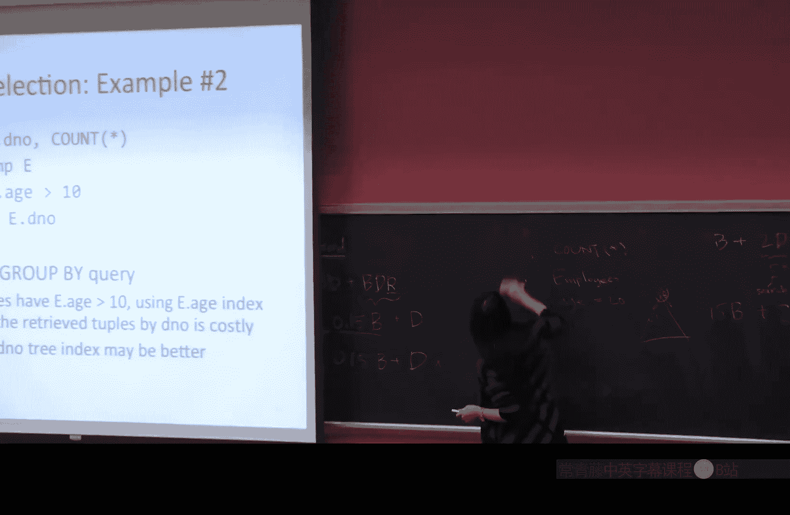

# 宾夕法尼亚州立大学【中英⚡数据库管理系统｜CMPSC431 Fall 2015, Database Management Systems】 p33 P35 成本分析模型与索引选择 -BV1N76CBwEXb_p33-

Good morning， guys。So if you haven't done， so you can put your home fight right here。

And today we will， we will continue the discussion。From last time。About。

The house announced this model。The last time we were。cluster index files。We haven't finished it yet。

男生におい。残片。And before we start， I'll just quickly put down the variables we'll be using。雨后冰临的那。

Out data pages。Our。ナンバ。Okay。很精灵。By。哎。So let's continue the discussion on post theory。

I'm sorry I forgot about homework five that the table actually include also cluster index and un cluster。

 so if you guys got the email yesterday you don't have to fill that out。But those rows。Okay。

Take a look at cost。いいんですか。Where did we finish last time， I think equality？I forgot。

 but then I could be answer all the way to range search。If you remember。

 let's quickly review about cluster index last time we talked about here we said empirical study shows that the pages usually have 67% occupancy。

So we say actually the 67% comes from。What direction？23。So in 23 equals to one over。1。5。

 So if we in total have B number B B data pages， then physically， we actually have how many pages。

长得少。1。5 b。RightThe reason being we are talking about the occupancy right here is the occupancy are saying okay out of all of the total physical data pages we have。

 how many pages we actually have data stored in there。 So right here we say we have fee data pages。

 we have data in there， so it means if the occupancy is 67%。

 then we only have we in total actually have one point。At1。5。第二配就。Okay。嗯。All right。And if you recall。

 starting from last time， the very beginning we talked about heat files right。

 and the simplest analysis is the scanning for heat file。

 and we say if you want to scan all of the data pages and if you want to scan through all of the data pages。

 then the cost is the number of data pages you have。Yeah。1 I O per page， okay。For the he filed。

The cost rate will be B times d。Right， so how about。Cluusster5， if in total we have 1。5 B pages。

 then what should be the cost for scanning all of the data pages？In clustering。1。

5b times D right because for accessing every page you will need an IO cost and the IO cost is D all right。

 so you're just basically saying I want to times the number of data pages that we actually have。

With the cost for in IO。And last time， a little bit more complicated is starting from research search。

 So starting from cluster， that's where we will talk about the tree structure。

So if you recall last time we talked about tree structure like this。

 we have indexes organized in this kind of hierarchical way。And if in total， we have 1。5D pages。

 okay you can think of every node as a page。If in total， we have 1。5 feet。And for one note。

 it has F children here。哎。What is the height of such a tree？No？Yes。Wass the base。I one。

Pep and that was the quiz for last time as well。And why do we want the height？打 the去。

What are we trying to look？Okay， so the reason we are looking for the height is because if you recall the structure。

For indexing。Right here， everything organized in a hierarchical way are the indexes and you go all the way down。

 your goal is to reach the bottom to find the data entry you want right so doesn't matter what you will always starting from the top and reach to the bottom of the tree。

So top we say the root and the tree， how many steps will we take and that number of steps？ですがはい。

That's why we want to look for the height。So here the reason we found the height is because doesn't matter what。

 the dirt always have to go through this many steps。And whenever we go to one one step。

 it means we are retrieving one data page and one data page cost is reading cost of one I O。

 So that's why you will see right here for searching， I put equality select the math only one record。

 The cost of it is D times。L base of F1。5。Because that's the number of steps we will take。Times。

They cost for each step。So that's for searching and here I also have if we are not matching just one result。

 more than one。Then the cost of it is just very simply。嗯。

Will cost for matching one and read the rest sequentially。 Okay。

 here we can say we just simply plus read the rest sequentially is because for cluster index。

 here recall。At the end this is a data entry and here are the actual data records。

That we want the entry to locate。Then for data entry。

 the way it's gonna pointing to it is all going to be kind of。Quair。Based on the order。

So they won't cross each other these point。 Okay， so later on。

 you' see in un cluster is not that way。 You you recall in the previous lectures。

 we talk about in non cluster structure， then maybe it's potentially this pointer can point all the way to the end of the data record。

Its not in this way， more like a cluster award。So here you over see for range， select the cost。

Co is the same for when we match。More than one record for equality。How about insertion。

 what do you think will be the cost for insertion？So if you recall last time the vote。

Basic structure is the heat file so we don't really care about where we actually input the new data record。

 so we say the assumption is which is always append at the very end。How do they erect。

Depending at the end， so there's no cost of searching the right position。就印象。However。

 when we talk about four to file， then where you insert the new data actually matters。

 then you want to find the right position first， put it in and rewrite the。

Because if it's in sorted file。You can think of it as one dimensional。

And everything is sorted in some order， and today if you want to insert new data。

 say it's supposed to belong to this position。Not only do you have to spend the cost finding the right position first。

😔，After you insert it， you have to refine all of the rest。Again can。

 right because now it's taken the place， so they all have to be rewritten again。

So that's where it sorted。How buffer cost。Saing this one， this is the cluster structure。

You can imagine the steps。 so you first， again， you have to search for till the right page in the leaf。

And then you just simply do the right。That's all。 Okay， so what's the cost for searching it？

Then that's what we saw earlier。The number of steps。Times the cost for each step。

And how about writing？Wriing is a out。Okay，You you recall from last time when we talked about the very basic。

Insertion for heat file， we say the cost for insertion is too deep。So where does these？

Do you come from？First all， you can think of it the same as writing。This one。Is actually reading。

And you can do it the other way around。For inserting。Into the heat valve。

 so it doesn't matter what we just append at the end。

 we have to first leave the last page and then write。All the records。

 so if each of them takes one Iowa cup now you might wonder， okay， so that takes 2D。

 we Why do we only add 1 D right here？Because the D for reading was already included in the steps。

 okay， because for each step， when we are traversing to the tree in the tree。

 we already eat read through the pages。喂。走啦。So， this is the cost。How about do钱。你道。Deletion， again。

 you can think of it as just rewriting the corresponding data page again。

 but it's just one recommendation。You got the answer for de。Deletion， so again。

 for deleting you think of you are deleting a record so you're deleting a record from a page and that's essentially the same for rewriting that page。

But just with one record missing， for that cost itself， again， is C。And what do you want to delete。

 that's still based on you need to surf for it。Correct。So deletion the cost of it。The same。

As inception。Inertion。Astation。Heres metal cluster。 Let's take a look at on cluster。あんかしちゃ。

If we want to reuse this graph again。The same thing that this shares with cluster index is the structure of hierarchy。

But down here is different。In a sense that now the pointerss are not allocated in the more class manner。

 so maybe this first pointus in this data entry page。Again you can forget。This the data unchanged。

And below。Is there a record record where the actual data is？W is it。Okay， so for data entry。

 the pointer， maybe for this one， you can go all the way there。And maybe second one can go here。

And maybe here， we can' go here。Do few sense that doesn't have to be in a custom way。

So how does this affect？The cost for each operation。So you can see right here， the first thing。

I look down there it is。Assume that the size of data entry in the index is1/10 of data record。

Then if the data pages have 67% of occupancy， the number of leave pages will be。About 0。15 the？

So you can think of here the number。呃， here。The number of lead pages will be about that。

Then the number of data entries on a page。Is around 6。7。So here is the first time we talk about R。

So the whole point right here， I actually don't really want to touch on R。

So R is the numberbel records per patient that we didn't really use that much。嗯。

So initially I plan to go in detail of the scanning cost。AndI kind of regret it。

 so we will just compare other ones but for scanning costs。

The point right here is take a look at the number of lead pages。ok。So就是。Other than the cost。

 just like the other structure we have。015 P D。 so that's the number。Leaf pages。Or scanning， right？

And you alsoに。嗯。I won't go into much why these are adding this way。

 but the point is right here actually。Why does unclluster suddenly need to consider art？

R is the number of records per page screen， so you can think of the number of records right here。

I should have done it this way， for example， this is one page。One page。One page。

The reason for uncoed structure suddenly considering R， but not the other ones。

It's because when you get to the very end。😔，Even though from data entry。

 you found a corresponding data records。It doesn't mean the data records near the one you found will have a data entry value close to the one that traces back。

 because it's on clusterster now。So it's kind of just ch。

So that's why scanning through all of the data records per page。Now， it matters。

And that's why here we tested it over far。So yeah， I won't really put in too much emphasis on the scanning for on cluster stuff。

 but this is the cost。Okay， so on cluster when scanning， these parts add a lot of。

I think more importantly， will be the search。So let's take a look at the search。

So you can see now we talk about this is the number of data pages in there。死。

So what should be the search， the search cost？If you compare to cost。

Actuallyact really similar because you just need to trace through the tree first。What do you think。

Okay， so the cost will be。And this is where we will stop if it's just cluster。

But here we take an extra D。Cost。换一下。That you recalled earlier the difference。

 major difference between Coa and Acosta。And why do we need to do。This is3。

Because you actually have to read the data page itself to check whether that's the one you want。

 because now it's un clustered。So the data records are not。Insure to being the one you want。Okay。

 so you actually have to read。So this is the case。So we only have one record。

So you will see more of an emphasis on this de when you take a look at matching more than one0。Okay。

So again， you think of it， we traverse all the way to the data entry we want。

 and if it matches more than one data record。Unlike last time， maybe with cluster one， the entry。

 if it matches more than one data record， then they will recite very closely but now it's unclued so you can't make sure it's always clustered in closed location。

 so for your data entry， you might need to keep accessing multiple times。

So if you have multiple data records。Then the cost this time。Looking you like this。

So you still have the de of this time。You can。With the number qualifying。你到。

Because now it's on cluster， so it will be necessary for you to access。我。So you might think， okay。

 now it doesn't look that useful at all， we have oncoco。

 but it's adding all the overheads then why do we even bother it？

Can anyone remember what would be the cost for searching？In sort file。And the assumption is fine。

Anyone remember。Today the45。给银行。The the感。You beans这 pages。What is the cost for searching and sort？

If the assumption is fine。How does binary research work？

Every time you cut things you have and you decide which you have to go。keep开。そま啊。

The cost for searching。You sort of fog and love to be。So you compare。So on cluster， oh。

 it's love to be。大付。So if you compare to our cluster。Do you think it's already an improvement？

You we know。Do you think that's already an improvement overlooked？First of all。

 judging from this part。The 0。15 B is already making sure it's already small。

So and also the F right here。U the S goes up， so us the number of children goes up。明把我要俾我听。大。系。

So this one， if you design it in a way that you。Have点。And the good number。

 we won't talk about how to optimize it， but if the S。Is in a good number？

Poten it's possible that he can leave。你睇说十吧。てい。Because here it's true。The basic two。But here。

But again， if your structure is just two2 and per note。Okay。How about research。R select。

that's the next one for you。What do you think the cost for rent select will be？In cost。

You think would be the same。U， the one matching for multiple records。So again。

 when we go back to one clusterster。Do you think it will help in any way of range select。

If the pointers are in the crispIS。Because it's on cluster。So， now， the order。

Is not being put into consideration so if you have a range of values you want to retrieve。

 let's say like like last time we talked about maybe you want to find the employees with salary between 3000 to 5000。

 you actually have to go through every single value。Like right here。

 you have to go for every single record。So the range select in on clustered is actually exact same。

As when it matches。猫付宝。Back。Okay， so the cost for racial elect is the same as this。被子。

The first searching cost。Plus， number qualifying。Okay， finally， for insertion and deletion。

What do they think。What do you think is the cost for insertion positive？Again， the for inserting。

 you have to find the right spot first。And then just you。Right。

So that's basically searching plus right， so what's this search in La clustera？Here。

So we say we want to first do the search。the search result already takess up this。

And then we do the write， writing is one IO。のかせな。Okay， so you want to make in market size。

And that's just based on。Where does these 2 B come from？1 D comes from the search。は。不。他不成立。

Likeking cluster。Inserion and delete is the same。So do you think on cluster will be def？Yeah。

 you need to search。Through the tree first。Find this spot you want to delete and you just take one eye to delete it。

So见。For the reason。And also， the。え。15 feet。So just remember Y TVD1 of the D is from this。

Plus this that the cost。Here is。And here's another。Obviously so you can goodbye。

 so that's all for the cost and that。

So if I ask in an exam， I won't be really annoying asking you to like memorize all of them。

 but I might ask you， so again， so is this why？So you just need to tell me why the cost。嗯 give me。

Explanation that now being important than enough。So。Will we finish the cost analysis？

Left for chapter 8， not sure whether we can enter chapter 12 today， but for chapter 8。

What is left is。So just basically discuss a little bit about selecting the index。

Okay so so far we are just assuming we have this structure and then we do the cost analysis。

What kind of values are you based on for doing the indexing， For example。

 in the employee data we have maybe the age， the salary， the department it's working in。

All sorts of data。 then what is the one that you are based on to do these kind of structure。Okay。

So that what you talk about。In different scenarios， what is more suitable？

Or remind me there will be a quiz。

So let's talk about indexdent。So in different times， different applications。

 there will be different suitable index， okay， based on what kind of attribute you choose for index。

So here we say what we want to consider is to consider the most important part in turn。

 so in different kind of application， a lot of times what you probably the most will be different okay。

Online shop， what what are different？Maybe for。Looking flights， then the application。

The most important priority。对。So we also want to consider the best plan using the current indexes and see if a better plan is possible with additional index。

So， sometimes。Index based on。1 more than one bill。In your data。

So the attribute when we think about it in。SQL queries。In which clause will be a good indication？2。

What you want to choose is in。What do you think？But choosing index， that's kind of like。

The order of the values matter， so that's why we structure it， right。

 so you will do a lot of comparisons。Against the order。So which。Cls inside。The field。

 the fields in class。In SQL come in， do you think will help us to give us an idea of what attributes we should choose？

In which clause inside a SQL command？It's indicating here is what we will do comparison because ofs criteria。

Yeah， in a way。So attributes in the where cause are good index candidates。

So here we're saying some kind of。Example， for example， if in your warehouse cloth。

 you're always having。Just equality check。Okay，Then we say exact match condition。

 we will suggest you can do hashingts。Because we talked about very early on for hashing。

 the cost is so low， you just need to compute the hash function and see which buckets to go。

That's Okay， so exact match。 If you do a lot of exact match in your application in the warehouse cost。

 then we are saying。Hish index will be great。However， if today you are having lots of range query。

 for example， in your warehouse cloth， you are always saying salary between 3，000 and 5000。

 just keep using the example if it's within the range。If the range query is used a lot。

 then instead of using hash index， we say tree index might be better。

 just like the cluster tree we were using before。whyhy not hashing， Because hashing function。

A lot of times I'm not guaranteeing the relativeness between the values， right， you hash it。

 and then it completely changed the bucket。 If you remember the very basic hash example we work on from one to 10。

They will all be assigned into different buckets。So if you use hash。

 then if you're doing a range query， then you actually have to access so many different buckets。

So often then accessing each bucket is an IO and IO an IO， so that will be expensive。So range query。

 what we suggest will be training index。Okay， so here we also say clustering is especially usefulable for range periods。

And also， like we just said earlier， a lot of time is' not just based on one attribute。

That's being what used the most。It's possible that we will also have multi。

So then you might want to build your index based on more than just one attribute。And also。

 the order of attribute is important， which I'll show you later。 So what you want to index based on。

 maybe you want to base on some attribute A first in attribute B later， okay。

So I'll show you why matters。And also here I say。嗯。

Such indexes can sometimes enable index only query processing。 So what do we mean by index only。

I'm not sure whether that I have it。

For example。你好。If we want to select。嗯。So let's say from the employees。苹供。

We want to find those with age。Equal to。关钱。And what we want to select is just basically we want to count。

Such a point。If we do this is saying from the employee table。

 we want to find how many employeess are age 20。If today where our index is based on age already。

 lets say where we store the data is based on the equation。OkayThank you for tip。In the tree， okay。

 so then the data increased all based on the age， maybe the root is 18。

 so when we want to find 20 we go right。Like so。Then we see this is an index only query。wi蛋。

Because you only need to count how many。いいんだよ。On like that。后咪 did的电条。

So you don't actually have to go to the record itself to see other athletes。Put it about。

 right you don't have to know all the actions。You only need to know the attribute that it used as the index。

这该。喂。So this is what we call the index。But today， if you are saying。

 I want to count something that may be goed by。The department is working。We say， okay。

 today not only we want to use this， but group five。Depart I。

Then this would need to。The attribute。Other。えと毎日。So then that now。

 this one is not meaningful visible。For taking this out。This in。

definitelyfinite mean by in the county card。So sometimes index only query as you can see by health efficiency a lot because we don't have to access other attributes。

 so sometimes if you have queries。

Like you think potentially can design as index only。

 then you might want to find a way to find the attributes to use this index that would make as many index only query as possible。

Okay。So， let's take a look at。This exactly。1。Take a look at。で。Crry。And I think down there。

 I say how selective is the condition if everybody is older than 10 years old。

 this is a change that between。Change that into within age 20 to 30。Okay。

 because I think what I asked them them。ItSo considered。This prairie right here。

Here we say a B post Street index。Only the age can be used to get qualifying couples， right。

 because here all it cares about。Is the age。Okay， we are doing comparison on age。

 so if your indexing is based on age。Then that'll be better。 And also， if it's even cluster。

Because here is a range， so that' the most suitable right here。Okay， so right here， I ask。

 is the index cluster， I should ask， should the index be cluster That here。

We will see a bit more of these kind of examples。嗯。I think for Home six I already posted it。

 it's super simple， I on Monday， so it's few。Next Friday。It's super simple。

 I just give you simple curves and you just tell me other than you have to draw or execute your。

 which we will talk about next time， you just tell me， okay， what kind of index。

And should we use that will help them？Okay， so like here， we say if we use a cluster one on H。

 that's the best for now。 Okay， so for that，So like before we consider a bit more。

 now we also consider group。So in this example。Really similar to the one we actually just drew on the board so now if we want to find。

The number of employeesees。That are older than 10 years old and group by the department number。

It doesn't really make sense because your work should be older than 10 years old anyway。

So that's the example right here if we consider group by。What do you think， what kind of index？

Do you think now we should still based on。So here we say if already many couples。

Have age greater than 10。 Allright， Then today， indexing。On age doesn't help that much anymore。

 right， But what will help is a re index based on the department number。In the cluster way。

 so you can think of the tree as this。

So if you think of the trees，And we index them based on a department number。At the very end。

 all these pages。You these are data。You can think of them。

Like they're assigning to the actual record。It's not exactly like that。

 but it's almost like each page is a department。That's how we design it then when doing the count。

 it will take less IO because if you do the age， then every time you still have to search for， okay。

 now we are considering department one and we go to this page and that page。

And that's way more IO than necessary。I' get to that。はい。So here we say。

Choosing a cluster three index based on the department number might be。Okay。

 so so far we are talking about。Okay， this one is easy too。 How about this example。

We select the department number from employees。Where the employees hobby is collection spent。

Then which index do you think we should face？Just basically based on a hobby。

Because that's what we care。Or another one。Because now we are doing equality research。

Maybe has should。But here， because。Yeah， hashing will help as well。

 but here you can also cluster it based on the one that you compare here。

I just want to talk about one last thing。So here， other than only comparing one attribute。

 a lot of times we also care about more than just one attribute。

 so we say this is a compositeive search case。Okay so right here you can see maybe we have query that we want to find 8 equals to 20 and then salary is 75。

 or you have a rate query， but it also involves more than just one attribute。

 So then this means for the index in itself， you will want to take more than one attribute。

For indexing， okay， I'll show you an example right here。For example， in the middle。

 this is the data we are using。 Okay， we have the name agent salary。 So in one system。

 you can index them in so many different ways。 For example， the first one。

 you just index them based on age。 Okay， so each pointer points to the record。That has that h。

 So you just say okay， sort by age， that's it。 or here we can sort by salary。

 So these are all simple。 but what's a bit tricky is here。I。When you have composite keys。

 so if we say we want to index based on both age and salary then we have these two versions。

 this one is on age first then salary so you can see we have the age sorted first and then salary。

Follows along and here， on the other hand， is salary first and age follow little。Okay。

 so next time we'll see。When should we choose which order， so it actually matches， okay。

 it changes the efficiency。And one question before we finish。Is what kind of alternative is this。

 if you recall。Number two， why is that because we have。One each， instead of say， for example。

 right there instead of having。Age of 12 following salary 10 and 20 in the list， right。

 So we actually have a pair each pair each。 So this is alternative to。Alright， so now。

Take cut a piece of paper。You don't have to write this。So if we say we have two queries right here。

 this one left one is a。Right one is B。And it's indexed based on the salary。

Which one is index only query？We have these two queries。Left one and right one。

Both from the same database and now today the index we use。Is index based on。Salary。So A and B。

 which one is indexed only correct。That's it if you're done， and you can turn it in。

