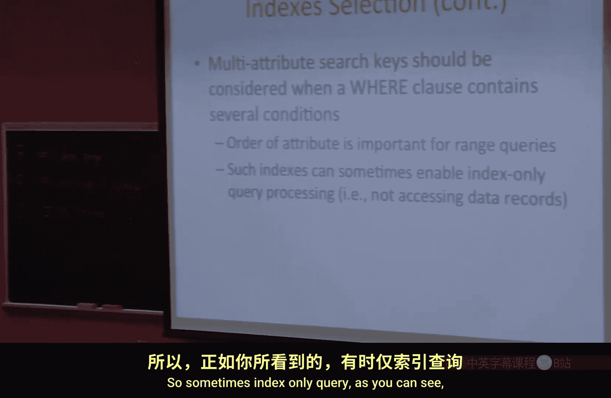

# 数据库管理系统：第8章：成本分析模型与索引选择 📊

在本节课中，我们将继续学习数据库索引的成本分析模型，并探讨如何根据不同的查询需求选择合适的索引类型。我们将从回顾聚集索引的成本开始，然后分析非聚集索引的成本差异，最后讨论在实际应用中如何选择索引属性。

## 回顾聚集索引成本分析

上一节我们介绍了堆文件和聚集索引文件。现在，我们来回顾一下聚集索引的成本分析模型。

首先，我们定义几个关键变量：
*   **B**： 数据页的数量。
*   **D**： 一次I/O操作的成本。
*   **F**： B+树中每个节点的扇出（子节点数量）。
*   **R**： 每页中存储的记录数量。

经验研究表明，数据页的平均占用率约为67%。这意味着，如果我们有 **B** 个逻辑数据页，物理上实际需要大约 **1.5B** 个数据页来存储数据。

以下是聚集索引下各种操作的成本分析：

**扫描**
扫描所有数据页的成本是访问每个物理页的成本之和。
`Cost = 1.5B * D`

**等值查询（返回单条记录）**
这需要从B+树的根节点遍历到叶子节点，找到目标数据项。
`Cost = (log_F(1.5B)) * D`

**等值查询（返回多条记录）或范围查询**
首先找到第一条匹配记录的叶子节点，然后顺序读取后续匹配的记录。由于数据是聚集存储的，后续记录在物理上相邻。
`Cost = (log_F(1.5B)) * D + (#匹配记录数 / R) * D`

**插入**
首先搜索到正确的插入位置（叶子页），然后写入该页。
`Cost = (log_F(1.5B)) * D + 1 * D`

**删除**
首先搜索到要删除的记录所在页，然后重写该页。
`Cost = (log_F(1.5B)) * D + 1 * D`

## 分析非聚集索引成本

上一节我们分析了聚集索引，本节中我们来看看非聚集索引。非聚集索引的树形结构与聚集索引类似，但其叶子节点中的数据项指针指向的数据记录在物理上是无序分布的。

假设索引数据项的大小是实际数据记录的1/10，且页占用率为67%，那么叶子页的数量约为 **0.15B**。

以下是各种操作的成本分析：

**扫描**
需要读取所有叶子页，并且由于数据记录非聚集，可能还需要为每个数据记录进行额外的I/O。
`Cost ≈ (0.15B + B) * D` （简化模型，实际更复杂）

**等值查询（返回单条记录）**
遍历树找到数据项后，还需要一次I/O去读取实际的数据记录。
`Cost = (log_F(0.15B)) * D + 1 * D`

**等值查询（返回多条记录）或范围查询**
每条匹配的记录都可能位于不同的数据页，因此需要为每条记录支付一次额外的I/O。
`Cost = (log_F(0.15B)) * D + (#匹配记录数) * D`

**插入**
搜索到正确位置后，写入索引页和数据页。
`Cost = (log_F(0.15B)) * D + 2 * D`

**删除**
搜索到记录后，删除索引项和数据记录。
`Cost = (log_F(0.15B)) * D + 2 * D`

与有序文件（二分查找成本为 `log_2(B) * D`）相比，非聚集索引（尤其是当扇出F较大时）的搜索成本 `log_F(0.15B) * D` 通常更低，是一种改进。

## 索引选择策略 🎯

了解了不同结构的成本后，我们面临一个实际问题：应该基于哪些属性来创建索引？索引选择的目标是优化最频繁或最重要的查询性能。

以下是选择索引时需要考虑的几个关键点：

**1. 考察查询的WHERE子句**
WHERE子句中用于比较和筛选的属性是索引的首选候选者。因为它们直接参与了数据定位。

**2. 匹配查询类型**
*   **精确匹配查询**：如果应用中有大量 `=` 操作，**哈希索引** 是高效的选择。
*   **范围查询**：如果查询经常使用 `BETWEEN`, `>`, `<` 等操作，**树形索引**（如B+树）更合适，因为它能保持键值的顺序。**聚集索引**对范围查询尤其有利。

**3. 考虑多属性索引（复合索引）**
有时查询条件涉及多个属性，这时可以创建基于多个属性的复合索引。**属性的顺序至关重要**，它决定了索引的排序方式，进而影响查询效率。

**4. 利用“仅索引查询”**
如果查询只需要返回索引键中包含的属性，数据库可以直接从索引中获取数据，而无需访问实际的数据记录页，这称为“仅索引查询”，能极大提升效率。
例如，如果索引建立在 `age` 上，查询 `SELECT COUNT(*) FROM employees WHERE age=20` 就是一个仅索引查询。

**5. 评估条件的选择性**
如果某个条件过滤掉的数据很少（例如 `age > 10` 几乎匹配所有员工），那么基于该属性的索引帮助不大。应该选择那些能将数据集显著缩小的高选择性属性。

**复合索引顺序示例**
假设有数据（姓名，年龄，薪水）。复合索引可以有两种顺序：
*   `(age, salary)`：先按年龄排序，年龄相同的再按薪水排序。
*   `(salary, age)`：先按薪水排序，薪水相同的再按年龄排序。
对于查询 `WHERE age=30 AND salary=5000`，索引 `(age, salary)` 更有效，因为它能首先利用`age`进行快速定位。而对于查询 `WHERE salary=5000`，索引 `(salary, age)` 则更好。

## 总结

本节课中我们一起学习了数据库索引的详细成本分析模型和选择策略。
我们回顾并比较了聚集索引与非聚集索引在扫描、查询、插入、删除等操作上的成本差异，理解了非聚集索引因数据记录分散存储而带来的额外I/O开销。
接着，我们探讨了如何根据实际查询需求（如精确匹配、范围查询、复合条件）来选择合适的索引类型和属性，并引入了“仅索引查询”这一优化概念。
掌握这些知识，有助于我们在设计数据库时做出更明智的索引决策，从而提升系统整体性能。