# 宾夕法尼亚州立大学【中英⚡数据库管理系统｜CMPSC431 Fall 2015, Database Management Systems】 p34 P36 索引选择与查询评估 -BV1N76CBwEXb_p34-

Good morning。It will be the last flex of the semester then starting from next week on Monday we have。

Review session for the final exam。And Wednesdaydnes and Friday。By no project presentation。

And I think the TA has sent out which team。在な。So also。

 I think most of the teams will be doing the demonstration。That they came into very well。All right。

 so wherever we end today we will be。嗯。We finish for the final event。

 so we don't finish and we won't。So last time we stopped at。

Different kinds of indexing so we talked about index selection for our application。

 so under different scenario maybe different kinds of index being selected will be better。

 won be more suitable。So we talked about。It's based on what kind of queries you use the most。

And then you can choose what kind of index you want to index based on。

So lastly we talked at this example where we talked about。

 we not only can index based on one attribute， but we can also index based on multiple attributes。

 for example， here we index based on age and salary。

 and here we index based on salary and age and note the difference between them if you index age first then salary。

 then the toples will be sorted based on age first as you can see right here。

And here is the other way around。So can anyone recall what kind of alternative。The system uses。

Alternative one or two， alternative  two， It's alternative 2 because right here it stores the entry。

 but it's still。Par by pair， instead of saying， for example， right here。For age 12。

 their salary 10 and 20， instead of sting them 10 and 20 in a list is store them separately。

 So this is alternative。这第一份就是。Different ways of indexing with the same data。

You can have different kind of English。And in the database， when you have， for example。

 just one table， like here， you can create multiple types of indexes。Okay， so you doesn't have to。

So here let's take a look where we have some examples。And you can see。

 you can answer which will be a better。Candidates for the evening。For example。

 today in the employee record we just saw。If we often。

Send queries such as H equals to 30 and salary equals to 40。Then although of these three indexes。

 the first one is。Having indexed both on agent salary。

 the second one is just age and the third edge of salary。

 which one do you think will be a better choose choice。

If ourqueries is often like age equals to 30 and salary equals to 40。

 we want to find maybe employees。With that criteria， then which do you think is a better image？Okay。

 today， if ourqueries is often based on just eight。

Then indexing with a will be better okay and if our query is often based on salary。

 then index based on salary will be better， but today if the query is often based on more than one attribute。

Then based on both。And so this is how it be used with comp key。So I would say out of these three。

 the first one is better。And in this example， we're just choosing out of the three。

 but today if I say how about the index of salary and then age？

Do you think that will make a difference？Or not really。How about if we look at this， this example。

 if condition is often like。Within a range of age and then within their age of salary。

What kind of index do you think will be better？So the answer to my previous question is actually right here。

 whether you do it age first or salary first， doesn't matter。Okay。

 later I'll show you when when Google matter。嗯。So here。

 what will be a better index for this second one？When the condition is often within the range of age and within an age of salary。

 then the answer will be equal。Either based on comply agent salary or we say salary。

So what's the difference between these two as we saw in the earlier example？

The difference between them is。Right here。If you do the index based on H first。

 then the tuples are just basically sorted by H first， then sorted by the salary。

 Okay and this is the other waiver。So in the example of your show， it won't be too much of it。

Then we move on and see when it will actually make a difference， for example， in this example。

 if the condition is often like this， when the two terms are not both equality or both range select。

 if we have one equality search and one is a range search。

So say if our condition is often like age equals to 30 and salary within the range of 30 and 50。

Then which do you think will be better？As better。W。你。嗯哼。So both a costa。嗯。い。Exactly， so a is better。

And the reason being。If we use approach A， then all of the topples are going to sort by H1。

And then you can just do the equality search on age。And then you get all the rest。

And because it's cluster。T doing it。For the range is fast。

 but if we do it the other way around today， okay， it's based on salary first。

Then when you do the age， even though it's cluster。

 you have to go through them and the position won't be。Conseccututes it anymore。Okay。

 so for this one， a is a bit。So here are just different examples of how would choose different kind of income。

And remember last time at the end of the lecture we talked about。Indexed only cur， right。

 that was the one we tested on。So anyone remember what index only queries are？

Do you remember last time we gave？A few different equal queries， and we say if。

If executing the query itself will only access the index， then you can get the answer。Then it'sいいんで。

Okay， so here I'll give you a couple of different examples。We have three of them right here。

 going to three。And let's say today our goal is to have them all become index only。

And can you tell me for each of them， what should the index be so the queryvy can be indexed only？

You forgot what index only is？Let's start from this one。If you don't remember what index only is。

 for this query， if we want it to be indexed only， then we can index based on the department number。

Then all it has to access is department number and that's the index， correct？

So then when you execute the whole query， you group by the。

Index itself already and then counting it won't access other attributes or other foods， right？

So for this one， if we choose the department number as the index we use， that's index only。Okay。

How about。That one。What do you think the index should be so that it will be indexed on？

Deform a number and salary。10。So here you see the order is department number first。And then Saturday。

Do you think doing it the other way around will get the same effect？It will be less efficient。Yet。

 if we do the salary。Then here and the group I will be difficult。

 so that's why we choose the department of。How about the trip。For the third one。Just salary。嗯，好甜名。

Age is just equal， so you don't index， right？Will index。 But if you don't index by age of then。

 you have to access these。So then it's not index only。So。Do I want to predict that。

so here I actually put two options。嗯。like we discussed earlier actually right here because age is in quality so using the first one is more efficient right but what I didn't say was using both。

 even though one of them is less efficient， it is still indexed only right because you don't have to access other than the index。

So giving you the query， I can ask if you want to make an index only。

 then what should you index data？O。Let's take a look example。D right here。We have two queries。

And we already know if we want to make them index only， then that's the index we'll be using， okay。

 either depart number and age or age and then department number。Okay。

 so out of those two for the left query， which one do you think will be more suitable？

It's already indexed only then which one do you think will be。Yeah，A than why。I don't last me said。嗯。

嗯。But how about when we go to Groupby？是的。The other way around， So actually doing it。

 the other way around is better。 It's because we have this right here。 So group by itself。

 you can think of it as having a。Higher cost than just choosing whether it fits the equality equation ranking。

Okay。And then you can think about it right with wither。Choosing the same answer will still give you。

Yeah， or should we trigger。定解 about贝。So actually， that was all we would talk about for chapter eight and then。

But before we finish， I'll just give you a wrap up for what we cover。A little bit of summary。

So in chapterpt 8， we talked about there are many alternative file organizations and each appropriate in some different situations。

Okay。Also， if selection queries are frequent sorting the file or building and index is important and when we talked about different kinds of organization we talked about here we have hash based and we have sorted file or tree based right。

So for hash face。Later on， when we discuss more different kind of thought organization。

 we discovered where hash place actually has less benefits。

But in what kind of search do you think hashb will be the best。Will perform the fastest。Ecology。

So for hash space it only good。For equality。But the reason is because you have a hash function。

 and then that's。Only one step。And then that gets you to the right bucket。The right back。Okay。

And when we talked about index we say index is a collection of data entries plus a way to quickly find entries with given key values。

 so one of the examples that we use a lot is we talked about the tree structure and then we travel through the tree based on the parent and then we decide which child to go to。

 and then we can find the corresponding index。Or entries。AndAlso for data entries。

 it can be actual data records or key record ID pairs or key record ID list pairs。

These are the different alternatives， right， if you recall。

 so the one storing actual data records is alternative one。

And then the key record ID pair is alternative two and then is alternative three so the one we saw earlier at the beginning of the lecture。

 that example is exactly key record ID pair。So that one is alternative， too。

so we can have several indexes on a given file of data records each with a different search。

Also indexes can be classified as clustered or uncostered as we saw。

 and they are both three structured。The way you can tell the difference is by the point the point to the lead page。

On to the day that records。And then there's also primary and secondary who didn't talk about。

so how you choose it will affect。And lastly， what we talked about in chapterpter 8 is the indexes。

 so we said indexes must be chosen to speed up important queries。

Inindexes maintenance this overhead on updates to keyfill and choose indexes that can help many queries。

 so that's what we were doing right we were choosing different kind of indexes based on what queries are used the most。

 so when you want to design， you want to evaluate what kind of queries you use the most in your application and then you want to choose the index that will benefit as many queries as。

So we also learned about how we can build indexes to support index only strategies。

 so it will be great if you only have to access the index and not the other attributes。

It will be a lot faster。Also clustering is an important decision。

 only one index on a given relation can be clustered。Eventually啊。

Order of field in composite index key can be import as we said before。

 like which field you want to be based on first will actually make a difference。Okay。

 so that will be all for Cha8 and what's left today and actually the material left for the whole semester will be Cha 12。

Now。Actually， Tra has a lot that we can talk about， but I wouldn't touch on that much。

We go a bit deeper than after。Requires way more lectures。

 So today I'll just give you a really brief taste of how chapter club is like。And then after today。

 you to be。It goal to finish。4 six。But right now， what you have learned can already do。あのこも。Okay。

 so chapterpter 12。We are finally going to talk about however are you going。

Sa you recall quite a while ago in the semester early on。

we were talking about different kind of relational algebra。

 given a task you want and how can you write the relation of algebra down？

to get the Cur1 query and at the time we didn't put much emphasis on efficiency and the performance rate。

 we just say as long as we can get the correct answer， and that's fine。

But we kind of derusedly as saying， okay， within the relational algebra， if we moved。

 let's say the projection。A bit too the in the parenthesis。

 maybe the intermediate result will be a bit small and that time we think about that might be better。

 but we only talked about it we didn't say。We do want to custom。

So the focus for chapterpt 12 is to get the Earth optimal performance query as possible。

So the overview of this chapter is howqueries are evaluated in relational database。Oh， it's DBM。

 not the M。So how courage are you evaluatedd in a relation？And we'll talk about evaluation plans。

 so how they are actually represented。Which I'll talk about later， which you will draw down。

and implementation of relation operators， so when we talked about different kind of relation operators。

 if you recall we have selection， we have projection， we have join or cross product all those things。

 we didn't talk about how theyre actually working。But how they are actually working does affect the performance significantly。

Okay and what are the alternatives for retrieving Saat and then lastly query？

So let's start with query execution plan， what do you mean by that？

So Per execution plan is an extended form or of relational algebra。

 so you can think of it as what you were writing before the relational algebra。

 this is totally based on that。But instead of writing it into just one dimensional super long super long formula。

It will be represented in terms of the truth。And in this query execution plan。

 each node industry the tree is an upgrade。The child should late。

And we can think of the operators as the building blocks for cur evaluation so how you position the operators in the tree in terms of the node actually make the bigger difference。

And also each operator typically implemented using a pool interface。

 what we mean by that is later youll see when we put a relational algebra into a tree structure。

A tree always start from me。wait for heat。So every time you have a parent in the tree。

 it actually pulls whatever that's resulted from the children。Thank you。And， lastly。

The implementations of the operators are carefully optimized for good。

That we won't really talk about。The action。So right now。I write it on the board。

 but take a look at the next slide。Yeah。On this one， I think you。地图。Very。

And it asked you to write down the religion。do that。以来。

That's this equal。We have。

So how can we map this to a relational？How would就 start。The select in SQL is the what in relation of。

うえ。はい、ァイロポセす。Projection in relation algebra is select in SQL， okay， okay。

That's from a long time ago though。Okay， let's start from Pi， let's start from Pi and we say we want。

你带。Okay。证明。哦， what。あ。喂。あとす。Our oh， like so。Okay。But what goes on the sub？应该是。All of them。

最。嗯哼。And。And。

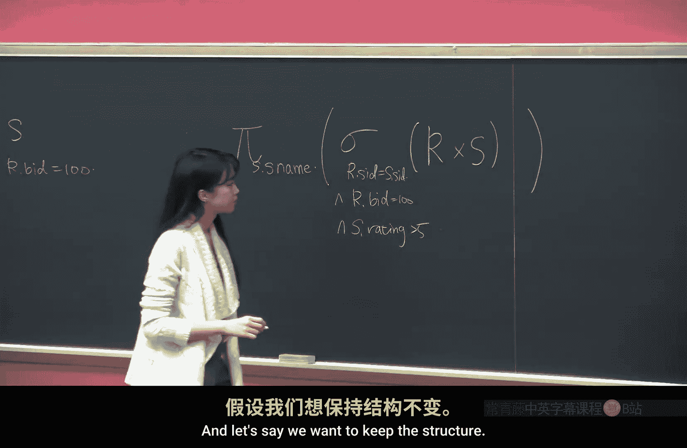

Okay， let's say we want to keep the structure， okay， everything's positioned。The same。

 but can we improve the just tinyiness。Let's say。And we change it up and we don't actually need this。

This R SID equals together。By changing an operator。We can actually。Aitで。You you remember that。Ajo。

Yeah。

So then instead of taking a cross product， if we say we just want to directly do a natural join。

 then for the fields with the same attributes， directly cuts。

Okay， so that's a improvement note。So this is how we can drive the relation of algebra， given sequL。

 just a bit of review。

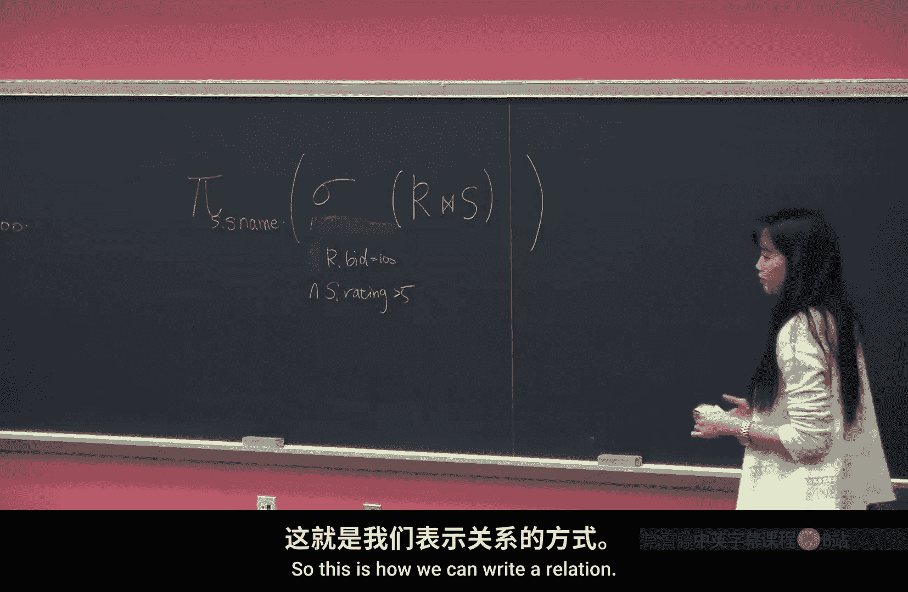

咁刚系。AndSo that's what you can write down on slide。好。All right， so then。Take a look at slide 13。

 I asked you。啊。To draw a relational algebra tree based on the relation algebra we just wrote。

 So what do we mean by relational algebra？

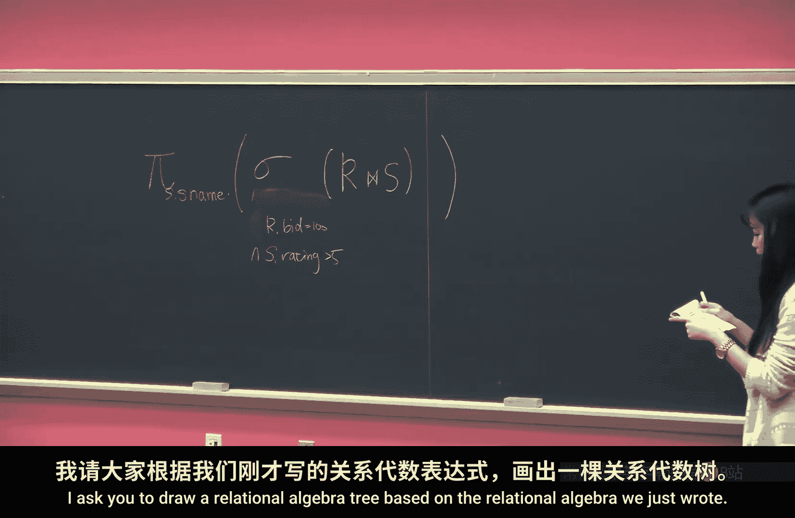

You're right。Right now。Basically looks like this。Starting from the aler home。

 the aler path of the relation algebra。That's the group。For the tree。Saing。LetStart with this route。

睇が啲。The next step。Is what we do the next。有。啲。Selection。And the selection is based on。ItsPia。

So this is the root of the tree， and this is the only child。です。And then we move on， saying。

And the child。All this now。Istsure。And because it's a natural drone， I won't cook down。Re。Eventually。

This one has。Two children。是的。So what does this to remind you of the number of children an operator。

If you recall when we were learning about our relation of algebra， I kept asking you which is urary。

 which is winery？😔。

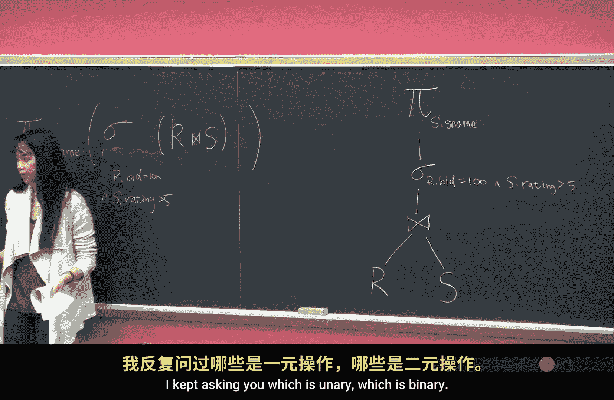

And this is exactly shes on。Because right here。The joint operator is binary that it has to take。

Any selection is going。This is what we do。All right， so translating from SQL。

 then we have a relation algebra and relation algebra， we have a relation algebra tree。

 but this is not the query execution plan yet。So for a queryie execution plan。

 actually what is special about it is on top of the tree it has， it will denote the tree。

 or you can say decorate the tree even more with the algorithm you will use。For each offer。

So when we were talking about relation algebra， we just imagined the results of it。

 but we didn't think through so much about how it's actually being implemented。So。

Let's think about how the possible algorithm can be， for example。

 starting from reserve table and Saors table， if you do a join。

What are the potential implementation you will do to join T teams？One of the dumbest way。

 but the simples way you can do。Just to do simple。

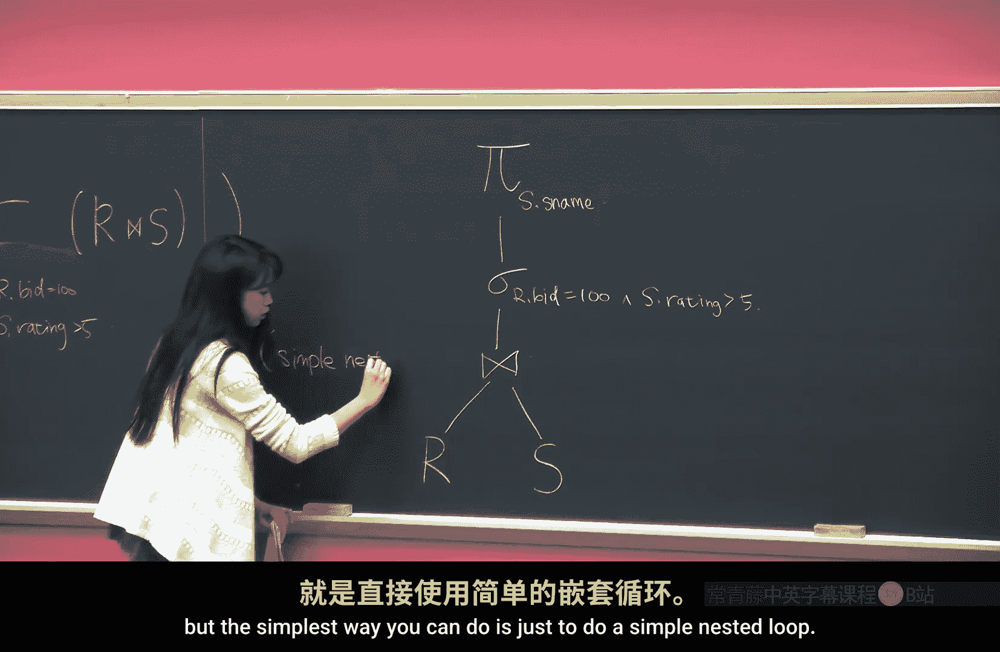

Yessterly。so for each career execution plan， you write each of the algorithm next to。Okay。

 so one of the ways you take two tables and then you just have one table iterate one couple on table one。

 iterate through every couple of tables。And you do the comparison。

 so that's the dumbest least efficient way， the simplest。

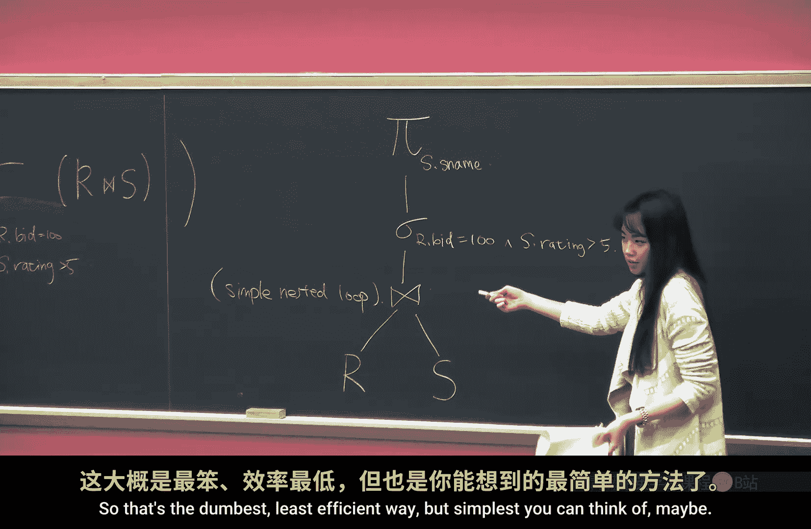

So that you can say for the joint out。

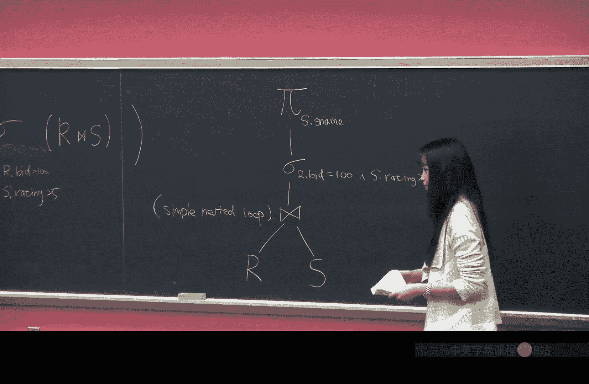

诶。And then for these， it has a special name， so now we have these。

 we only need to do really simple comparison。We have the result right here and when when we get to here。

 we just do super comparison， we don't need anything。Okay。So there's a term， when we do this。

 we just call it。Everything you just do throughout out things you go on。Okay。

And then after so here you get the rows anymore。And then here we want to get the columns we on。

 that's also just another process of filteruring things out。咋地。It's also people。

So as you can see throughout the whole plan， when we have this part and this part。

 if we want to use choosing different algorithm to improve the performance。

 there's nothing much we can do right here here。のまでいふ。So here we go the planning。

好算吧。

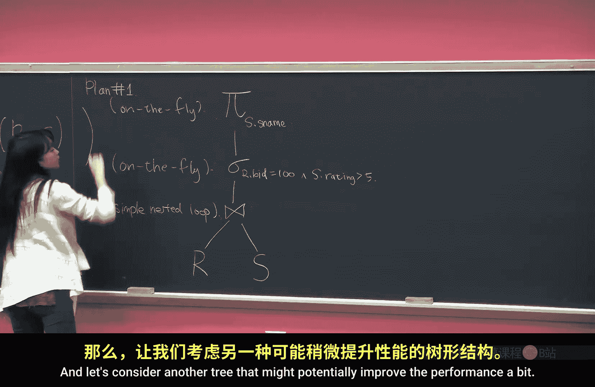

Let's consider another three。But my potentially。

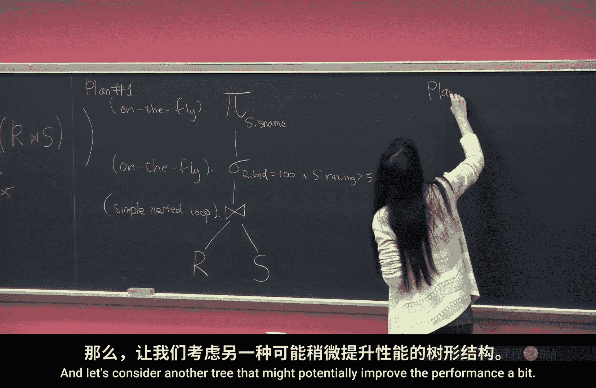

佢方。就。How can we restructure the tree， reposition the operators。Based on this thing。

You think we make the performance。Ignore the other。そいとの。Definitely okay。

 so we're still starting from our。But instead of directly joining them。

We do selection of each of them first。诶。So what you can do is saying。なしょ。系。So make them first。

Youjo them。Go up to the chain。And what is left to do eventually。Yeah。哇。So why is this a？

Because when you actually evaluate the intermediate result on each step。

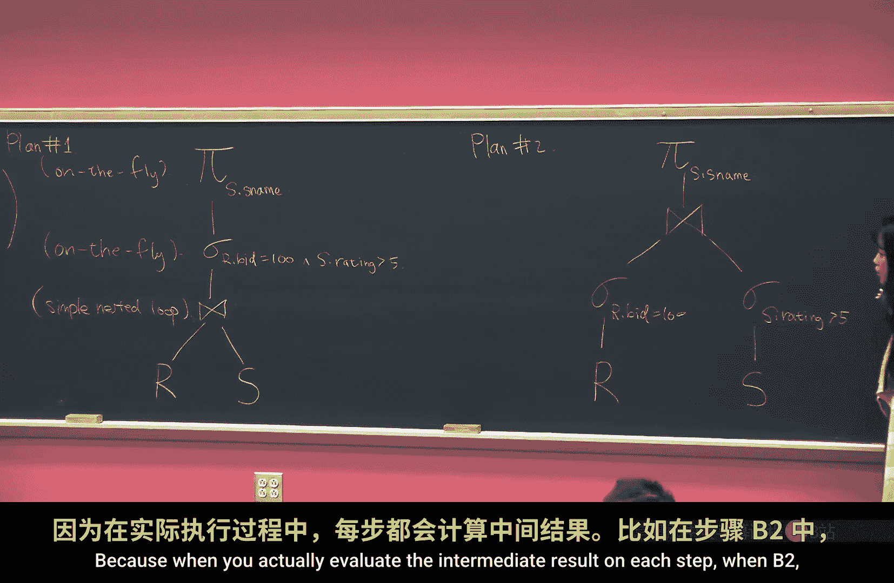

These two。When we do selection first， that would generate。Smaller tables the way you do join。

So we are just getting dirty work done。All right， so if we want to denote the algorithm on the tree。

 what you thing can do？で oneれ？I forgot to say something really important。

So right here we say it's on the flight because you just keep pushing up and you don't actually have to store in a temporary result。

いけだ。Okay， but here， will we have these two。What we actually want to do is at this point。

 we want to put it into a temporary result in here。あさ。Okay， so that's kind of like。

A little bit like when we were doing movies of probably we had。tor it。Okay， so here you can say。

For the algorithm we want to use， you can say skin。😊，And。Store。你你唔 take关。

And then here you can。nice 같은。Scan and。Do。But instead of like that。

 we just say keep pushing it up and then we get the result。

 saying on the slide here we say scan them， store them in a temporary result first。Okay。

 so earlier we say we're doing a join， you can do a dumb way that's simpleisticistic。

Just look through every possible combination and then get the ones you want and then contact negative。

But here。Of saying just the simple of there's some swas away。啊。So what we mean by S March join。

Instead of directly comparing every single one of them。We actually sorted each of the table first。

By by the attributes， we won't join baseball。And thats so much。So here we will sort it based on。

Silary。And then comparing which one we should。Mararch together。So。

Improvement from Sphon we can to the so。And theで not。So this is the second。We can do。

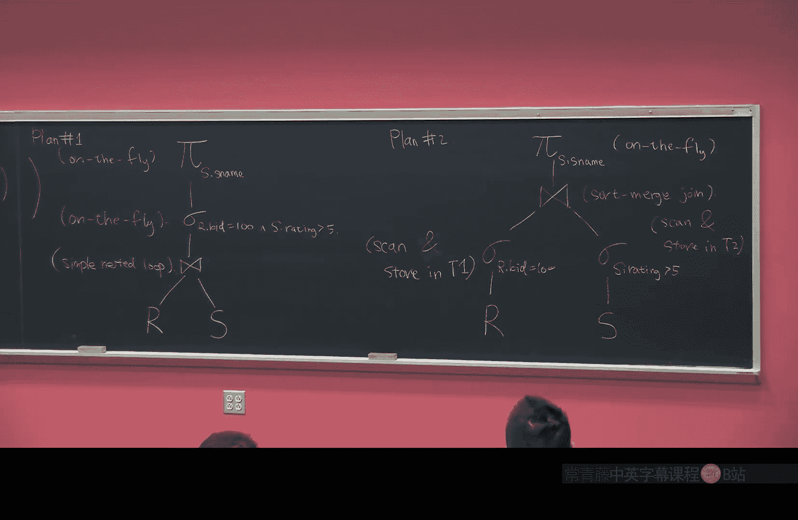

Okay。So that's typically what like the beginning of doing query optimization。

 so you start with different kind of institutions。So we sayqueries can be represented in many combinations of barrierators and alternative algorithm。

 just like we did earlier， we can change up the structure of the tree and we can change out different kinds of algorithms on which operates。

Okay。So the process of finding a good execution plan is called a query operator。

So the basic task of it is just to consider several alternatives executive plan。

So there's no smart way of generating the tree。So you can do it like。By evaluating the order。

 even generating from relation algebra， what you put in inner， what you put in the out point。

 and that gets you。Okay so there are two main issues in query optimization so for a given query what plans are。

And。Algorithm to search plan space for cheapest points。

 so basically you just want to list down different kinds of plans and then pick the one that's the cheap。

为嗯。I really briefly talk about how the bank。年て。So ideally， of course， we want to find the best plan。

 but a lot of times realistically， we just want to avoid。So like we did earlier。

 if you can bubble down and do this selection first， then that will reduce a lot。

Just like we saw earlier， there are different kinds of algorithms for relation operators。

And each of them can be costly based on different situation。 So for example， the selection。

 the cost will be basically based on a number of positiveifying toples。And the projection。

 the interesting part， is actually dropping columns， doesn't take much。其实啲。

Expensive part is if after dropping the fields， dropping the columns and you want to remove the duplicates。

 removing duplicates is the expensive。Okay。So how are removing duplicates often taken care of that's by sorting Okay so you sort sort them first。

 and then you will be easier to spot them theyre a duplicate。

 So sorting is useful for eliminating duplicate code。And then lastly we have join。

 join is the most commonly used one， and it has quite a lot of different ways of doing join。

So here just like we saw earlier， when we talk about drawing the simplest way just doing this to Ray。

 we have you can think of it as。A two， four loops， and then you just loop through every possible couples and then eliminate the ones you don't want and keep the ones you want。

Or you can do index net to loop joint， so you scan， so for example， we do join on R and S。

 then you scan R and for each tople use the index on S to find matching topples net。

And the most optimal one or the best one we can think of at this moment is the sort。😔，Okay。

 so you sort them based on the one you want to compare first。这な种。哎。真时光。Cale。O。So after this。

 I'll give you one。The protection。エのとュ。Depends on what you request。Because。

When we discuss about relation algebra， we just assume every time the result we get rid of it。

DuplicatesBut if it's specify you want to keep the duplicate， then that。

If we just get the columns the image。O。So， lastly。How do we actually estimate the cost based on the query？

So for each plan consider， we must estimate the cost。And。Two parts that we want to consider。

 the first one is the cost of the operation， operation itself。So like we say， maybe。The operation。

 if it's a joint， then what are the cost algorithms， then that's the cost。Operator。

And you also must estimate s of results for each operation intri so you can think of。

The tree in little soft trees。Every little sub will generate an intermediate。Size a result， right。

 so you want to minimize the intermediate。So that will be。Add to the cost。So that's basically just。

A super brief discussion on chapter。So it actually can get really long。All right。

 take out a piece of paper and this will be the very last quiz。还没调整过。There what。This is the。要定你成 out。

No那か系咩嚟ど。All right，Okay， just so you know。Today's the  tenthth twist and after that we will drop two。

Out of 10 in your total grade， you can drop two quickly。At homework， we can drop one。Out the six。

な。

II I don't know what to off。嗯。T someone。这さ。Oh no， I want test on this one。系系意事。Yeah， that's hard。

 okay。可看。Now， when lot of people came in late， I don't want to be so late。呵呵呵。😊，Yeah。啊。感。All right。

Okay， I'll just why？All right。Let's say。I do these too。Basically。

 what I want you to do is I'll write the st when you write the relation of biometry。That。

 you don't have to give me the execution plan itself。Okay， let's say we you want。Yes， I。

Nothing really creative going on。嗯。And then。When。Oh， I am。We that about。So first thing first。ピ。来。

So that we join all of them。I on get。The rip。O， that's it。

So write down the relation of algebra of that。

我就。

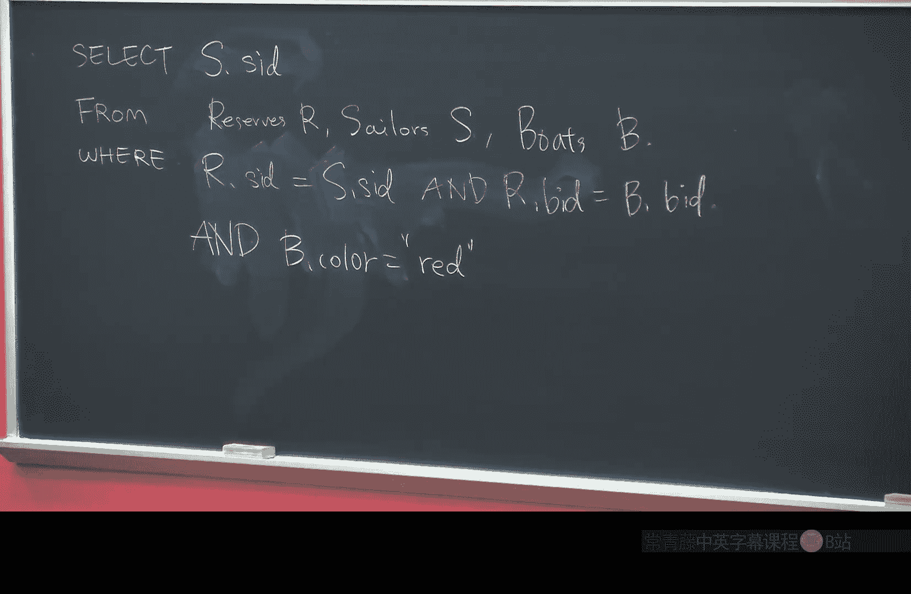

嗯。Doesn't have to be up。

对。If you are ready， you can。

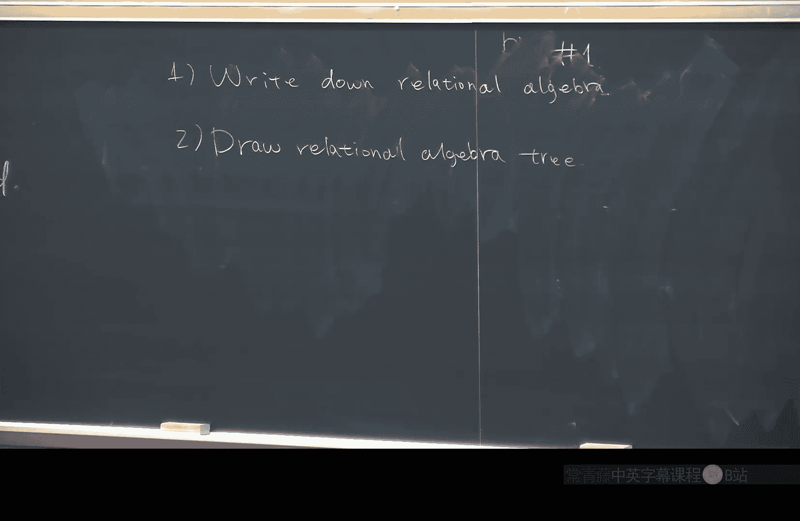