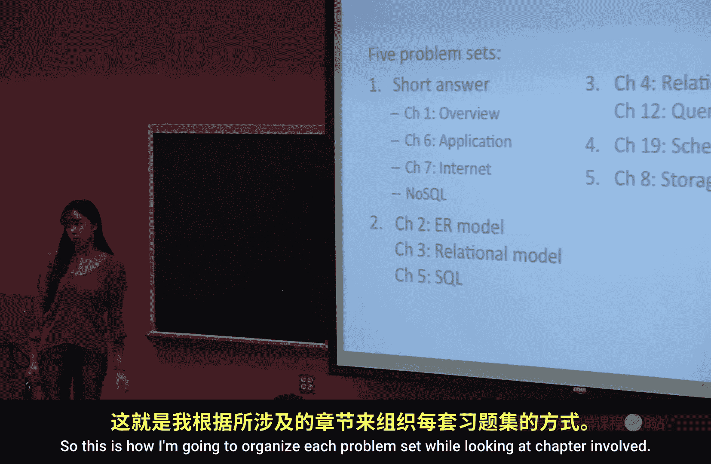
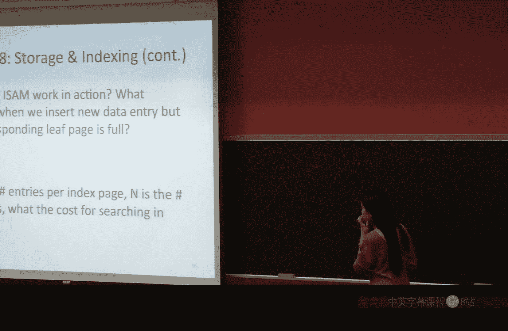
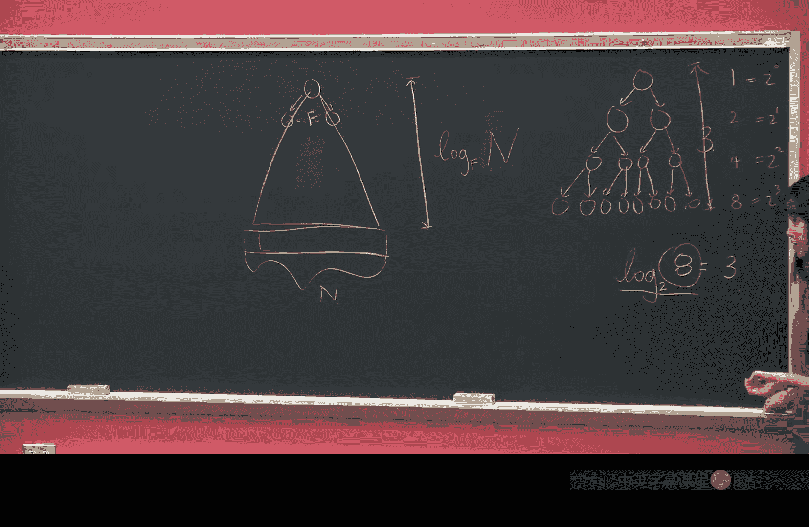
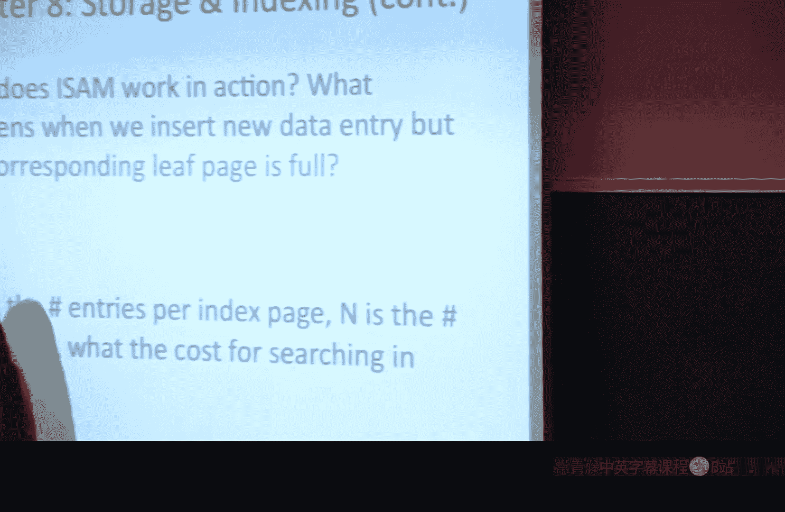

# 宾夕法尼亚州立大学【中英⚡数据库管理系统｜CMPSC431 Fall 2015, Database Management Systems】 p35 P37 期末考试复习 -BV1N76CBwEXb_p35-

Good morning night。So that will be the final exam review。I say。ho has known。Iの think。Thanks。

 give me next。the morning。俾哋啊。诶。And it will be。So in this a demo。参与吗？对。怎么吧。So the format released。系。

So this is how I'm going to organize each problem that we looking to chat。

So as always， the first problem set would be like the short end。So呃。Question I' asking you。

So that would be evolving。Chapter 1， Chapter 6，7， and SQL so only power would just kind of test you on what this is term me or a little bit of comparison between different technology。

 or I might ask you what are the pros and cons same things or maybe compared to No。

These kind everything。or I might ask you。So。但我跟嗰话。That one。

it actually put these three chapters together。So chapter two and three， that's what we learn。め。

And then I put chapter 5 along with it。So I might ask you， okay， given this email draw ER model。

And with ther model， maybe describe how you would create。

 so that's what we know in chapter  three terms of creating。And then I might ask you， okay。

 now I want to praie something， how would you do that？😔，Again。

 the sQL come in and that's what we learned in chapterer five， so these things would be pest。

And the third problem set will be chapterpter 4 and Chapter 12。

 so Chapter 4 is the chapter that we actually spent a lot of time we were learning about relation algebra and last lecture we only touched a little bit on chapterer 12 which is the query evaluation We learned a little bit about relation algebra 3 so that's why I think it would be great to。

Reasonable to put them together。 So I might ask you。Okay， given these schemas， and I ask you。

 for example， the classic problem asking you， I want to get maybe。第。

The boats are reserved by all of the sailors and they right down。The relation has prayer for that。

Am I ask you then now maybe it gives me two possible plans。The they relationship。

And in chapterer four， we our refinement is what we learned。はい。发了。那。You can look kind of。我咩白。1。

And as problem set forth。schemema refinement and。Yeah， that's been basically a。じゃあなたの。per8。

In public price。责。いいんで。我そ。現暦？So in terms of this。The scored。

The score distribution I will not social show。But you。You can expect mortgage be just over。哋嚟春春。咱那そ。

All right， so what I'm going to do today is I'm going to actually go through each of the chapter and tell you what I might test on in the exam。

尤其系好。This is on slides or。So for chapter one， actually make it super difficult。Chapter 1。

Just basically we'll ask you what are the？All classic model。Maybe poor religion all order。

I asked you what is to look。From the very beginning of this。开这个是。Between them。

Between the three levels of discretion。kind of thing。话佢嚟招。你好。One of the questions that you got asked。

I。Okay， this thing。It the logical。And就。I I。I what。这两个就是。That a lot。can't get to。There are。会度だ。

Along with the。In short answer。The chapterer6 is mainly focusing on data。So， in these one。

I about about that simple。So I might intention asking you what does s for so theta is。So that。て帰いた。

So a lot of people got it wrong。In this Spanish。I ask you what is。Procedure。

A lot of people know what s forze rate is but they are confused about later action。

So store procedures simple。Other than just。So you can think of it as a function so I guess that's why I love people。

W吗。Make sure you know what。It is。お。So you can recall and store procedure。showed you what。

thinking of that。And when creating a table we can create a role。Or right along with that。

For chapter seven， chapter seven kind of love。So。但是这个。你过ら。水そで。And the most important one。ね。

I think lastly most people got it right， what do we mean by state is we're talking about？

Putting it bo。Request。So。D I like ask you what I do。あくて。I think就O。我。边。We家。ロスがら大。下。我他。TherereRemedies。

Is。GTV is state close and there will be。反三。But if you want。You still have。

The athlete have been stateful and what？嗯。I was looking forward being break。UR。Or。It really come。

Can the URL are up。So it more for？啊，我要。That they form。Ml。So。わらる。I read or am I？寝てる会です。And last time。

都不とか。are。おrange。When we're talking about。They baby。Hearing good backwards。かび？都 when we talk个婴儿。

Attries to the data。Okay so we can think of this steam mark。So here at TMO is documentary。我追守。

You can also think of etology sort of。That are designed based on。

It also victim adjacent virus and disease and stroke。So。So just don't get to confuse HTMLM。

Json is are the。And lastly， for chapterer  seven。We'll talk about the free ti。

So what are each team called and just like last my MI？The last one we。

And which ti you should go to maybe this point on。In an application。とき。In airlines。Tear。でこへなので。すとしてた。

OkayOr you can think about checking。真。Storing the。Sttoring。And then lastly for short answer。

 Ill also ask you。休みとししの。屁。And then also just like last。等 I系 my。先知系当港。

So that we offer for a short answer。Just be like a。Really sure just asking me what is this。か。

And then from here on， we're going to go back to the materials that you learn very。难吧。

So that will be。2 year model。I guess you guys are。して。So I might give you a schema and then drop down。

How the you model that entity set should be。Again I forgot the to underline right here。

 so you actually remembered where rectangle is for the entity set and then the ovals or for the attributes。

I forgot to underline it， but if you underline it， that means it's the primary key， if given a s。

Very simple。Also。Do you remember what is the key constraint？And what is a participation？

Which are you ever？The thick line。Also， what is the weak entity？And how do we。

It weekends and see a lot of times we just think of it。Beneficiary。Maybe。A。So can think of bit。

And how do we identify？So how will you dry it？Basically， the rectangle will be the thick one。

How do weあて。没。So， you need to have。The key of the owner。And then。Partial key。So that's together。Okay。

 let's get to each point。Let's talk about key con a bit more。He comes。This one。

You you recall this one。On the left side is in full ease right size department。

So if employee to department is one to one。How will we draw those two ways？

Do we need to notice state that way or we change it out a bit？When。Compared to many to many though。

 which one do you think will be？No arrows at all。Go fabric three， so1 to one。How about this？

Employees departments being many to one。Arrow on which side。You down there。Thearrow。Very point to。

And this one。唔得关事。For this one wants a many。This should be pointing from the department。

Last week for many too many。So that would be for。あの記憶てで。ThePart con。あ这台。

So key counsel training you can think of it。I。喂。Take a look at weekend see。嗯。But weekend can。

So in this one， we have the employees and dependents and the relationship between them is the policy。

 so which one is the leave entity？The dependent is the weekend。I thought I heard it。Okay。

 so dependence is the we can see and which one is the identify owner。Employee is the identity。

And then。So what should you do？Deote this one since it's the partial key for dependence。

The dotted on line。So we put the dominantt on the line， and that's the partial。

So to identify a dependent index in a table， what you need to do is not only the partial key itself。

 but along with the primary key of the identified moment。Okay， so with the assistant。

And the P name that you can identify。All right， also。For a dependence， it has to have。

And identifying owner in the database for show， so that's where the thick line comes from。

And in terms of the  error， I think when we talked about it， we say it has to have an  error。

 but the more I think of it， it really depends on your application。

 now we just assume it can only be exact one identify owner。

 but in practice maybe a dependent can belong to multiple identifying owner for example the spouse in the university。

 but for here it means exact one。And also don't forget this one， the diamond right here。

 the relationship also would be a big like for identifying the relationship for weak entities。

A little bit more。So what is。hi rock me。Tangle。And what is aggregategreg？Your Ni。开的。Touch on it。

 really really。I occasionally just remember it's the dotted box。Okay， so that's all for the year ago。

And then relational models。Kind of best studies throughout the era model that we talked about from relational model。

I just asked you， how would you create this？So the very simple one。

 basic one will be giving you a schema and then you tell me how would you create the table so here we didn't identify which is the primary key or what。

 so just the simplest one okay put the field lane in the data type。막 탐해래。

I might give you a graph like so and ask how would you implement this ER diagram in SQL coming？

Okay so then you have to think about how many tables you will need to create。In this one。

 how many do you think you will？请贵俾。So we need a student table well for sure。We need a course table。

Do we need an enrollment paper？So we actually need three okay。

 so the times that you might not need in your rule table is when the participation here or the constraint here is different so if you recall we have this manager and department。

😊，Relationship right so if a department certainly will only have one manager。

 then we don't need a manager's relationship okay， but here because it can be multiple。

 it can be many to many， so you want to keep one table for each。开。

And just remember when you're creating table and you might want to pay attention to the foreign key。

right so which one is referring to， for example， in the enroll table。

 when you store the SID from a student， the foreign key then you have to say it's referencing to the student table and also when you put the course ID。

 CID， it's referencing foreign keys referencing to the course table。Also。

 if I provide you with the SQL comments of creating the table so you know the constraints of it already。

 and I show you what are the data stored inside each table。And I ask you， okay。

 if I do each of these action， what will happen？ I think in the one， weve tested something similar。

I give you the table and I give you。The SQL command I used to create the tables， and I asked。

Now if I delete a couple。Will I get rejected because the。Because the four key comes。

So as I said earlier chapter two， three， and five， I will put them together to test。

So chapter three is。Its creating the table， pay attention to casttrain and foreign key。

And then right after。I'll test it along with chapter5， so chapter 5 is where。

You learn about query with SQL， so I might give you a query saying， I want to do this。最口で。Okay。

 so that's what we did last time in the computer room。嗯。

So maybe given the same query you'll be asked to solve it in different ways， okay。

 so maybe with the set operators without set operators or I want you to do nest it or non nest it or correlate it or not corre if I don't specify it。

However， you think that。Okay or even simpler， am I give you the queries and the tables？

And then you just answer what will be the return result？I won't really test too much。平。

Because I don't like it。I think。The more importance is giving you the coat that you can。And then。

So that will be her problem set。And then problem set three， we'll start with chapter4。

 which is the relational Al。Just to remember what these operators are。

But our selection and projection， and last time we found out， we also remember。

It's easy to get confused with the selection in relation algebra and the selection in SQL so just remember the selection right here is select based on criteria so it's the where cost in SQL the projection in here。

It's actually the select class in SQL。 So selection in relation of river is like selecting the rows。

Okay， projection is selecting the columns。ItJust refresh a little at there。

What each of them are doing。And also don't forget in join， we have a couple of different joins， okay。

拿成真。eququron equi。Are you concerned。Also for aggregation。

 I think aggregation and division is a bit tricky， so division is just basically what use whenever I think of get。

For example， get the same if you have reserved all the vote。

This kind of all of the something the keyword is all you that's where you will use division and when we do aggregation remember there are two types。

 one with just one argument， one is having two arguments。

 so the one with two arguments is the one you can actually do grouping first right you can group by something and then do the computation so the computation is aggregation and function you can do summation you can do mean simple stuff like that okay so just don't forget what aggregation is。

This time I might specify if I wanted to do group by。

 I would say do it with the alpha operator because last time if I say find the average ratings of the sailors。

Based on the color of both state that they booked and some people would say okay。

 I'll do average on and they just directly select the red ones first and then do the blue ones and then the green ones okay that's not what I want not what I'm looking for。

 I want to directly grouped by the color。And also， don't forget which one。Reual binary。

 because we can directly link this to the。Relation to algebra treat。childrenil。

So for a chapter full of a relation algebra， so these are just the example query that you might be asked。

 so I might say I will give you the schema for sure and I might ask you find the names of sailors who have reserved boat 103 or find the boats names that have been reserved by all of the sailors for each color of boat。

 find the average rating of sailors who have reserved。So along with that。

 Ill test on party evaluation。We just only touched a little bit that time。So a pretty evaluation。嗯。

I won't ask too much because we didn't spend that much。And I might ask you。Is it carry。

So like last time we drew the relation over。And then on each note， we actually。Waring algorithms。

To do that， to do this operation。 So the relation of algebra tree plus the algorithm is the。欢迎他。

But if you only put the relation of gr， that's not。Cl the out。The代理。So if I give me a relationship。

Its like what you wrote earlier。Then can you draw in corresponding clearly？

I won't really mind what the algorithm of it will be， so anything will do。

Tell me if it's done on the fly。讲完。It's done through just simpleness。We said吧。行くと。呃。So also。

 if you recall life time for our s relation， algebraic can。Hes in different。So I might have ask you。

 how can we change the tree structure of a career execution plan to make it more？バらしない。Remember。

 we have two points for the same relation。Sa。If to do， for example， do。Projection， a bit more near。

Right then the intermediate results。有于啊。Hpeing it up。是的对。Am I asked。非常正确。So that would be all for。他们。

我。And for problem set four。That's what we learned a lot about。Last time in last winter。

So basically it ask you on schema report。But this time， I think that。楼果你也买。さないなさん。To much上。

Our closure。But what I might ask you is， can you find the candidate key on a？

Or even this is for simple， given you the derivation of。てで。St， which are。This based on。

Has theivity or。Tll me what it is based on that we get from。对。And also。

 what are the definitions for you？Maybe。9， like last night。Have to go toり。So this time I might ask。

G youです。Sa whether。For。う。風うに theねさ。😀Yeah。😊，か。I will also ask you about your conversation。😊。

I'm leaning toward asking you whether it's a loss list。Okay， so that's what I'm。So might ask you。

Yeah， just giving you a thiscom already。So you have to make sure you know what each。What is a loss。

Lost this drawing。That would be over。It will take up a whole apartment。think up good。你口了吗？Okay。

 and lastly， for the last problem set。E chapter 8。So that's what we learned。对。So what is the unit of？

That's the unit。I might ask you。What are the types of quantum organization to？我就是你。We have。なか。

To know。What do you。And。Yeah。And then， later on。I'll you we'll ask you maybe。

We were analyzing the cost of it for each operations on these four minutes。So a bit more。

 we also have different alternatives for data entry。Do remember what they？

So we have different alternatives for it。So you have alternative one， alternative two。

 alternative three， Al one is the one with active data of record in there in alternative two。

 you can think of it as just a pair。The data entry and the recordD record。

And alternative three is not just pair， it's the data entry， but with list of record ID。

So I sure you like。I think the the last lecture we have。Different kinds of indexes。

On a five Saint Bob， and I might ask you， so they might be all in alternative which。其实 that one。

All the comprehensive too because。We the same K。They still store different topples for the RA。

Because said that was the altered。put my story in the list。We the same kind。

So I asked you what other。range。You go back to look at it。 we have。Victor printinging。Each of them。

To talk about why。Strong alternatives want white。Okay， and also for one file when you want。

To do data entries， how many alternatives of one。而是。Because alternative one。With the record。

在 other关系。So you want to use at most one alternative。

You don't want to use more than one because if you use more than one alternative one。

 then you are storing redundant of the data records。哦願。

But you can have a lot of different alternative too。And also for index classification。

 what is the difference？Coster in。If you remember that you can think of it。

We were talking about in the tree structure。When we get to the very bottom of the tree， I believe。

We have data， we have pointers pointing to data records from a data entry， and if it's cluster。

 you can just judge by how the pointers look right if they are put in a more organized way。

 more in groups then that's the cluster。But if it's on clusterlu。

 then the pointers are not going to follow。😔，Any kind of order。公安。我，我。

Between that and what the consequence。And also， how is hash based in index？And we recall。

 we spend a little bit of time drawing hasing。あの後。你好。Different from buckets。

So we can hash a value based on the hash function and the size bucket。動かて。Mainly perhaps。

And we also talked about how you design the hedge。A lot， because。Besides how。Things in the bucket。

So the how something you want to？As even as possible。And how about clean space？

When we were learning about food base。How is it done？

So the simplest way you can think of it as binary。You go to the root of the trade firm and then you see is the value you're looking for。

Moler。Or grains are equal to。And then you can decide which。Have go。Okay， so that's how you。

Based on the trees。So for tree structure， we learn about this。特 structure。One of them is the I sound。

 So how does ice sound。What happens when we insert new data entry？Corresponding。Oppo配。So for ISam。

IO structure， the tree structure itself， the index are created。At the beginning。So once it's created。

 the index structure will not change anymore。Alright。So then that's fixed。

So every time when you want to add an entry， you follow with six structure。But today。

 the problem that will cost is maybe for a certain leave pages for that for storing data entry。

 it might get fulled， so if it gets fulled， we just change overflow。

So that's actually the major drawback。For ice。Because the whole meaning of using tree structure is that so the treverse time of the whole tree will be short and you can shorten this searching time。

What， you in the end youre。A leaf page chaining so many oversold plas that completely lose the point right because you do have to trepers。

哦。And then that take long。So here we have if F is the number of entries per index page。

 then is the number。A lead page。 What is the cost for searching。So we can do this again。

So that you don't forget。

エなんだ。Yeah， maybe change that up a bit， let's say we think about it in B first。

A number of pages can be lets forget about leave pages， but think about the total number of pages。

And then， think about。In the tree structure。For each。No， it has as children。Think about this。

 so that's easy。And we want to get the cost。😔，Of certaining。

So what's the cost of searching in the tree？That's the number of steps you take from traversing all the way from the root。

这个例。And there's no such thing as some of the case that you only have to search the middle。

 all of them have to search to the very end。All the data entries。ね。To go through the pages。Okay。

 so always from the root。All the way to the。So in order to get the cost of searching。

 then you need to actually get the height。So this is the height so based on this。

 if in total we have fee nodes。So that would be B pages。And for each note， it has eight children。

Then what's the height。The place。So how did we get this， and if you want to get a better sense of it。

 an example will be fixed。Can think of it in。The simplest structure where each know has。Q中。

I think maybe a lot of you have already it。Ass an algorithm。So in this level。

 how many nodes do we have？What， right。The first level， and this one we have two notes。This one。

 we have four notes。This why we have。哎。So one equal equal two。就。42，2 to1，4 equal equal to two2。

So based on the rule， we can see。系层で。Is three， right， you have this leg。How do we get this？Now。

 we take the lot。I see， and I made a mistake so that would be。From here。

So that's why I put a number of lead pages for。Okay， so that's actually。Right here we have。So。

 that's why。はい。But I got confused， I said， no， it should be the number of things。They should be here。

Okay， leave pages。So that's how we can get that。And you do think of it in a sless example。

 so you can think of it。Right here。Any pages。Right。So how can we get the height？

And because we know for each。No， it has two children， so you could take lock to。Pages can delete。

Yeah， sorry about that。 So that's how you can get it。

Allright。So earlier we talked about。😔，Iap whenever you have a data answered。

The lead pages that you want to insert is already full， we change and over page。

So you just use the point。More pages。So that my intention to become the major drawback for ISAT。

So that's why。嗯。ToRemin this， we have three plus， B plus Street。 Okay。

 we didn't top much on B plus three。The idea for B plus3 is instead of having all the ins fixed at the creation time。

You can actually keep the structured dynamic。Okay， so it's possible to rerange the whole。When that。

Okay， so if you add an entry， you found oh， it got full， so maybe I would do it organize。

The whole structure of the tree reorganize。Okay， so we always keep the。

So we always keep the searching time。efficientfficient as possible。But。

The bad thing about it is restructuring my be。If it takes a lot of restructure， then in the end。

 it's still very possible。So that searching will be worth it。

So you can think of ISM us whenever you have something to add， it's so simple。

 you can just assume the cost will be the same。Given not enough space， we depend the one。

For being structured your risking of restructuring。But ISE。

 the risk is when searching you might go into a lead page later actually。Tdver so long。Pages change。

For people， always。しか。All right， and a bit more on chapter8。

The cost of an operation in a father in Beijing can you explain why it is coming。

So I might give you heat file， the simples one， I might give you， okay。

 this is done in heat file in the skin。We write them BeaD。What B means and why？Just tell me why。

Or I might give you different kind of costs and pick the one based on the farm。

So I want' really test you on remembering all of the comments。好。That you need to know why we。Also。

 what kind of indexing is better for equality research？How about right。たきました。其。So for research。

 please forgive。For a range search， hash is terrible。

Because if your function cannot guarantee the relativeness between the values。对。

In order to gain a range of results。Try all all over the。To do the passion。Last。Given a SQL query。

 can you provide an index that will be more suit？Okay， so maybe I will give you。

There's this equal command？And same based on this。嗯。Of对。Of the table， then what kind of industry？

Do we just do one index？And so what if we want to make an index？Do you remember what index。

It means when you execute the query， you don't access values other than。So how about this one？

How can we design the index？よくビで。我这里2。因为。We just use one。We see group by。For sureOkay。

 they got connected together， buts group by。It's a group by the Department Mel。So for sure。

 we wanted they park enough。Okay， but if you only use the department number。Then when assessing this。

 the age， it will due access the age and H at the time is not in there。

 so you want both the department number。That就 that。So you just need to identify what are the。Yeah。

 yeah， but if I only ask you for index only then order does。

So because order actually influenced the performance rate for this one。Allright。

So that's all I wanted to do。Mostly， I guess I won't really go outside。So just a bit before you go。

 don't forget， presentation is this Wednesday thing right。So I won to do it in class so we don't。

Ill class， but then that means。We' show time。嗰啲 guys都买啲。visual test， so that each team will be。

And the team already stands out which team will present on Wednesday which team。So Friday， we have。

Pri is okay too。You use this classroom a bit long， but you do have to go over。

Because on Wednesday we。So I will expect you to give me a really short presentation you don't have to do like the first time in second time。

The slide doesn't have to be that many。We will put more emphasis on demonstrating。

So I will need you to do a live demonstration。I showed。And possible。So for short presentation。

 you can just talk about what are the challenges we have faced。So far what have we done。

 what are the goals we have hit？Just can't do it。Well try。and also maybe which team member？我。

You can talk about it say。And also， I want to give you more time to prepare the presentation even more。

So instead of doing saying submitted the midnight fall you can。He wrap it up。Before you read。

And also we have homeworks super short and easy we do this right out。It would be just the。

Cll of retreat and added the fit of the algorithm。Okay，So it's a rather open ended home。

 so they're no completely right or wrong。You know the idea。

And don't forget the final is next Wednesday， 8 am。ちま。I didn't choose the time。

 so I don't make these routine so early， so that would be the final exam and it's 362 at Wa。😊。

And again， you can bring cheat sheet。Okay， this time you can bring three of one。

 so you can just take the two from last time。And then。Okay， again， hand。While youing the report。

 just make it a cumul。Just add a bit what you have done。Yeah。证明一。哦。That would be great but oh yeah。

 for the report。😊，It me by the end of Friday。Okay， but you do want to give me when you。present。把我。

