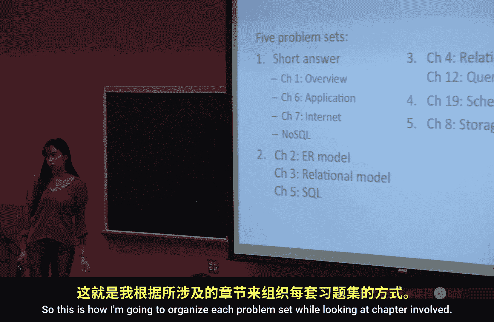
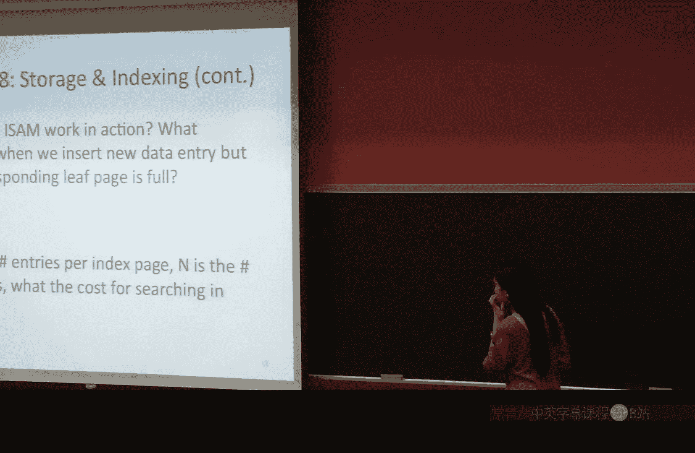
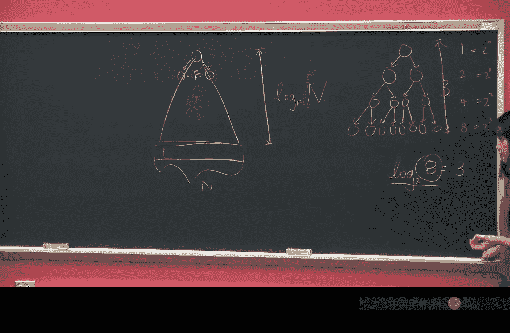
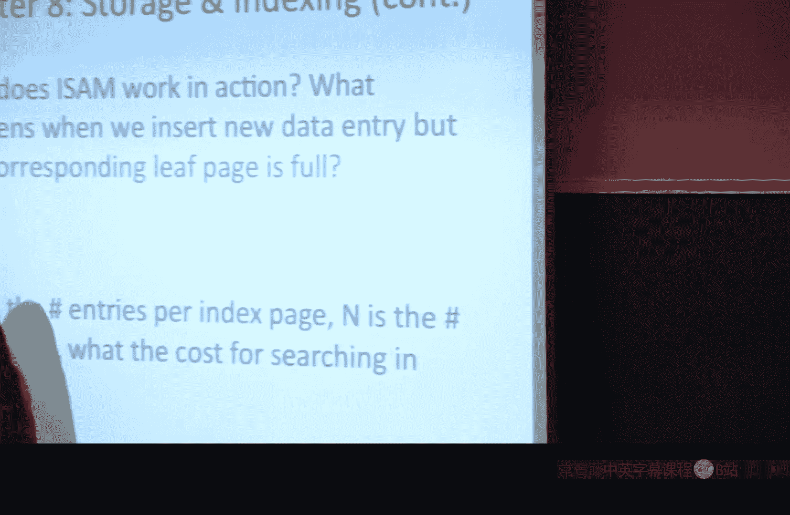

# 数据库管理系统：期末考试复习指南

在本节课中，我们将对数据库管理系统的核心知识点进行系统性的复习，涵盖从基础概念到高级索引技术的全部内容。我们将按照期末考试可能涉及的问题集结构，逐一梳理每个章节的重点。

## 问题集一：简答题（第1、6、7章及SQL基础）

上一节我们介绍了课程的整体结构，本节中我们来看看第一部分简答题的复习要点。这部分主要考察对基本术语、概念和不同技术之间比较的理解。

以下是第1章（引言与数据库概念）的核心考点：
*   **数据模型**：理解层次、网状和关系模型等经典数据模型。
*   **三层模式结构**：区分内模式、概念模式和外模式。
*   **数据独立性**：理解逻辑数据独立性和物理数据独立性的含义。

以下是第6章（中级SQL）的核心考点：
*   **完整性约束**：掌握`CHECK`、`NOT NULL`、`UNIQUE`等约束。
*   **触发器与存储过程**：
    *   **触发器**：由特定数据库事件（如`INSERT`, `UPDATE`, `DELETE`）自动执行的代码块。
    *   **存储过程**：可视为数据库中的函数，用于封装复杂的业务逻辑。
*   **授权**：理解`GRANT`和`REVOKE`语句在权限管理中的应用。

以下是第7章（高级SQL与应用开发）的核心考点：
*   **JDBC/ODBC**：理解数据库连接API的作用。
*   **有状态 vs 无状态**：
    *   **无状态协议**：如HTTP，每次请求独立。
    *   **有状态应用**：服务器端维护会话信息（如使用Cookie、Session）。
*   **数据表示格式**：区分`XML`（可扩展标记语言，用于结构化文档）和`JSON`（轻量级数据交换格式）。
*   **触发器的类型**：理解`BEFORE`、`AFTER`、`INSTEAD OF`等不同类型触发器的应用场景。

## 问题集二：ER模型与关系模型（第2、3、5章）

上一节我们回顾了基础概念，本节中我们来看看数据库设计核心——ER模型和关系模型的转换。

以下是ER模型（第2、3章）的绘图与概念要点：
*   **基本元素**：实体集用**矩形**表示，属性用**椭圆**表示。主键属性需**加下划线**。
*   **关系约束**：
    *   **键约束（映射基数）**：通过箭头表示。
        *   **一对一**：两端都画箭头。
        *   **一对多**：箭头指向“一”的那一端。
        *   **多对多**：两端都不画箭头。
    *   **参与约束**：用**粗线**表示全部参与（每个实体都必须参与关系）。
*   **弱实体集**：
    *   用**双线矩形**表示。
    *   通过**标识性关系**（双线菱形）依赖于**属主实体集**。
    *   其主键由属主实体集的主键加上自身的**部分键**（用虚线标出）共同构成。
*   **高级概念**：了解**特化/泛化**（三角形）和**聚合**（虚线框）的表示法。

以下是关系模型与SQL实现（第3、5章）的要点：
*   **从ER图到关系模式**：根据ER图创建对应的SQL表。
    *   通常每个实体集和“多对多”关系都需要单独的表。
    *   注意定义**外键**（`FOREIGN KEY ... REFERENCES ...`）。
*   **参照完整性操作**：理解对主表进行`DELETE`或`UPDATE`时，由于外键约束可能引发的拒绝、级联等操作。
*   **SQL查询（第5章）**：
    *   可能要求用不同方式（如使用集合运算符、嵌套查询、相关子查询等）编写同一查询。
    *   或根据给定的表和查询语句，推断查询结果。

## 问题集三：关系代数与查询求值（第4、12章）

上一节我们探讨了数据库设计，本节中我们来看看数据库查询的数学基础——关系代数及其执行计划。

以下是关系代数（第4章）的核心运算符：
*   **基本运算**：
    *   **选择 σ**：对应SQL中的`WHERE`子句，用于筛选行。公式：`σ_{predicate}(R)`
    *   **投影 π**：对应SQL中的`SELECT`子句，用于选择列。公式：`π_{A1,A2,...}(R)`
    *   **并 ∪、差 -、笛卡尔积 ×**
*   **连接运算**：包括等值连接、自然连接等。
*   **除运算 ÷**：用于处理“查询所有...”这类问题，例如“查找预订了所有船只的水手”。
*   **聚合运算 γ**：
    *   单参数：如`SUM`、`AVG`。
    *   带分组：使用`γ`运算符，对应SQL的`GROUP BY`。例如，按船只颜色分组计算水手平均评分：`γ_{color, AVG(rating)}(...)`

以下是查询求值（第12章）的要点：
*   **查询求值计划**：将关系代数表达式转化为具体的执行步骤树（关系代数树），并为每个节点选择具体的算法（如排序、哈希连接）。
*   **查询优化**：通过改变代数树的结构（如尽早执行选择σ和投影π操作）来减少中间结果大小，提升查询效率。

## 问题集四：模式求精与范式（第4章部分）

上一节我们讨论了查询的表示与执行，本节中我们来看看如何优化数据库结构本身——模式求精。

以下是函数依赖与范式的核心考点：
*   **函数依赖**：给定属性集间的推导关系。
*   **闭包计算**：计算给定函数依赖集下属性集的闭包。
*   **候选键**：能唯一标识元组的最小属性集。
*   **范式判断**：
    *   **BCNF**：每个函数依赖的决定因子都是超键。
    *   **3NF**：每个非主属性都非传递依赖于任何候选键。
*   **分解**：
    *   **无损连接分解**：分解后的关系通过自然连接能无损地恢复原关系。
    *   **依赖保持分解**：分解后的函数依赖集能逻辑蕴含原所有依赖。

## 问题集五：存储与索引（第8章）

上一节我们学习了如何设计好的模式，本节中我们来看看如何高效地存储和访问数据——存储结构与索引技术。

以下是文件组织与索引基础：
*   **记录组织**：堆文件、排序文件等。
*   **索引条目替代方案**：
    *   **方案1**：索引条目直接包含数据记录。
    *   **方案2**：索引条目包含`<键值， 记录ID>`对。
    *   **方案3**：索引条目包含`<键值， 记录ID列表>`对。
*   **索引分类**：
    *   **聚簇索引**：数据记录的物理顺序与键值顺序基本一致。
    *   **非聚簇索引**：数据记录物理顺序与键值顺序无关。
*   **索引类型选择**：
    *   **等值查询**：哈希索引通常更高效。
    *   **范围查询**：B+树等树型索引更优。

以下是树型索引结构详解：
*   **ISAM索引**：静态树结构，创建后不变。插入可能导致叶子页溢出，形成长溢出链，降低查询效率。
*   **B+树索引**：动态平衡树，通过分裂、合并节点保持结构平衡，保证高效的搜索性能。
*   **树结构搜索成本**：与树高`h`成正比。对于有`N`个叶子页、扇出为`f`的B+树，树高近似为 `h ≈ log_f(N)`。

以下是索引设计应用题：
*   给定一个SQL查询（如：`SELECT dept, AVG(sal) FROM Emp GROUP BY dept HAVING AVG(sal) > 50`），设计合适的索引。
*   考虑创建**覆盖索引**（索引包含查询所需的所有列），以避免回表访问。
*   对于带`GROUP BY`和`HAVING`的查询，索引应包含分组列和聚合计算涉及的列。

---

在本节课中，我们一起系统复习了数据库管理系统的核心内容，涵盖了从数据模型、ER设计、SQL查询、关系代数、模式范式到存储索引的完整知识体系。请重点理解各章节的核心概念与联系，并熟练运用关系代数和SQL解决查询问题。祝大家期末考试顺利！