# Python超全入门教程-p01-P01-Start-coding-with-PYTHON-in-5-minutes--BV1fcdLYXEw9_p1-

So I say we just jump right in。 There's two things we'll need to download。

 The first is a Python interpreter to convert our written code to machine code。

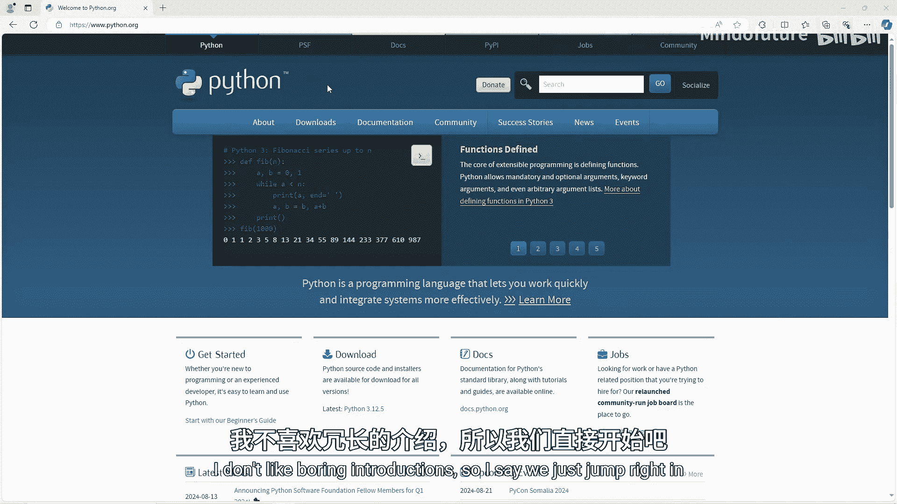

We're going to head to Python。org。

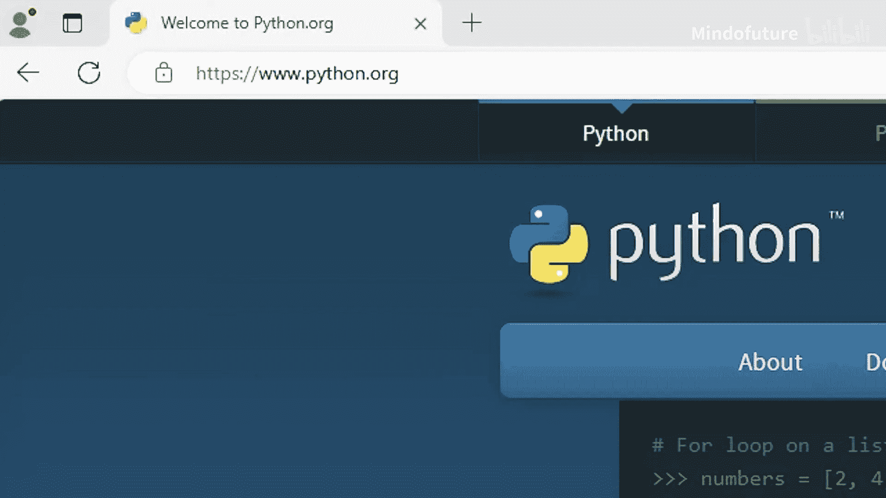

Go to downloads。And download the latest version。We will open this executable。If you're on Windows。

 you'll want to check this checkbox， add Python EXE to Path。And we will install now。

The setup was successful， and that's all you need to do to download the Python interpreter。

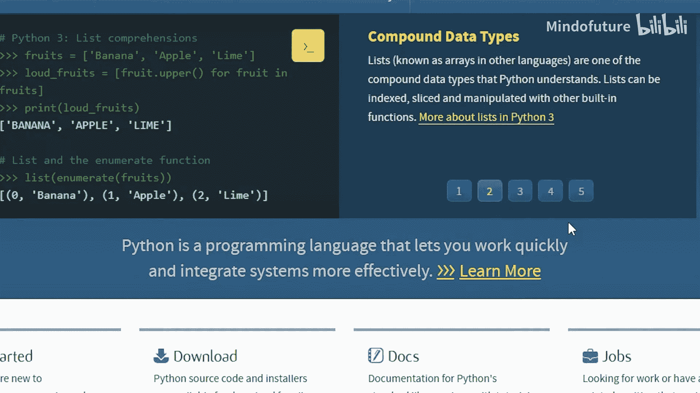

The second download we'll need is an IdeE， an integrated development environment。

 Basically a place where we can write code for IDdes。

 there's two popular choices when writing Python code。 Pycharm and Vs code。

 If you already use VS code， you can stick with that， just be sure to download the Python extension。

 I find Py charmm more beginner friendly。 If you've never coded before。

 If you would like to use Pycharm， go to jetbrains do com slash Pychar。

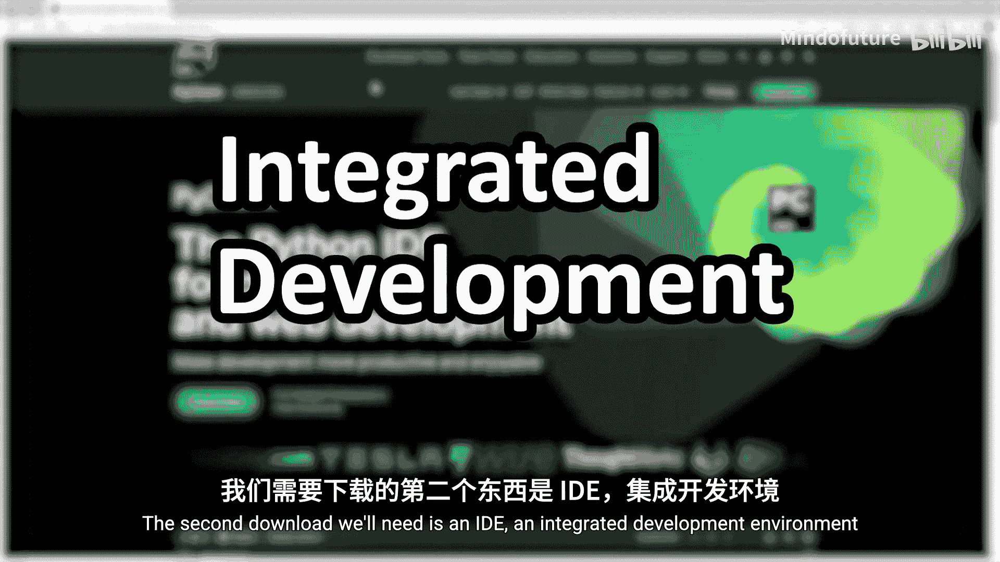

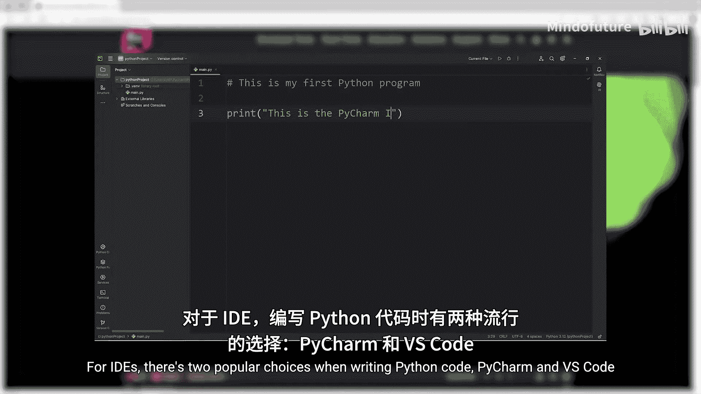

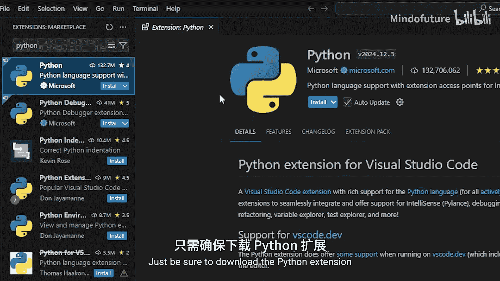

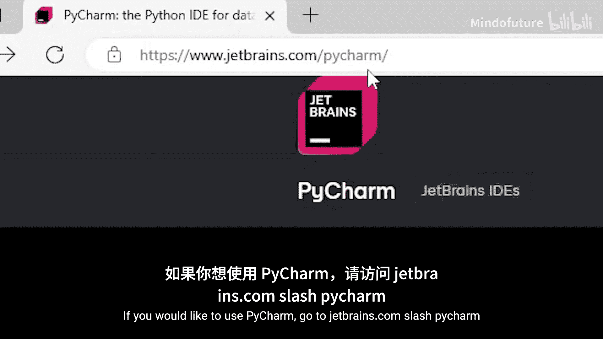

And we will click the green download button。

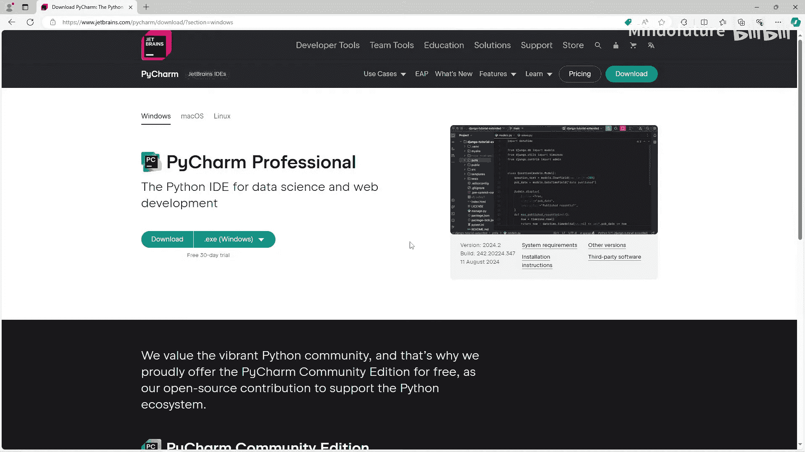

There's two versions of pie charm， the professional version and the community version。

 The professional version is paid for。 I would not recommend using it only because there's plenty of free Ides on the market。

 We'll use the community edition， The free one， because I don't like to pay for things。

 And I'm sure you don't either。

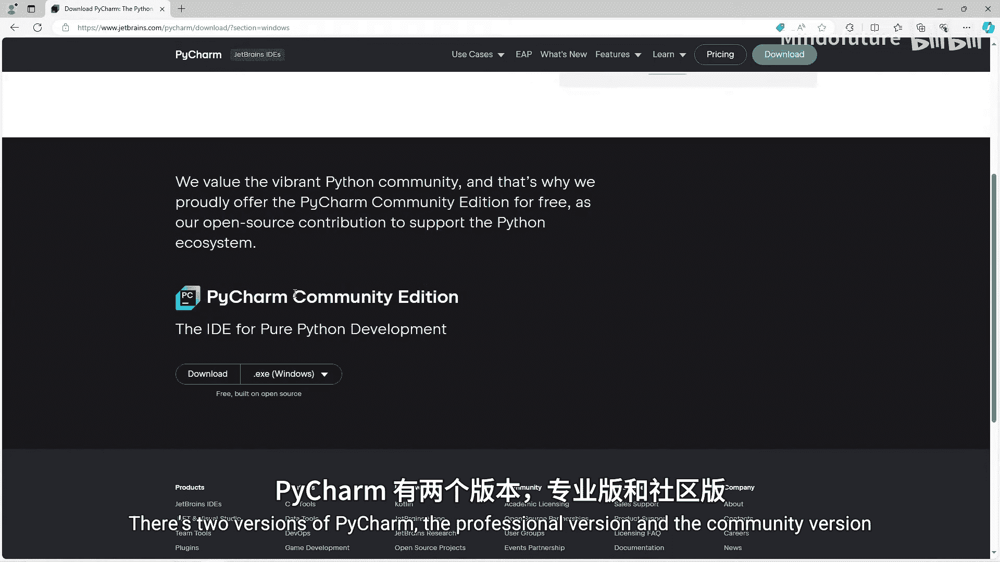

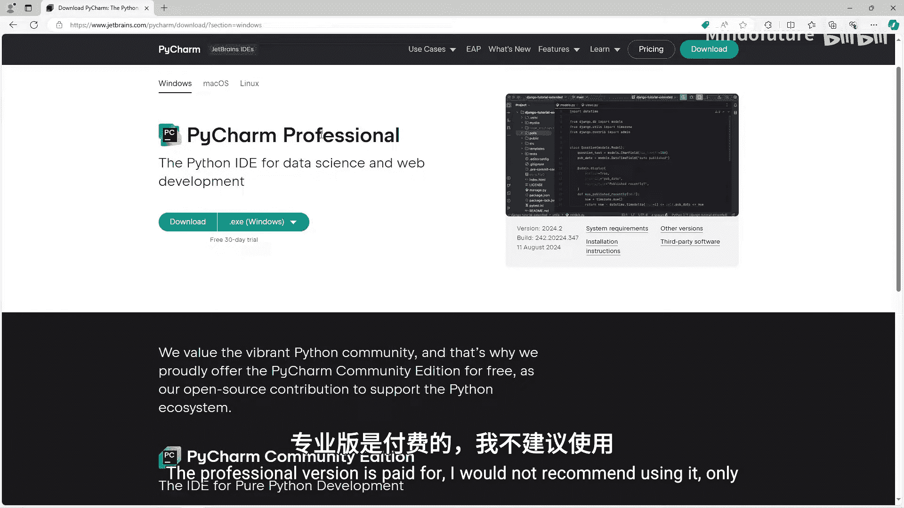

Select the correct download for your operating system， I'm running Windows， I will download P Char。

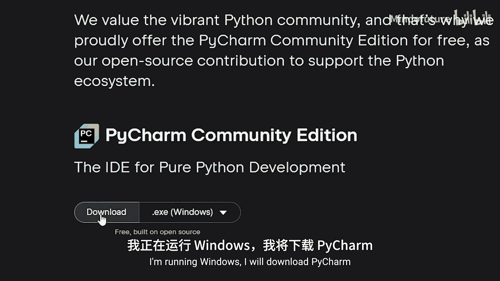

We will open this executable。

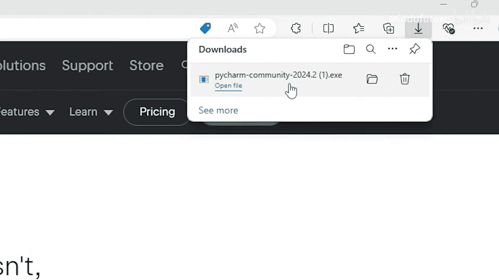

Click next。You could select a destination folder。 I'll keep it as is， next。

I'll create a desktop shortcut。But you don't necessarily need to。Click next。Install。

And we'll just have to give it a moment。Okay， the setup is now complete。

I'll check this checkbox to run pie charm when we close this window。

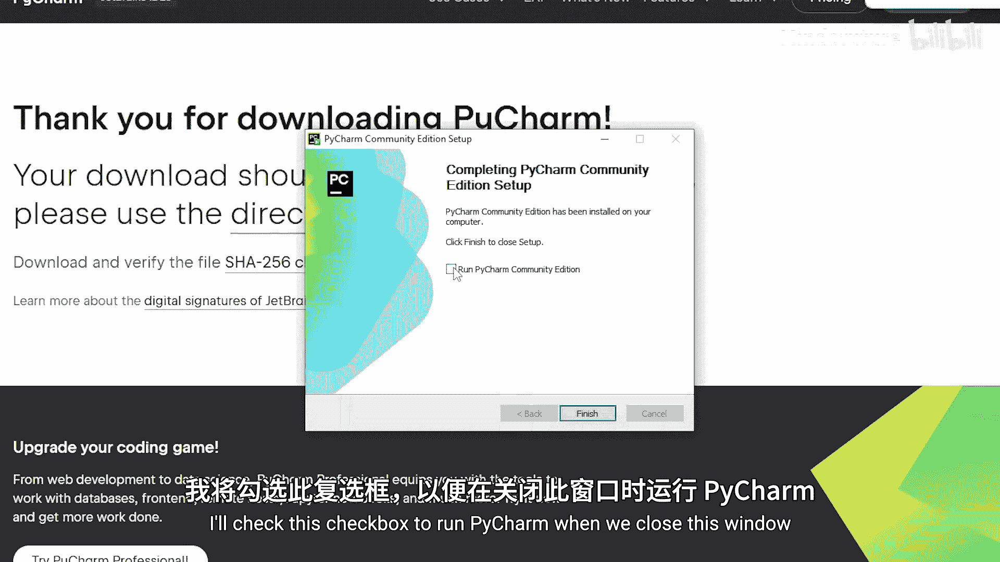

After opening pie charm， we're going to create a new project。You can rename your Python project。

 I'll keep it as is。You can select your location again。 I won't change that。

 You can create a sample welcome script， but for this tutorial， we won't。

 Let's select the latest Python version。And create our new project。In the menu to the left。

 we're going to create a new Python file file， new Python file。😡，Let's name this file Main。😡。

But really， you can name it anything。And select Python file。

Python files end with the Py file extension。We should have our main Python file within our Python project folder。

Now we're going to print something to the console window。Within our main Python file。

 we're going to write a print statement。 So type print。

 add a set of parentheses between the set of parentheses。

 We will add a set of double quotes to print something or single quotes， either one。

My own preference is double quotes。Normally in a programming tutorial。

 the instructor would tell you to print something such as hellello world。

 but we like to be different here。Instead， think of your favorite food。In this case， I like pizza。

 I will print。 I like pizza。To run our Python program。We will click the screen arrow。

To run our main Python file。We should have a console window that displays our output。

 I like pizza or whatever your favorite food is。Let's print another line of code。Let's print。

It's really good。By adding a second print statement， we are printing a second line of code。

Now we'll discuss comments。The Python interpreter doesn't output comments。To write a comment。

 you use a pound sign， I like to call this a hashtag。My comment will be。

 this is my first Python program。Comments are used as notes for yourself or for other people reading this code。

If I were to run this code again， this comment is not displayed to the output。We still have。

 I like pizza， it's really good。Al right， everybody。

 so that is your very first Python program and in the next topic， we'll discuss variables。

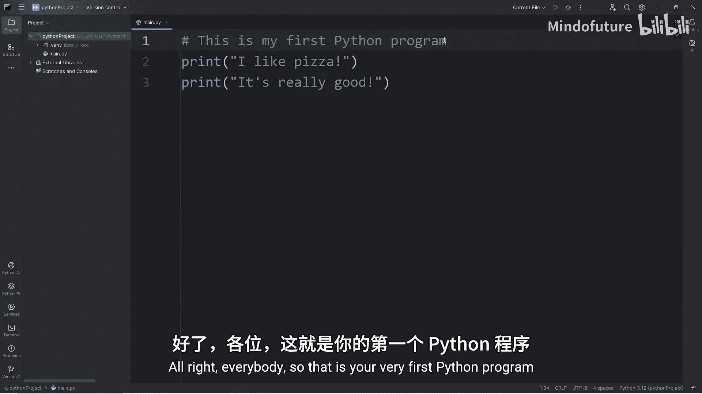