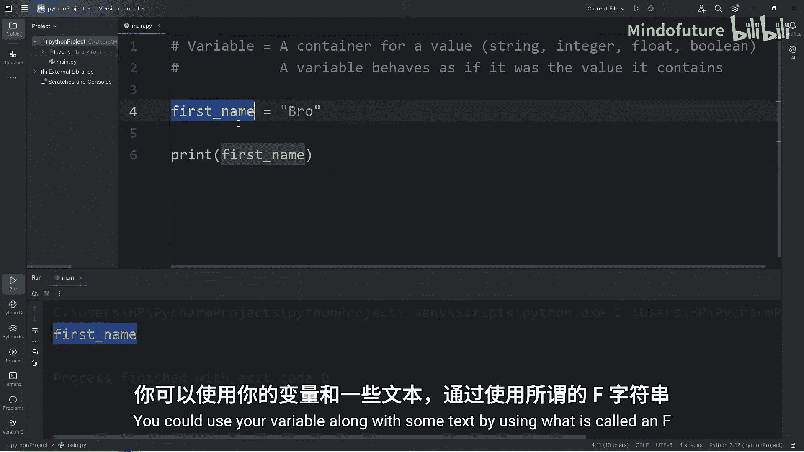
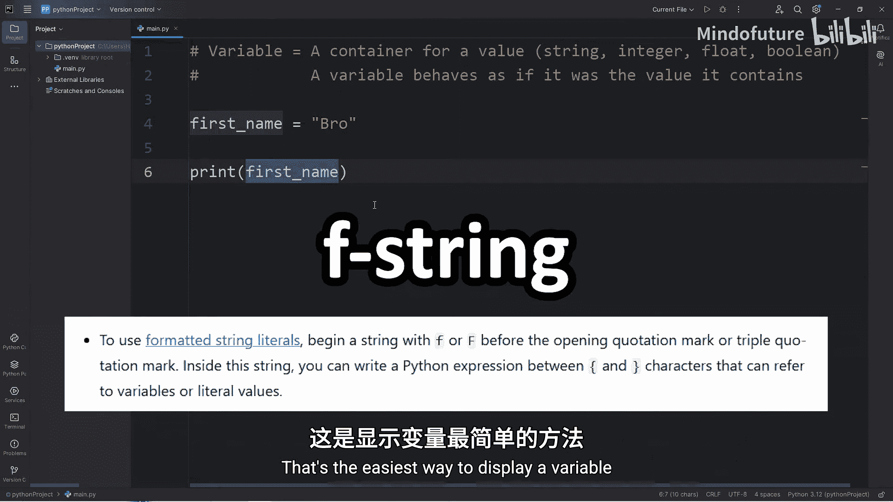
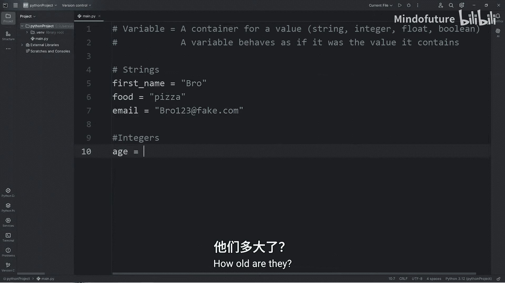
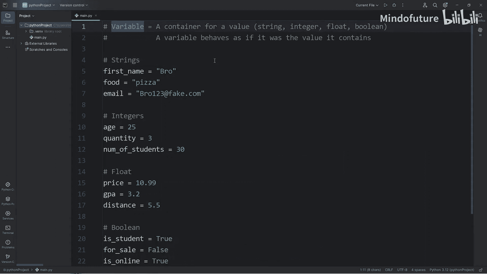

# Python超全入门教程-p02-P02-Learn-Python-VARIABLES-in-10-minutes--BV1fcdLYXEw9_p2-

Al right， everybody。 We are moving on to variables。 A variable is a container for a value。

 There's four different data types we'll discuss strings， integers， floats and Booleions。 Yes。

 I know。 That's a silly name。 A variable behaves as if it was the value it contains。

 Each variable should have a unique name。 Let's say we have a variable of first name。

To assign a variable， you use the assignment operator of equals for text。

 a string is a series of text。 This can be double quotes or single quotes。

 My own preference is double quotes。Why don't you type in your first name？This variable。

 a first name， will behave as if it was this value， the series of characters。So to demonstrate this。

 I'm going to print my first name variable。So place it within a print statement without quotes。

That will print your first name。Now you don't want this within quotes。

Because then you're literally printing the word first name。

You could use your variable along with some text by using what is called an F string。

That's the easiest way to display a variable。 So you type F， then a set of quotes。

The F means format。So let's say the word， hello， Then we will add our variable。

 We will insert our variable into this text when using an F string to do that。

 You need a set of curly braces。Then insert your variable。So the result is， hello。

 whatever your first name is， in my case， bro。Let's create another variable。

Let's say we have a variable of food。Food equals， think of your favorite food。For me。

 I will type pizza。Let's print the following。You like add a placeholder again。

 I'm using enough string。Our variable of food。Hello， bro， you like pizza。Let's create an email。

Use your own email or make one。 let's say my email is bro12，3@ fakeake。com。

Then let's print our email。Your email is at a placeholder， display our email variable。

Your email is bro 1，2，3 at fake dot com。So these are strings。

I'm going to add a comment that these are strings。A string is a series of characters。

 They can include numbers， but we treat them as characters。Now we have integers。

An integer is a whole number。An example of this could be somebody's age。 How old are they。

 According to my YouTube statistics， Many of you are between the ages of 18 through 24。

 Let's say that I'm 25。

Let me zoom in a little。 Your integer should not be within quotes。Because it would be a string then。

 technically。If I would like to work with this variable。Again， I'll use enough string。

 Let's say you are at a placeholder。Display our age variable。Years old。You are 25 years old。

Another example of an integer could be a quantity。You are buying a certain amount of something。

Maybe I am buying three items。I wouldn't have half an item。 This would be a float technically。

 rather than an integer。We are buying three of something。So let's print the following。You are buying。

Add a placeholder。Display our quantity。Items。You are 25 years old。You are buying three items。

Another example of an integer could be an amount of people。

Let's say numb of students like a classroom。There are 30 students in our class。Then， we will print。

Your class has at a placeholder。Students。We will display the number of students， nu of students。

Your class has 30 students。Those are integers， they're whole numbers。 And again。

 make sure they're not within quotes because then technically， they would be a string。

Integers we can use in arithmetic expressions if they were strings， we couldn't。Then we have floats。

 Float means floating point number。A float is a number， but it contains a decimal portion。

 An example would be a price。 What is the price of something。1099。Let's print our price print。

 I'll use an F string。The price is at a placeholder， display our price。The price is 1099。

Let's precede our placeholder with a unit of currency。 I'll pick American dollars。

 but feel free to pick something else。The price is $10。99。So floats contain a decimal portion。

 What about a grade point average GP。Let's say my GP is 3。2。Then I will print。Your GP is。

Display our GP。Your GP is 3。2。What about a distance？A distance can contain a decimal portion。5。5 km。

 maybe。Then I will print。You ran。Add a placeholder， display our distance。 Then I'll add K M 4 km。

 or you could add M for miles， but I'll stick with kilometers。You ran 5。5 km。Okay。

 then we have Booles。 a Boolean is either true or false。Let's say we're a student。Is student equals。

 If we are a student， we could say that this is true。True starts with a capital T。

 If we weren't a student， let's say we graduate。We could say that this is false。Again。

 the first letter is capital。 Booleions only have two options， true or false。

 So let's say that I am a student。Then， I will print。Are you a student。

Then we will display our Boolean value of is student。Are you a student， that is true。

With Boolean values， we really don't output them directly。

 You're more likely to see them used internally within a program， such as when working with。

 if statements， this is a topic we'll discuss in the future。 So don't worry， you may see if。

Is student， if this variable is true， then we will print the following。Now。

 we don't need to use enough string。 We're not going to insert any variables。You are a student。

If this were false， we can add an else clause。Where we will print。You are not a student。

Our variable of is student is true。We will print the if statement。You are a student。

 If this were false， we will print whatever is within else。You are not a student。

Let's think of a few more examples。Is something for sale。Like a car or a product of some sort。

Let's say that is true。I'll write another if statement， if， for sale。If this variable contains true。

 we will do the following。Let's print。That item is for sale。Else， if it's false。

 we will print something else。That item is。Not available。For sale is set to true。

This variable is true。 We will print That item is for sale else， if it were false。

We print that item is not available。One more example。

 let's say we have a Boolean variable of is online， is somebody online， I will set that to true。

If is online。If that's true， we will print。 You are online。Ese， we will print。You are offline。

Is online is set to true。We will print。 You are online else， if it were false， we print your offline。

At everybody。 So those are variables。 A variable is a reusable container for a value。

 There's four basic data types for beginners。 A string， which is a series of text integers。

 which are whole numbers， floats， which are numbers， but they contain a decimal portion。

 and Booleions， which are either true or false。 They're binary。

 Your assignment in the comments section， is to post four variables。 post a string and integer。

 a float and a boolean。 Try and think of a unique example， if you can。 And while， everybody。

 those are variables in Python。😊。

