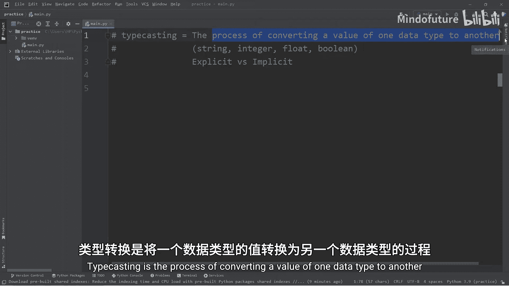
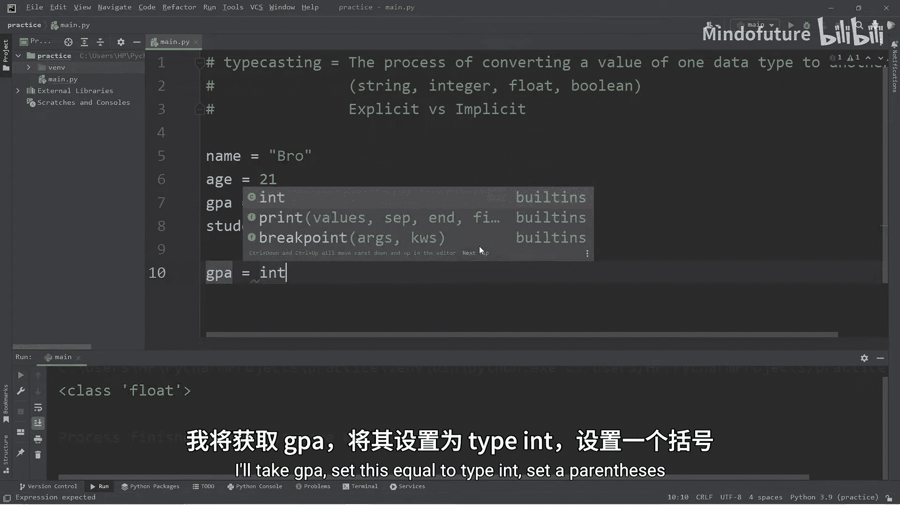
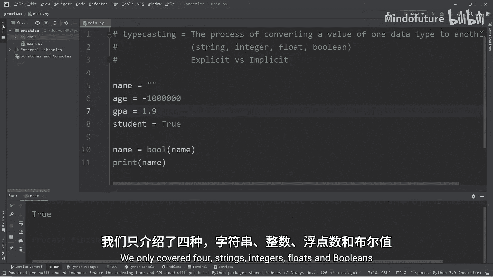
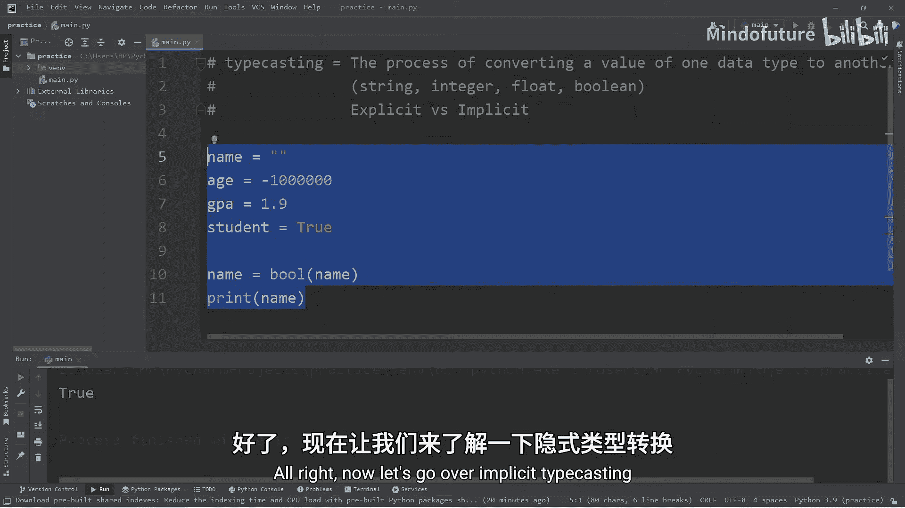
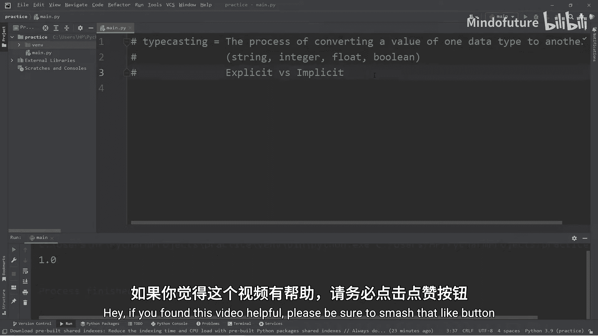

# Python超全入门教程-p03-P03-Type-casting-in-Python-is-easy--BV1fcdLYXEw9_p3-

All right， Welcome back， everybody。 In this topic， I'm going to explain typecasting。

 Tycasting is the process of converting a value of one data type to another。

 We can convert integers to floats， Fats to integers， strings to booles， Booles to strings。

 floats to strings， strings to integers， integers to booleions。 I think you get the idea。

 Why might you want to use typecasting。 When we get to the lesson on accepting user input。

 the user input is always a string。 If somebody were to type in a number。

 and we need to perform math involving that number。

 We would want to convert it to either an integer or a float。

 Another example is that if we had a floating point number。

 and we need to round that number to an integer。 One possible way is to cast it as an integer。

 we can truncate the decimal portion。 There are two different ways we can do this。 explicitly。

 and implicit， let's cover some explicit typecasting。 I have four variables。 We need a string。

 let's say a name， type in your first name。😊。

Age， that's good。Float， how about a grade point average g for short。My GP will be a solid1。9。

 Then we'll need a boolean。 What about student， Are we a student， If we're a student。

 that would be true， If not， that would be false。 Here's four variables of the four basic data types。

 We have a string。An integer， a float and a boolean。 If you ever need the data type of a variable。

 you can use the built in type function。 type the word type followed by a set of parentheses。

 place a variable within the set of parentheses。 However， when I run this， we can't see anything。

 So we need to place this statement within a print statement。

I'm going to type a print add a set of parentheses。We will cut this line of code。

And paste it within the print statement。So we are printing the type of my variable name。

And that is STR， which means it's a string。 Let's do that with age， GP and student。

 just so you're more familiar with using the type function。We have age。GPA。And student。Here we are。

 Python says the data type of name is a string， SR。Age is an integer。 I N T means integer。

GPA is a float。Then student is bo， which means boolean。

 Let's do some explicit conversion for practice。 I need to convert my variable age into a floating point number。

 I could take my variable age。 I could reassign this a value by using equals。

 Then I will explicitly cast age into a float by typing float a set of preheses。

 Add my variable to be typecast within the set of preheses。😊。

Then let's print whatever age currently is。 Look at that。 age is now 21。0。

 You can tell it's afloat because it has a decimal portion。

 If I were to use that type function again， we can see what the data type of age is now。

And my variable age is a floating point number。 That's how to cast a value as a float。

 You type float， add a set of parentheses， place your value or variable within that set of parentheses。

 Then you may need to reassign it to something Here。 We're just reassigning our variable age。

 We know how to convert a value to a float。 Let's try an integer。 I'll convert my GP into an integer。

 I'll take GP said this equal to type int set of parentheses。

 place my variable within the parentheses。

Then I will print whatever my GP is。My GP is now one。 So an integer， it's a whole number。

 We can't contain that decimal portion。 So it's truncated。

 That's how to convert a value into an integer。Let's convert a value into a string。

 How about this Boolean。So student。Equals to convert a value or variable into a string type ST R add a set of parentheses。

 place your value or variable within that set of parentheses。

Then let's print whatever our variable is after we reassign it。So student still says true。

 It appears the same as it did before， but now it's treated as a series of characters rather than a booleion。

 just to prove to you that student is a string。 Let's use the type function and surround our student variable when we print it。

Student is now a string， so to convert a value or variable into a string。

 you can use the built in string function， just type STR set aheses， add your value or variable boom。

 there you go。All right。 Lastly， we can convert a value or variable into a boolean。

 So a boolean can only be true or false。 What if we were to convert a number into a boolean。

 What would happen， So let's take age equals to cast the value or variable into a boolean。

 You type bo said of parentheses。 Add your value or variable。

 I'll place age within the set of parentheses。Then let's print whatever age is。

 Do you think the result is going to be true or false？

It's actually true when converting a number to a booleion， If that number is anything but 0。

 it will always be true。 Let's say ages like a million。 Well， it's still going to be true。

 What about negative 1 million。That is still true。But if age were0。Then it's false。

 Why would casting something as a boolean be useful。

 Let's say that we ask a user to enter in their name。

 I need to check to see if they entered in something。 Let's type cast my name as a Boolean。

That is true。 But if this was an empty string。That would be false。Even a space registers as true。

 Like I said， we could use typecasting to check to see if somebody typed in their name or not。

 if we cast the name as a boolean and it's true， that means they typed in something。

 We'll have more practice with that later。 That is explicit type casting。

 All explicit type casting is， is manually converting a value or variable into a different data type by using one of these cast keywords。

 We only covered4 strings， integers floats in Booleions。 All right。

 now let's go over implicit type casting。 implicit type casting is when a value or variable is converted into a different data type automatically。

 For example， let's say we have x X equals 2。 Then we have Y Y equals。 How about 2。0。

 What if I were to reassign X and set X equal to X divided by Y。 Well。

 we're dividing an integer by a float。 So what's the result going to be is x going to be an integer。

Or af float。So let's print whatever X is。X is now afloat。

 even though we assigned it to be an integer originally， a whole number。

 So that's implicit typecasting。 A variables data type can be converted when you perform certain operations on it。

 such as arithmetic expressions like this。 All right， everybody。 So that is typecasting。

 It's the process of converting a value of one data type to another。

 You can convert strings to integers， integers to floats floats to Booles， Booles to strings。

 Any combination of those。 And there's still more data types we didn't cover。

 But that's the general idea。 So that is typecasting。 Hey， if you found this video helpful。

 please be sure to smash that like button， leave a random comment down below and subscribe if you'd like to become a fellow bro。

😊。

