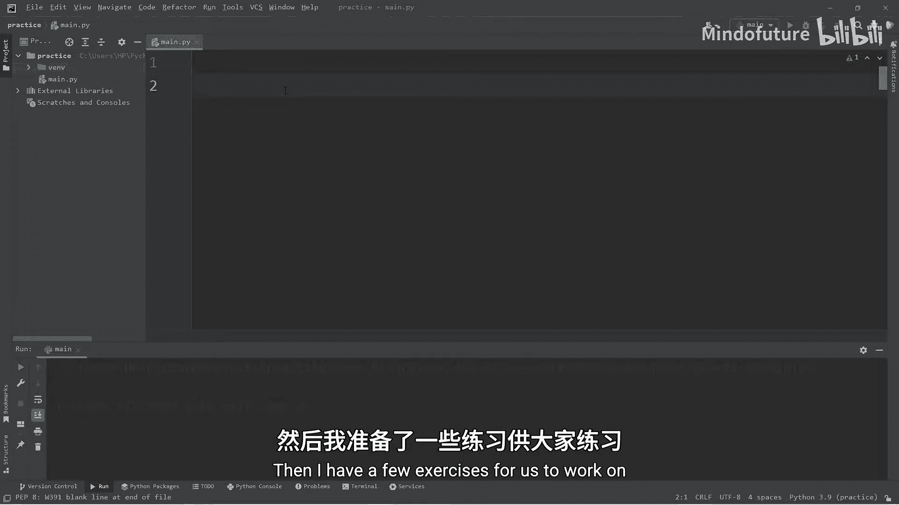
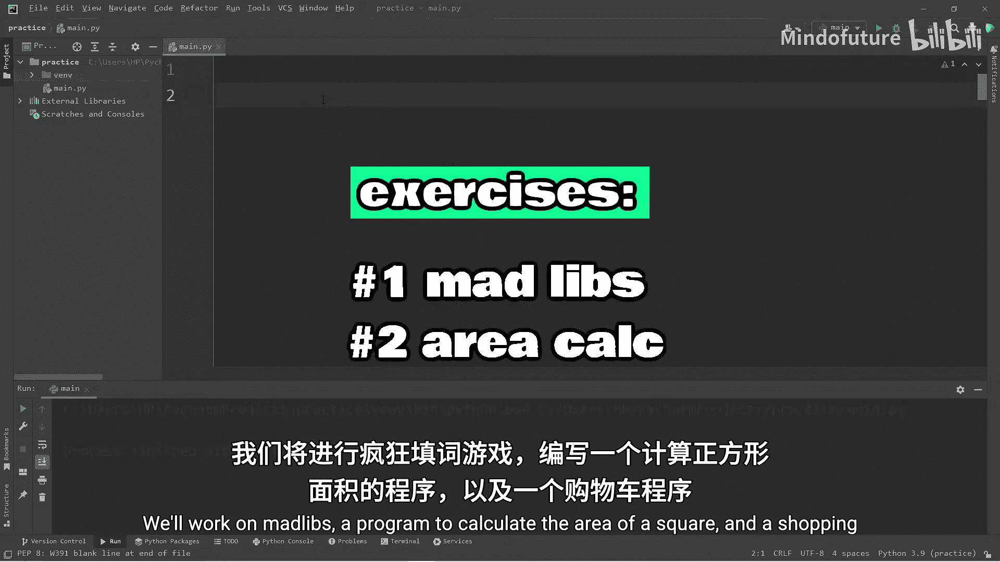
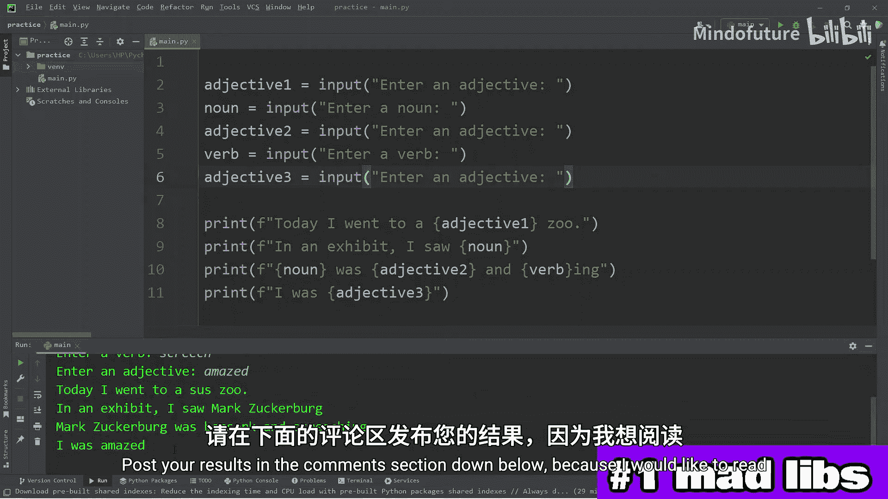
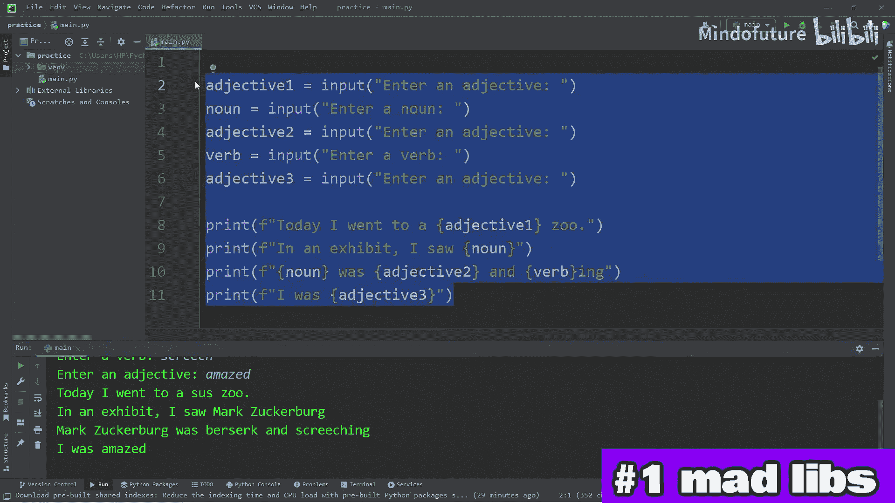
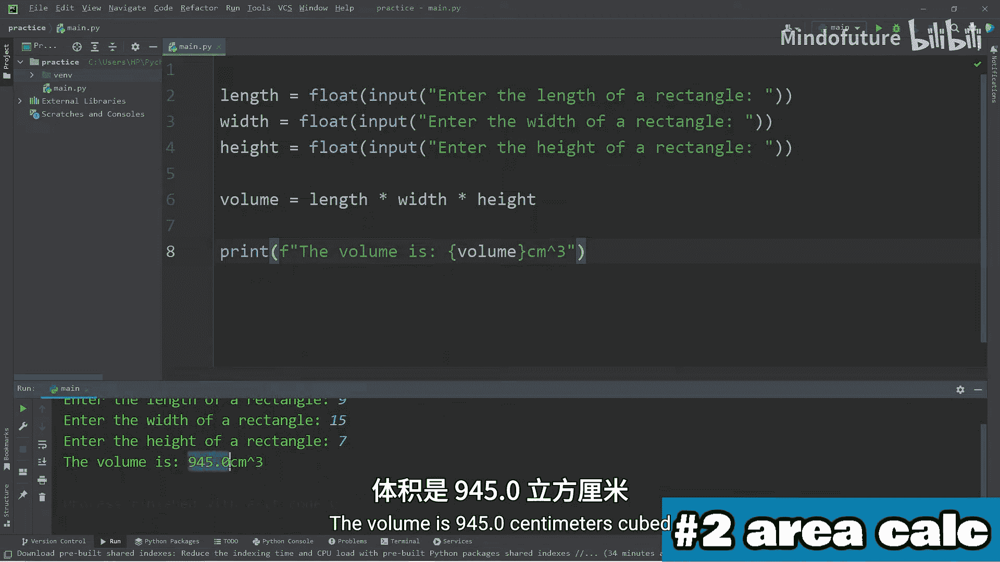
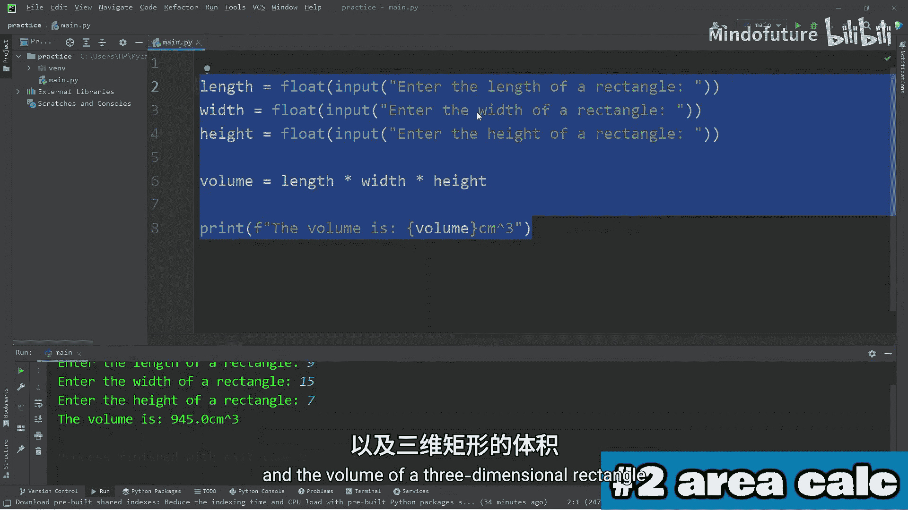
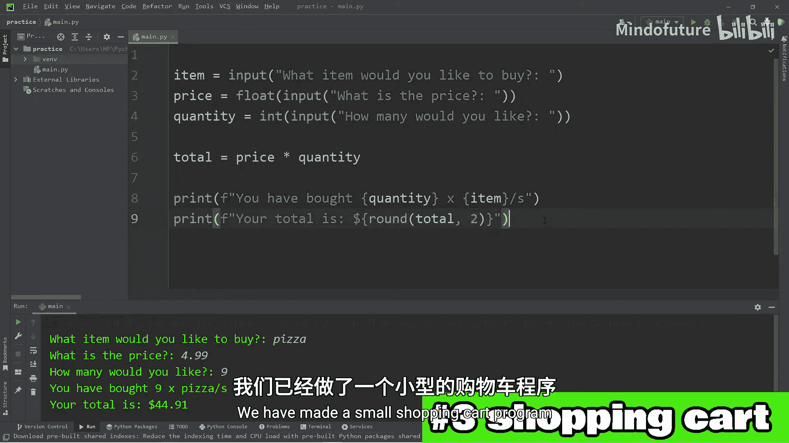

# Python超全入门教程-p04-P04-User-input-in-Python-is-easy-+-exercises--BV1fcdLYXEw9_p4-

Hey，Every， in this topic， I'm going to show you how we can accept some user input。

 Then I have a few exercises for us to work on。 We'll work on madlibs。

 a program to calculate the area of a square and a shopping cart program。

 How do we accept user input。 Well， we do so within our console window down here。

 The same that we use for output。 to accept some user input。

 We can use the input function within the set of parentheses。

 We can type a prompt to be displayed to the console window Let's ask for somebody's name。😊。

Enter your name。When I run this program， our program is paused in the console window until we type in something and hit enter。

I'll enter my name。 You can enter in your own name。 Get enter， but nothing appears to happen。

 We've accepted user input， but we should probably store the input somewhere。

 How about inside of a variable。I'll assign my variable name equal to the input that we receive。

 Our input will be stored within this variable， and then we can use it for something。

So let's print whatever our name is within a message。 I'll use an F string。Hello。Our variable name。

 Let's try this again。And to your name， I'll type in my first name。 Hi enter。 Ho， bro。

 Let's ask for somebody's age this time。Will'll create variable age。Said the sequel to input。

 then we'll need a prompt。Enter your age。Then， we will print。Using an F string。

 you are our variable age years old。And to your name， I'll type in my first name。 and to your age。

 I'll make up an age。Hello， bro， you are 21 years old。 When we accept user input。

 the input is always of the string data type。 What if I were to increase my variable age by one。

Age equals age plus 1。This is what would happen。Brow 21。

 we have a type error can only concatenate strings， not integers， to strings。

 If I accept user input and I need to use it for any sort of math。

 I would want to type cast that input as either an integer or a float based on the previous lesson on type casting。

 we could write age equals。 I'll type cast my age， which is a string into an integer。

So type in your first name and age。And that appears to work。 However。

 I like to do this involving one line of code in place of adding an additional line where we're type casting。

 I'll take the user input and place this function within a typecast。 I'll type int。

 then surround the input function with the set app parentheses。

 Then that only takes one line of code。 So bro 21。 There we go。 That also works。

If we were to type cast our input as a float。Well， then my input would be a floating point number。

 It has that decimal portion。 So when you accept user input， it's always of the string data type。

 If you're going to use your input with any sort of math。

 you'll probably want to type cast it as either a float or an integer。

 And that's how to accept user input。 Let's go over a few exercises。

 The first will create a madlibs game。Al right， everybody， for our first practice program。

 we're going to create a madlibbs game。 Madlibs is where you have a story。

 but the user gets to submit nouns， verbs and adjectives within your story。

 So let's think of a story。 Feel free to come up with your own。 I'll use F strings。😊，Today。

 I went to a Well insert an adjective here。An adjective is a quality of a thing。Zo。

So what kind of zoo， an expensive zoo， a cheap zoo。A dirty zoo， a clean zoo。 That's an adjective。

 It's a quality of a noun。Our second line。Let's say， is。In an exhibit。I saw。Then a noun。

 a noun is a person placer thing。A noun。Was。Then， an adjective。And。A verb。 A verb is an action。

 I would like two different adjectives。 Let's rename this first adjective as adjective 1。

 The second adjective will be adjective 2。 After our verb， I'll add I N G。

 That means that this verb is current tense。 It's currently happening。Print。

This will be an up string。 I was。Then let's add a third adjective， adjective 3。

We just need to declare and assign these variables。We have adjective 1。Are noun。Adjective2。Our verb。

Then adjective 3。We'll accept user input input。Will'll ask the user to enter。An adjective。

Let's copy this line， add that to adjective 2 and adjective 3。For noun。Will input。Enter a noun。

Our verb will be enter。A verb。All right， we're ready to run our Madlibs game。

An adjective describes a quality of a person placer thing like vast， slow。 What about suspicious。

 or I'll just say a suss for short。Enter a noown。Mark。Zuckerberg， a noun is a person placer thing。

Enter an adjective。Berk。Enter a verb， a verb is an action。 How about screech。Enter an adjective。

 amazed。All right。 here's our story。To day， I went to a Suss zoo in an exhibit。

 I saw Mark Zuckerberg。 Mark Zuckerberg was Brserk and screeching。 I was amazed。😊，All right。

 that is our first exercise。I'd like to see what you wrote。

 post your results in the comments section down below because I would like to read it。

All right， let's move on to the second exercise。

For this next exercise， we will calculate the area of a rectangle。Will need two variables。

 length and width。Will take length equal to， accept some user input。Enter the length of a rectangle。

Then， we'll need the width。With enter the width of a rectangle。We will take our area variable。

 set this equal to length， times width。Then let's display whatever the area is。The area。Is。

Cool in space。 I'll insert our area variable。 depending on the unit of measurement。

 you can set this2 inches， cent or something else。 I'll just say cent。

 I believe that cent squared technically。 Okay， let's try it。 The length will be 9。 The width is 15。

 We have a problem。 Ty error can't multiply sequence by non integers of type string。

 What we're missing here is we need to type cast our user input as either a floating point number or an integer。

 We're using these variables in arithmetic equations。

 So let's type cast our length in our width as a floating point number。Then let's try this again。

Enter the length of a rectangle，9，15。The area is 135 cm squared。 Hey， if this were a 3D rectangle。

 we could add pipe。Height equals， I'm going to copy all this。Enter the height of a rectangle。

Volume equals length times width times height。Volume is。Our volume centm cubed technically。9。15。

Seven， I'm just making up numbers here。The volume is 945。0 cm cubed。 All right。

 so that is the second exercise We have calculated， well。

 I guess both the area of a rectangle and the volume of a three dimensional rectangle。

Okay， we have one more exercise， a shopping cart program。We have three variables， item。

A price of the item。Then， a quantity。Will ask the user what item they're buying。Input。

What item would you like to buy。Then， a price。Input。What is the price。Then a quantity。Andput。

How many would you like。If we're working with the string， we don't need to do any type casting。

A price with a price that could include a deciim bowl。

 We should type cast our input as a floating point number。

I'll surround our input with a type cast to a float。 And with a quantity。

 those are typically integers。 their whole numbers。 I'll type cast our input as an integer。

So surround our input with an int cast。Then we can do some calculations。Total。Equals。

Our price multiplied by our quantity。Then we'll display a message to the user。

Print will use an up string。You have。But。Our quantity variable。Times。

Whatever the item is that we're trying to buy。It'll add slash S。

Because they might buy more than one item。Then will display the total。Your total is colon space。Then。

 our total。I should probably precede the total with some currency。 may be a dollar sign。Okay。

 let's run this program。What item would you like to buy， I would like to buy a pizza。

What is the price。Maybe a pizza is 4。99。How many would you like to buy， I would like to buy9 pizzas。

All right。 here's the total $44。91。We can truncate everything up to two decimal places。

And here's how there is a built in round function。I'm going to surround our total within a round function。

Then after our variable， I'll add comma than the amount of decimal places to round 2。

 Let's try this again。 What item would you like to buy。A pizza。The price is $4。99。

 How many would you like to buy？ I'd like 9 pizzas。 Your total is $44。91。Like I said。

 to trunnccate everything after two decimal places， you could use the built and round function。

 Then set the amount of decimal places you would like to round to。 All right， everybody。

 That is the third exercise。 We have made a small shopping cart program。

