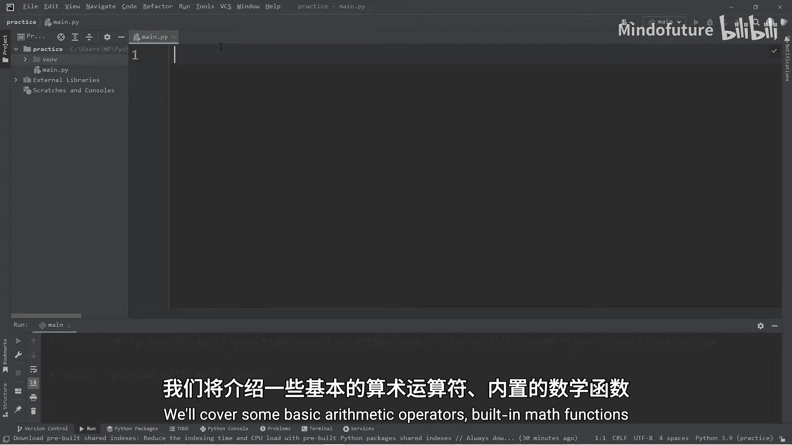
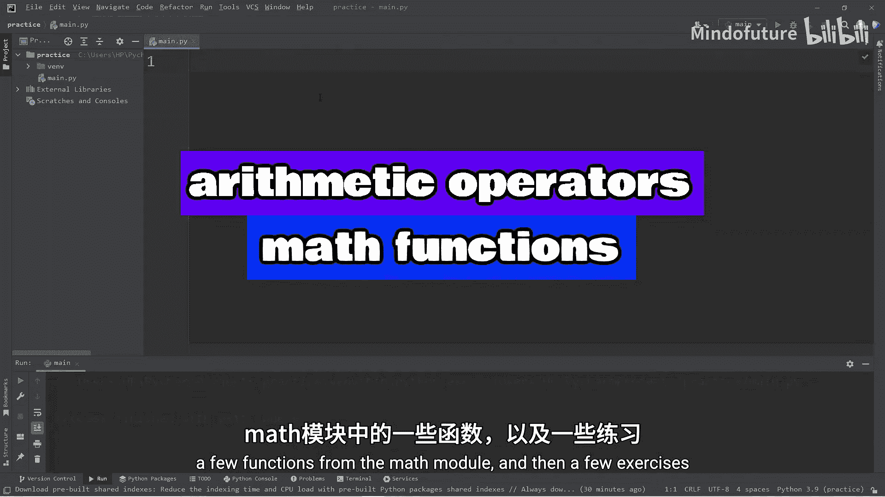
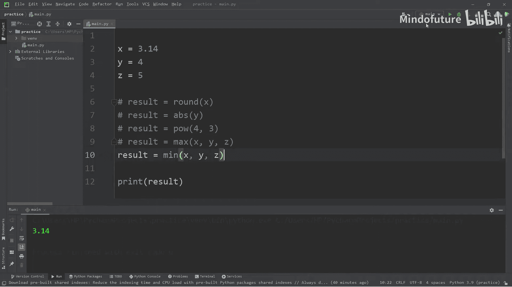
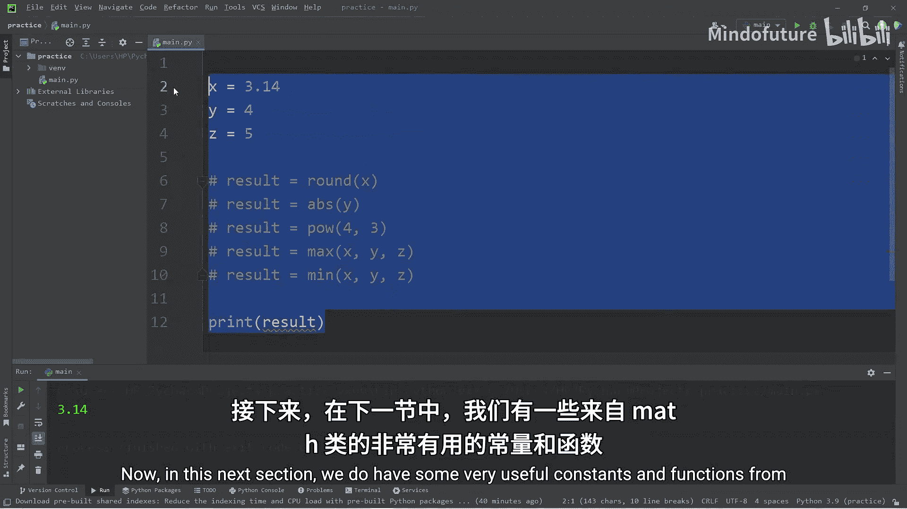
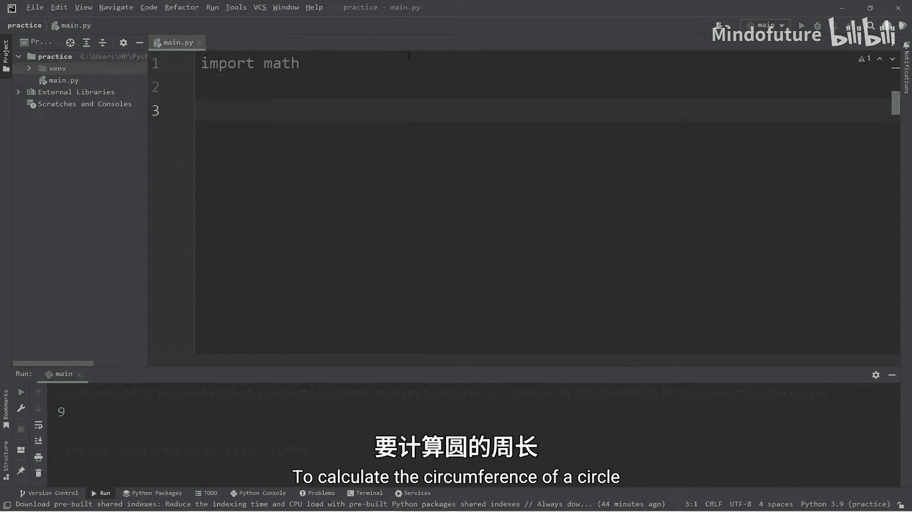
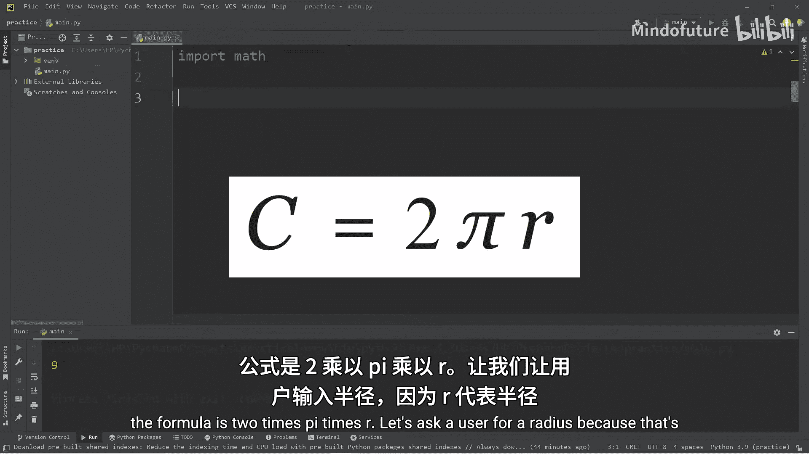
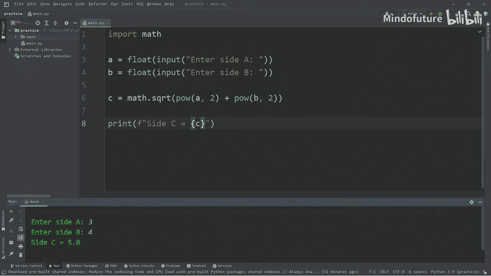

# Python超全入门教程-p05-P05-Math-in-Python-is-easy-+-exercises--BV1fcdLYXEw9_p5-

Hey， everybody， in this video， I'm going to show you all of the different math that we'll need throughout the rest of the series。

 I have a lot to cover， and I'll split this video into different sections。

 We'll cover some basic arithmetic operators， built in math functions。

 A few functions from the math module。 And then a few exercises。 Be sure to look at the timets。

 If you would like to skip ahead to another section。 Let's begin with some really easy stuff。

 We're going to cover some basic arithmetic operators。 Let's say we have a variable。😊。

Friends。Currently， you have zero friends。 If you need to increment a variable by one， you could say。

Friends。The name of the variable equals the name of the variable again， plus  one。

 So the plus sign is the addition operator。 And I think we do have a little bit of experience with that already。

 So if I were to print my variable friends。Guess what？ You now have one friend。

 We could also shorten this line of code。You could say。Friends plus equals  one。

 That would do the same thing。 This is known as an augmented assignment operator。

Now'll give you the same result。 I prefer to use augmented assignment operators just because they take less text。

 And I think they're easier to read。 Now， let's use subtraction。Friends equals friends。Minus2。 So。

 of course， minus is the subtraction operator。 You have negative two friends， I guess。

If you were to use the augmented assignment operator， that would be friends minus equals 2。There。

 you still have negative two friends。Okay， multiplication， let's change friends to。How about 5。

Friends equals friends。Times3。You now have 15 friends。

Then the augmented assignment operator version of this would be friends。Times equals 3。So again。

 you have 15 friends， let's cover division。Friends equals friends。Divided by2。So we have 2。5 friends。

 Somebody was cut in half。 We have half a friend。 Maybe it's just their legs or torso or something。

 Then the augmented assignment operator would be friends。Divided by equals 2。

And the result is still the same。Now， exponents。Friends equals friends。To the power of two。

 So if friends is currently 5。Friends to the power of two would be five times 5， which is 25。

The augmented assignment operator version of this equation would be。Friends。Exponent equals 2。

And again， friends is 25。Then we have modulus。 modulus gives you the remainder of any division。

 Suppose we have 10 friends instead of 5。 I will assign a new variable remainder。

Remainder equals friends。The percent signed is known as the modulus operator。

 It will give us the remainder of any division。 If I were to divide my group of friends by three。

 we will have one remaining。 I'll store the remainder within a separate variable。

 We would have a remainder of one。 It's kinda like in class。

 when the teacher says for everybody in the class to go into groups at 3。

 Then there's always that one kid that's by themselves。That's kind of the same concept。

 We're dividing our friends into groups of three。 Then the modulus will give you the remainder。

 If we divided our group of friends into groups of two， Well，10 divides by  two evenly。

 So there is no remainder。So that is the modulus operator。

 It's fairly popular to use this operator to find if a number is even or odd。

 because it will divide by two evenly if that number is even。 if the remainder is one。

 that means that the original number is odd。 Okay， so yeah。

 those are some basic arithmetic operators。 additions， subtract， multiplication， division。

 exponentiation， then modulus。Now， what we're going to do is cover some built in math related functions。

 Suppose we have three variables。 X equals 3。14。Y equals 4。Z equals 5。

 It doesn't matter if these are floating point numbers， or whole integers。

The first is the round function。 We have a variable named result。 I'm going to round X。

So there is a built in round function。After the set of parentheses。

We can add some value or variable to be rounded。So we will round X to the nearest whole integer。

 then print the result。So our result。Is3。 So that's the round function。

With the absolute value function， we can find the absolute value of a number。

 Let's change y to be negative 4 instead of 4。Will take result equals A B， S。

 which means absolute value of y。 The absolute value is the distance away from 0 as a whole number。

The absolute value of negative4 is 4。Let's change y back to four。There's a built in power function。

Result equals Pu。Then we'll need a base and an exponent。What's why to the power of three。

That would be 4 times 4 times 4， which is 64。 That's the p function。

You can raise a base to a given power。The next two are really useful。Using the max function。

 we can find the maximum value of various values。 What's the maximum value between X， Y and Z。

 Then I'll just need to store this value。 results equals the max between X， Y and Z。

 Well the maximum value is 5。Otherwise， there's men。What's the minimum value between X， Y and Z。

That would be 3。14。

Now， in this next section， we do have some very useful constants and functions from the math class。

 but we'll need to import the math module at the top of our text editor。

So import math。 If you need the value of pi， you'll type the name of the math module。Dot pi。

And I'm just going to print this。Print math， dye pie。The value of pi is 3。

14159 and a bunch of digits that come after。If you're working with physics。

 I do know that people use the constant E a lot。We won't be using E in this video series。

 but if you ever need access to it， just type math dot E。And that will give you E， which is 2。71。

 something， something， something。 I believe E is known as the exponential constant。

 If you need the square root of a number。Let's say， result equals。Math dot S， Q， R， T。

 We can place a variable or a value within the square root function。 Let's say we have X again。

X equals 9。What is the square root of x。Then I will print whatever the result is。

The square root of 9 is 3。 That is the square root function。There's a ceiling function。

 Re equals math。Dot seal sealal will always round a floating point number up。Suppose x is 9。1。So 9。

1 rounded up is 10。Otherwise， there's floor。Which will always round a number down。 Reult equals math。

 dot floor。 Let's change x to 9。9。9。9 rounded down is 9。 Those are some useful math functions。

 Let's go over some exercises。Okay， this first exercise。

 we are going to calculate the circumference of a circle。

We'll need the help of the math module because there's some good functions in there to calculate the circumference of a circle。

 The formula is two times pi times R。 Let's ask a user for a radius。

Because that's what R is。 We'll accept some user input。Enter the radius of a circle。

We will type cast the input as a floating point number。To calculate the circumference。Again。

 the equation is two times pi。 We can get that from the math module times whatever the radius is。

And the user is going to type that in。 Then we will print whatever these circumferences。

Print will use an up string。Sirumference。Is。Our variable circumference。Enter the radius of a circle。

 I'll enter 10， actually，10。5。Their circumference is 65。97。

 If you want to round and truncate some of these numbers。We can use the round function。

 around circumference。Then round to a given decimal place， all round to two digits。Again，10。

5 rounded is 65。97。 You could add a unit of measurement， to， let's say centm，10。5 is 65。97 cm。

 All right， that is the first exercise。For this next exercise， let's calculate the area of a circle。

 We'll import the math module。Will ask for a radius， much like before。Radius equals input。

Enter the radius of a circle。Willll cast our input as a floating point number。

The equation for the area of a circle is。Pi。Times radius squared。

 We could easily use the built in power function to raise our radius to the power of 2。😊。

Then we will display the area。Print， I'm using an F string。The area。Of the circle。Is。

Our area to some unit of measurement， let's say centimeters。Squared。Enter the radius of a circle，10。

5。The area of the circle is 3，46。36， but I would like to round this number to two decimal places。

I'll use that round function。And I'll place area。And the number of digits to around 2 within this function。

 Let's try that again。10。5。The area of the circle is 346。36 cm squared。 That is the second exercise。

For this last program， we're going to find the hypotenuse of a right triangle。

The formula to calculate the hypotenuse of a right angled triangle is C equals the square root of a squared plus B squared。

Will'll begin by importing the math module。 We'll ask the user for the lengths of side A and B。

A equals。Import。Enter side a。Will cast the input as a floating point number。

We'll do the same thing with side B。B equals。Enter side B。Now， this part's going to be confusing。

 We'll calculate C。 We'll need a squared plus B squared。Willll take a to the power of 2。Plus。

B to the power of two。Then we'll need the square root of all of this， whatever the result is。

I will surround this equation with math dot square root。That should give us our answer。Let's print。

Using an up string。Side， see。Equals。Whatever sea is。So enter side A3 side B will be 4。Side C is 5。

Al right， everybody。 So that was everything related to some arithmetic operators and math related functions in Python。

 And in the next video， we're going to cover a few things involving string formatting。😊。

