# Python超全入门教程-p08-P08-Python-weight-conversion-exercise--BV1fcdLYXEw9_p8-

Hey there。 It's me again。 In today's topic， we're going to create a weight converter program in Python。

 This is an exercise that will follow up the lesson on if statements。

 willll convert pounds to kilograms or kilograms to pounds。

 The user is going to decide We will begin by creating a weight variable。

 We will assign some user input。😊。

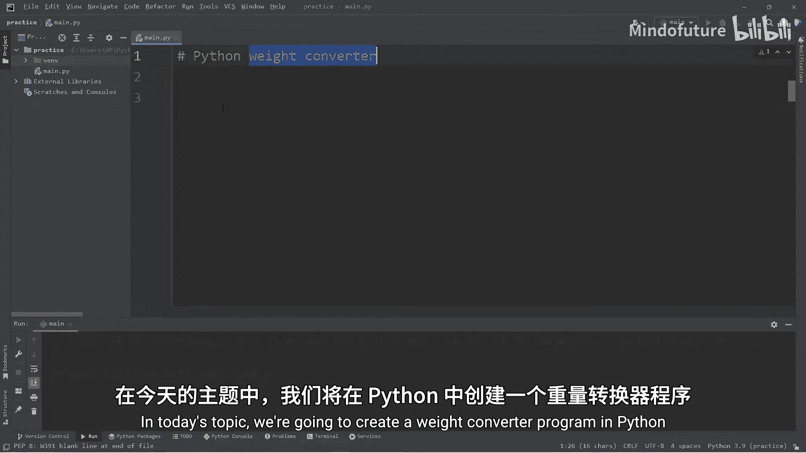

Enter your weight。We will convert this input into a floating point number。So add that cast。

 Then we will ask for a unit。 Is this weight in kilograms or pounds。Input。Kilgrams。Or。Pound。

We want the user to type in either K for kilograms or L4 pounds。And these are capital letters。

 by the way。Using an if statement， let's first check to see if our unit。Is equal to a capital K。

 That means the current weight is in kilograms。 We need to convert that weight to pounds。

Let's reassign weight， equal to。Our wait times。2。205。Else， if unit。Is equal to L。

 We need to convert to kilograms。Weight equals weight divided by 2。205。

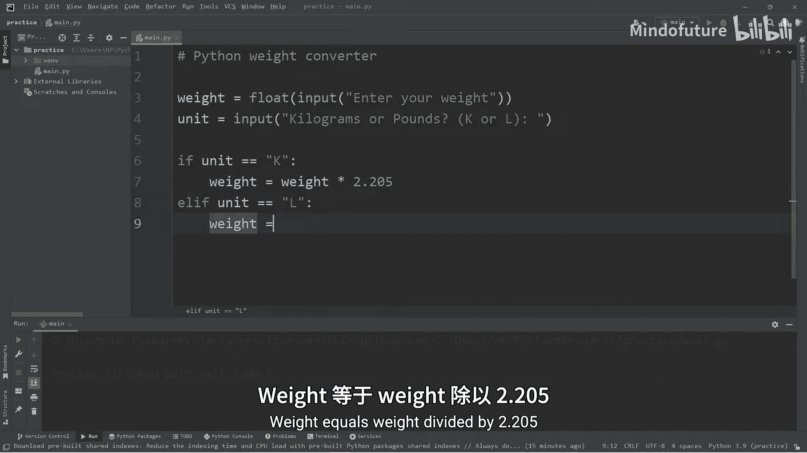

Else， the user did not type in something that was valid。Let's print。Using an f string。Unit。

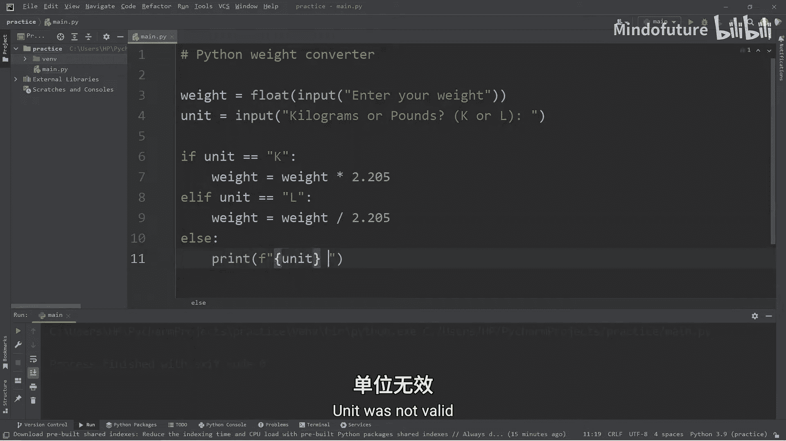

Was not valid。At the end of our program， we will print the new weight。 I'll use an up string。

Your weight is。Our new weight after it's reassigned。 Now we need a unit of measurement。

 This is what I'm thinking will'll do within our if and Elsif statements。Let's reassign our unit。

We're reassigning unit to B L B S 4。Else， if unit equals。Kgs4 kilograms。

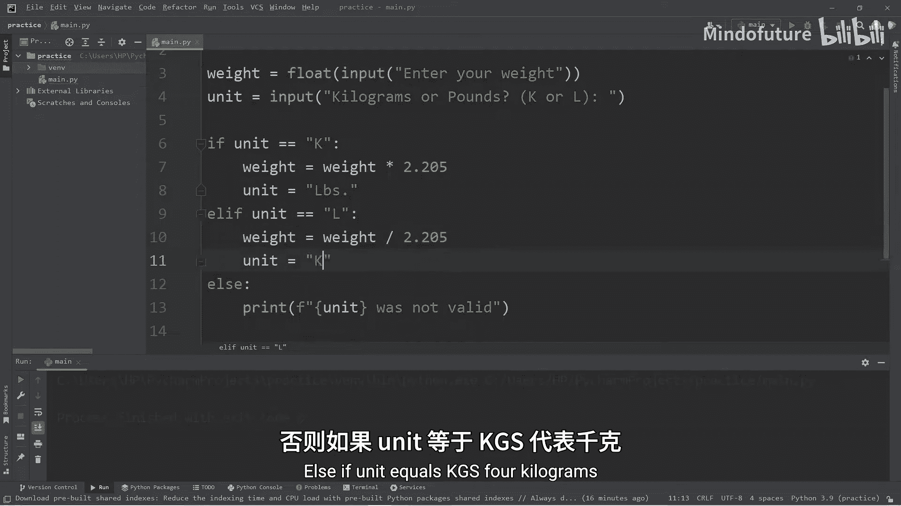

In our results， we will display our new unit。Let's take a look。Andter your weight。 Actually。

 I'm just going to make one change。 I'm gonna add coal in space。

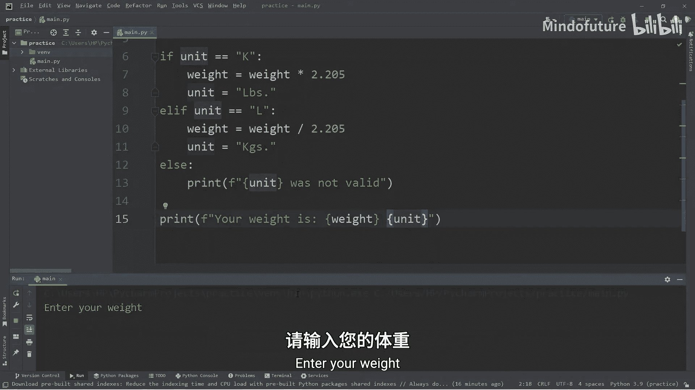

There， that's much better。Enter your weight。Let's say， I'm 180 pounds。This is in pounds。

 I'll type capital L。Your weight in kgrams is 81。63。 I think I'm going to round this。

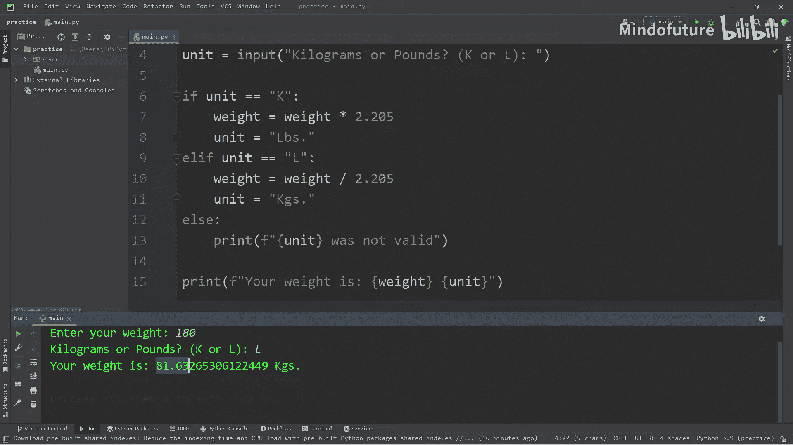

I will enclose the weight variable within a round function。We will round to one decimal place。

 Let's try this again。And to your weight， maybe I'm 81 kg。I'll type K for kilograms。

Your weight is1 seventy8。6 pounds。Let's make sure that this L statement works， too。En your weight。

180 pizzas。Pizzas was not valid， so we're still displaying our output。

 We would want to avoid that if somebody doesn't type in a valid unit。

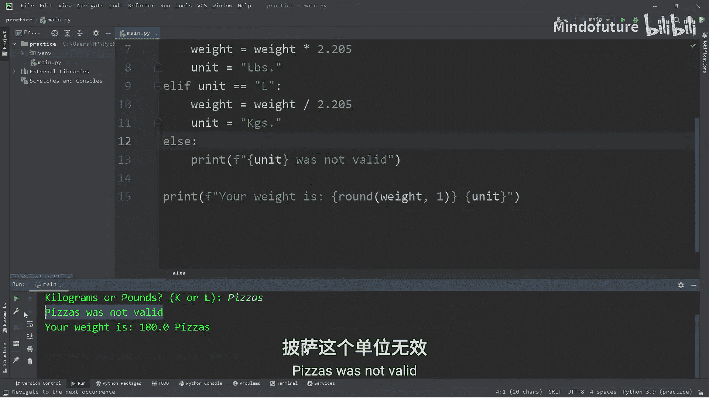

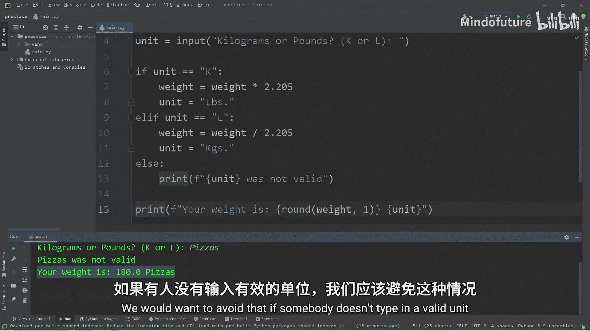

So let's cut this line。

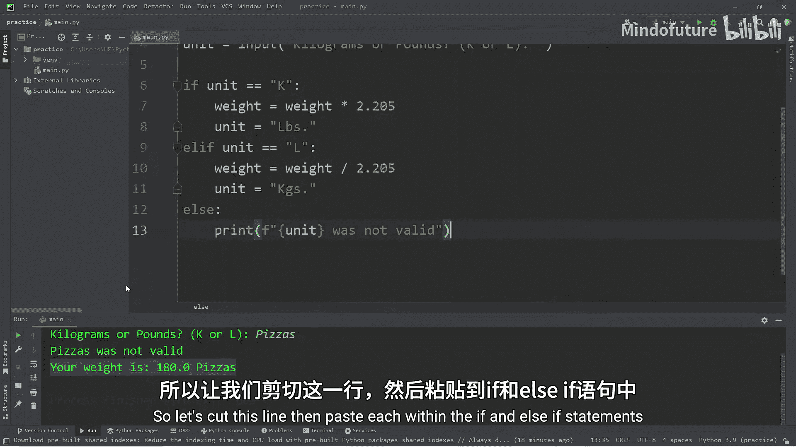

Then paste each within the if and elsesif statements。

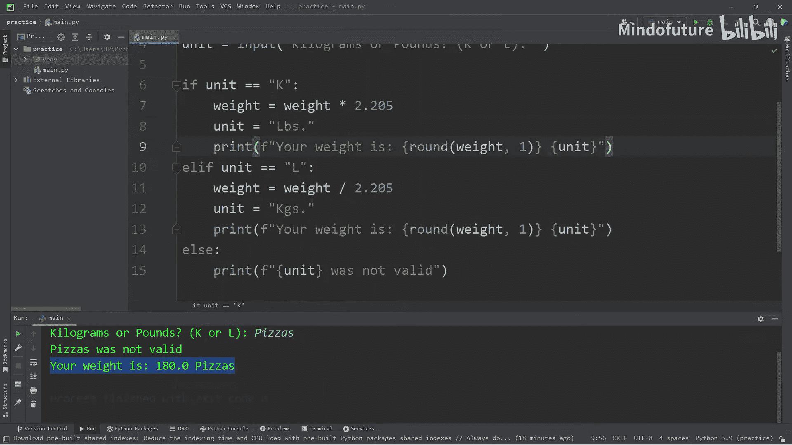

When we exit the L statement， we're not printing the output。So let's make sure that this works。

And your weight， I am 180 pizzas。

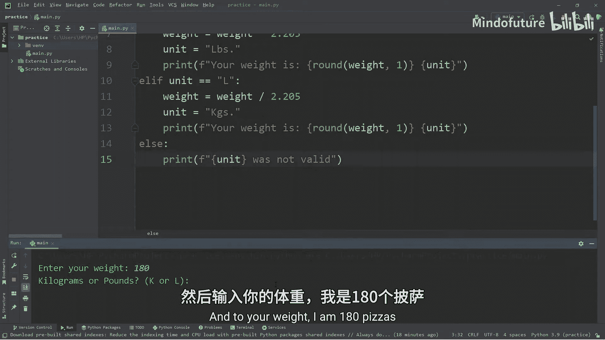

Pizza was not valid。All right， everybody。 Well， that is a weight converter program in Python。

 I thought this would be a helpful exercise now that we have finished the section on if statements。

 And yeah， that is a weight converter program in Python。😊。

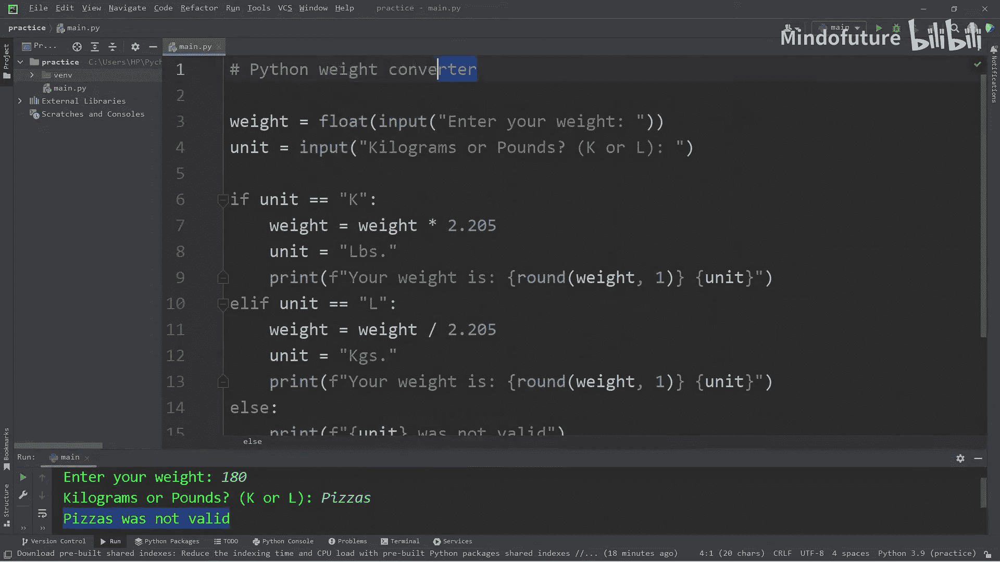

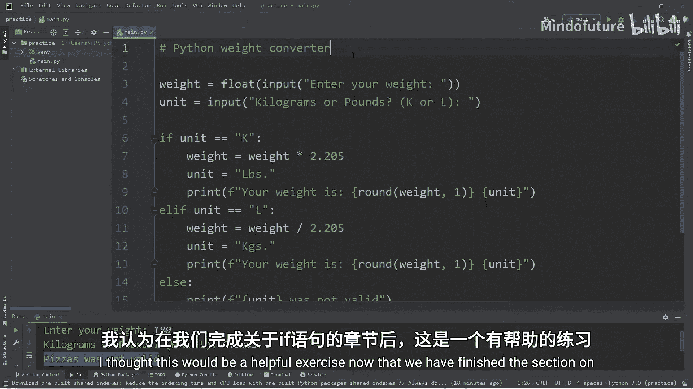

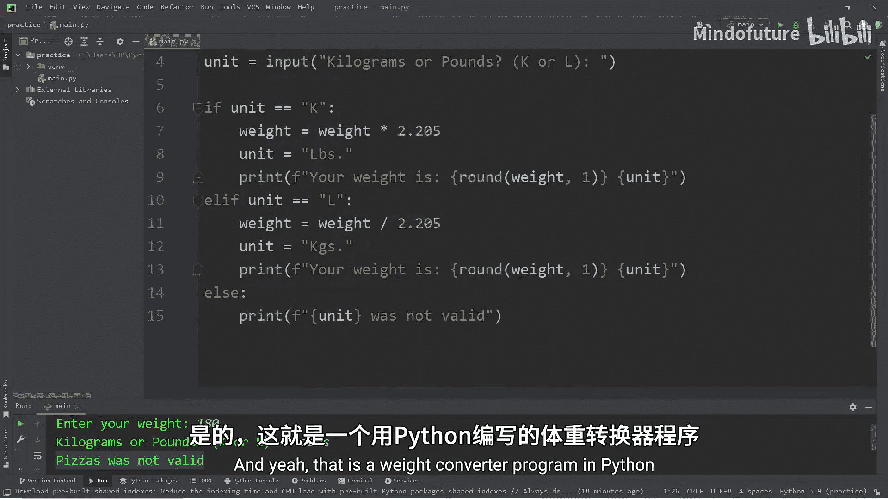