# Python超全入门教程-p09-P09-Python-temperature-conversion-program--BV1fcdLYXEw9_p9-

Hey， everybody， in this topic， we're going to create a temperature conversion program as an exercise。

 We'll begin by asking what the current unit of measurement is， unit equals。

We'll accept some user input。Is this temperature。In。Celsius。For Beahrenheit。C， slash F。

Then we will ask for the temperature。I'll store the temperature in a variable named tempemp。

 meaning temperatureemp。 temp equals input。Enter the。Temperature。

Then we should cast our user input as a floating point number。If unit is equal to C。

I'll fill this in momentarily。 I'm just going to write pass as a placeholder。Else。

 if unit is equal to F， we will do something else。

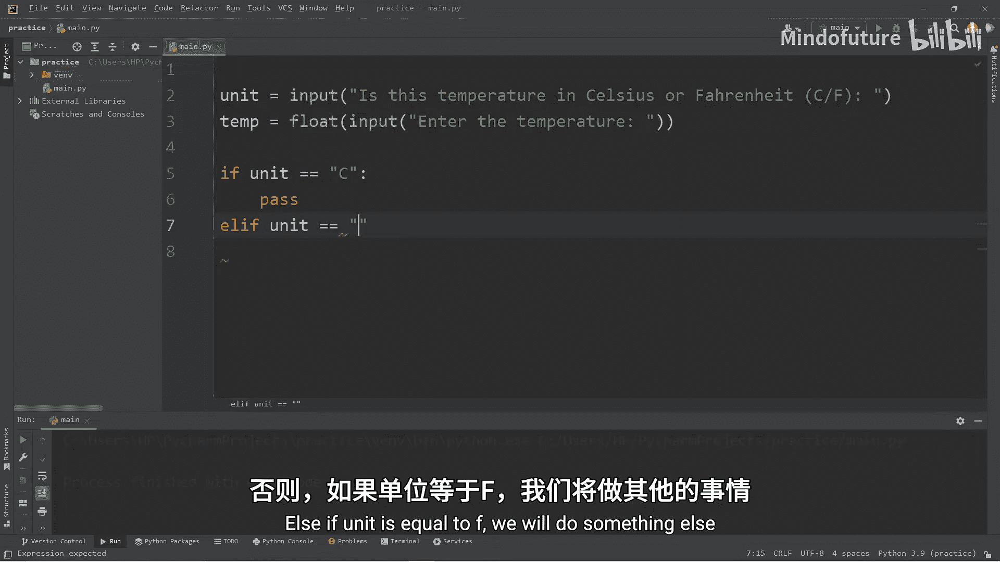

Else， let's print something。 just an error message of some sort using an f string。Unit。Is。

An invalid unit of measurement。Let's test this L statement。

Is is the temperature in Celsius or Fahrenheit。 What if I were to type Cape or Kelvin。

 I'll make up some temperature， like 100。K is an invalid unit of measurement。All right。

 We know the L statement works。 Let's convert Fahrenheit to Celsius using this formula。

 We will take our temperature。

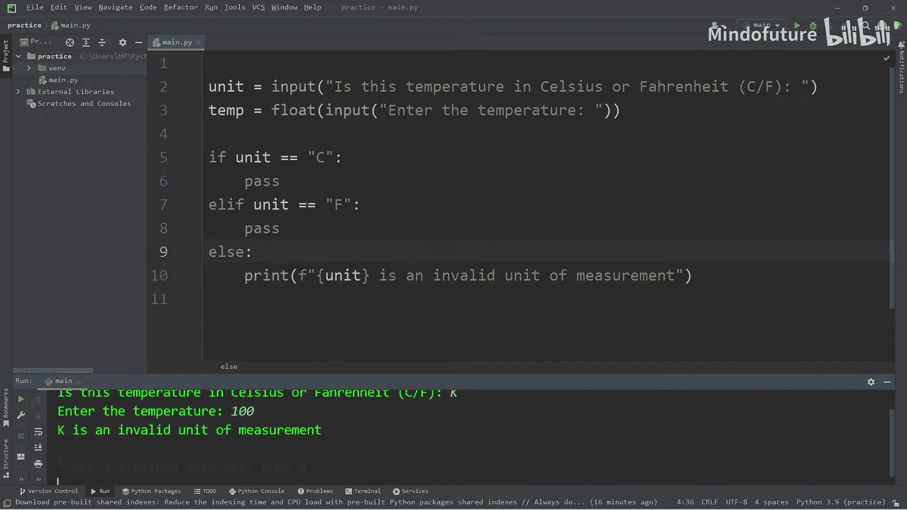

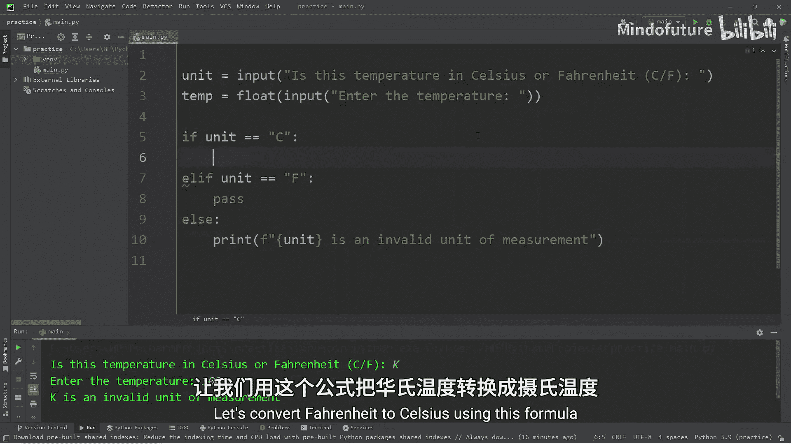

Equals。9 times art temp。Divided by 5。Plus， 32。I'll take all of this and use the round function。

What round to one decimal place。

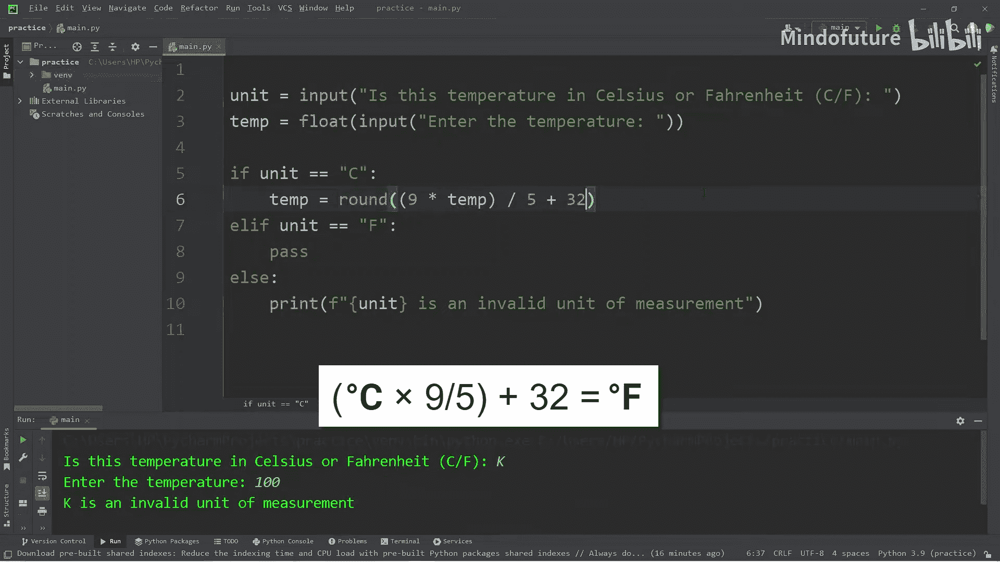

Then we will print the current temperature in Fahrenheit。I'll use an up string。The temperature in。

Fahrenheit is。

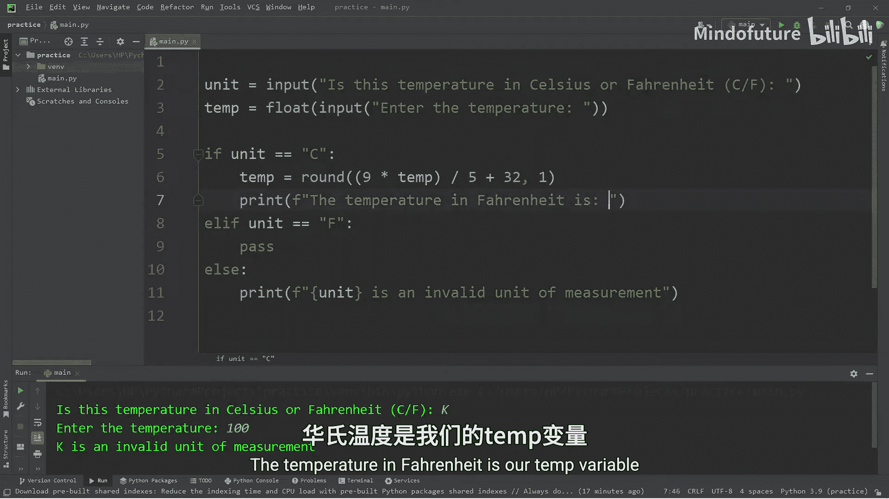

Our temp variable。Degrees， Fahrenheit。

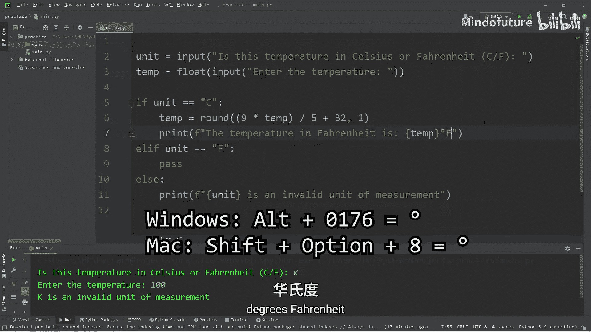

Let's test this， if statement。Is it the temperature in Celsius or Fahrenheit。

 it is currently in Celsius。What is 33 degrees in Celsius converted to Fahrenheit。

The temperature in Fahrenheit is 91。4 degrees。

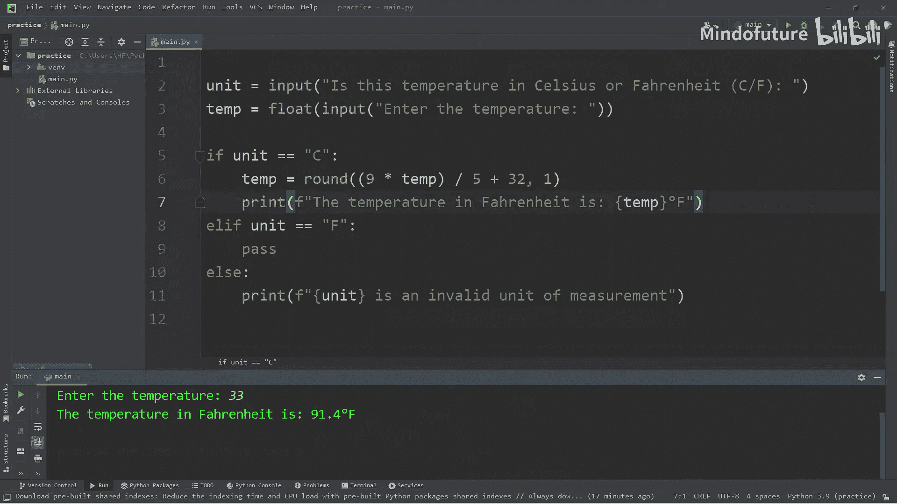

All right。 So this section is working。 Let's work on the L statement。 else。

 if our unit is currently in Fahrenheit， we'll convert to Celsius。

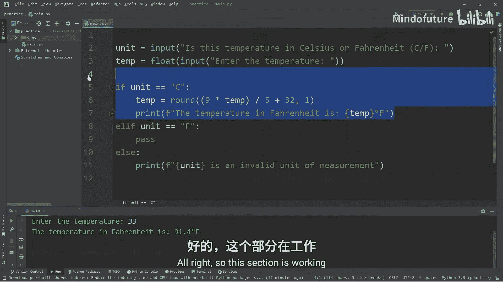

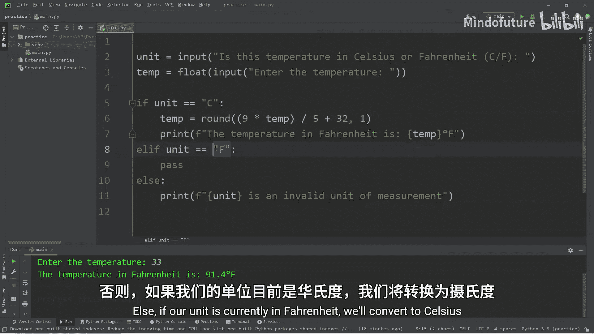

That formula is temp equals。Our temperature，-32。Times 5。Divided my9。

Then I will round the result to one decimal place。

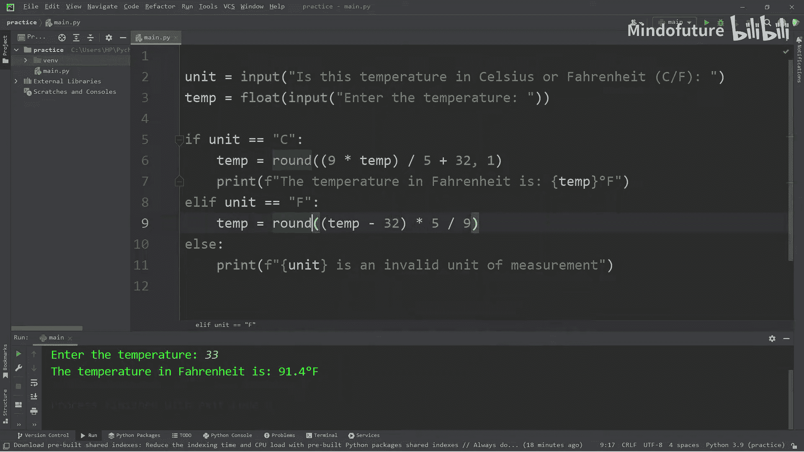

Then we'll print the temperature in Celsius。

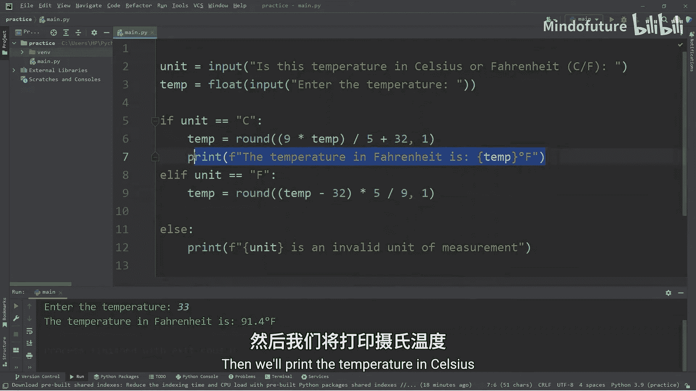

The temperature in Celsius is 10 degrees。C， for Celsius。Is the temperature in Celsius or Fahrenheit？

 It is currently in。Fahrenheit。Enter the temperature，91。4。The temperature in Celsius is 33。

0 degrees Celsius。

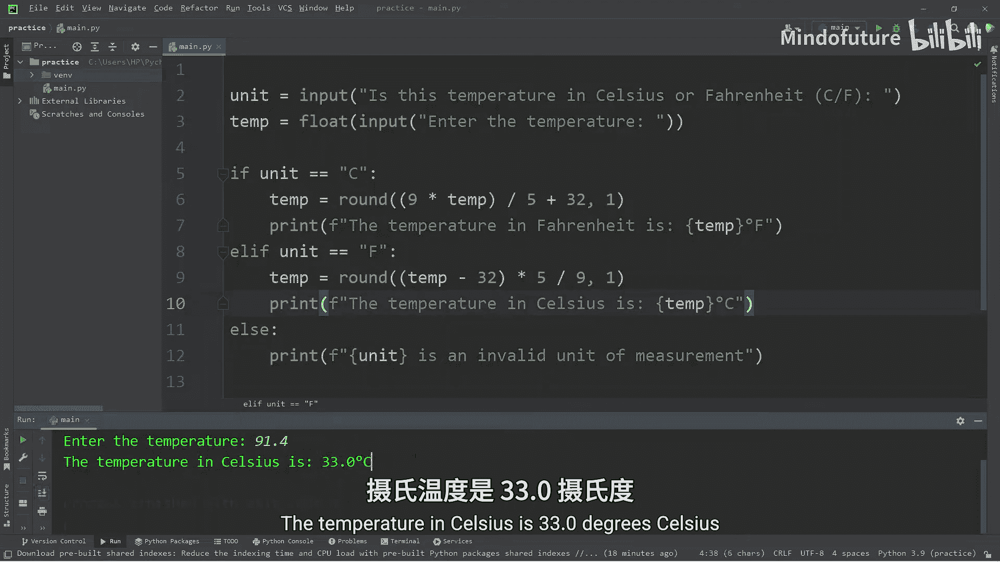

Well， everybody， that is a simple temperature conversion program in Python。

 I thought we could use some practice with if statements。 And in the next video。

 we're going to create a calculator program。😊。

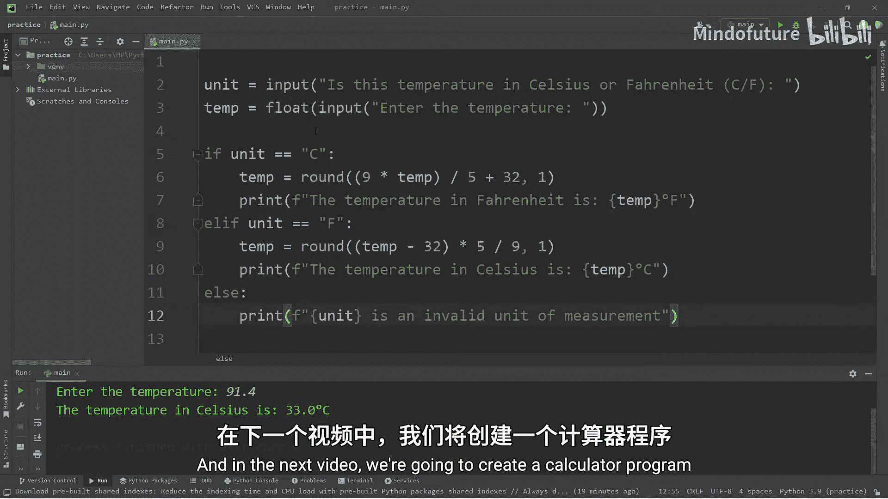