# Python超全入门教程-p12-P12-String-methods-in-Python-are-easy--BV1fcdLYXEw9_p12-

Everybody in this topic， I'm going to cover a few useful string methods that you may be interested in。

 Then at the end of this video， we will work on an exercise where we will validate some user input。

 As we know， a string is just a series of characters。

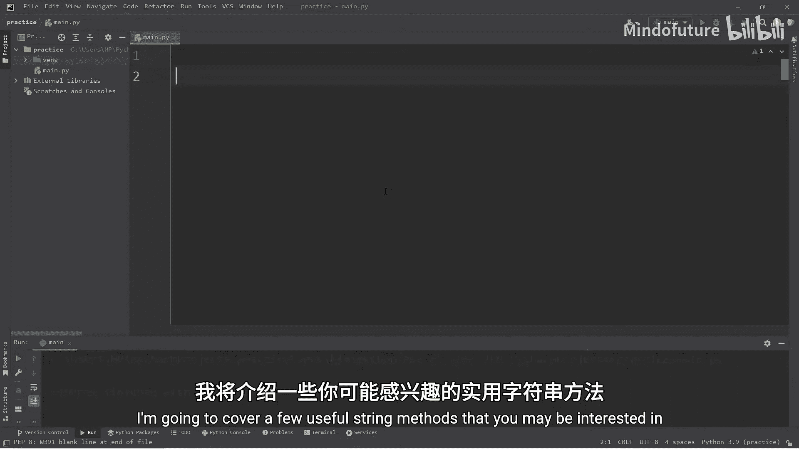

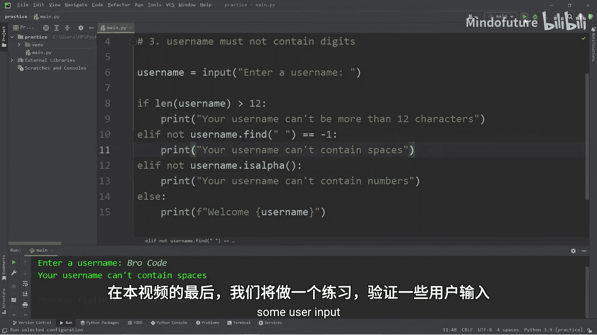

Let's ask a user for their full name。 Name equals input。Enter your full name。

The first method I'll show you。 Well， technically， this is a function。

 The length function will give us the length of a string。 How many characters is it。

 We will find the length of our variable name after the user types in some inputpoint。

 This function returns an integer。 I'll store that result within a variable。 Let's just say， result。

Then I will print whatever the result is。Why don't you go ahead and type in your full name。

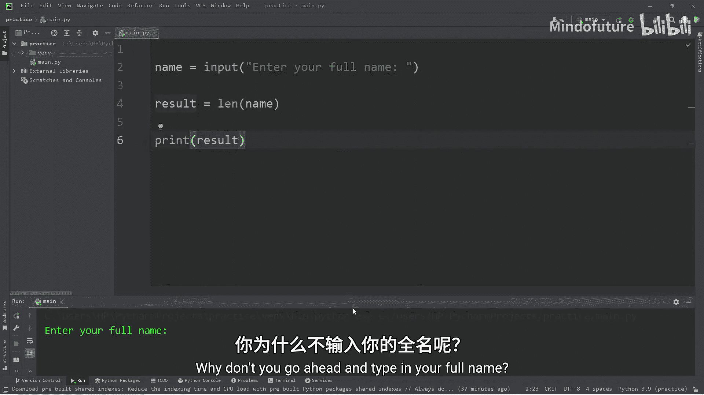

The length of this string， in my example， is eight characters。That does include spaces，2，1，2，3，4，5，6。

7，8。 If you ever need the length of a string， there is the length function。 Let's move on。

 If we were to type our variable name followed by a dot。

 We have access to a whole bunch of different methods。 We have the find method。

 The find method will return the first occurrence of a given character。 The position。

 Let's find any spaces。I'll store the results within a variable， named result。

I will type it in my full name。The first occurrence of a space。 That's what we set is at position 3。

 When working with indexes， we always begin with 0。 This first character would have an index of 0。

 then 1，2，3。 That's why the find method returned 3 in place of 4。

 Let's find the first occurrence of a capital B。See， it's 0。 How about。Oh。For me， that would be， too。

 So remember， it's always the first occurrence。If you need the last occurrence。

 there is a different method。Which is R find。Our remaining reverse。

 we will find the last occurrence of an O。That has a position of 5，0，1，2，3，4，5。

If Python isn't able to locate a given character， it will return negative 1。 Let's find any。

 I don't know， cues。Python could not find any lower case cues。

 The Rfind method will return negative one。 if there are no results。

 we can capitalize the first letter in a string by using the capitalizeized function name dot capids Eli。

This method will return a string。 I will reassign that to name。Then we will print our name。

 capitalized。I'll be sure to type in my name， all lower case。Since this is all one string。

 only the first letter is capitalized， even though I'm including a first and last name。

The upper method will take all of the characters in a string， then make them all uppercase。

Follow your variable that contains a string， followed by dot upper。

 Then I will reassign the result to my name variable to overwrite it。And to your full name。

All of the letters are now uppercase。There is also lower to make all of the characters lowercase。

Name equals name， dot lower。Yep， all the characters are lowercase now。

The is digit method will return either true or false if a string contains only digits。

 The result is a boolean。 Tru or false。 I'll store that within a variable named result。

 then print result。

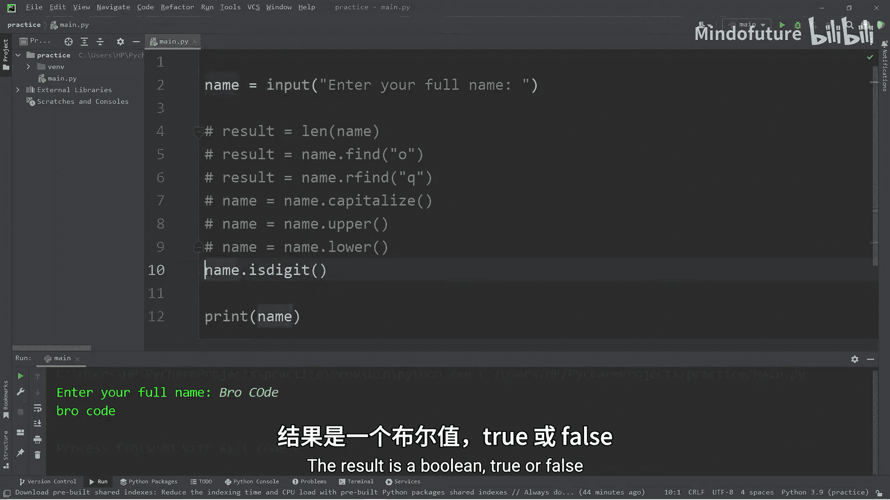

So if I were to type in my full name。Is digit returns false。

 There are not only digits within that string。 If my string was some combination of alphabetical characters and numbers。

This method will still return false。 It only returns true if my string only contains digits。

I'll just type in 1，2，3。 See， that's true。 That is the is digit method。Otherwise， we have is alpha。

Name dot is alphapha。The is alpha method will return a Boolean true or false。

 depending if a string contains only alphabetical characters。 I in my full name。

So the reason that this came up false is because my full name contains a space。

 which is not an alphabetical character。If I typed in my full name， excluding any spaces。

 this would now be true。 Is Alpha would also return false if my name contained any sort of digits。

 Bro 1，2，3。 and that is also false。That is the is alphapha method。Now let's ask for a phone number。

Phone。Number equals input。Enter your phone number。With the phone number。

 they typically contain dashes。 Let's count how many dashes are going to be in somebody's phone number。

Phone。Number。Dot。Count method。 Let's count the amount of dashes。

So place a character within the account method。 This method will return an integer。

 Let's store that within a variable。Result equals phone number， dot count method。

So type in some phone number。1， dash，2，3，4，5，6，7，8，9，0，1。We have three dashes within the string，1，2。

3。That is the account method。 We can count how many characters are within a string。

We also have the replace method。 Honestly， the replace method is probably one of the most useful methods of strings。

 We can replace any occurrence with one character with another。Replace， let's replace any dashes。

With。Maybe a space。This method will return a new string。

 I'm going to reassign this to our phone number variable。tThen print the phone number。

And to your phone number 1， dash 2，3，4， 5，6，7， 8，9，0，1。So here's my new phone number。

 But we've replaced all of the dashes with spaces。 Even better yet。

 we could eliminate all the dashes completely by replacing the dashes or another character with an empty string。

😊，1， dash，2，3，4， dash5，6，7， 8，9，0，1。Here's our new phone number without any dashes。

 We've replaced all dashes with an empty string， No characters。

 If you would like a comprehensive list of all of the string methods available to you。

 you can use the help function， type in the data type SR meaning string。

 Then I will print whatever the result is。😊。

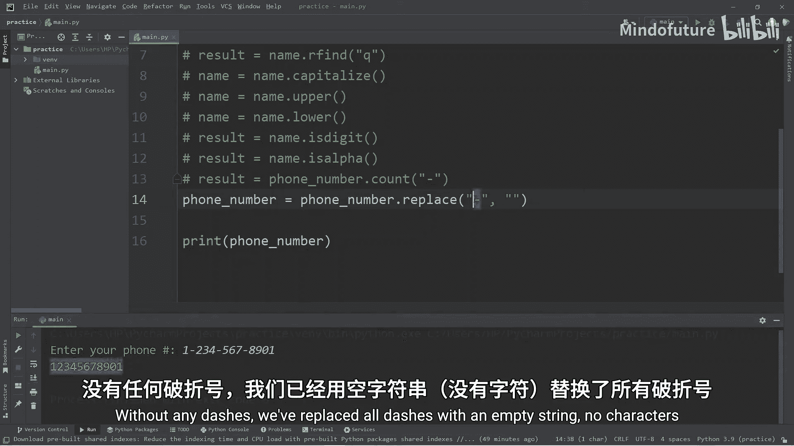

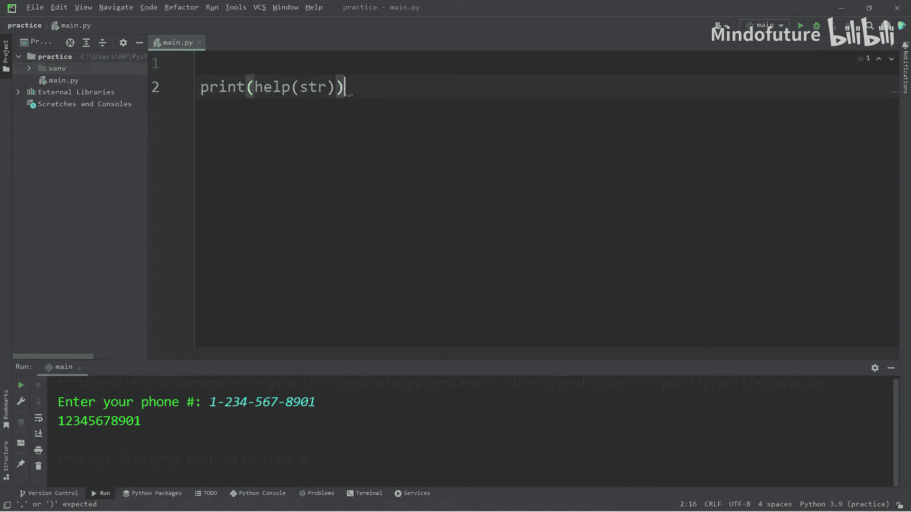

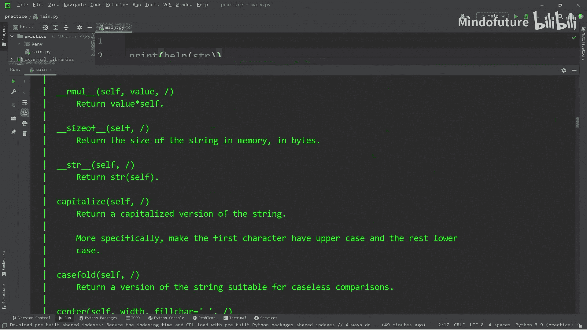

Here's a bunch of methods you might be interested in in the future。 Capitalize casefold center。

 count。

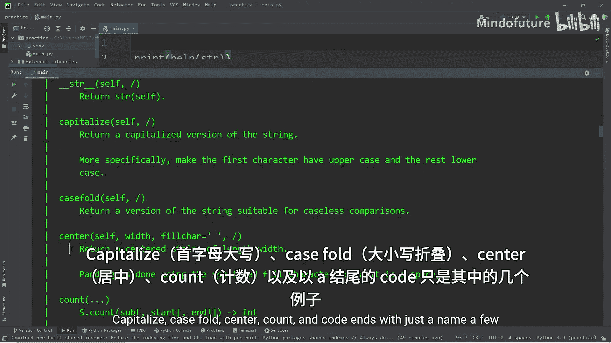

And code ends with， just to name a few。

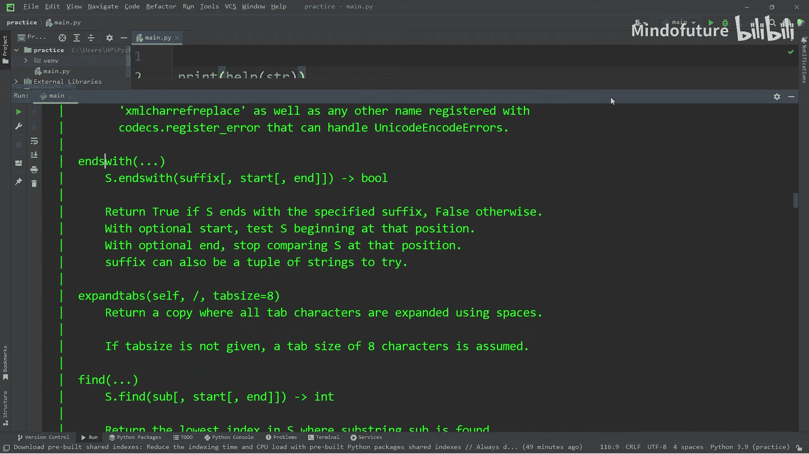

All right， everybody。 here's an exercise for you。 We will validate some user input。

 We would like a user to enter in a valid user name。 However， there's a couple of rules。

The username can be no more than 12 characters along。The username must not contain any spaces。

And the username must not contain any digits。Let's assign a variable named username equals input。

Enter a user name。First， let's check to see if our user input is more than 12 characters long。

 We can do that using the length function。 We will find the length of our user name。

The length function returns an integer。 Let's check to see if the length of our user name is greater than 12 characters。

If it is， we'll print a message。Your username。Can't be more than 12 characters。Else。

We will print using an up string。Welcome， whatever our username variable is。

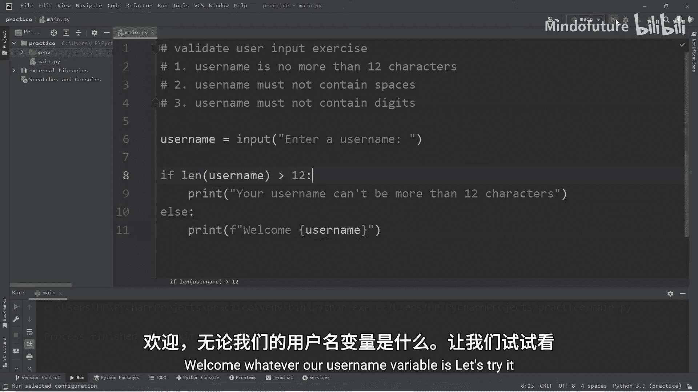

Let's try it。 I'll type in my first name， last name。Then add a whole bunch of characters afterwards。

Your username can't be more than 12 characters。Let's type in something that's under 12 characters。

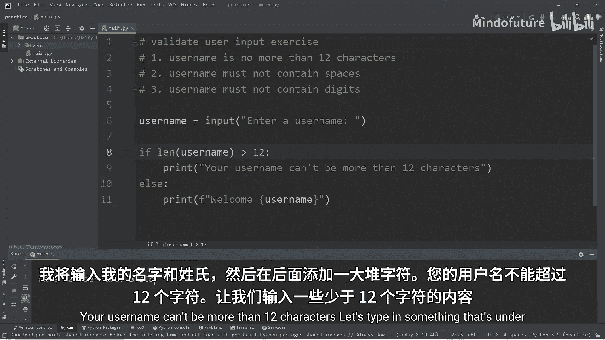

Yep， and that appears to work。 Okay， so we have accomplished task number one。

 Our username can't be more than 12 characters。 Next， our user name must not contain any spaces。

We can use the find method of a string， username， dot find。 We will find any spaces。

 That's a character。If no spaces are found， this method will return negative  one。Using an else。

 if statement。I'll add， not。If the find method of username。Equals negative one。

If the result is not negative one， meaning we found a space， we will print。Your username。

Can't contain spaces。I'll type in my first and last name。

You might need to think of something that's underneath 12 characters。

Your username can't contain spaces， so we have accomplished rule number two。Three。

 username must not contain digits。We can use the is alpha method of strings。

The is alphat that returns a Boolean if a string only contains alphabetical characters。

So let's copy that。I'll add another Elsev statement， not。User name is alphapha。Then， we will print。

Your。Username。Can't。Contain numbers。I guess technically is Alpha would check for spaces， too。

 but I'd rather have that be handled within a different if statement。All right， I'll type in。

A username， I'll include some digits。Your username can't contain numbers。All right。

 I think we've accomplished this。

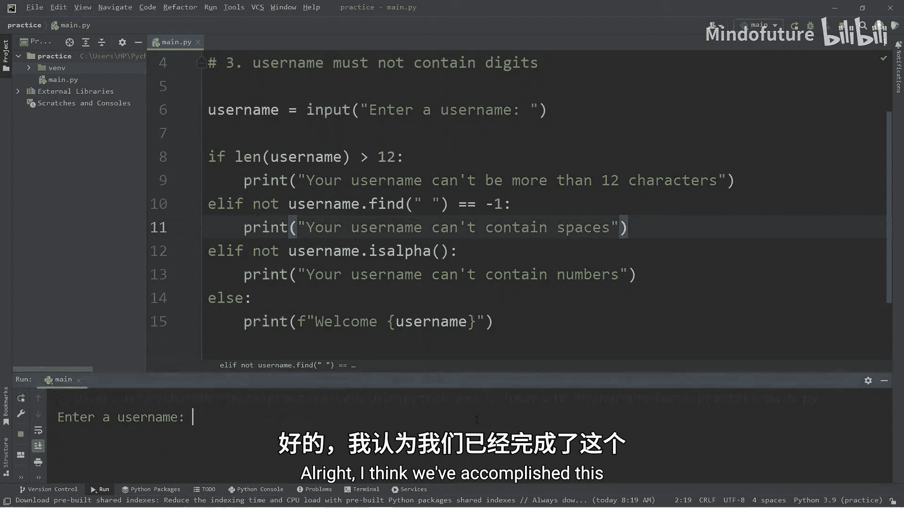

Let me make up a username following these three rules。Yep。It seems to check out。 All right。

 everybody。 And that is a few useful string methods that you may be interested in。

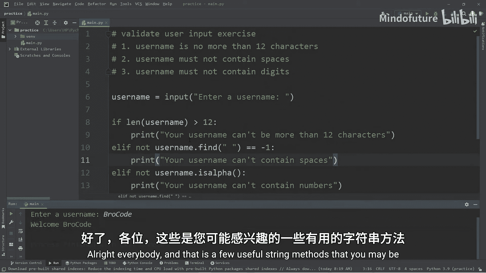