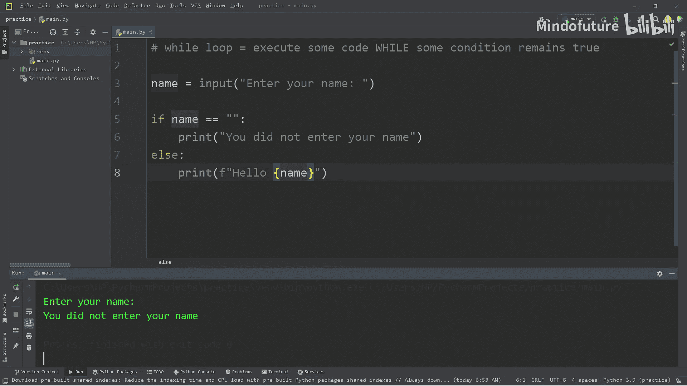
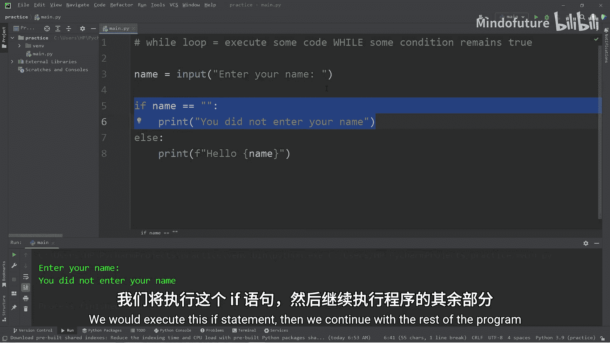
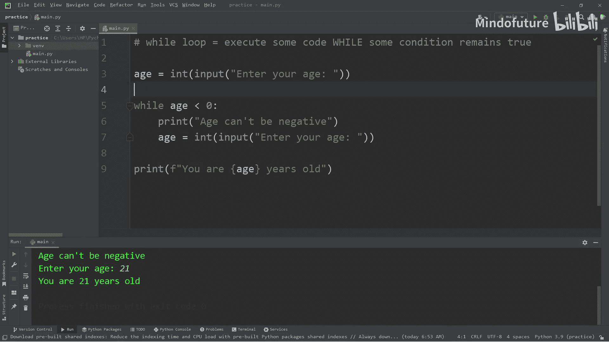
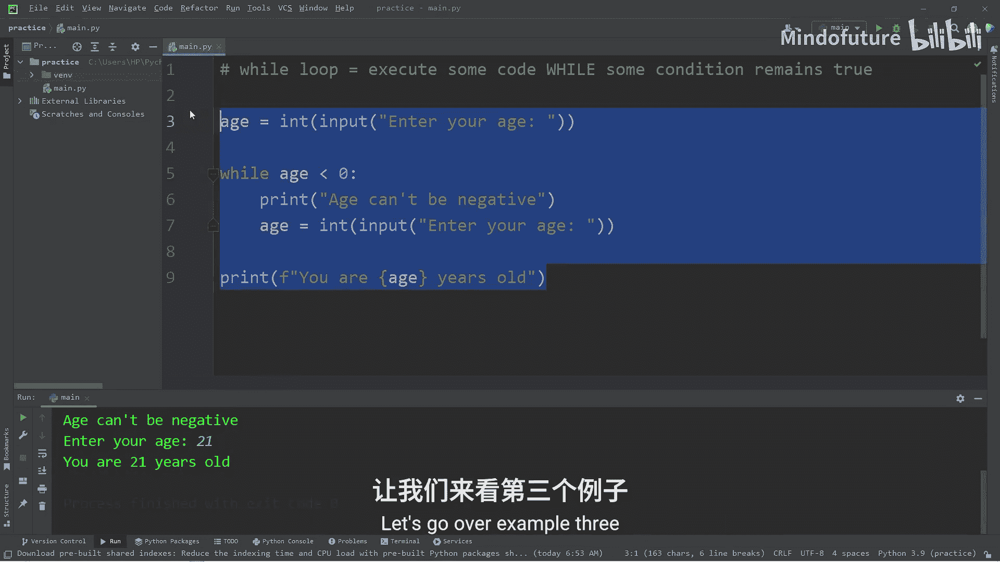
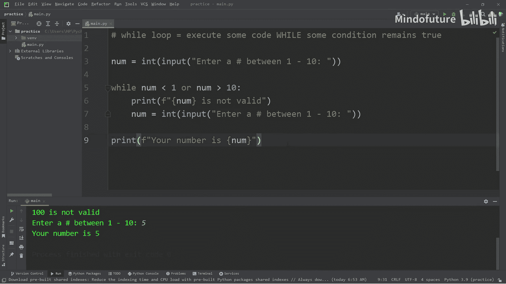

# Python超全入门教程-p16-P16-While-loops-in-Python-are-easy--BV1fcdLYXEw9_p16-

Everybody， in this topic， I'm going to explain while loops。

 A while loop will execute some code while some condition remains true。 Here's an example。

 We'll use an if statement first。 we will ask a user for their name。 Na equals input。Enter your name。

If our name is equal to an empty string， that means the user didn't type in anything。

Let's print a message。You did not enter your name。Else。We will print。Using an F string。Hello。

Our user's name。If I were to skip this prompt。

We would execute this if statement。 Then we continue with the rest of the program。

 What if I would like to continually prompt the user to type in their name。

 We can't continue until they type in something。 Well。

 we could replace this if statement with a while loop。

While this condition is true， continue to execute this code Within the while loop。

 I'm going to repro the user to type in a name。Then if we were to exit the while loop。

 then we will print hello， whatever your name is。So let's run this。Enter your name。

 I'm going to hit enter。 You did not enter your name。 enter your name。 No， no， no， Okay， I give up。

 I'll type in my first name。 Hi enter。 Ho， whatever your first name is。

 While this condition remains true。 Exute this code potentially forever until this condition is no longer true。

 So that's one of the main benefits of a while loop。 If it's not true。

 then you exit out of the while loop。 And that's why we are able to continue， then print our name。

 Hello， name。 You do want some way to escape out of the while loop。 Otherwise。

 you'll run into what's known as an infinite loop。So let's say while name is equal to an empty string。

We will print。 You did not enter your name。So I'm going to hit enter。

 So we are stuck in an infinite loop。 We can't actually escape this loop。

 We didn't give ourselves an exit strategy。That's why previously。

 we repromped the user to type in something or giving them a chance to escape。 In a way。

 it kind of works like an if statement， But instead of executing some code once。

 it's potentially infinite。 Here's another example。 This time， let's ask for a user's age。Age equals。

 and I will convert the input to an integer。Enter your age。

We'll need the user to type in a positive number。While age。Is less than 0。

Let's print a message to let the user know that they can't do that。Age。Can't be negative。

Then we need some strategy to escape。Let's repromp the user to enter in their age。

Once they type in something that's valid， we can escape out of the wild loop。 So let's print。

Using an F string， you are。Age years old。So empty your age。

 I'm going to say negative one age can't be negative， negative 2。Negative 1 million。 Okay， I give up。

 How about 21， You are 21 years old。 So that was another example。

 While our edge variable is less than 0， repeat this code forever。

Let's go over example three。

I'm going to introduce some logical operators。 We will have the user type in a food they like。

 Food equals input。Enter a food you like。 But in order to escape， they need to press Q to quit。While。

Food is equal to the letter Q。Continue this wild loop。However， I'm going to make one change。

We want to exit the while loop when they press Q。 So you could say while not food equals Q。

 So within this while loop， let's print the food that they stated that they like。

 I'll use an up stringing。You like。Your variable food。

Then we will prompt the user to enter in another food that they like。 Enter another food you like。

 Qe toqui。Then once we escape the while loop， we will print just buy。Okay， enter a food you like。

 Cue to quit。 I like pizza。You like pizza。 I like sushi。You like sushi。 I like ramen。 You like ramen。

 Okay， this program's kind of lame。 So I'm going to press cu to quit。And we escape the wild loop。

 We have printed by。 So you could do something while something is not true by using the not logical operator。

 Al right， Last example， example 4， we will use the or logical operator。

We'll ask a user to type in a number between one and 10。Let's say nu equals input。

Enter a number between1 through 10。Then I will type cast the input as an integer。While。Our number。

Is less than one， or our number is greater than 10。 Let's repromp the user。 Let's print。

 using an up stringing。Our variable， nu。Is not valid。Then we will reprot the user。

Enter a number between one and 10。Once we escape the while loop。

 then we will print our number using an up string。 Your number is our variable nu。

Enter a number between 1 through 10。0ero。0 is not valid， negative 1。100， nope，5。Your number is 5。

That's an example of how you can add logical operators to while loops。

 While this condition is true or this condition is true。 Execute this code forever。 All right。

 everybody。 So those are while loops。 A while loop will execute some code While some condition remains true。

 It's fairly useful for verifying user input。 If a user types in some input that is not valid。

 You can repromp them。 And there's many other uses that we'll discuss in the future。 But yeah。

 those are while loops in Python。

