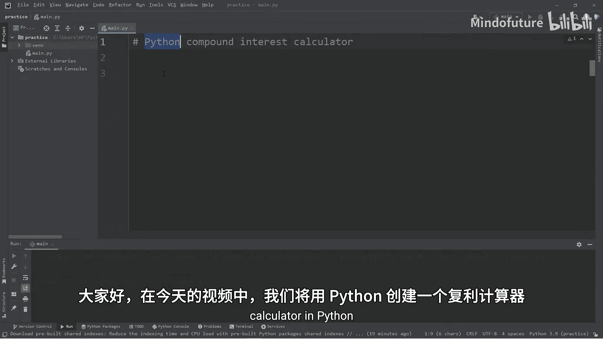
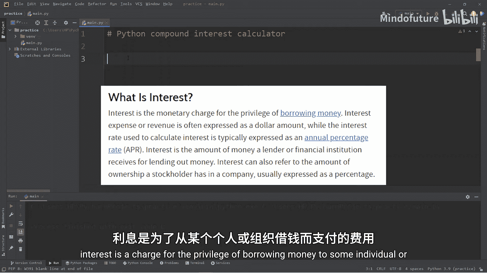
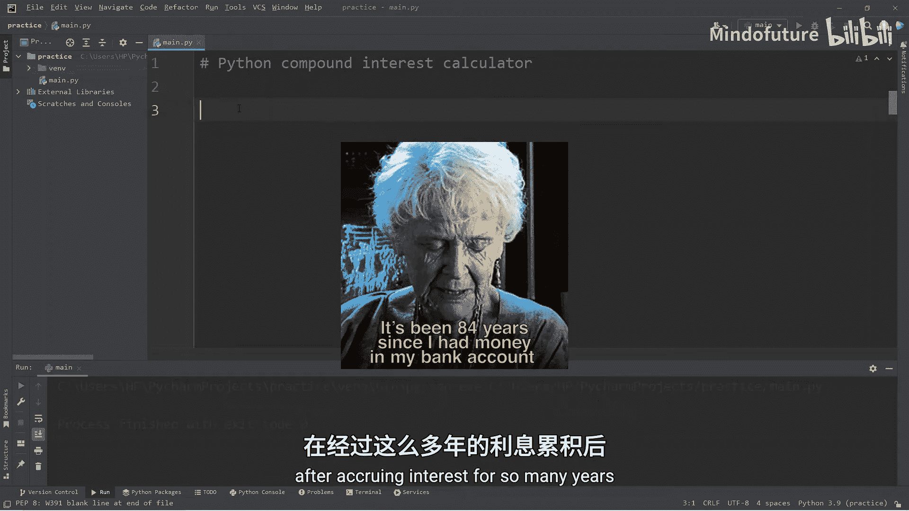
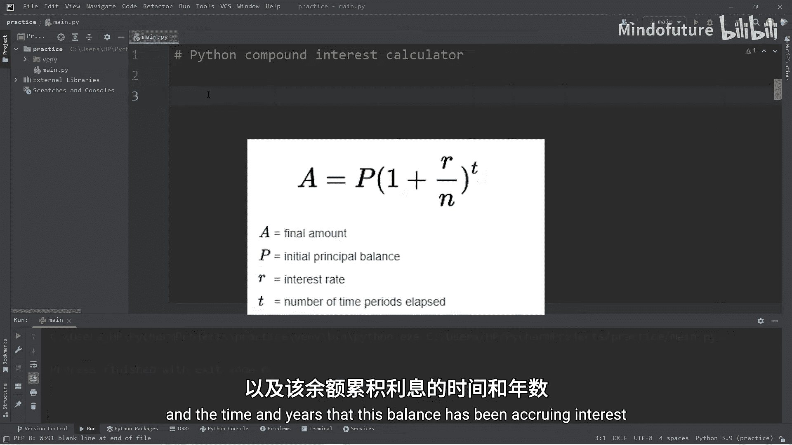
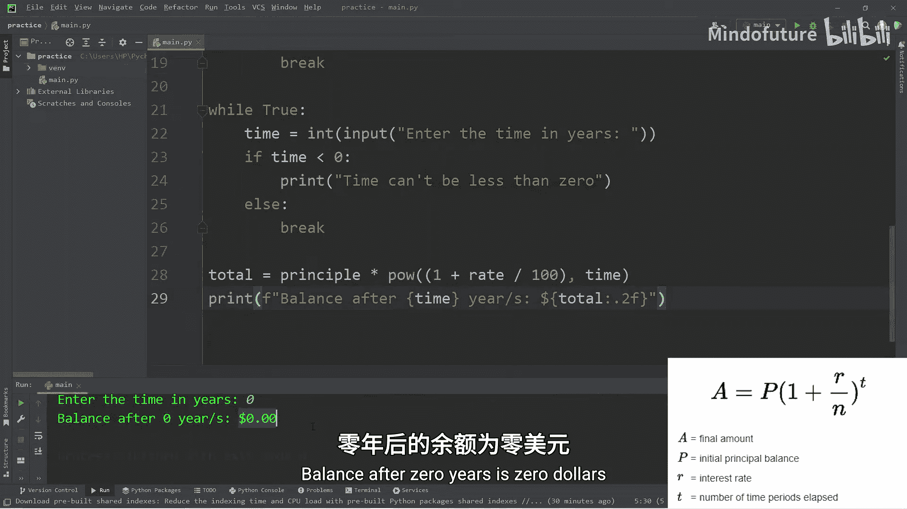
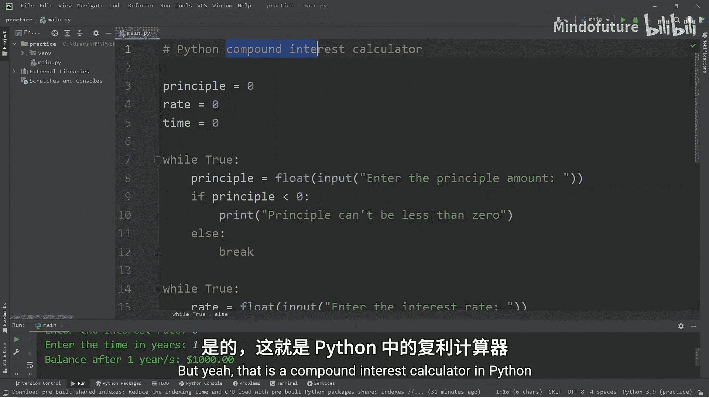

# Python超全入门教程-p17-P17-Python-compound-interest-calculator--BV1fcdLYXEw9_p17-

Why， hello， everybody。 In today's video， we'll be creating a compound interest calculator in Python For those that don't know。

 interest is a charge for the privilege of borrowing money to some individual or organization。

 When you place money in a bank account， you typically accrue interest。

 We'll create a program to tell you what your new balance will be after accruing interest for so many years。

 But the user is going to decide the initial principle， That's the investment。

 the rate of interest and the time in years。 that this balance has been accruing interest。

 So let's begin。 Let's declare three variables， a principle。 A rate。 that is rate of interest。

And time， time will be in years。We've recently learned about while loops。

 I would like to include those within this program just so we get the hang of using them。

 We will ask the user to type in an initial principal investment。

 We will continue to prompt the user to type in a principle that's above 0。

 Our condition will be while principle is less than or equal to 0。We will take our principal。

 assign it some user input。Enter the。Priinciipple amount。

Then we would like to type cast our input as a floating point number。

If our user input principle is less than or equal to 0， we need to inform the user。

Principle can't be less than or equal to 0。So I'm going to test my program by printing the principle at the end just temporarily。

Enter the principal amount。 I can't type a negative number and continue。

 What if my investment was negative $1000。Princiipple can't be less than or equal to 0。 How about 0。

 Nope， can't do that either。 Is 100 O。Yep，1000 works。 That is for the principle。

 Let's copy this while loop， paste it， replace principle with rate。 This is the rate of interest。

Enter the。Interest rate。Interest rate。Can't be less than or equal to 0。And let's copy this again。

 paste it。Change rate to time。Let's type cast our input as an integer because we're working with whole years。

 enter the time in years。Time can't be less than or equal to 0。I'm going to print my principal。

 rate and time。We have principle。Great。Time。Okay， we know that principle works。

Enter the interest rate。 Can my interest rate be negative 1， No， it can't。 Can it be 0， Nope。

 how about 1010% cent。All right， that works。Time can time be 0。 No， it can't。

 Can my time be negative 1， No， it can't。What about three years。All right。

 So we know that our wild loops are working。 Now， here's the formula to calculate interest。

Let's say our total。 That's our total balance。Equals are principal times。

1 plus our rate divided by 100。I'm going to enclose this function with a set of parentheses。

This portion of our function will take our interest rate， which is a whole number。

 Then create a decimal。 enclose this function within the power function。

Raise this function to the power of time。And that is how to calculate compound interest。

Then we will print the new balance。I'll use an up string。Balance。After our variable time。The word。

 years。I'll add a placeholder。 We will add our total。Then I'll include a dollar sign。

 Maybe this will be in dollars， but pick any unit of currency you would like。

 I will format this variable with the format specifier。 We will display two decimal places，02 F。Okay。

 let's try this。Enter the principal amount。 I invest $1000 into maybe the stock market。

The interest rate is maybe 10% this year。The time in years will be one。

So after one year at 10% interest， my new balance is $1100。

Let's try it one more time for good measure。 maybe $500 with an interest rate of 7 over two years。

 Your new balance would be $57245。All right。 Now there is another way of writing this program。

 What if we would like to allow the user to enter in values that are equal to 0。

 While principle is less than 0。 If principle is less than 0， principle can't be less than 0。

Let's do that for rate。Interest can't be less than 0。Time。Time can't be less than 0。

Here's what happens to our program。 Remember that we're declaring our variables at the top。

nothing happens， we go straight to the results。So the reason that this is happening is that when we reach the wild loops。

 this condition is false from the beginning， we never end up entering these wild loops。

 We skip over them because these three conditions are all false。

 We can write a different variation of this while loop， where we could say， while true。

True is a boolean。 That means this while loop will continue forever unless we explicitly break out of the while loop。

 We're going to add an else clause。Else， we will break。 Bak will break out of a loop。

With our second while loop， change rate is less than 02 while true。Then we will add an else clause。

Else， break out of the loop。While true。Else。Break out of the loop。

We should be able to enter zero values in now。Enter the principal amount，0，0，0。

 B after 0 years is $0。

This should work the same as before， but we should be allowed to enter in zero values。$1000。

Interest rate of 0 after one year is still $1000。Well， okay， then everybody。

 I thought that would be an interesting project to create now that we know how wild loops work。

 you could write either a standard while loop with a condition such as。

Principle is less than or equal to 0。Or you could say while true。 This loop would continue forever。

 You would need to explicitly break out of the wild loop using this brake keyword。

 which well cover again in four loops。 But yeah， that is a compound interest calculator in Python。

