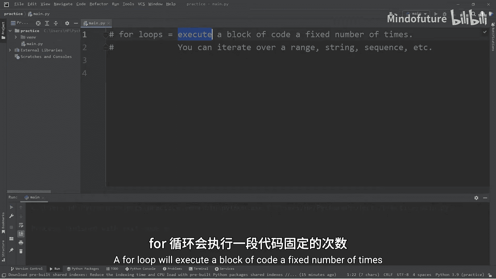
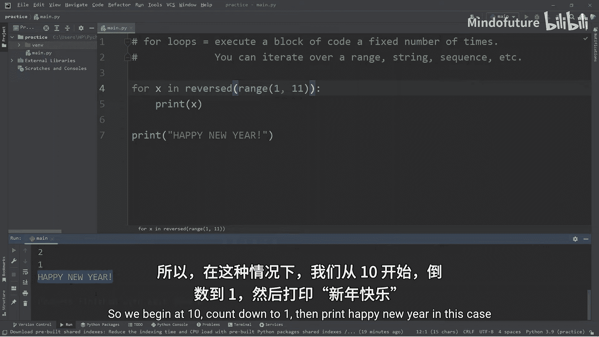
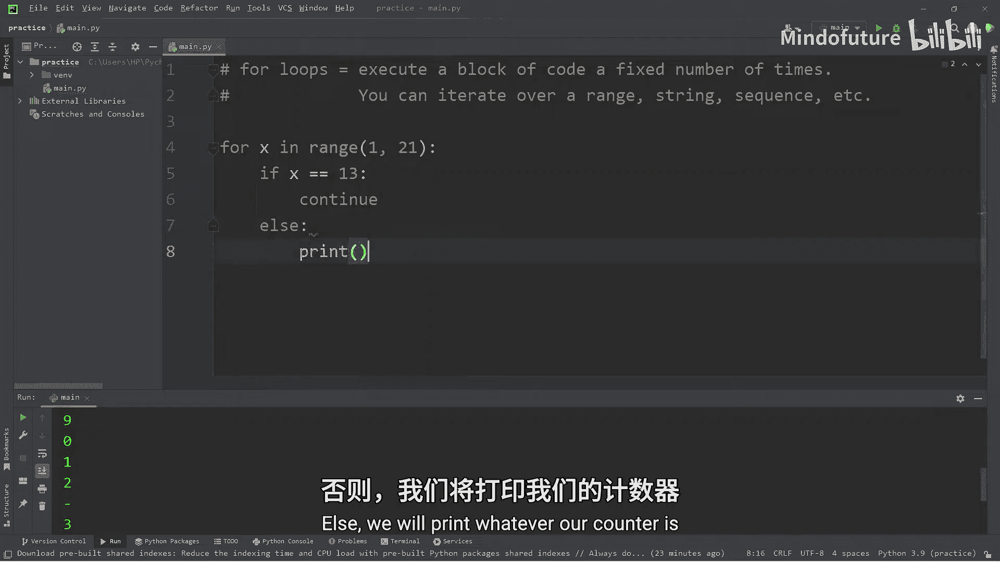
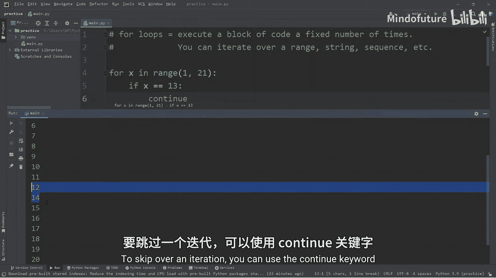
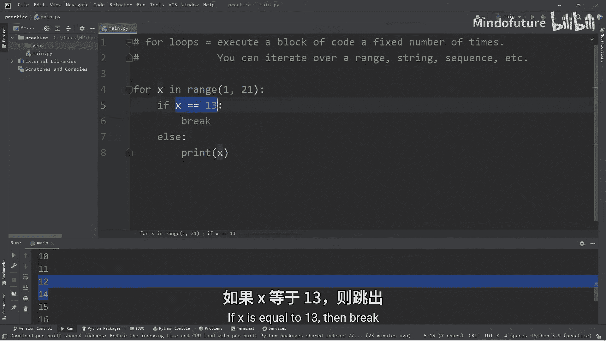
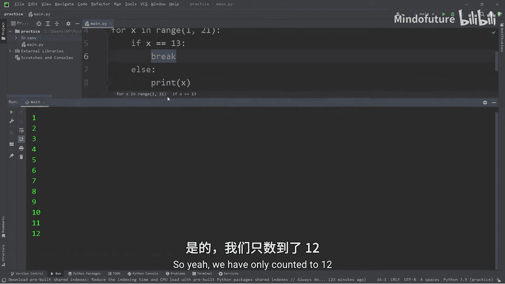
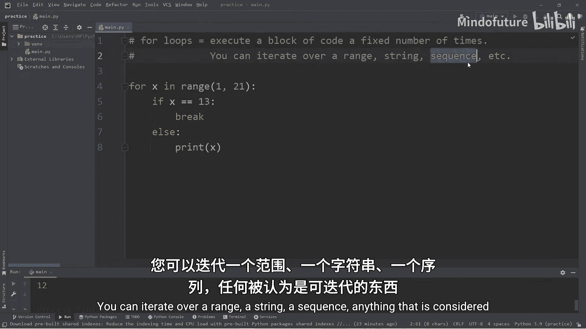
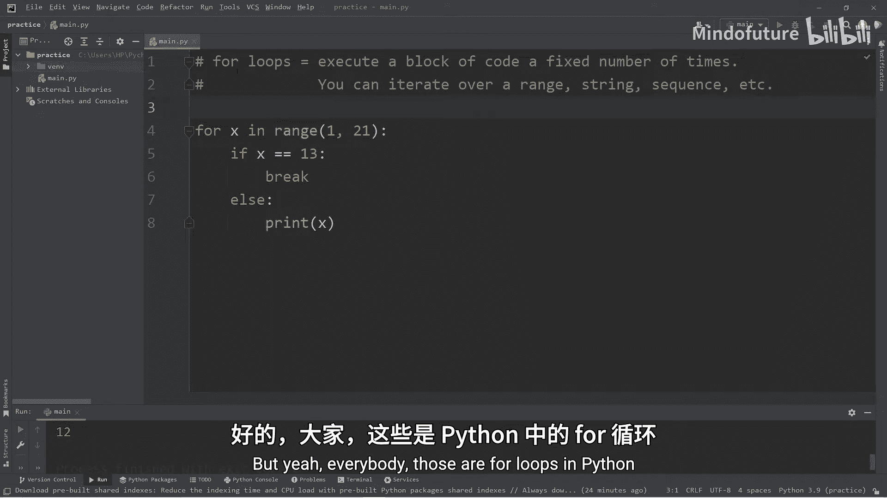

# Python超全入门教程-p18-P18-For-loops-in-Python-are-easy--BV1fcdLYXEw9_p18-

yEvery， in this topic， I need to explain four loops。

 A for loop will execute a block of code a fixed number of times。 You can iterate over a range。

 a string， a sequence， anything that is considered iterable。

 I'll have more examples for you in future topics。 There is a lot of overlap where you could use either a wild loop or a for loop。

 But four loops tend to be better in situations where you have to do something only a fixed number of times。

 Here's an example。 Suppose we need to count to 10。 If we were to use a for loop。

 we could write something like this。 We would s 4。

Then we would need some sort of counter。 Typically， you see people write X。4 x in。

Then we will use the range function。What number would we like to start at。

I would like to start at one。Then count to 10。 But the second number is exclusive。 So really。

 we're going to write 11 if we want to count to 10。So then colon。

 then hit enter whatever code you would like to repeat a certain number of times。

 you will list underneath the for loop and make sure the code is indented to。

 I will print whatever our counter x is。 When I run this code， we will begin at one。

 then stop once we reach 11。So yeah， there we are。 We have begun at one。

 and we have counted all the way to 10。 So that's the basic syntax for a for loop，4 some counter。

 Really， you can name this anything。 Sometimes you'll see people name this as counter。

And that would work， too。 But let's stick with X。In。Some range。 Where would we like to begin。

 Where do we stop。Okay， now let's count backwards。 Let's start at 10， then count down to 0。

 When we escape the for loop， let's print。Happy new year。When we print Happ New Year。

 we are outside of the for loop to count backwards。

 you can enclose your range function within the reversed function。Reversed。So we begin at 10。

 count down to one， then print H New Year In this case，2， count backwards。

 You would enclose the range function within the reverse function。

 There is an additional parameter 2。 you could add。 That is the step。

 If you would like to count by twos， you would add comma 2。

So I'm going to get rid of Happy New Year。Let's print the numbers 1 through 10。

 but we will count by twos。And this does begin at one， though。 So 1，3，5，7，9。

 If you were to change the step to 3， you would count by threes。Beginning at one，4，7，10。

So the range function isn't the only thing you can iterate over。 You can iterate over a string。

 Let's say we have a credit card number。Credit card equals。

 I'll make up some credit card number with dashes。That is good enough。

4 x in credit card print X X will hold our current position。 At first， it'll be 1， then 2，3，4， dash。

 so on and so forth。 So here's our credit card number 1，2，3，4， dash 5，6，7，8。

 I think you get the idea。 So you can't iterate over a string with a four loop as well。

 We'll have a few projects involving that。 There are two useful keywords as well。

 These aren't exclusive to 4 loops。 You can use these within while loops as well。

 They are continue and break。 Suppose we are going to count to 20。4 x in range。 We will begin at 1。

Stop at 21。I think this is kind of a dumb example， but it gets the point across 13 is considered an unlucky number。

 right， What if our counter reaches 13， I would like to skip over it。 Well。

 we can do that with the continue key word。If x is equal to 13。

 we will continue and skip over that iteration。Else， we will print whatever our counter is。

So， let's take a look。Yeah， we have the numbers 1 through 20， but we have skipped the number 13。

To skip over an iteration， you can use the continue keyword。Whereas the brake keyword。

 we will break out of the sloop entirely。 If x is equal to 13， then break。

So yeah， we have only counted to 12。

Once we reach 13， we have escaped the loop。So yeah， everybody， those are four loops。

 You can execute a block of code a fixed number of times。 You can iterate over a range， a string。

 a sequence， anything that is considered iterable。 there is a lot of overlap where you could use either a while loop or a for loop。

 while loops tend to be better if you need to execute something possibly infinite amount of times。

 such as when you're accepting user input， for example。 But yeah， everybody。

 those are four loops in Python。

