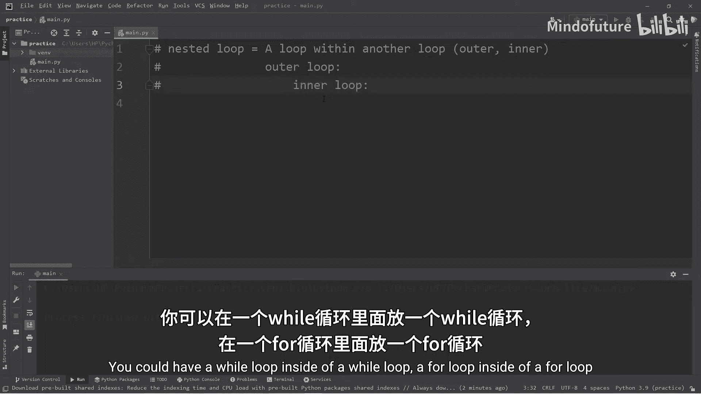
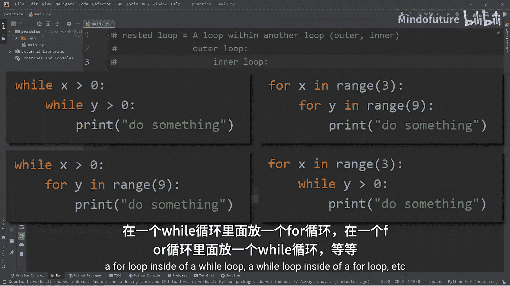
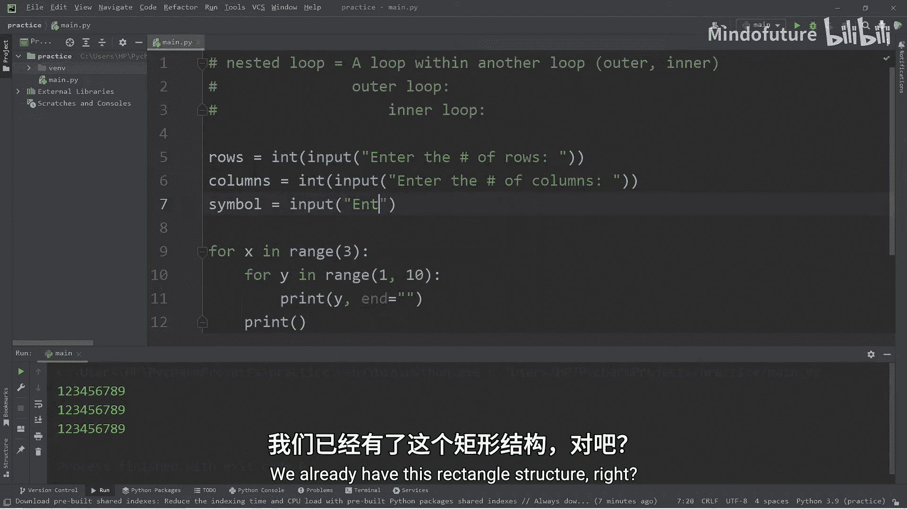
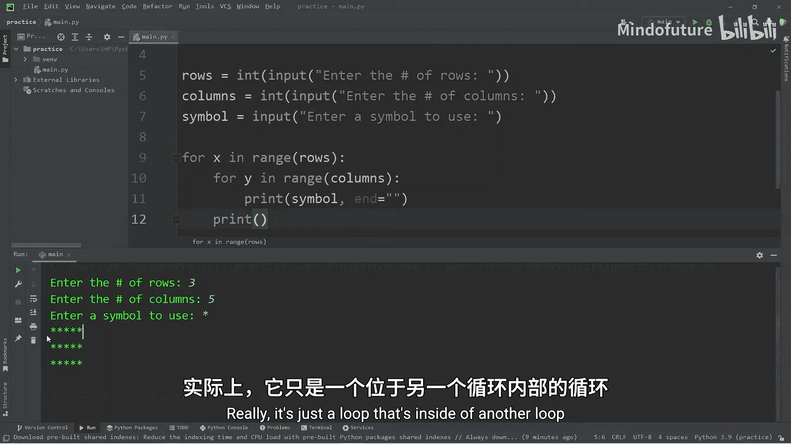
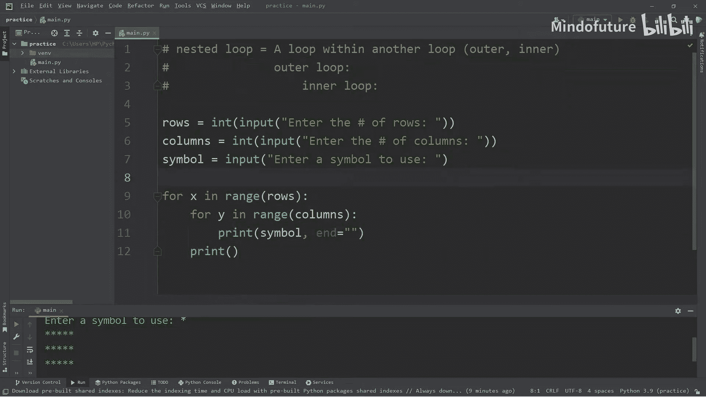

# Python超全入门教程-p19-P19-Nested-loops-in-Python-are-easy--BV1fcdLYXEw9_p19-

Everybody， So I guess in today's topic， I'm going to be explaining nested loops it looks like。

 So a nested loop， think of it as a loop found within the code of another loop。 You have a loop。

 right， Any code within that loop is indented underneath that loop。 Well。

 you could have a looping structure found within the code of another looping structure。

 The loop on the outside is the outer loop。 The internal loop within the outer loop is known as the inner loop。

 where you'll encounter nested loops。 It's really situational。

 You can have a while loop inside of a while loop， A for loop inside of a for loop。

 A for loop inside of a while loop， a while loop inside of a for loop， et cetera。

 So here is a demonstration。 Let's begin by displaying the numbers  one through 9。

 but will use a loop。😊。

4 x， x is our counter in range。1，a 10。 Remember that the second number in this case，10。

 that's exclusive。Then I will print our counter， X。

This program will print the numbers  one through 9。Now， we have an exercise at the end of this topic。

 I should probably explain this feature。 So with a print statement。

 we end each print statement with a new line character。

 If I need all of these numbers on the same line at the end of my print statement。

 I can add comma and equals an empty string。Normally， with a print statement。

 each ends with a new line character。 but we can set that to be something else。

So when I run this again， all of these numbers are on the same line or you could add a different symbol like dash or a space。

Each of these characters is now separated with the space。 But let's stick with an empty string。Okay。

 so we have used a loop to count the numbers 1 through9。

 What if I would like to repeat this three times。Well， I could create another loop。4 x in range。

You could say one comma 4， or you could just say three， either way。

Whatever code is within this loop will be executed three times。Let's cut our original for loop。

Then place it within the code of our new loop。Our outer loop will have this code repeat entirely three separate times。

 but we do have one thing we need to pay attention to。 We have two counters with the same name。

 You'll want to be sure that they're different。 Let's rename the counter of the inner loop to be Y instead of X。

 and be sure to change that here as well。Now， when I run this code， we're completing。

 let's see 27 iterations to exit the four loop。 We need to count the numbers 1 through 9。

 Once we do so， that is one iteration of the outer loop。 But our outer loop is saying， hey。

 we still need three total iterations。 Now， if you would like these on separate lines。

 let's make this look a little different。 let's add each iteration of the outer loop onto a new line。

So within the outer loop， but not within the inner loop。

 I'm going to create just a blank print statement。 This will just print a new line。

Let's try this again。With the inner loop， we count the numbers 1 through 9。

 After we exit the four loop， we will print a new line。

Then repeat this all over again until our outer loop is satisfied。 So that's basically a nested loop。

 It's just a loop that's inside of another looping structure。 So let's create a project。

 We're going to print a rectangle made of some symbol that we set。

 We'll have the user type in how many rows and columns this rectangle will have。

 We'll reuse this code that we have already written。So this time， let's accept some user input。

 rows equals input。Enter the number of rows。Then we should type cast this input as an integer。

Let's copy this line。 Pase it。Change row two columns for the second line。 En the number of。Columns。

Then let's create a symbol。 symbol equals input。Enter a symbol to use。

We are to have this rectangle structure， right。 Think of it as the outer loop is in charge of the rows。

 Let's change in range 3 to in range， rows。The inner loop will be in charge of the columns。

For y in range。Columns。We will print our symbol， whatever the user chooses。So let's try this again。

 En the number of rows。 How about four rows。10 columns。I'll use a dollar sign。So。

 here's our rectangle。We have four rows。Then 10 columns，1，2，3，4，5，6，7，8，9，10。

 Let's try it one more time。3 rows。5 columns。 and I'll use an asterisk。Yep， the three rows。

5ive columns。So， yeah， that's a nested loop。 Really， it's just a loop that's inside of another loop。

 The type of loop really doesn't matter， as well as what's within each loop。

 It's just a situation where you have a loop inside of another loop。 And yeah。

 those are nested loops in Python。

