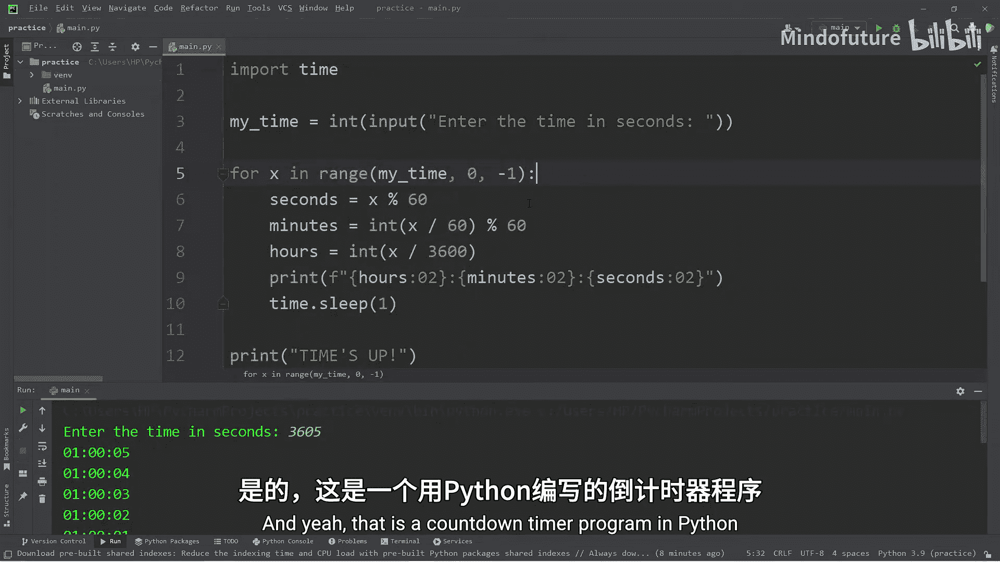

# Python超全入门教程-p20-P20-Countdown-timer-program-in-Python--BV1fcdLYXEw9_p20-

What is going on， everybody in today's topic， We're going to be creating a countdown timer in Python。

 We'll be using what we learned in the previous topics。 Let's begin。

 We'll need to import the time module。 There's a pretty cool function within the time module。

 That is the sleep function type time dot sleep Add a set app parentheses。😊。

Within the set of parentheses， our program will essentially sleep for a given amount of seconds。

 like three。After three seconds， let's print something。 This is just a demonstration。Times up。

When I execute this code， nothing happens for3 seconds， but after three seconds passes。

 it displays our message Times up。 So you can use the sleep function of the time module to sleep for a given amount of time。

We will ask the user， how long would they like to set the time before。We will create a variable。

 Let's say my time。 my time will be in seconds。We will create a prompt。Enter the time in seconds。

then we should type cast our input as an integer。We'll need to create a loop。

 We could use either a while loop or a for loop。 There's a lot of overlap where you could use either one。

 I'll use a for loop， in this case。4， well need some sort of counter X。In our range。0 through。

My time。After each iteration。We will sleep for one second。 Let's test what we have so far。

I would like to sleep for three seconds。I think that's approximately 3。

 But now we are going to print whatever x' is。Print。😡，X， X is our counter。0，1，2。Time's up。

 We're getting somewhere， but I would like to count backwards。

 What we could do is enclose our range function within the reverse function。

But another technique that we can use is by using a step。Let's replace 0， with my time。Then end at 0。

 but we will set the step to be negative 1。Then we can increment backwards using this function。

That's another technique， too， to count backwards。 So let's wait for three seconds，3，2，1， time's up。

Now， let's display a digital clock of some sort， But we would have to calculate how many hours。

 minutesute and seconds there are。 So let's calculate seconds， seconds equals。X。

 x is our count to remember。Moulus 60。Within our print statement， we'll use an F string。

We are displaying hours， minutes， and seconds。I'll add some placeholders for each of these fields。

 we have seconds。With our digital clock， we can't go above 60 for either seconds or minutes。

 That's why I'm using modulus 60。 The modulus operator gives you the remainder of any division。

 Let's begin at 11。So 1110，9。 So it is counting down， but I would like to add some zero padding。

 and we can do that with the format specifier。After seconds， I will add colon。

I need to display two digits。 then 0 pad those digits。 Let's try that again。

I will wait for 11 seconds，1110，9。 Yeah， and we do have some zero padding。

 So that's looking more and more like a digital clock。Let's add minutes， then。

So to calculate minutes。Let's assign variable minutes。Equal to。

X divided by 60 because there's 60 seconds within a minute。

 But then I'm going to type cast the result as an integer。Modulus 60。

 we would not like this field of minutes to go above 60。So let's add a placeholder。

 we displaying minutes。Format specifier 0，2。 Now， I'm going to wait for 65 seconds。

 That is one minute and 5 seconds。Then I just want to be sure that we go below a minute。Yep。

 it's working。Then let's calculate hours。 Oh， by the way， to stop your program from running。

 hit this red square up in the corner。Let's calculate hours。Hs equals。X divided by 3600。

 There's 3600 seconds in an hour。Then we will type cast the result as an integer。Within our F string。

 we will display。Hours， format specifier，0，2。Then I will run this program。

 Let's wait for 3605 seconds。That is one hour and five seconds。

I just want to be sure that we go below one hour。Yeah， all right， so that works。

So the reason that I didn't add modulus 24， I don't have days within my F string。

 We can display any amount of hours。 I will exclude modulus 24。All right， everybody。 Well。

 I thought that'd be some good practice with working with loops。

 We should try and do as many exercises as we can。 And yeah。

 that is a countdown timer program in Python。😊。

