# Python超全入门教程-p21-P21-Python-lists,-sets,-and-tuples-explained--BV1fcdLYXEw9_p21-

Well， hello， everybody。 Today。 I will be explaining a few different types of collections in Python。

 There's four general purpose collections。 Three of them are lists， sets and tuples。

 There are also dictionaries， but I'll save that for the next topic because they can be kind of tricky。

 A collection， I would think of them as a single variable。

 And I'm saying that within quotes that is used to store multiple values。

 That's how I would explain a collection to a beginner。 For example。

 let's say we have a variable variable fruit。 Fruit equals some value like Apple。And then。

 I can print this fruit。

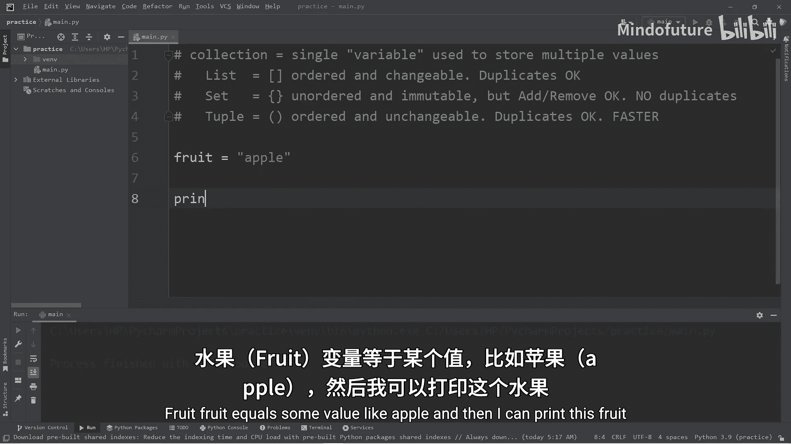

Which is Apple。 I could turn this variable into a collection by surrounding my values with either a set of square brackets for a list。

 curly braces for a set or parentheses for a tuple。 Let's begin with a list。

 If I would like to store more than one value in this variable。

 I will surround my values with a set of square brackets。 This variable is now a list。

 I can store multiple values separated with a comma。 Not only do we have an apple in this variable。

 but we have an orange。😊，A banana。And coconut。One naming convention that I like to use。

 If I declare a collection such as a list set or tuple。

 I like to take the variable name and make it plural just so that it's more obvious that this is a collection of values。

Technically， in the English language， fruit would still be plural。 English is a weird language。

 We now have a list of fruit， named fruits。If I were to print my list。This is the result。

 We have all of our values enclosed with a set of square brackets to access one of these elements found within your list。

 You can use the index operator， much like what we can do with strings。

The first element would have an index of 0。That would print my value Apple。

Index of one would be my orange。2 is banana 3， coconut。 What about 4， We don't have a value there。

List index out of range。 Each value in a collection is also known as an element。

 If we attempt to access an element that's not found within our collection。

 you'll run into an index error with the index operator。 You could set a beginning index。

 an ending index and a step。 I would like the first three elements。You could say0， colon。3。

That would give me apple， orange banana。 Technly， you don't even need the 0。 You'd need that colon。

 though， we can even use a step。 I would like every second element。Apple banana。

 It's every second element beginning from index 0。 Maybe I would like my fruit backwards。

 I'll set the step to be negative1。 Coconut banana， orange apple。

 You can use the index operator with collections， much like you can use with strings。

Another cool thing you can do too with collections is that you can iterate over them with the for loop。

4 x in my collection， fruits。What would we like to do， I will print whatever X is。

So we have iterated over our list。 Apple， orange， banana， coconut。 Now。

 X isn't really too descriptive。 What you'll see some people do is that with their collection name。

 it's plural。 their counter will be the singular version of that word。

 If our collection name is fruits， let's rename X as fruit， singular。It's not mandatory。

 but that's a common convention。 It's more readable that way for every fruit in fruits。

 If this were cars， you could say， for car in cars。

 our counter is storing whatever value is within our collection。

 So what are all the different methods that we can use with collections。

To list the different methods that are available to a collection。

 you can use the de function Within this function， Add your collection fruits。

But we would need to print this。 Let's surround this function， with a print statement。

These are all an alphabetical order。 We have attributes， which I have not explained yet。

 but I will in a future topic。 But if we scroll to the end。

We have a bunch of different methods that this list can perform。 Append， clear， copy， count， extend。

 index， insert， pop， remove， reverse and sort。 If you would like a description of each of these methods。

 there is a help function。 Help Add your collection to the parentheses。

 Then we would need to print this。Here's a description of all the methods and attributes。

 For example， we have our sort method。 And here's a description。

 Sot the list in ascending order and return none。 and then a bunch of other stuff。

 If you ever forget what you're capable of with a list or other collection。

 you can always use the help function to print a description of the attributes and methods available。

 If you need the length of how many elements are within a collection， there is the length function。

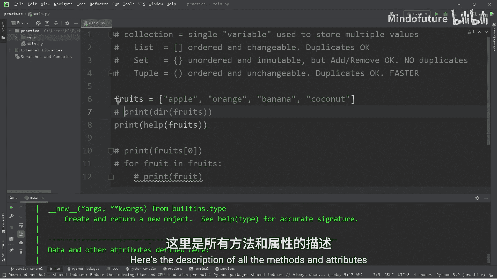

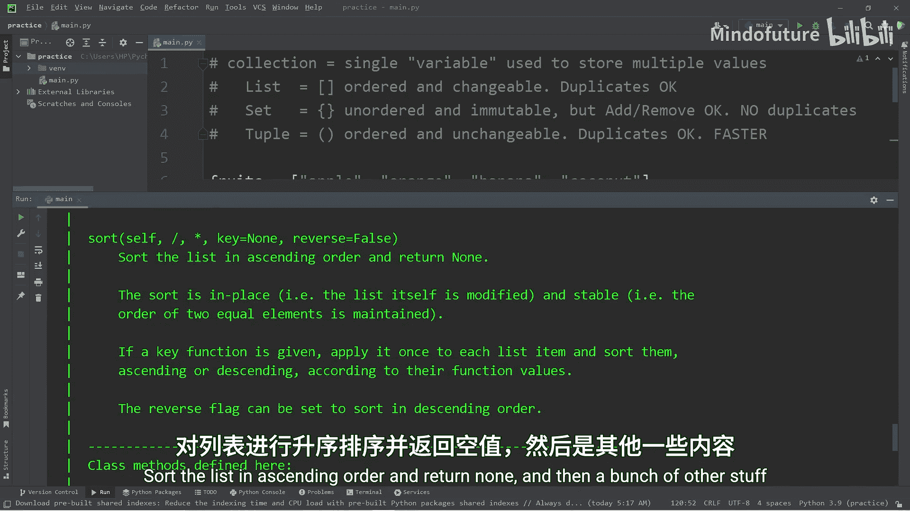

Return the length of my list fruits。Then， let's print it。There's four elements within my list。

 The length function returns 4。If I were to add an extra element， like a pineapple。

Then that number would be 5。Let's remove that。Using the in operator。

 we can find if a value is within a collection。Is our value Apple。In fruits。

But then we would need to print this。 This operator will return a boolean。

 So let's print whatever that is。Is apple in fruits。That is true。But is pineapple。Pineapple is not。

 It's false。 You can use the in operator to find if a value is within a list。

 and that applies for your other collections， too。With lists， they're ordered and changeable。

 duplicateups are okay。 We can change one of these values after we create our list。

Let's take fruits at index of 0。I will set this sequel to be a pineapple。

Then let's iterate over our fruit。

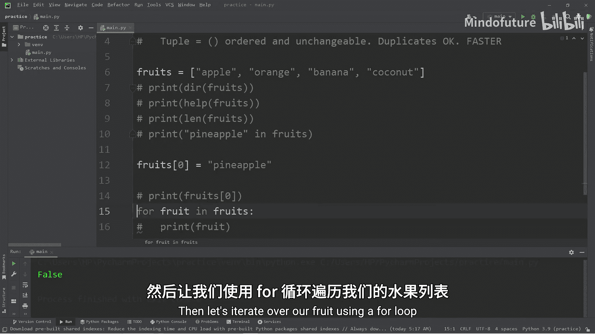

Using a for loop。Okay， the first element is no longer an apple。

 It's a pineapple than orange banana coconut。 usings an index， you can reassign one of the values。

Fer to change 0 to 1。Well， now we have an apple， pineapple， banana， coconut。

Let's cover some of the methods that are found within a list。 We can append an element。

Type the name of the list， dot append。 What would we like to append to the end of this list。

 Let's append a pineapple。

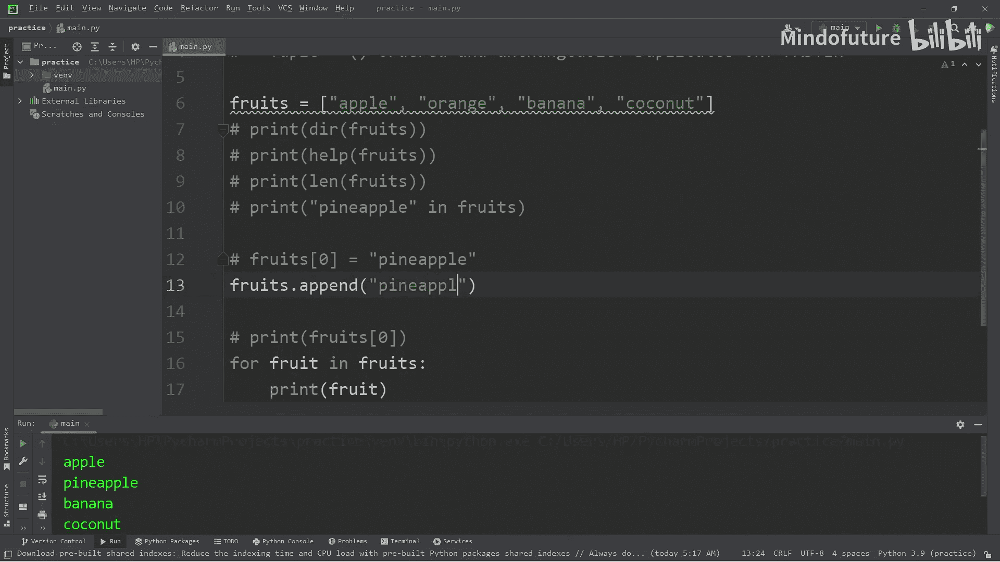

I'm going to get rid of this for loop。 I'm just going to display my list There。 We have an apple。

 an orange， banana， Coco pineapple to add an element to the end of a list。 Use the append method。

To remove an element， you can use the remove method， Frus dot remove。Let's remove our apple。

Our apple is no longer there。 We have an orange banana， coconut。Using the insert method。

 we can insert a value at a given index。Fruits dot insert。List an index，0 would be the beginning。

 then a value。Pineapple。Now we have a pineapple， apple， orange， banana， coconut。

The sort method will sort a list。 Fruit dot sort。These are all in alphabetical order。 Now， apple。

 banana， coconut， orange。To reverse a list， you would use the reverse method， Frus dot reverse。

Coconut banana， orange， apple。 However， these are not in reverse alphabetical order。

 These elements are reversed based on the order in which we place them。

 If you would like reverse alphabetical order， you can first sort and then reverse。

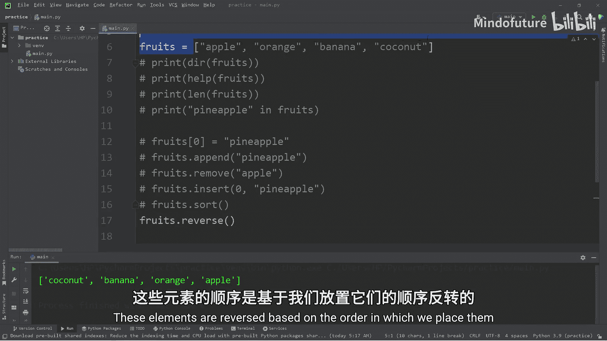

Now we have orange， coconut， banana， apple。To clear a list， use the clear method。 Frus die clear。

 All of the elements are gone。We can return the index of a value。 Let's return the index of Apple。

Fruit do。Index list and element。Then we will need to print this。Let's print the index。

 That is returned。The index of Apple is 0。Coconut。That would be three。

What if we don't find a value like a pineapple？Well， we have an error。 Pineapple is not in list。

You could count the amount of times that a value is found within a list because duplicates are okay。

Fruits dot count。 Let's count how many bananas are in this list。Banana。Then print it。

1 banana is found within this list。How about pineapples。There are 0。

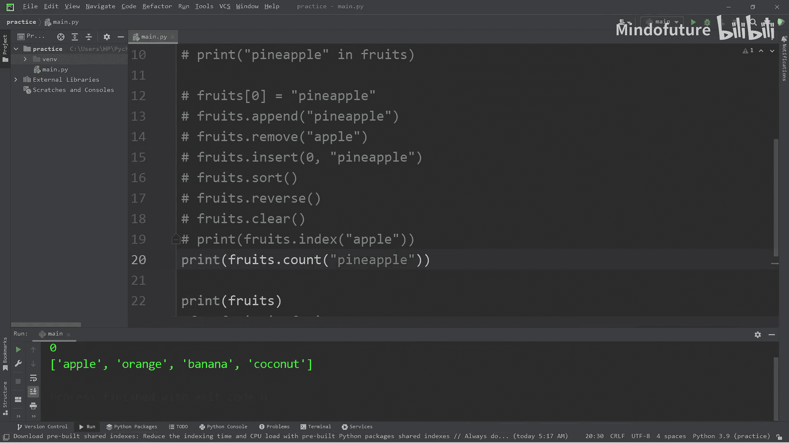

Now， those are lists surround your values with a set of square brackets。

 These values are ordered and changeable。 Duplics are okay。 Now。

 let's talk about the next collection， which is a set to create a set。

 surround your values instead with a set of curly braces。Our collection of fruits is now a set。

 A set has different benefits。 The values are unordered and immutable。

 meaning we can't alter these values。 However， we can add and remove elements。

 A set does not include any duplicates。 I'm going to delete these methods。

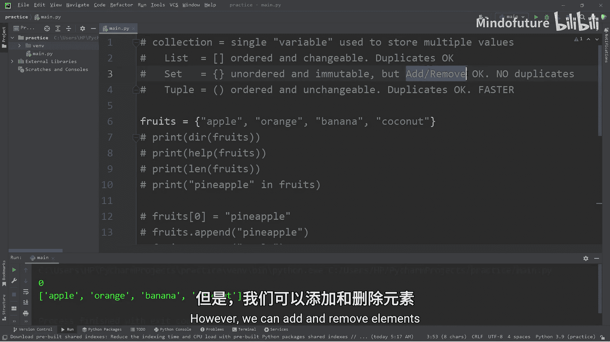

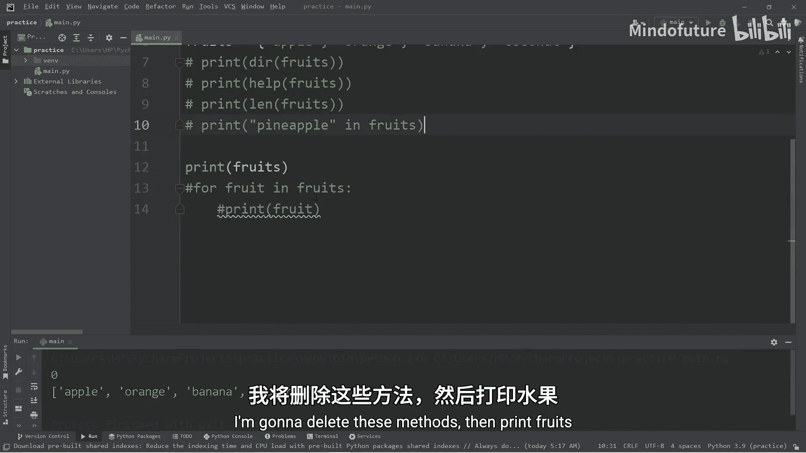

Then， print fruits。We have all of the same values， but they are not in the same order as they were originally。

 A set is unordered。 If I were to run this again， they will likely be in a different order。

 See now we have a banana， apple， coconutco orange。

To display all of the different attributes and methods of a set。You can use the de function。

And here's all of them。 Some of these methods are a little more advanced。

 but there's a few we might recognize like add， clear。

 copy for an in depth description of these methods， you can use the help function。

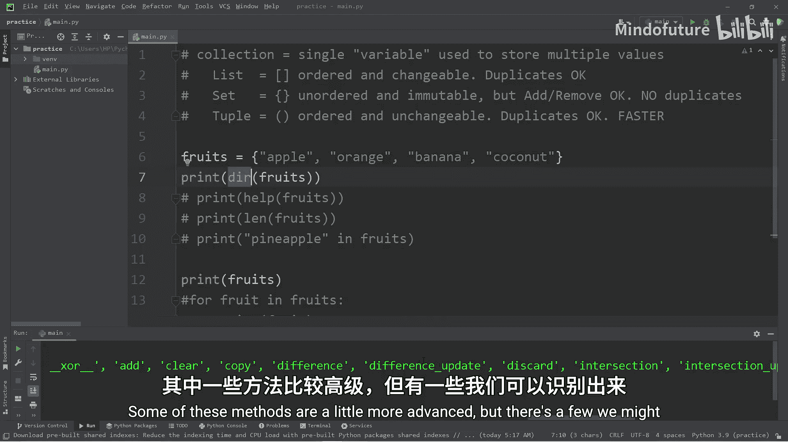

Much like what we did before to find the length of our set。 we can use the length function。

 which is for。We can use the in operator to find if a value is found within the set。Unfortunately。

 pineapples are not within our set。Now， if I was to use the index operator of my set。

This is what would happen。We have an error set object is not subscriptable。

 We're not able to use indexing on a set because they're unordered。

 much like what we can do with a list or a string。We can't change the values of a set。

 but we could add a remove elements。Let's use the add method to add。 Gus what， a pineapple。

That is okay。 O， apple， pineapple， coconut， banana。We can remove an element， fruit do remove。

Let's remove our apple。Our apple is gone。 Cocon， orange banana。We can pop。

The pop method will remove whatever element is first， but it's going to be random， though。

Orange coconut banana。Apple coconut banana。Apple banana coconut。You can clear fruit stock clear。

The elements of our set are gone。

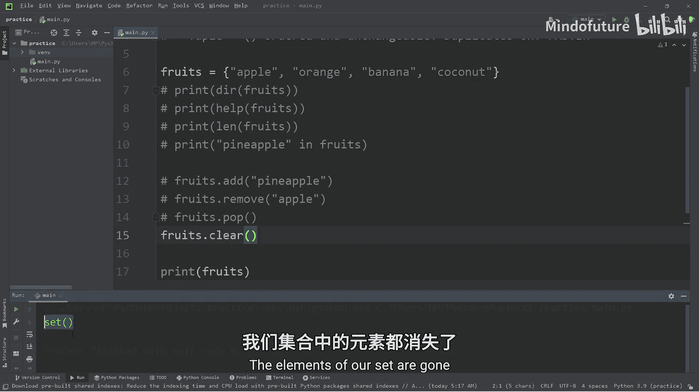

Those are a few of the more useful methods for beginners As a summary。

 a set is a collection that is unordered and immutable。 You can't change the values。

 but adding and removing elements is okay。 No duplicates are allowed。 Let's try that real quick。

 I'm going to add a second cocoanut。Yes， see。 We only still have one coconut。

 Se may work well if you're working with constants。Maybe colors， for example。

 you need to find if a color is within a set。Al right。 Now， lastly， let's talk about tuples。

 A tuple is a collection that is surrounded with a set of parentheses。

Tups are ordered and unchangeable。 Duplicates are okay。

 One benefit of a tuple over a list is that tuples are faster than lists。

 If you're working with a collection and it's okay if the collection is ordered and unchangeable。

 you might as well use a tuple because it's faster。 When I print our tuple。

 All of these values are surrounded with a set of parentheses。Again。

 we have the deer function to display the attributes and methods。

 There's not as many for a tuple for methods。 We only have count and index。Again， there's also help。

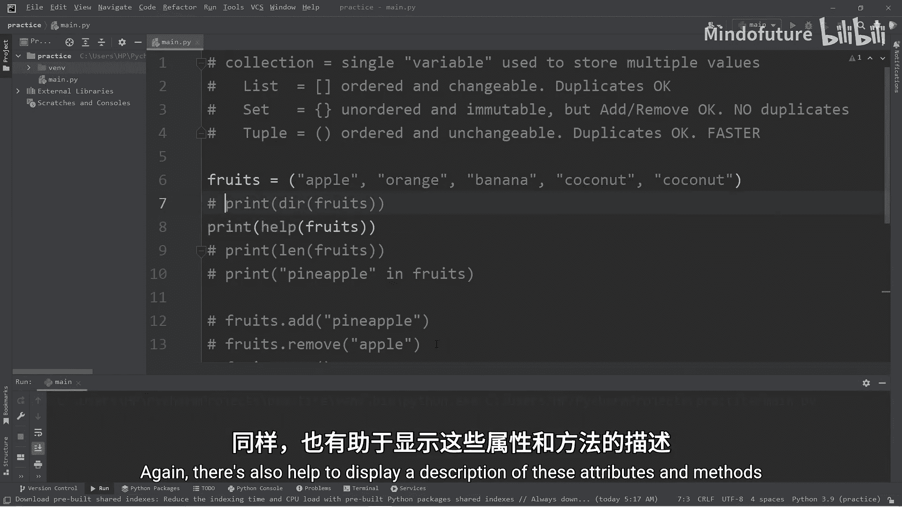

To display a description of these attributes and methods。

You can find the length of a tuple with the length function。 We have five elements within here。

Using the in operator， we can find if a value is found within our tuple。

Our pineapple is not within our fruits。So there's only two methods we have access to。

 Let's find the index of Apple fruitrus do index。Apple， then I will print whatever is returned。

Apple is found at index 0。 There is also count fruits dot count。

How many coconuts are found within our tuple fruits。Count the coconuts， then print this。

How many coconuts we have two coconuts。And then again， with any of these collections。

 they're iterable， so you can iterate over them using a for loop。F fruit and fruits。Yep， apple。

 orange， banana， coconut， coconut。Allright， everybody。 So those are collections。

 Think of them as a single variable used to store multiple values。

 There's four general purpose collections for beginners。 lists， sets， Tuples， and then dictionaries。

 which we'll talk about next。 Each of them has unique benefits。 Ls are ordered and changeable。

 Duplics are okay。 A set is unordered and im mutable， but adding and removing elements is okay。

 No duplicates allowed。 A tuple is ordered and unchangeable。 Duplics are okay。

 and they are faster than lists， Use tuples， if you can over a list。 But yeah。

 those are a few collections in Python。😊。

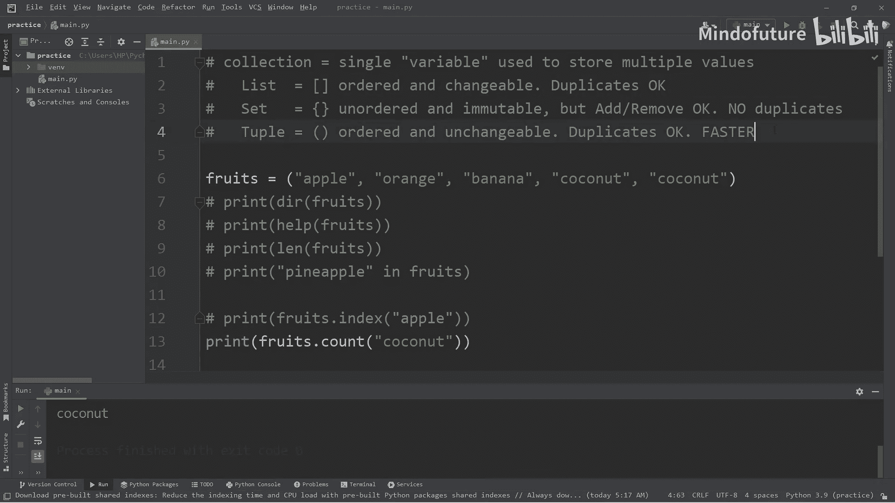