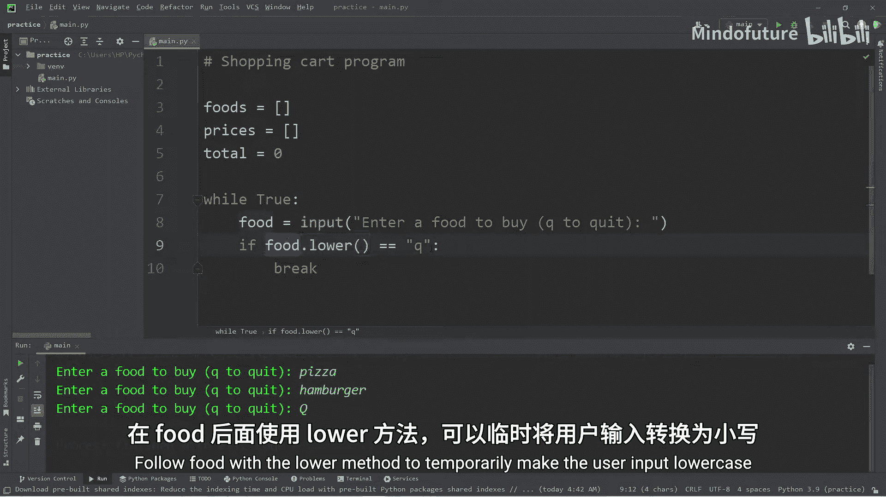
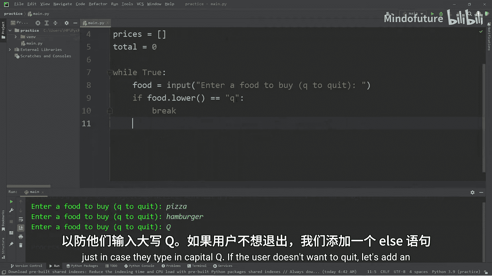
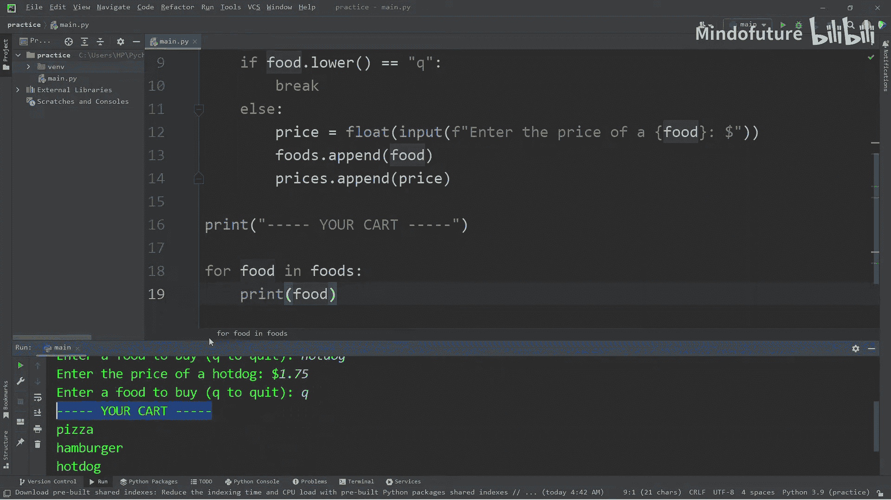
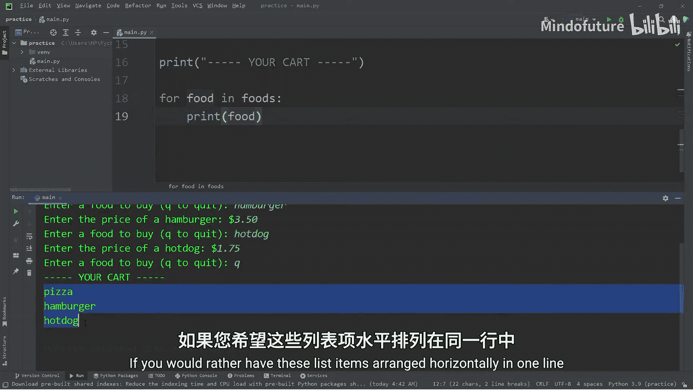
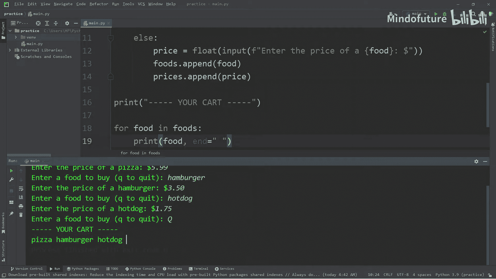
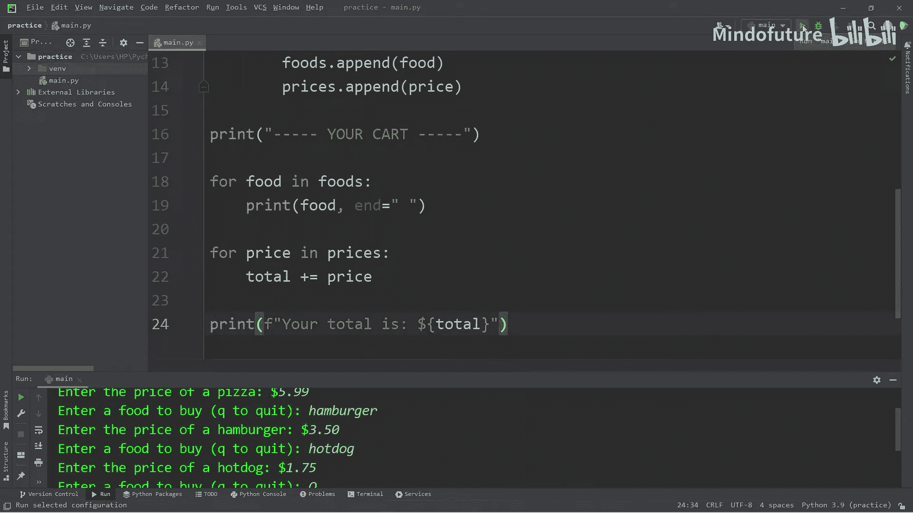
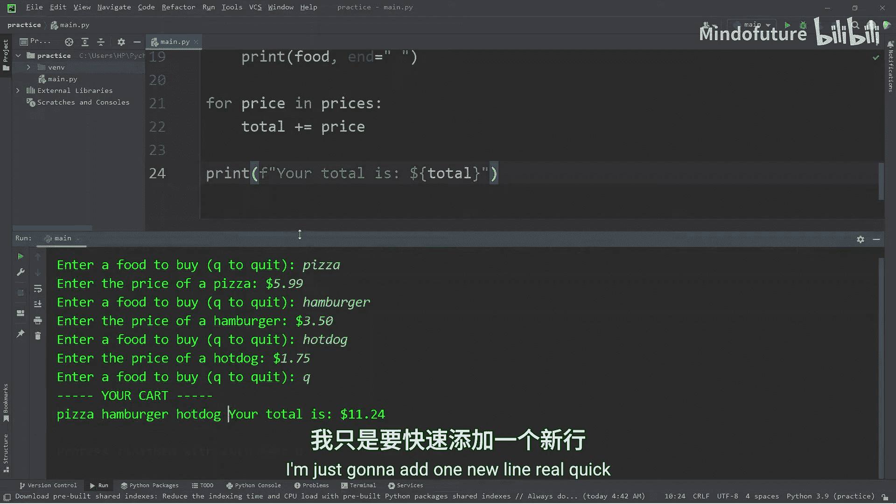
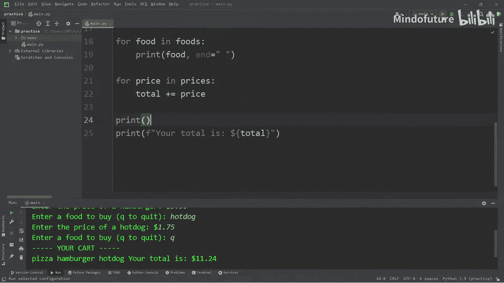
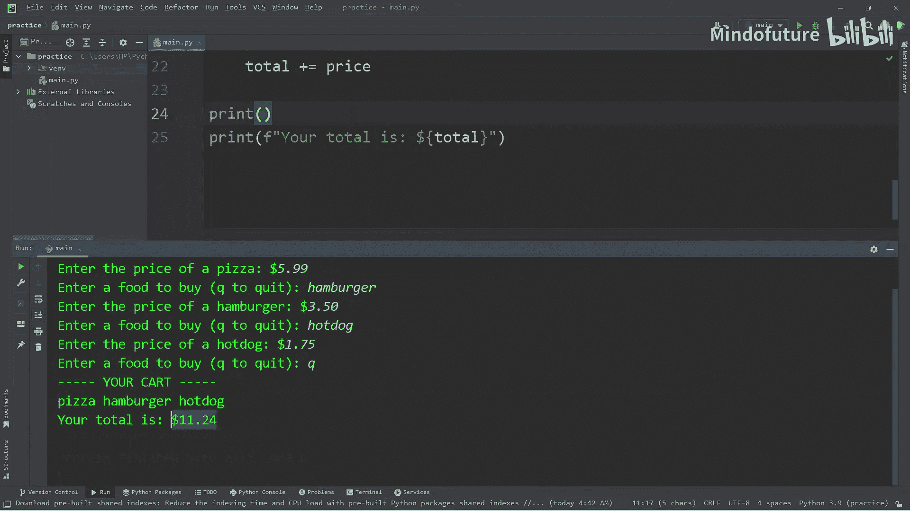
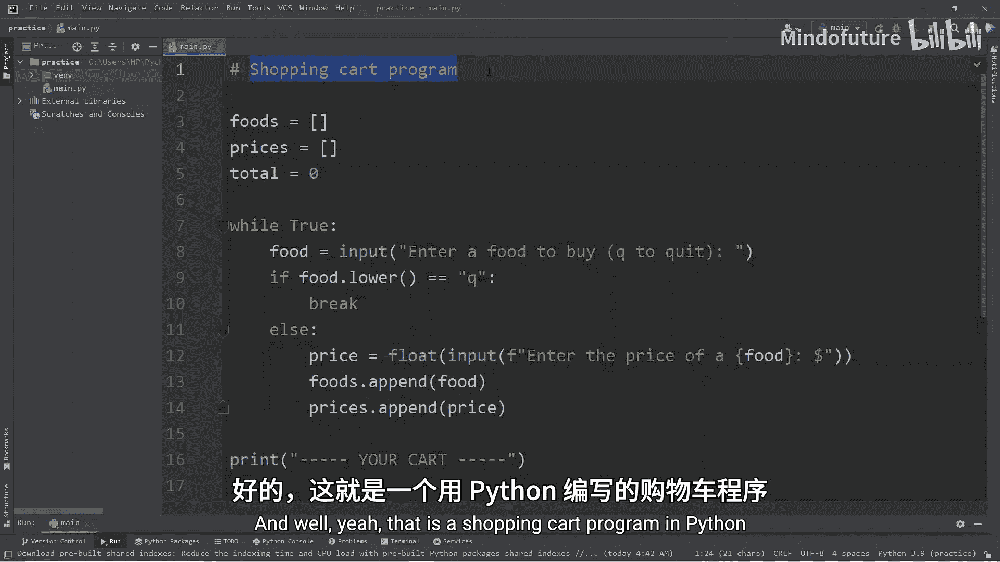

# Python超全入门教程-p22-P22-Python-shopping-cart-program--BV1fcdLYXEw9_p22-

Hello， everybody。 today， we will be creating a shopping cart program。

 This program will be an exercise to follow the previous lesson on lists， sets and tuples。

 The more that we practice with those collections， the better we'll be at using them。

 So I thought we'd create an exercise to get the hang of it before moving on in this program。

 we will have two lists。😊，Foods， these lists will be empty。 We'll declare them。

 but not use them quite yet。And prices。Then， a total。Total equals 0。

The reason that I'm not using tuples is that tuples are unchangeable。

 We're going to ask a user what food they would like to buy。 We can't depend any elements to a tuple。

 We're not using sets because sets are unordered。 I mean， I guess technically， you could。

 But at the end of this program， I'm going to print our shopping cart in order。

 So I think lists would probably be the best。 We have an empty list of foods and an empty list of prices。

 We'll use a while loop。 while true。If our condition is set to true。

 we'll need some way to break out of the wild loop。 We'll need a break statement somewhere。

We'll get to that later。 We will ask the user what food would they like to buy。

Let's declare variable food， equal to input。Enter a food to buy。To exit the while loop。

 you need to press Q Q2， quit。Then， let's check if。Food is equal to Q。 Lowcase Q。Then we will break。

 We're not done with the program， but let's at least test it。Pizza。Hamburger。Hot dog。 cue to quit。

 Okay， it looks like it works。Now， what if somebody types in uppercase Q？Pizza。Hamburger。

 uppercase queue。Well， we can't actually quit。After accepting our user input。

 if food dot lower method， this will take our input， make it lowercase， just for a comparison。

Let's try that again。Pizza， hamburger。I'll type capital Q to quit。 and that is valid。

Follow food with the lower method to temporarily make the user input lowercase。

Just in case they type in capital Q。 If the user doesn't want to quit， let's add an L statement。

Else， let's take our foods， use the append method， then add whatever food the user typed in。

 We'll also need a price。Let's ask a user for the price。Price equals。Input。Enter the price of。

 let's use an F string。A。Whatever food the user types in。Pick a unit of currency。 I'll pick dollars。

We are working with numbers。 We should type cast our input as a floating point number。

Since we're working with prices。So we will accept a price。 Add our food item to our list of foods。

 Do the same thing with prices， prices dot append。Whatever the price was。And that is the while loop。

Let's test this program again to be sure that everything's working。Pizza。Pizza will be $5。99。

Enter a food to buy。Hamburger， hamburgers will be 3，50。Hot dog。 Hot dogs will be 1，75。

 I would like to quit。 I will type either capital queue or a lowercase queue。 Both will work。

 And we have escaped the wild loop。 So the while loop is now complete outside of the wild loop。

 Let's display our shopping cart。 Let's print some decorative text。Maybe five dashes。Your cart。

 then another five dashes。I will then iterate over all of the elements found within my foods list。

For every food。In my list of foods。Let's print。Each food item。Let's take a look so far。 Again。

 we have a pizza。 The price was 5，99。Hamburger。The price was 3，50。Hot dog 1，75。 cu to quit。Okay。

 your cart。

That will display the individual list items If you would rather have these list items arranged horizontally in one line。

You can add this keyword， and equals。This end keyword will replace the new line character at the end of a print statement with s otherother character。

 like a space。Let's try that again。I'll try not to take too much time。Pizza。5，99。Hamburger。3，50。

Hot dog。1，75。You would to quit。Yeah， that's much better。

 We are horizontally listing all of the different items within our list。

 You could revert back to the vertical list if you'd prefer that。 I'll keep my output like this。

 Then we will need to iterate and add up all the prices。

For every price in prices。We do have a total variable that we declared。 Let's utilize that。

Total equals total， plus price。Otherwise， we could shorten this too plus equals price that would do the same thing。

Then we will display the total。Print， I'll use enough string。Your total is。

I'll add a unit of currency。 I picked the dollar sign。Whatever the total is。Okay。

 let's run this program one last time。

Enter a food to buy。Pizza， which was 5，99。Hamburger。Which was 3，50。Hot dogs。They are 1，75。

Cute to quit。Here is your shopping cart。 I'm just going to add one new line real quick right before we display the total。

Just an empty print statement。

Here are the results。 your cart， pizza， hamburger， hot dog。 your total is $11。24。

Al right， everybody。 Well， that is a shopping cart program。

 I thought this would be a fun exercise to follow the previous lesson on lists， sets and tuples。

 And well， yeah， that is a shopping cart program in Python。😊。

