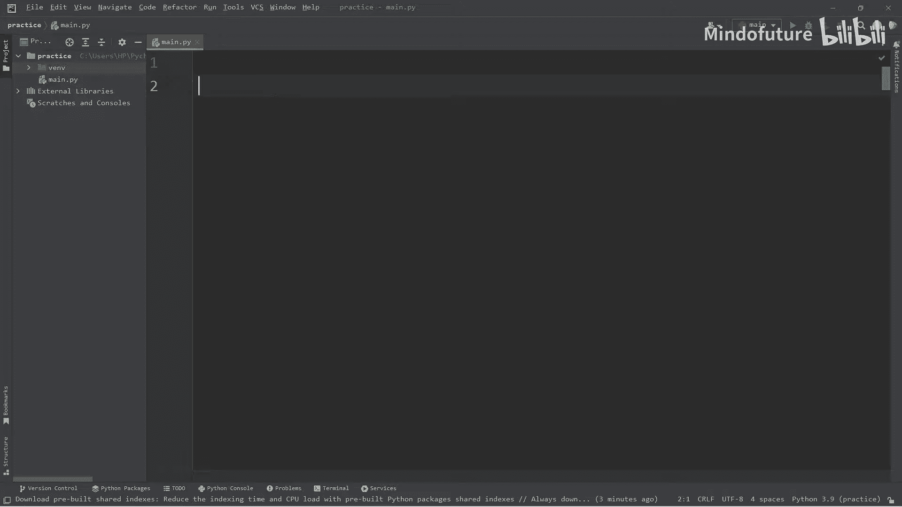
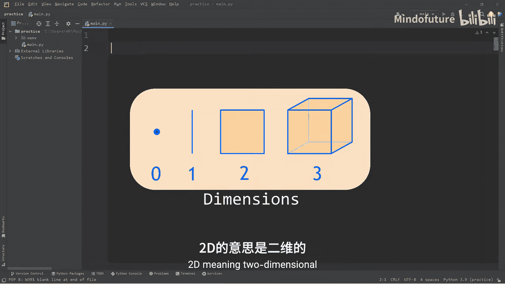
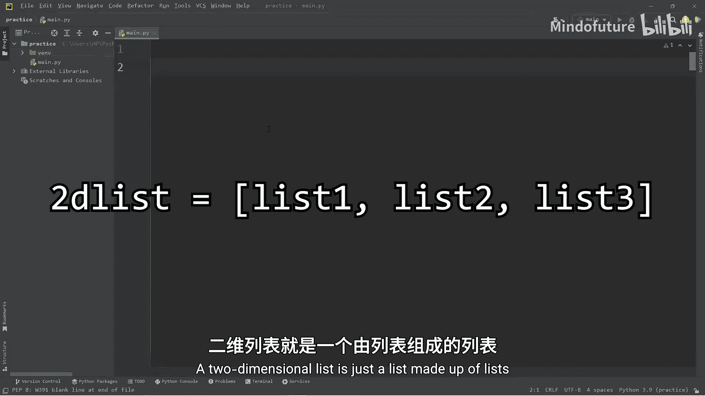
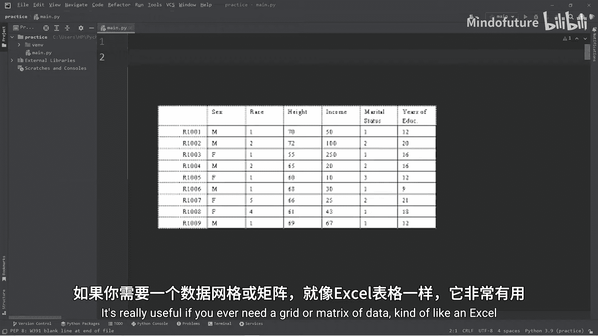
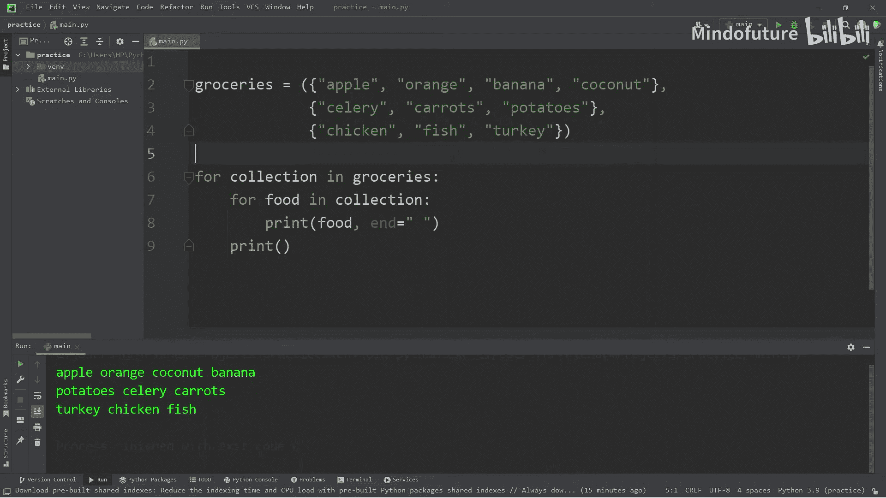
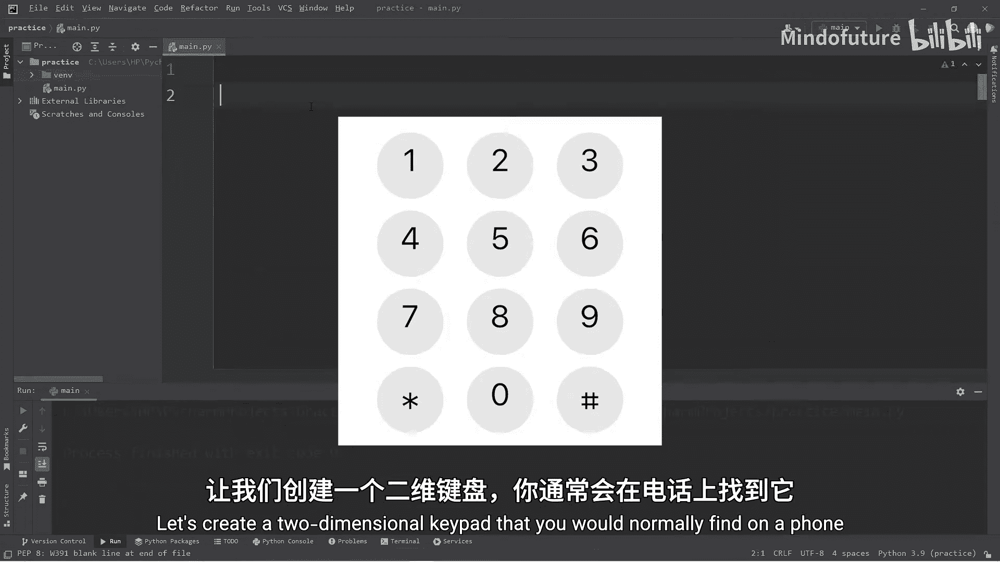
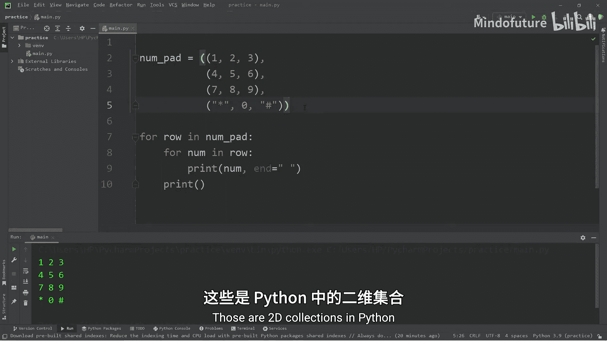

# Python超全入门教程-p23-P23-Python-2D-collections-are-easy--BV1fcdLYXEw9_p23-

Hey， what's going on， everybody。 So today， I'm gonna to be explaining 2D lists，2D。

 meaning 2 dimensional。 You do also have the capability of creating 2D tuples。

 I thought today we would use 2D lists just because they're pretty flexible。

 A two dimensional list is just a list made up of lists。

 It's really useful if you ever need a grid or matrix of data。 kind of like an Excel spreadsheet。

 Let's create three lists。😊。

A list of fruit。Vegetables。And meat。I'm going to speed up this video。

 feel free to pause if you need to catch up。Here I have three lists， a list of fruit。

 vegetables and meat。 Each of these lists is a one dimensional list to create a two dimensional list。

 Well， you would begin by creating a one dimensional list。 Let's create a list of groceries。😊。

All I would need to do is add my individual lists as elements to the outer list， the 2D list。

We have fruits， vegetables， and meats。Normally， to print a list or your other collections。

You would print the name the list。In my list fruits， I have apple， orange， banana。

 coconut to access or change one of the elements。 You would type the name of the list。

 then use the index operator。 So fruits at index of 0。Is a pineapple again？With a 2D list。

 it's a little different。 If I were to print my 2D list of groceries。

We would lay out the entire 2D list flat。 We have individual lists separated with a comma all enclosed within a set of square brackets。

 Ta the elements found within our 2D list。 I'm going to line these up， kinda like this。

It kind of represents a grid or matrix with rows and columns。 Each individual list resembles a row。

 Each element resembles a column。 If I were to print groceries at index 0。

In place of returning one element found within one of the lists。That would return an entire row。

 So groceries at index 0 is my fruits list。Groceries at index 1。Is my vegetables list。

 Grooceries at index 2 is my meats list for one of the elements found within one of the rows。

 you would need two indices。If I need the apple from the first row within my 2D listed of groceries。

 that would be row 0， column 0。It's kind of like coordinates。Row 0， column 0。 That would be my apple。

0，1。Which is an orange。0，2 is banana，0，3 is coconutcout。For the next row。

 I would set the first index to be one。Row 1， column 0。 That would be celery。

 I'm going to speed run this real quick just to show you all the different elements。1，1 is carrots。1。

2 is potatoes。 If we try to access 1，3。That index is out of range because we only have three elements within this row。

So then the next row would have an index of  two column 0 would be chicken。2，1 is fish。To。

2 is turkey。2，3 is out of bounds。To access an element from a2D list。

 you would need two indices in place of one， because using just one would return the entire row like so。

Now， when you declare a 2D list， you don't need to necessarily give each inner list a name。

 We could do something like this。I'm going to replace these names。With the rose。

I'm just going to put these on a new line to make it more readable。There， that would work too。

Just separate each inner list with the comma， then enclose everything with a set of square brackets。

If you ever need to iterate over the elements of a 2D list， you can use nested loops。

 If I were to use a single four loop， let's say for every maybe collection。For every collection in。

Groceies。Let's print what our collection is。Using a single four loop would iterate over the rows。

 but to also iterate over the elements found within each row， we would use a nested loop。

For every food in our collection。Let's print what our food is。Using nested loops。

 we can iterate over all of the elements found within our 2D list。

 but I'm going to make this more organized like that grid structure we have。

I'm going to replace the new line character at the end of a print statement， with a space。

Then when we exit the nested loop， I will print a new line by using just an empty print statement。

There， that kind of resembles our grid structure。We have Rose。And we have columns。

With two dimensional collections， you're not limited to just lists。

 You could create a list of tuples。So the inner rows will be surrounded with a set of parentheses。

You know， this is also valid， too， or you can make a 2D tuple。 It's a tuple that's made up of tuples。

You could make a tuple made up of sets。Seets are enclosed with a set of curly braces。

Here we have a tuple made of sets。Use whatever is best for your own programs。

Let's go over an exercise。 Let's create a two dimensional keypad that you would normally find on a phone。

 We have three data types， a list， a set， or a tuple。

The elements in a set are unordered， so we can't use that。 These numbers need to be in order。

 If we have the option， a tuple is faster than a list。 A tuple is ordered and unchangeable。

 so we should use it if we can。 And that's perfectly fine。 Let's create a2y tuple this time。

 I will name this 2y tuple nupad。We have an outer set of parentheses。

 then an inner set of parentheses for each row。 We will have four rows。The first row will be 1，2，3。

The second row， I'm going to put this on a new line。4，5，6。The next row will be 7，8，9。

Then the last row will be an asterisk character。Then zero。Then， the pound sign。So numppa。

 in this case， is a 2D tuple。Let's use a for loop to iterate over every row。

 This will be the outer loop for every， maybe row for every row in。Numbpad。

Let's begin by printing our row。So we're printing every row in our nunpa。

 but I'd like to remove the parentheses。Let's create a nested loop。For every。

Maybe numb for numb in row。Print whatever that nu is。We have one long vertical line。

 Let's replace the new line character at the end of our print statement， with the space。

Then when we escape the nested loop， let's print a new line。And there is our telephone number pad。

 You can see it's a grid made up of rows and columns。So， yeah， that's a 2D list。 Well。

 a 2D collection。 It's a collection that's made up of collections。Then with our nump pad。

 we made a 2 D tuple。 If you ever need a greater or matrix of data。

 A 2D collection would work perfect。 And there you have it， everybody。

 Those are 2D collections in Python。😊。

