# Python超全入门教程-p24-P24-Create-a-QUIZ-GAME-with-Python--BV1fcdLYXEw9_p24-

Hello again， everybody。 So today， we're going to create a quiz game in Python。

 Let's declare all of the different collections and variables that we'll need first。

 We will need a couple of questions。A 2D tuple of options。My quiz will have five questions。

 but you can add more or less questions。Then a couple of answers。A list of guesses。

We will be appending guesses to our list， that's why we're using a list rather than a tuple。

A score variable， which I will set to be 0， then question number。

This variable will keep track of what number question we're on。All right。

 let's begin with our questions， I have five。Here are my questions。 Therere all signs related。

 Feel free to choose your own。 This is what I have。 How many elements are in the periodic table。

 Which animal lays the largest eggs。 What is the most abundant gas in earth's atmosphere。

 How many bones are in the human body， Which planted in the solar system is the hottest。

 These are the questions but will need options， Let's add four options for every question。

 That's why we're using a two dimensional tuple。 Each inner tuple will consist of four elements。

They will be options a。D。屎。Or D。Let's copy these elements， then paste them within each tuple。

This first element corresponds to my first question。 How many elements are in the periodic table。

 I'll come up with some answers。I'll add some answers for the rest of these tuples too。

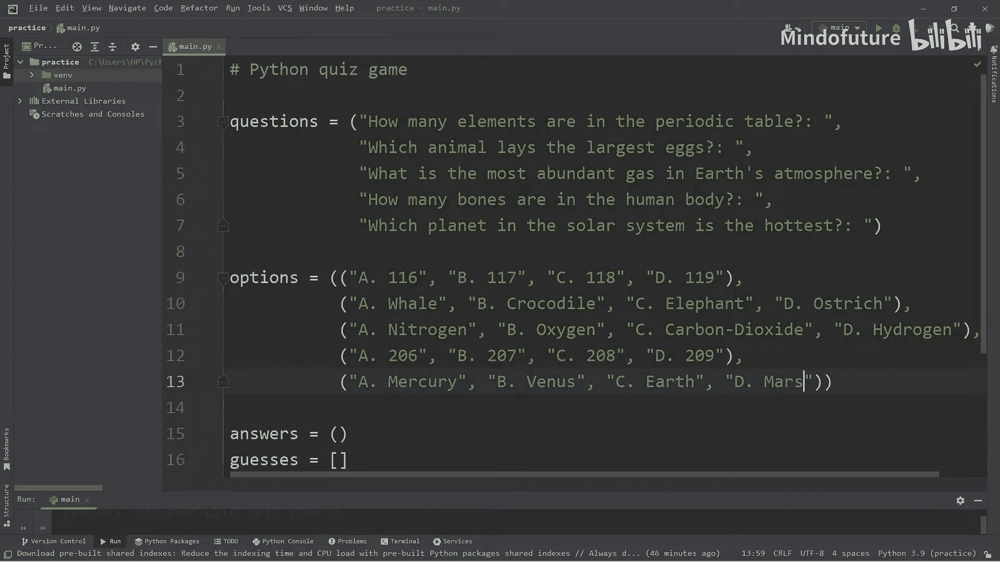

We have a couple of correct answers。The orders are C。D。A。诶。B。If you come up with your own options。

 your answers may be different Now that we have all of our different collections and variables taken care of。

 let's display each question。

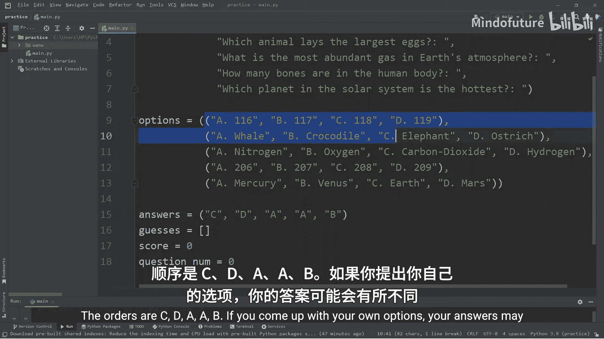

I will iterate over our couple of questions。 They are iterable for every question in questions。

I'm going to print some decorative text。I think that's probably good。

Then I will print each question we're iterating over。

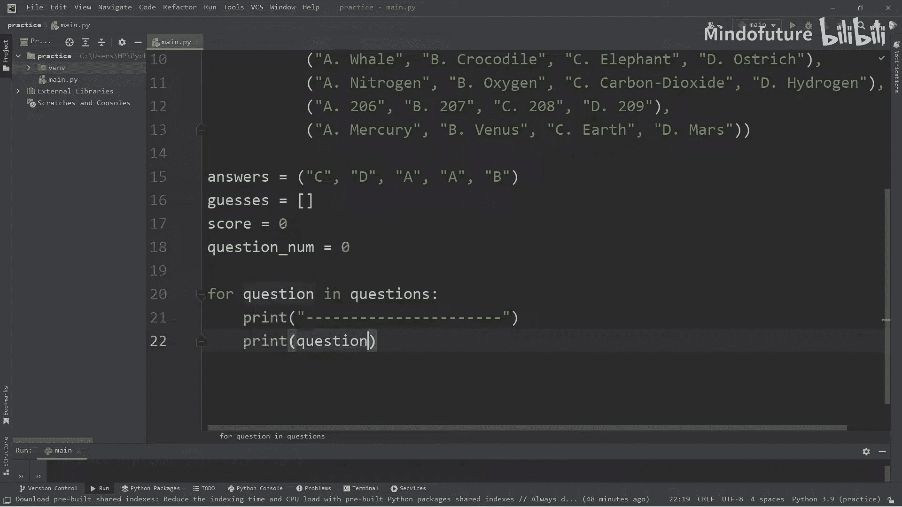

So let's see what we have so far。There's all five questions。

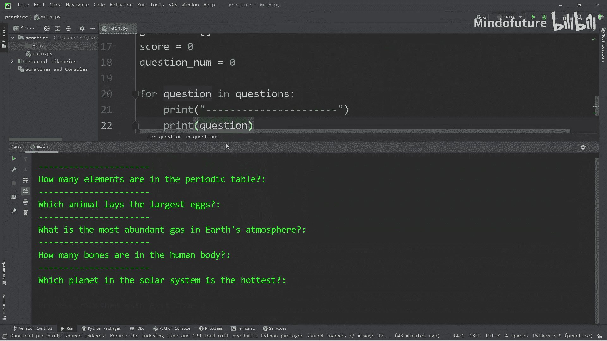

After we display every question， I need to display every option。For every option in options。

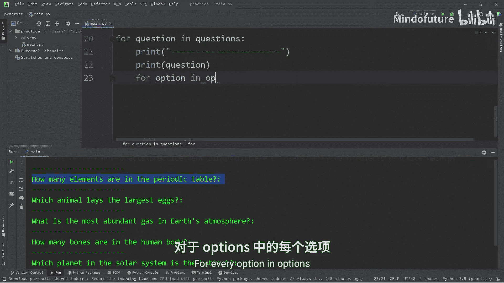

Our options options is a 2D tuple。

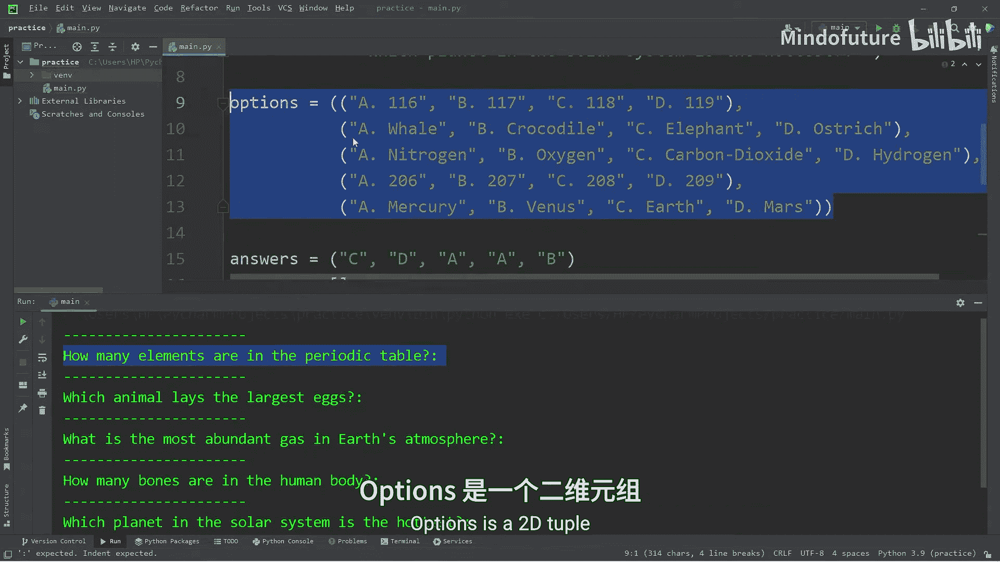

Let's add the index operator。The index is going to be our question number variable。It's a number。

 So at first， we're accessing options at index of 0， then 1，2，3，4，5。

We will print every option in options at a given row number。Let's test this。

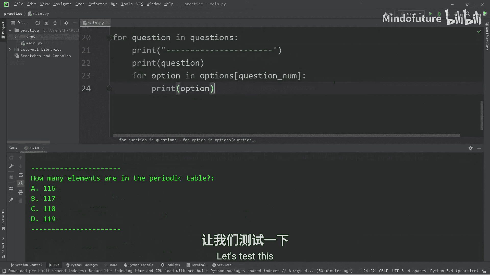

Okay， we have some options， but all of these options are for the first question。

 we will need to increment our question number， so let's do that maybe here。

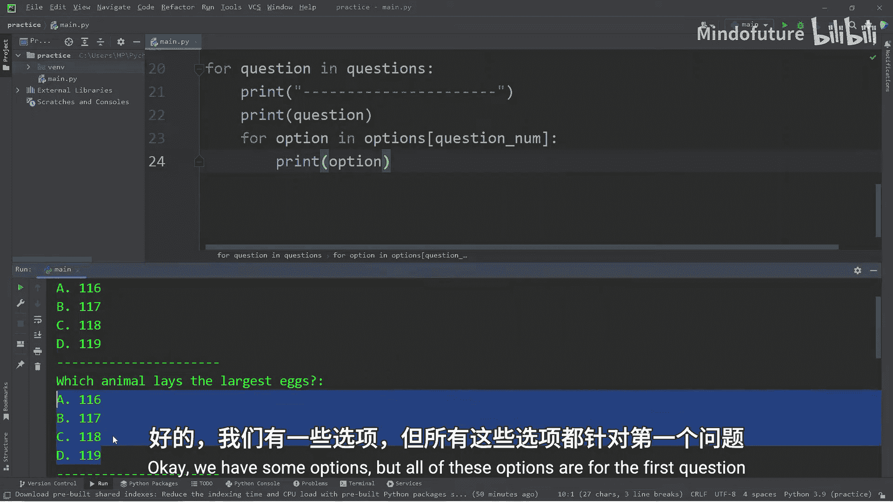

Question。Number plus equals one。That is much better。Before iterating the question number。

 we will ask the user for a guess。Guess equals input。Enter。诶。BCD。

In case the user types in something that's lowercase。

 I will follow this input with the upper method to make the user input uppercase。

We will take our list of guesses。Use the appendum method。Add our guests。To that list。

If our guess is equal to。The answers topple at index of question number。

That means the user gets the right answer。 Let's increase the user score score plus equals one。Then。

 print the word， correct。Correct。Else， we will print。Incorrect。I'll use an up string。Our answers。

At index of question number。Is the correct？Answer。All right， let's answer some of these questions。

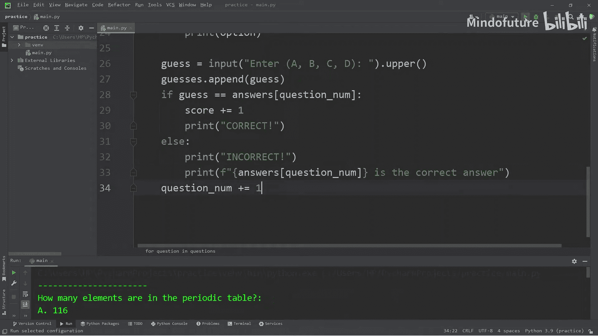

C。Correct， which animal lays the largest eggs， definitely the whale because the whale's the largest creature。

 right？Incorrect， D is the correct answer。What is the most abundant gas in Earth's atmosphere。

 nitrogen， correct， How many bones are in the human body， D， that is incorrect。

 A is the right answer。 Which planeted in the solar system is the hottest Mercury。

 because it's closest to the sun， right。Wrong， incorrect， B is the correct answer。

 We're keeping track of our answers successfully。 Once we complete all the questions。

 let's print the results。

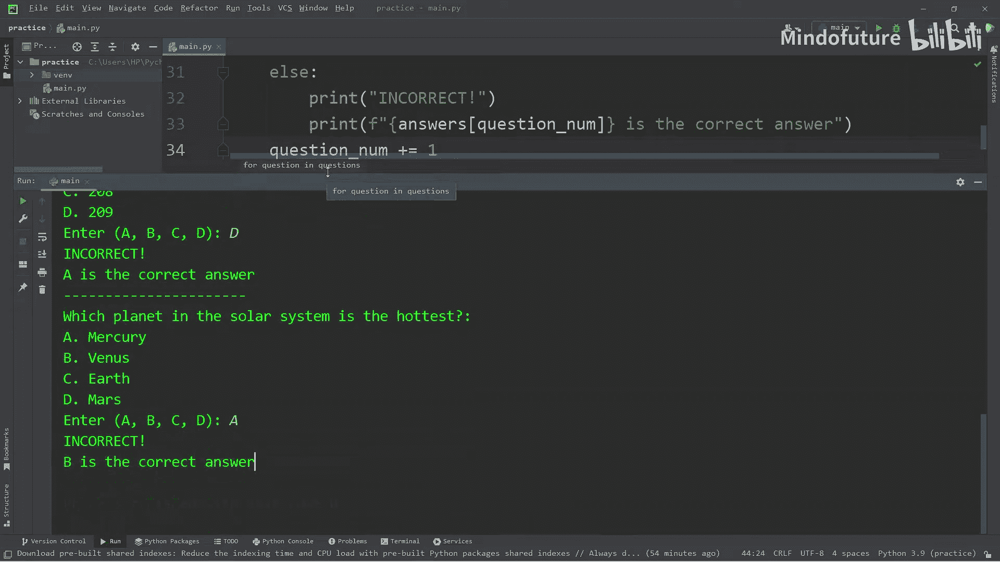

I'm going to add some decorative text。Not necessary， but I think it would look cool。

I will display the results。We will iterate over all of the answers and the guesses。Print。Answers。

I'm going to set the ending character。To be an empty string。For every answer。In。Answers。Print。

Each answer。I will set the ending character to be a space to separate each chanceor。

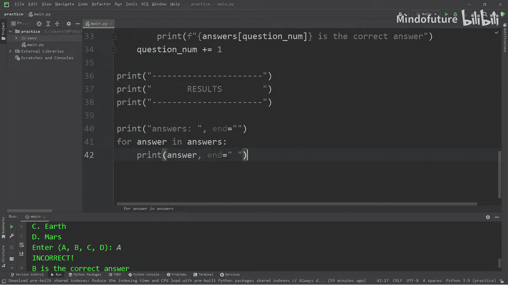

Then I'll add a new print line。Let's do this with guesses。

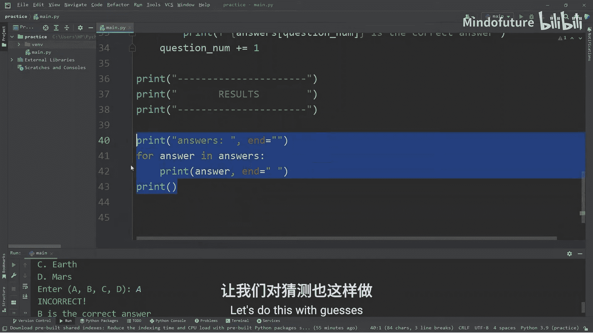

Change answers to guesses。For every guess in guesses， print each guess。

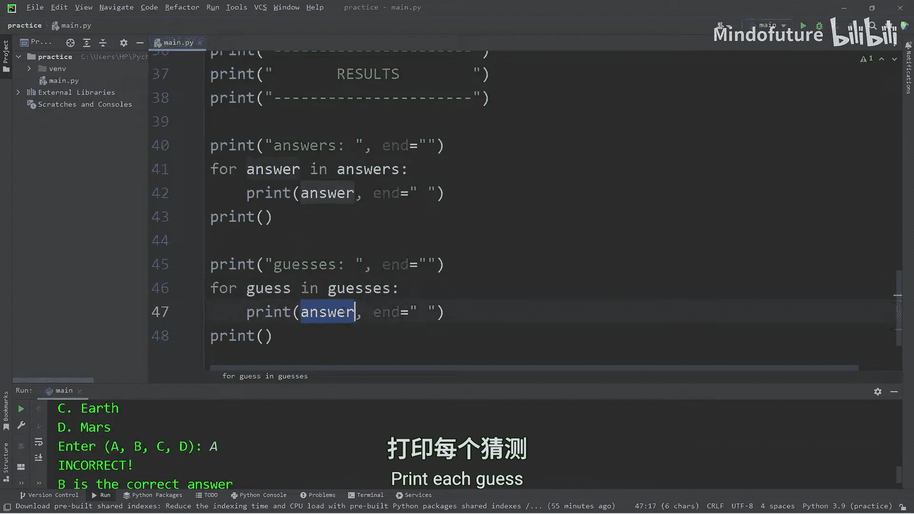

Okay， I'm going to run this again。I'm just going to make up some answers， A， B， C， D。

Here are the correct answers。 Here are the guesses。 I guess none of them right。

 Then we will print a score。

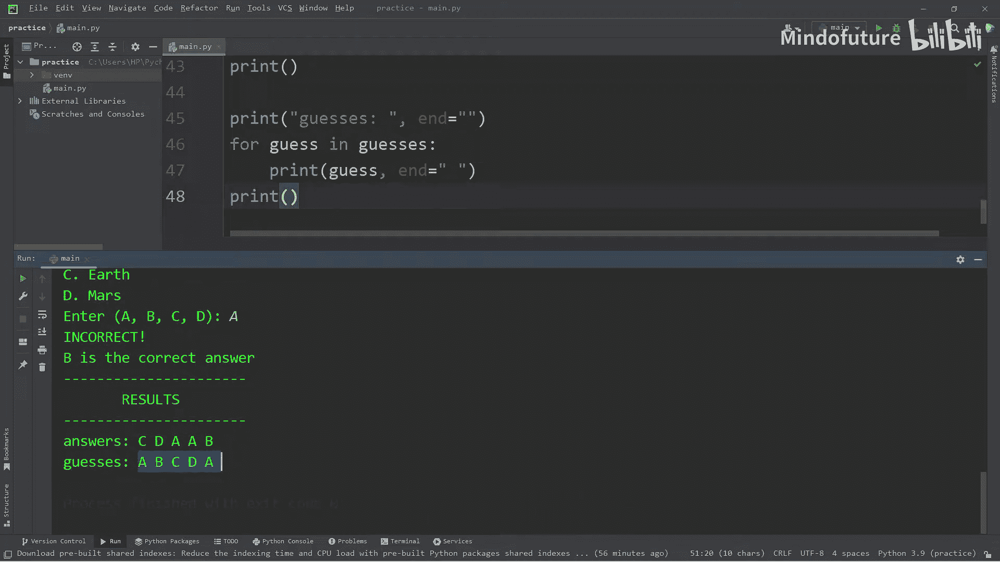

Score equals。Take our score， divided by。I'm going to use the length function。

 then pass in our questions。How many elements are within our questions Tbble。

 Then I will multiply all of this by 100 to give us a percentage。

 Then type cast this whole formula as an integer。So we're basically just reassigning our score variable。

Then let's print using an F string。Your score。Is。Our score variable。

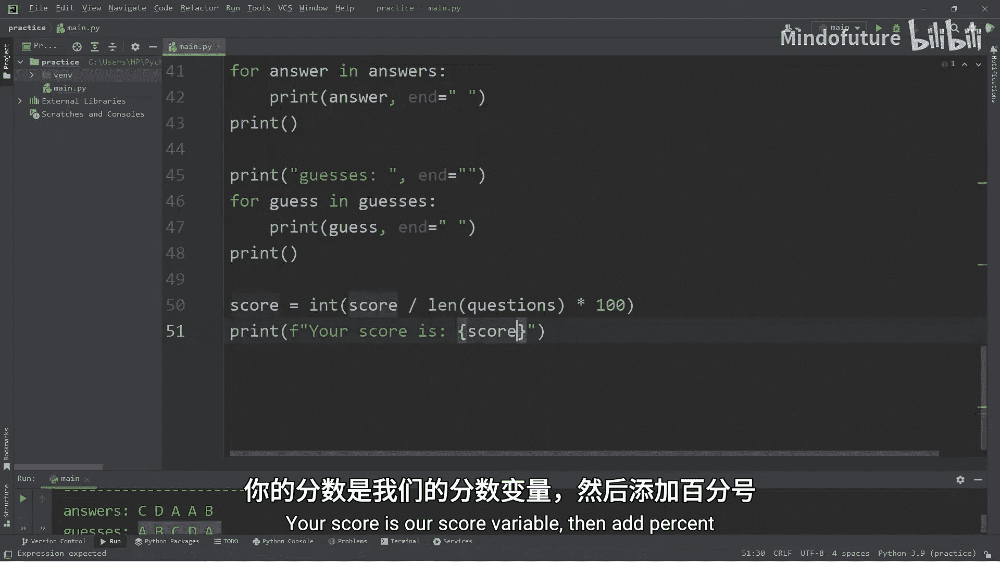

Then， add percent。I'm going to intentionally get all the answers right。C， D， A。B。

Here are the answers。 Here are your guesses。 Your score is 100%。 This time。

 I'll try and get a few incorrect intentionally。 See， C， C， C， C。Your score is 20%。

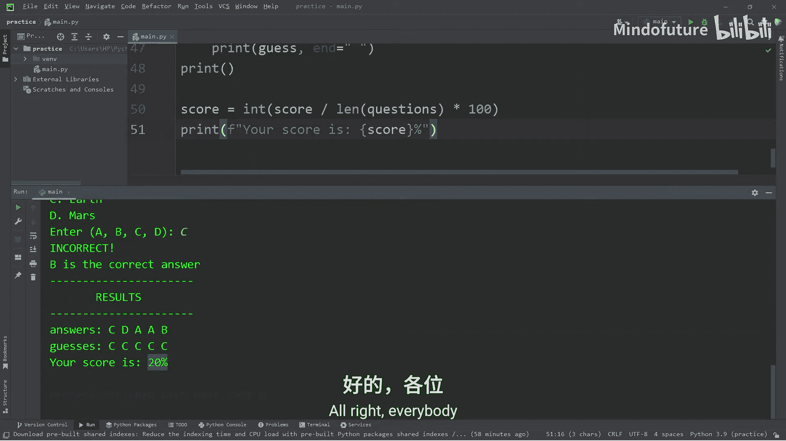

All right， everybody。 Well that is a quiz game。 Feel free to add more or less questions or come up with your own questions。

 and that is a quiz game written in Python。

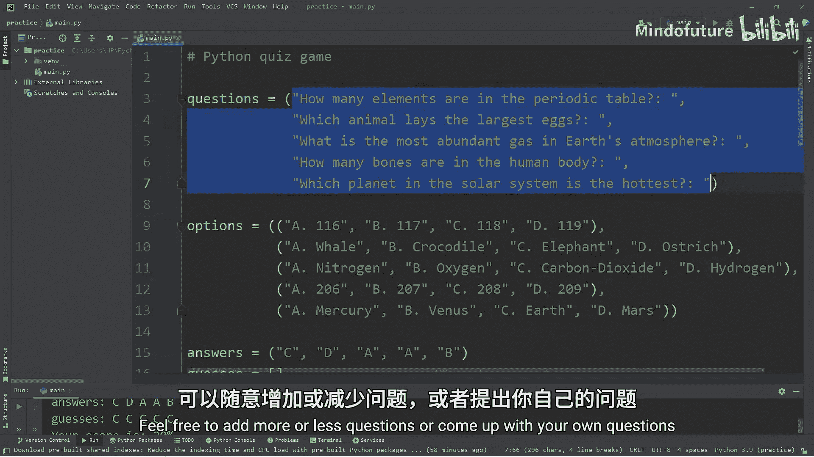

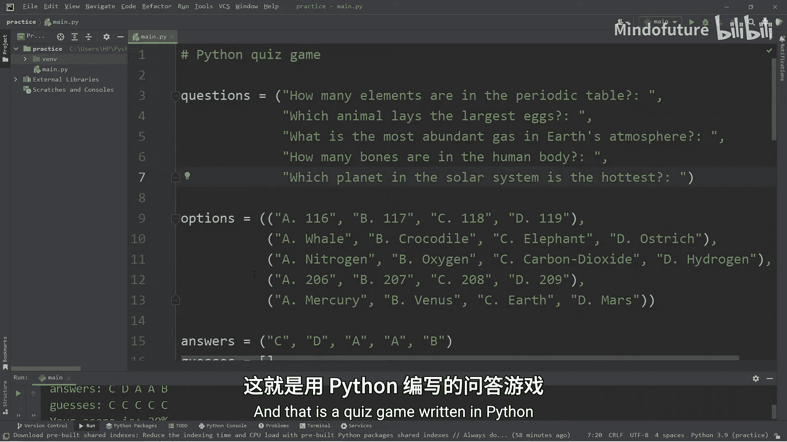