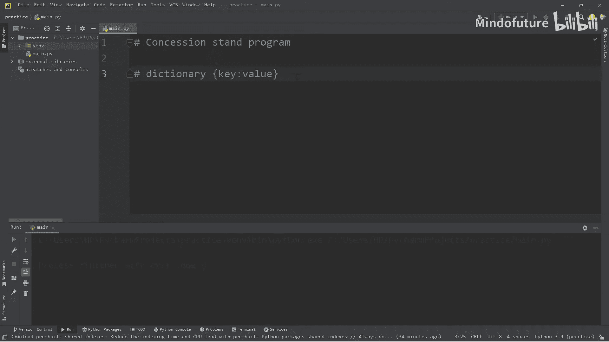
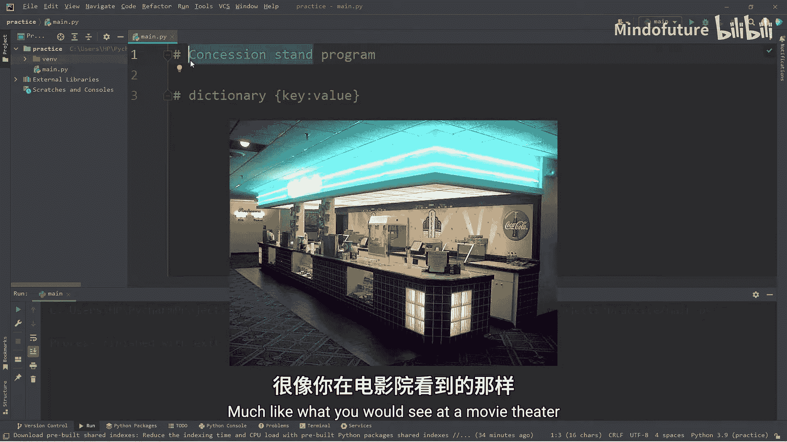
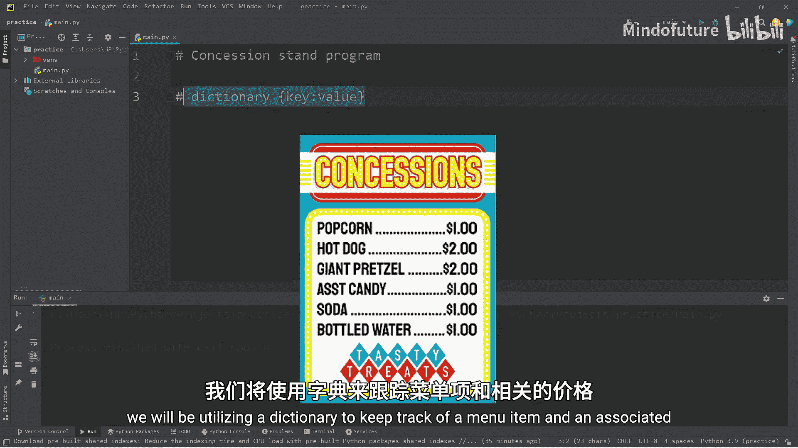
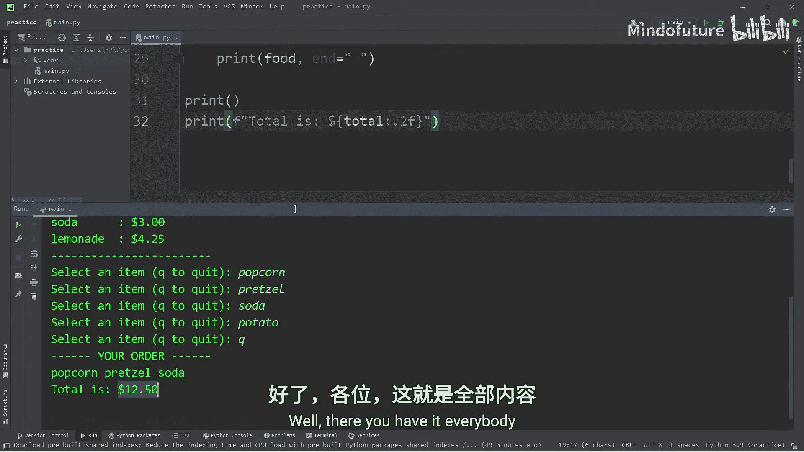
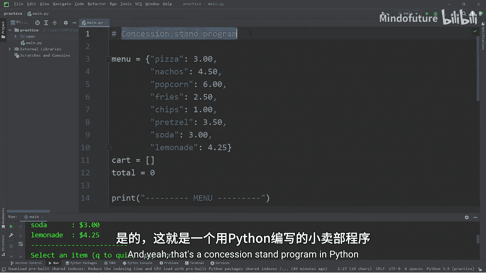

# Python超全入门教程-p26-P26-Python-concession-stand-program--BV1fcdLYXEw9_p26-

Hey， everybody， Today， we will be creating a program to mimic a concession stand。

 much like what you would see at a movie theater。 We will be utilizing a dictionary to keep track of a menu item and an associated price。

 More or less， this is just a program to help us get used to working with dictionaries。 Let's begin。

 We'll create a dictionary named menu。😊。

What items are on the menu will need an item and a price。 I'll think of some。

 I'm going to speed up this video。 Feel free to pause if you need more time。And here's my menu。

 Everybody。 I thought of a few food items you might find at a movie theater concession stand。 pizza。

 nachos， popcorn， fries， chips， soft pretzels， So to lemonade movie theater popcorn is really expensive for some reason。

 O， we have our menu。 A user is going to select specific keys from this menu depending on what the key is。

 We can get the associated value to calculate a total to keep track of the user selected items。

 I will create an empty list named cart。 I will also declare a variable named total to keep track of the total。

 We need to lay the dictionary down flat to display it to a user。 Well。

 we do have the items method of a dictionary， which we covered in the last video。

For every key value in our dictionary menu dot items method。

 the items method of our dictionary will return a key and a value during each iteration。

I'm simply going to print every key and value。I'll use an up string。I will print every queue。

Colon space。Then， a value。Let's take a look so far。Here's our menu。 I'll make a few changes。

 The price will be in dollars and cents， but feel free to pick your own unit of currency。

 I'll precede my value with the dollar sign。Then using a format specifier。

 I will display two decimal places，02 F。That's better。 I will line up all the keys After the key。

 I will add a format specifier， then allocate 10 spaces。Yeah， look at that。

 It's all lined up now before and after displaying our menu with this for loop。

 I will add some decorative text。Let's say， menu。Then outside of the for loop。

 I'll display a bunch of dashes。Yeah， look at that。Let's move on to the next step。

We will ask a user for some input。 What item would they like to buy from the menu。

While our condition will be true。If our condition is set to true。

 we'll need to break out of this loop one way or another。We will ask for some user input。

 Food equals input。Select。An item。Q to， quit。If。Food is equal to a lowercase Q。Then， we will break。

Let's test it。Select an item。Pizza。Nachos， soda。Ce to quit。 Yeah， it works。 Okay。

 what if the user types in capital Q。 Well， we can't escape the while loop。

If a user types in capital Q， we're assuming that they would like to quit When we accept our user input。

 I'm going to add dot lower method。 This will take our user input and make it all lower case。

So we should be able to acknowledge any uppercase letters。Yeah， it works， cool。

Let's add an Elsif statement。What if a user types in an item that's not on our menu。 Well。

 there is a get method of dictionaries。If menu dot get。Pass in our food， which is user input。

If the user selection is not within our menu as a key， it will return none。

 So we can use that else if menu dot get food is not none。

Then we would like to append that food item to our cart。Cart。Dot append。Our food item。

So outside of the while loop。I'm going to print our cart temporarily， just to test it。Okay。

 select an item。Pizza， soda。Pretzel。How about a potato。Cute a quit。 We have our pizza。

 soda and pretzel， but not our potato。 We don't want that in our cart because that's not on the menu。

 Yeah， you can just add that line else if menu item dot get food is not none。

That will complete our wild dope。 Let's calculate a total。For every food in our cart。

Let's take our total variable sett is equal to total。Plus。Then we need a value associated with a key。

Plus， menu dot get method。Get the food item found within our cart。

But I'm going to shorten this to total plus equals。Menu dot。

 get the value associated with this food in our cart。I will also display that food item， print。Food。

I'm going to avoid printing our food item on every line。

 I will set the ending character in our print statement， just to be a space。Okay。

 let's see what we have so far。I would like popcorn。Soda。Pretzel。Ce to quit。Popcorn， soda， pretzel。

Then we will display the total。I will print a new line。Print。I'll use an upstr。Total is。

Add a unit of currency， total。I'll add a format specifier，02 F to display two decimal places。

I'm going to add one line of decorative text。Let's copy， maybe this。All right， let's test it out。

Select an item。Popcorn。Pretzel。Soda。Potato。Cue to quit。All right， here's our cart。

Popcorn pretzel soda。 We did not include the potato。 That was not found within our dictionary。

 The total is $1250。 Well， there you have it， everybody。 That is a concession stand program。

 The point of this program was to help us get used to working with dictionaries。

 A dictionary is a collection of key value pairs。 such as an item and a price。 And yeah。

 that's a concession standard program in Python。

