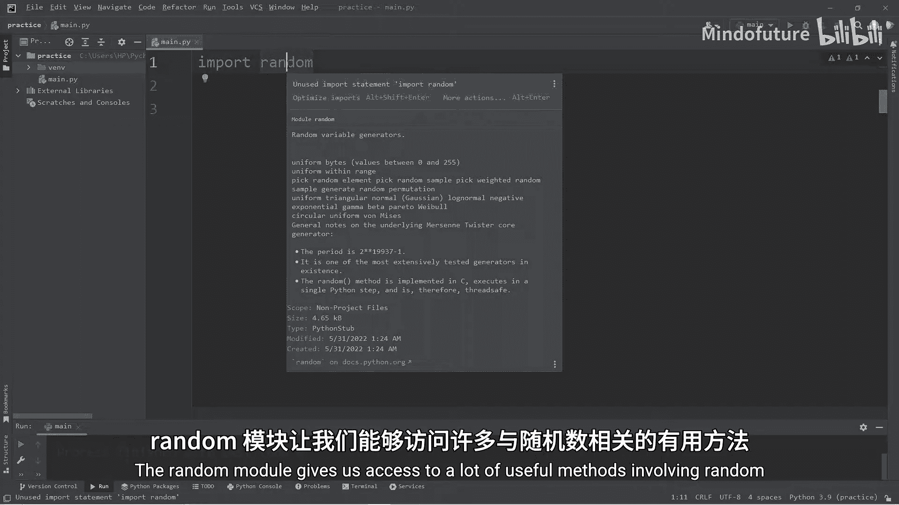
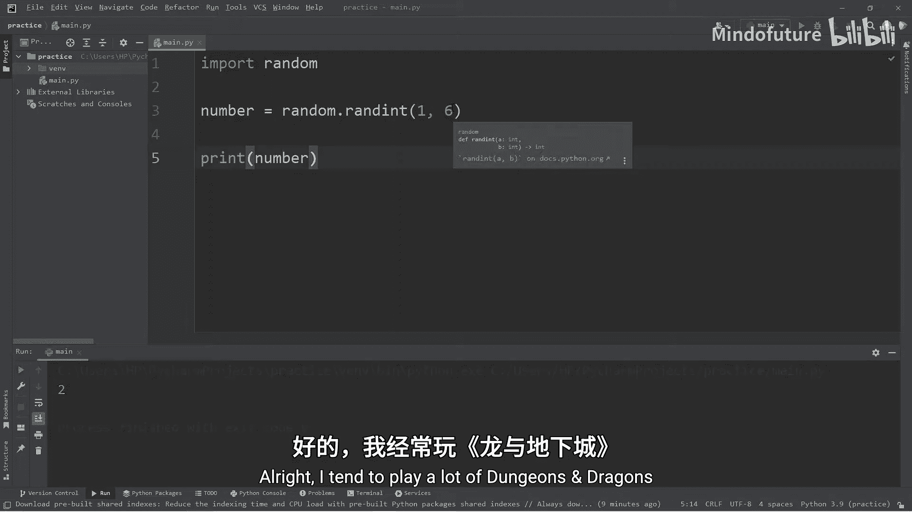
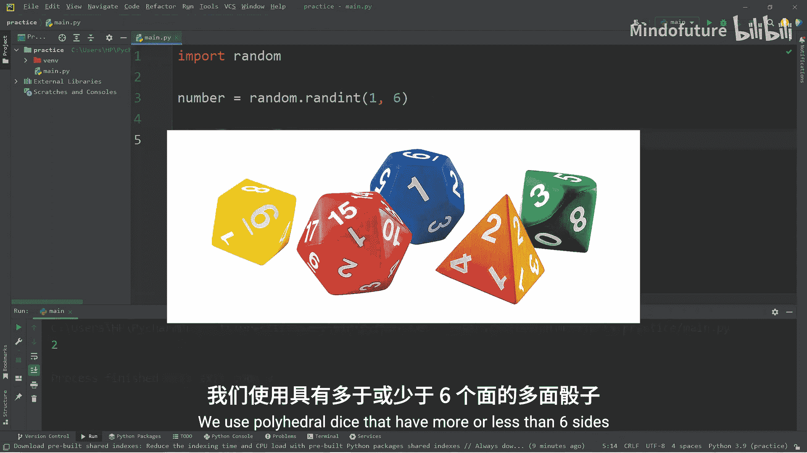
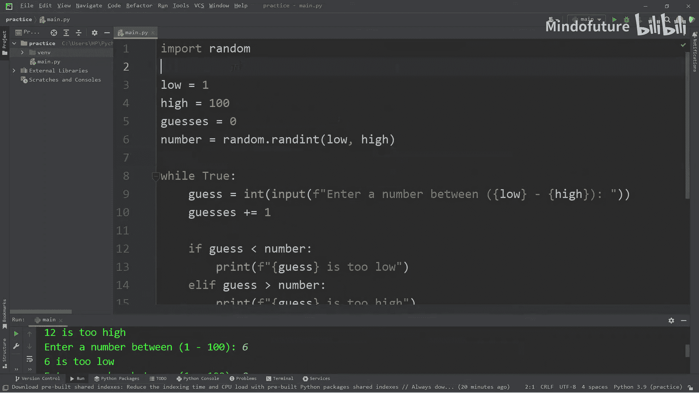

# Python超全入门教程-p27-P27-Generate-random-numbers-in-Python--BV1fcdLYXEw9_p27-

Well， hello again， everybody。 It's me。 In today's topic。

 I'm going to show you how we can generate some random numbers in Python。

 Then at the end of this video as an exercise， we're going to create a number guessing program。

 Let's begin。 We will be importing the random module type import， random。😊。

The random module gives us access to a lot of useful methods involving random numbers for a comprehensive list。

 You can use the help function， Pass in the random module。 And then we would want to print this。

Here's what we all have access to。We have a shuffle method， set state， seed。Sample random range。

 random， random int， random bytes。 And there's a ton of others。

 But we'll discuss a few of the more useful methods for beginners for a random whole integer。

 Maybe you're rolling a six sided dice。 You would type the name of the random module dot that a method for a random whole integer type Rand int at a set of parentheses within the set of parentheses。

 you will list a range If I'm rolling a six sided dice。 I would like the numbers  one through 6。

1 comma 6。Then I will assign what is returned to maybe a variable。Print whatever my number is。

My random number is a 4。3，1，4。 Al right， I tend to play a lot of dungeons and dragons。

We use polyhedral dice that have more or less than six sides。

 There is a 20 sided dice for a random number between 1 and 20。 I would set the range to be one，a 20。

Here I rolled the 16。And a 7 and an 8 within the ran in method， you can place variables as well。

 as long as they contain numbers。I will create a variable named to Lo。 I'll set that equal to one。

And a variable named Hi。 I will set that to be 100。

I will replace the numbers with my variables that behave as numbers。

Give me a random integer between my low variable and high variable。

 So between  one and 100 in this example， I have rolled a 75。Now， in 88。

 if you need a random floating point number， you can use the random method。 random dot， random。

Then let's assign this to a variable。Number equals the random method of the random module。

That would return a random floating point number between 0 and 1。

You can pick a random choice from a sequence。In the future。

 we're going to create a game of rock paper scissors。Let's say we have a couple of options。

Options equals。Rock。Paper。Scisors。We are accessing the random module dot， then use the choice method。

Place your sequence within the choice method。Give me a random choice from options。

I will store this within a variable。 Let's say option equals random choice from my options。

Then I will print the option。Our computer has generated scissors， paper。Rock。

So the choice method is a great use for games。 if you ever need a random element。Now。

 there's also shuffle。This time， maybe we have a deck of cards。Cards equals。

 I guess I'll use a list this time。I have a list of cards that you would normally find within a deck of playing cards。

 Well， besides the suit 2 through 10， Jack， Queen King Ace。Using the shuffle method。

 I can shuffle this sequence。Access the random module do shuffle。Pass in your sequence。In my case。

 it's cards。Then I will print cards。Yeah， look at that。My cards are now shuffled in the future。

 We'll be creating a game of black Jack。The shuffle method will be used then。

 to shuffle our deck of cards。Those are a few methods found within the random module。

 For some practice， let's create a number guessing game as an exercise。

A user has to guess a number between a certain range。Maybe between 1 and 100。 I'll set low to be one。

Hi， to be 100。Guesses。Set to 0。Then we will generate a random number。Number equals random。

Dot ranand int。The range is between our variables low and high。We'll create a while loop， while true。

While the user guesses the wrong number， we'll have to continue the wild loop。

 We only escape when they get the right number， but we'll give them a hint。So guess。Equals。Input。

I'll use an F string。Enter a number between。Low。Through。Hi。

I'm going to surround this with a set of printheses。

Then I'm going to type cast our input as an integer。After making one guess。

 I will increment our guesses variable by one guesses plus equals one。Now。

 if our guess is less than our number。Let's print。Using a enough string。Gas is too low。Else if。

Gas is greater than our number。We will print。I'm just gonna copy this。Guess is to， hi。Thenhan else。

If our guess is not lower than the number and our guess is not higher than the number， well。

 then our guess must equal the number。 That means we got the number， right。Then， I will print。

Guess is correct。Then we will break。So when we escape the wild loop。

Let's print the number of guesses it took to get the right number。I'll use an up string。

This round took you。Our guesses variable。Thenhan the word guesses。

Thathou should complete our program。 Let's try it。Enter a number between 1 and 100。

 I'll guess something right in the middle，50。50 is too high。 Okay， so our number is between 1 and 50。

I'll guess something in the middle of that rangech， maybe 25，25 is still too high。12。12 is too high。

6ix。6 is too low。 Okay， we know our number is between 6 and 12。9ine。9 is correct。

 This round took you 5 guesses。 Well， okay， then everybody。

That is how to work with random numbers in Python。 And hopefully。

 you gained a little bit of experience working with random numbers with this number guessing game。

 We'll be utilizing random numbers for a lot of games in the future。 And， well， yeah。

 that's how to work with random numbers in Python。😊。

