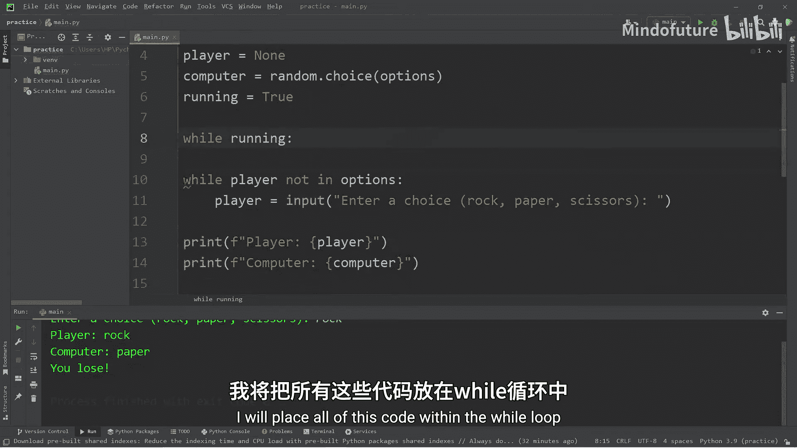
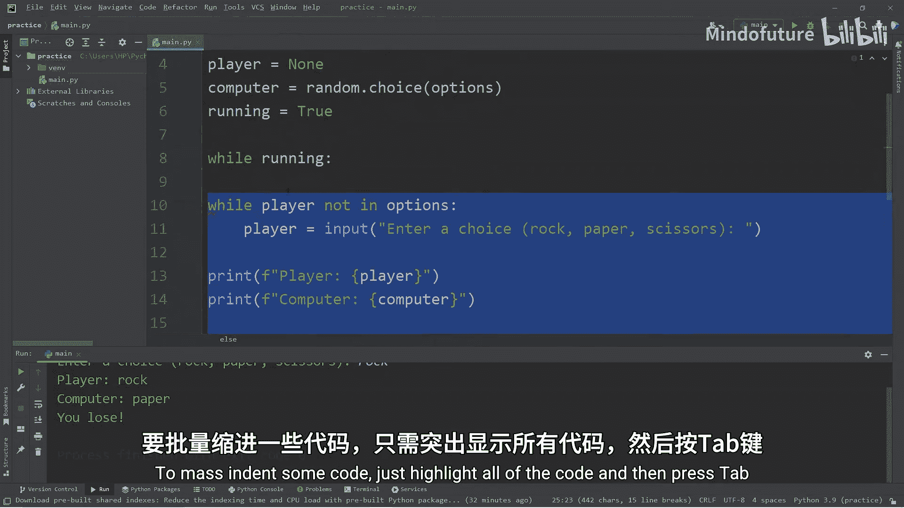
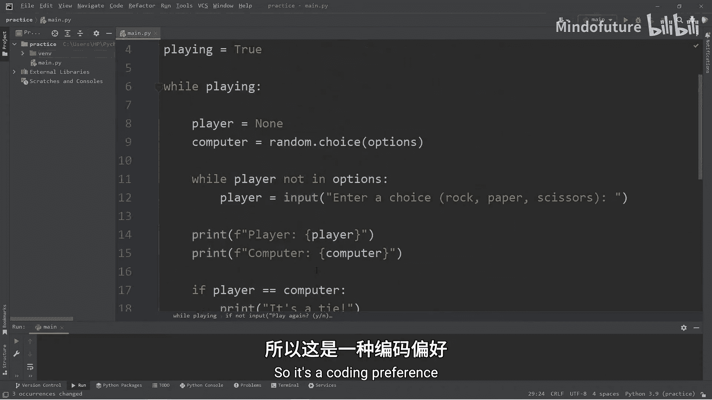
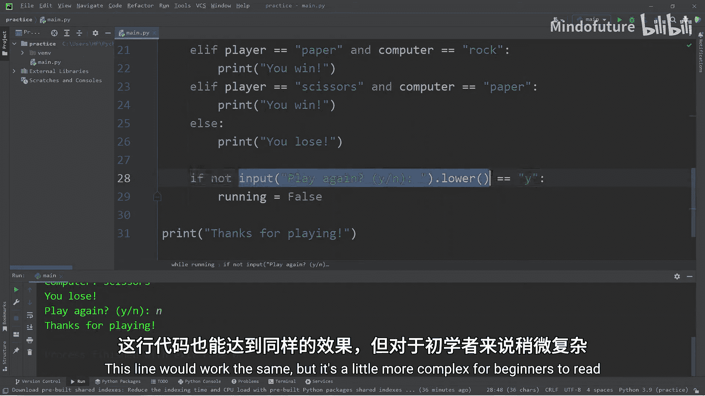
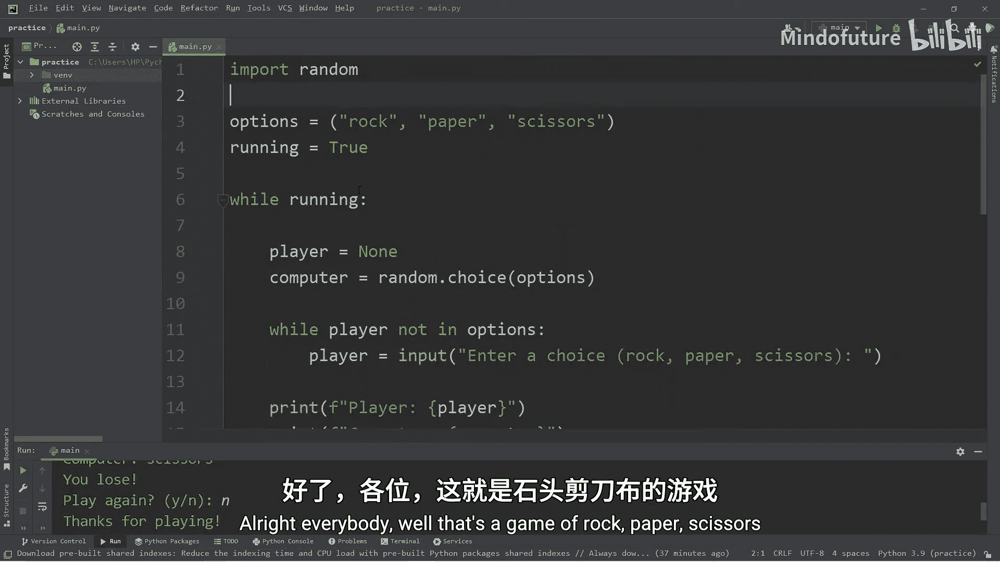

# Python超全入门教程-p29-P29-ROCK-PAPER-SCISSORS-game-in-Python--BV1fcdLYXEw9_p29-

Hey， everybody， In today's topic， I thought we would create a game of rock paper scissors。

 Now that we know how the random module works。 Let's begin by importing the random module。

 We will create some options。😊，We will use a tuple。 We're not going to be changing the options。

 So a tuple would be better than a list。 We have three options， rock。Paper。Or scissors。

I'll create a variable named player to store the player's choice。For now。

 I'm going to set this to be none。As well as a computer。

Our computer is going to pick a random choice from these options， Rock paper or scissors。

 in order to do so， we can use the choice method of the random module， random dot choice。

Pick a random choice from options。Let's have the player enter in some input。Enter a。Choice。Rock。

Paper。Sciissors。Then we will display the player's choice and the computer's choice。

I'll use an up string。Player Col in space。The variable player。Let's copy that。 Pae it。

Then change player to computer。Let's see what we have so far。Enter a choice， Rock paper scissors。

So I pick Rock， the computer picks scissors。Let's try it again just for good measure。

 I pick paper this time。 The computer picks scissors。I pick scissors。 The computer picks paper。 Okay。

 we know that the computer is successfully picking a random choice from our options。 Now。

 what if the player picks something that's not within this tuple， such as the gun。 Well。

 we would want to stop that， right， We need the user to pick a valid option。

 only rock paper or scissors。 I think what we'll do is that when we accept the user input。

 let's place it within a wild loop。 So indent this line。😊。

While this condition is going to be kind of weird。 while our player variable is not in。

A coupleple options。Let's try this again to see what happens。 I pick the gun。Enter a choice。

 All right。 Well， if I can't pick a gun， how about a sponge。Well， I can't pick that either， rock。

That works。 Our condition is while the player variable is not found within our options。

 If the player doesn't pick one of these options， this wild loop will continue forever。

 Once we pick something that's within our options， we then escape the wild loop。

 Let's check some wind conditions。Now， if the player is equal to computer， that means it's a tie。

I will print。It's a tie。I'll add a few LP statements。Else， if the player。Is equal to rock。

I'll use the and logical operator。And the computer。Is equal to scissors。That means you win。

Let's print。You win。Let's add another condition， El S。The player。Picks paper。And the computer。

Picks rock。Then you also win。Youwen。Esif， the player。Picks scissors。And。The computer。

And the computer picks paper。Then， we will print。Y win。Else。

If the player's choice is not the same as the computers and we don't meet any wind conditions。

 that must mean we lose。Print， you lose。Let's see if this works。En to a choice， rock paper scissors。

 I pick the gun。 Nope， I can't pick that。 I pick rock。I pick rock， the computer picks scissors。

 you win。Let me see if I can lose。 I'll pick paper。You win again。Ccisors。I need to stop winning。

 I need to see if the loose condition works。Okay， it's a tie， at least， but I need to lose。All right。

 there we go。 I pick rock。 The computer picks paper。 You lose。

What if the user would like to play again。Let's place all of this code within a while loop。

Let's do so right about here。 Now， I'm not going to write while true， like I normally do。This time。

 I'm going to create a variable。 Let's say running is our game running。 I will set that to be true。

While running。Equals true， or we could shorten this to just while running that simpler。

I will place all of this code within the wild loop to mass indent some code。

 Just highlight all of the code， and then press tab。😊。

Everybody， this is bro from the future。 I forgot to explain something。

 The reason I'm not setting the condition of my while loop to be true is that if you have a lot of code within a while loop。

 it can be really difficult to find where the brake statement is。

 If I set my condition to be a Boolean variable， such as running。

It's a lot easier to find any instance where I use this variable。 If I were to highlight it。

 we can see that running is found down here。 If I need to change any instance of this variable and rename it to something。

 you can refactor。 Let's rename running as maybe playing。Then I will refactor。

 So my variable running is now playing， and that change was made down here， too。

 So it's a coding preference。 Every time we start a new game， I will reset the player。

 as well as the computer。 Let's move these two lines into the wild loop， at the beginning。😊。

So when we start a new game， we will reset the player。 The computer will pick a new random choice。

 So let's see what we have so far。😊，Rock。I pick rock。 The computer picks rock。 It's a tie。

 Then we have to play again。 So paper。You lose。Sciissors， it's a tie。 Now。

 what if we would like to escape the wild loop After our wind conditions。

 I'm going to create a temporary variable。 Let's name this play again。

That we will ask for some user input。Play again， questiontion mark。W slash n。Meaning yes or no。

If the user types in something that's capital， I'm going to use the lower method to make it lower case。

So if our play again variable is equal to y。We would like to escape。

 What I would like to do is I would like to see if the player types in something that's not why I will precede this condition with the not logical operator。

 If the user does not want to play again。Then let's take our Boolean variable running。 Normally。

 it's true。And set that to be false。 Running equals false。That means we will escape the wild loop。

Once we escape the while loop， I will print。Thanks for playing。

Now I'm going to change this momentarily。 I just want to test it， rock。Play again， yes。

Paper play again， yes。Scisors。You lose play again， nope。Thanks for playing。

 This is entirely optional。 I try and create as few variables as possible。

 I would personally rather avoid creating a variable here。

 Another way in which I could write this is that I can get rid of this variable。Let's move， if not。

 in front of the input。And follow our input here， Then use the comparison operator。Then， add a colon。

If the user's input， after making it lowercase。Does not equal a why for yes。Set running to be false。

 So that should work the same。Rock， play again。 Yes， enter a choice。Paper， play again。 No。

 thanks for playing。This line would work the same， but it's a little more complex for beginners to read。

 or you can use the other method that I showed you。 All right， everybody。 Well。

 that's a game of rock paper scissors。

