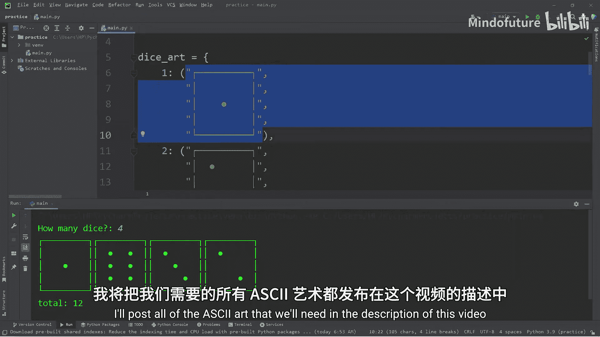
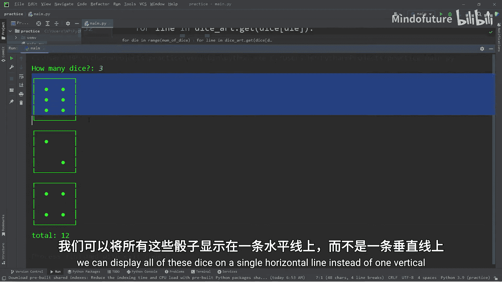
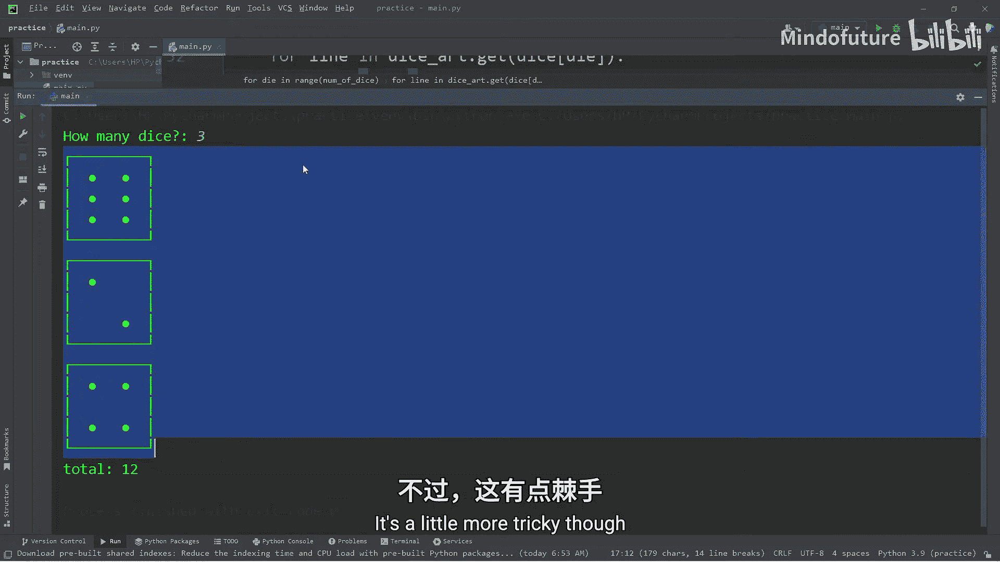
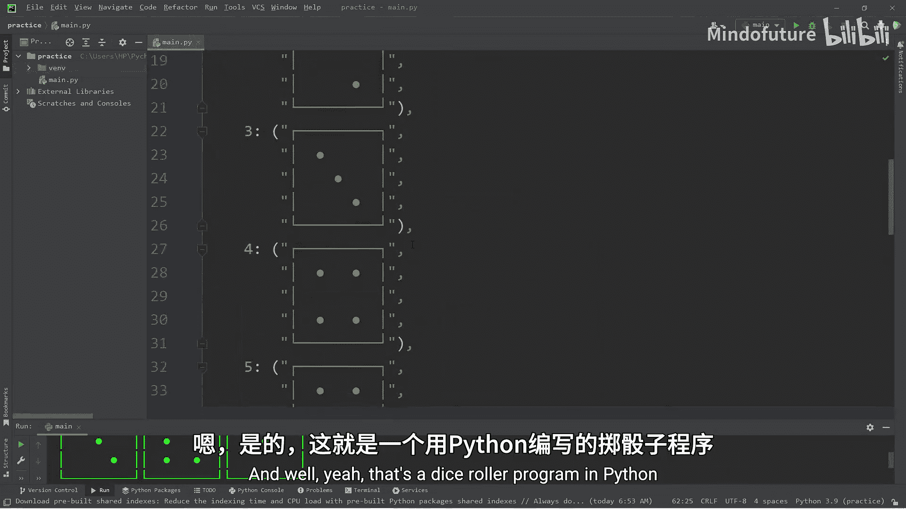

# Python超全入门教程-p30-P30-DICE-ROLLER-program-in-Python--BV1fcdLYXEw9_p30-

Hello， everybody。 Today， we will be creating a dice roller program in Python。

 We will be utilizing some ASci art。 I'll post all of the ASci art that we'll need in the description of this video。

 You can copy and paste it to save time。 if you'd like。 All right， let's get started， everybody。

 We will begin by importing the random module because we will be rolling some random numbers between one through 6。

 If we're going to create some ASci art will be utilizing Uniode characters to enter in a Uniicode character。

 It really varies depending on your operating system。

 I think the easiest way would just be to use Python to enter a unicode character type A forward slash Then a given code for each character。

 Here are all of the codes that we'll need。😊。

After writing these seven Uniicode characters， let's run this program。 These symbols that are output。

 Let's copy them。I'll add them to a comment。Then we can delete this line。

These are the Uniicode characters we'll need to build some mask art， some dice。

Each die will be made out of five lines。Let's begin with the first。 We'll need a left corner。

9 dashes。Then the right corner。For the second line。Copy this vertical bar。 Add 9 spaces。

Thenhan a vertical bar。We can copy this whole line。Paste it two times。

Let's use the left bottom corner。Add in nine of these dashes。Then， the bottom right corner。

And here's a basic box shape， depending on what the number die is。

 we can add one of these bullet points for a one。 We can add that right to the middle。

 So that's good for now。 We'll delete this later。 Let's create a dictionary。

 I will name this dictionary。Dice art。Our dictionary is made out of key value pairs。

 So the keys will be the numbers 1 through 6。Beginning with one， the value will be a tuple。

It's a dictionary made out of key value pairs where the value is a tuple within the tuple。

 Let's add these lines。Each separated with the comma。

I'm going to format these so they form a box shape。Let's take our bullet point。

Place it right in the middle， then add a comma to the end of this key value pair。

That is the first key value pair。 Let's copy all of this。Paste it again。 Change 1 to 2。

 Let's move this bullet point。 We need two bullet points。About right here。And here。

Let's repeat this process for keys，3 through6。Be sure to get rid of the comma at the end。

And here is our dictionary of dice art。Each key is a number。 Each value is a tuple made of strings。

Let's create a list。Of dice， our dice will be numbers randomly generated between one and 6。

A total to calculate the total。 I'll set that to be 0。Then we will ask a user for a number of dice。

This will be some input。How many dice。Then type cast the input as an integer。

We don't want somebody to write， you know，2。5 dice。

 You can't roll half a die to generate a random number。

 You can use the R inch method of the random module。We need a random number between one and6。

Then we need to append this number to our list of dice。Dice， do aend。

Then we can move this line to within the append method。We need to do this a number of times。

 depending on how many dice the user enters in。We can place this line within a forward loop。

For every。Die。In our range。Number of dice。 This will be a number。

Let's print our list of dice to see what numbers we have in here。How many dice I would like5 dice，5。

3，3，4，6。Okay， we know that that works。 Let's calculate a total。

We'll need to iterate and sum all of the elements within our list。 We can do that with the for loop。

For every die。In our list， dice。Take our total variable。Plus， equals。

The current value within our dice。Then we will print a total。 I'll use an up string。

Total call in space。Our total variable。Let's see what we have so far。

How many dice I would like5 dice。Our total is 19。Now， between these two four loops。

 we will display our ASi art。 The easiest way would be to create some nested for loops。

The outer four loop will be in charge of the number of dice。For every die。In our range。

Number of dice。The inner4 loop。Will'll be in charge of printing every tuple。For every line。In。

Then to get a value in our dictionary， we would type the name of the dictionary。Dice art。

Then use the get method。What are we getting， We're getting a value at a given key。

Let's take our list of numbers， dice。At index。Of die， our counter。

Depending on what the user types in for the number of dice die will begin at one then increment。

Within the inner four loop， we will print the line。So let's take a look。

How many dice I would like3 dice。And here's our ASci art，6 plus 2 plus 4。 That equals 12。

If you would prefer， we can display all of these dice on a single horizontal line instead of one vertical line。

 It's a little more tricky， though， If you would prefer that approach。

 let's turn this chunk of code into comments。

We will write this nested loop a little different。So each tuple is made up of five elements， right。

So if we're printing a horizontal line。Let's say we roll the numbers 1 through 3。

 We would first need to display this line of the first dice。Then the first line of the second dice。

 then the first line of the third dice。 During the next iteration of the outer loop。

 we would display the second line of the first dice。 The second line of the second dice。

 the second line of the third dice。So it's a little more complex。

Let's create an outer loop that will iterate five times for every line。In range 5。

Then the nested loop will be for every dye and dice。How many dice do we have within our list。

We will print。 We're going to get one of the values。 Fo out one of the numbers that we roll。

Take our dictionary of Dice art。Dot get， then a number one through 6。

That will be the value found within our list of dice。 Get the current die。

 Remember that this is a number  one through 6。We would then need one of the elements found within our tuple。

 So get the first line， then the second line， third，4，5。So let's add the index operator。

Place our counter of line within the index operator。 Let's see what we have so far。

We need to add one more thing。 How many dice 3。This is an abomination。

 There's one more change we need to make。At the end of our print statement。

 let's set the ending character to be an empty string。And that should fix that。 How many dice，3。Okay。

 we're getting better results。Then when we escape the inner loop， we will print a new line。

How many dice，3。And there we are，3 plus 6 plus 1 is 10。Al right， everybody。

 So that is a dice roller program。 It is kind of complex。

 but I thought this might be a good exercise。 If you would like a copy of this code。

 I will post all of this in the comments section down below。 And well， yeah。

 that's a dice roller program in Python。😊。

