# Python超全入门教程-p31-P31-Encryption-program-in-Python--BV1fcdLYXEw9_p31-

Hello， everybody。 Today。 I'm going to show you how we can write a substitution cipher encryption program。

 Basically speaking， what we're going to do is that we have a message to hide the message。

 We can encrypt it by replacing every instance of one character with another chosen at random。

 using the same key。 We can then decrypt the message。 When I was at my university。

 I took an intro to cybersecurity course。 I turned this program in as a final assignment。

 And I did get an A on it。 I don't know。 Maybe it'll help you。 At the very least。

 it's a good exercise。😊。

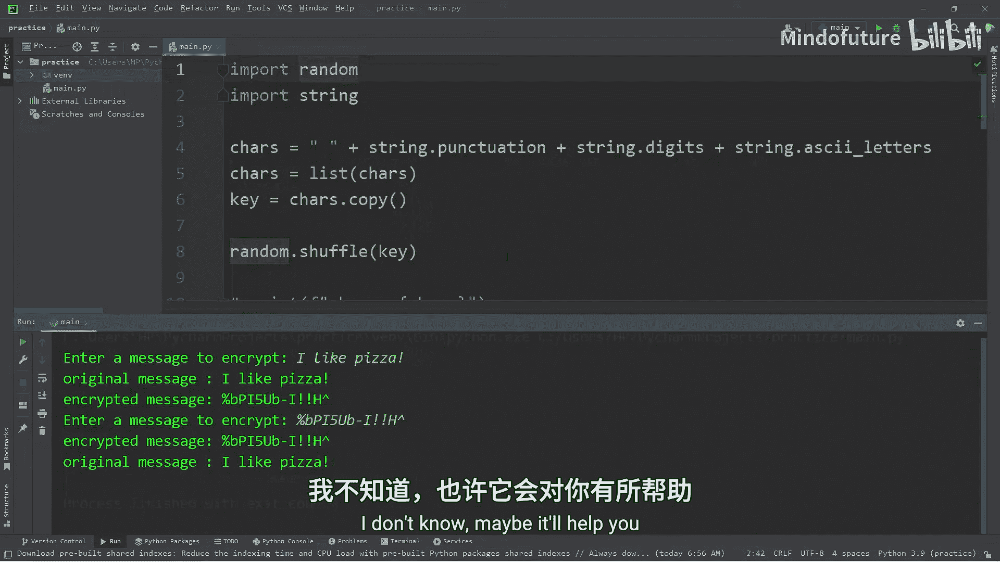

All right， let's get started， everybody。 We will begin by importing the random module。

 as well as the string module。Let's create a string of characters， named Chars。

Whatever characters you would like to use for your encryption program， list them here as a string。

 However， this can be a lot to write。 I think a better solution would be to import some constants from the string module。

 I'm going to include some punctuation。 I will import the punctuation constant of the string module。

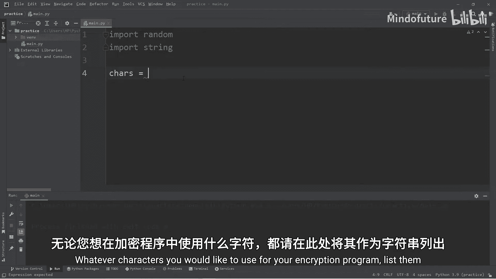

How' the hety spell punctuation。 Okay， that's right。Plus， I will add some digits。

 string dot digits constant plus。String dot。Asi。Letters。Let's take a look at our character， so far。

We have one long string of characters。What if I would like to include a space， a white space。Well。

 there is a constant for that。 but that includes things like carriage return。

 That's going to warp our results。 Let me show you just for a demonstration。 string， dot。

 white space， plus all the other stuff。We have a carriage return and some other characters。

 I would like to avoid that。 So in place of importing the white space constant from the string module。

I'm going to add a space character。 That's good enough。

Here are all the characters I will be using this program。 Feel free to add more or less。

 This is all one long string。I'm going to turn the string into a list where each character is an individual element。

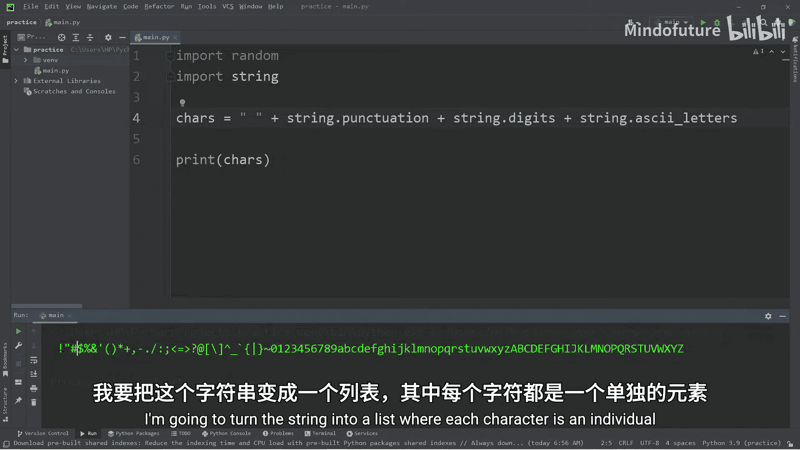

To do that， I'm going to take our string of chars。Reassign it。

 then type cast my string of characters as a list。 Then let's print it again。Print chas。

Instead of one long string， we have a list。 a list of all the characters will need。

I am then going to create a key， which we will shuffle eventually key。

Then to create a copy of a list， you can type the original list。Dot copy method。

Then I will print my key。I'm going to place these lists within a f string。Chars。Then key。

Let's see what we have。We have two identical lists， one for the original characters。

 and the other for the key。We're going to shuffle this key。Random dot shuffle。

 Pass in our list of key。Look at that， all of the characters are now shuffled in a random order。

What we'll be doing when somebody types in some text to be encrypted？

We will replace every instance of one character within that string。Let's say an O。

 then replace it with another one。 Every time we run this program， this key will be reshuffled。

 Let's ask for some user input。

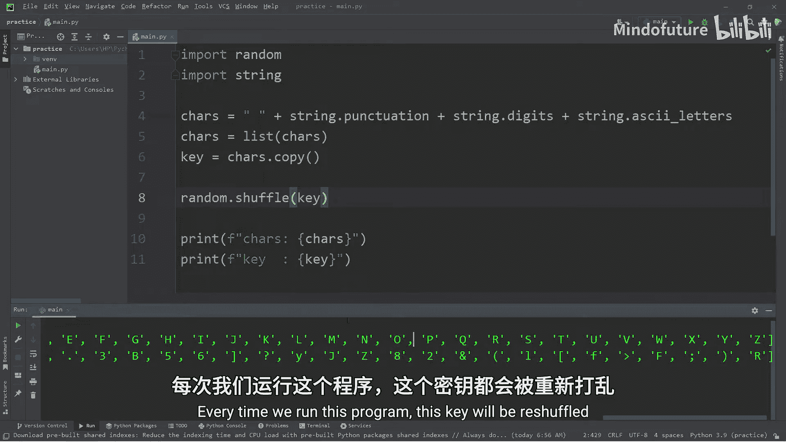

This part of our program， we will do some encryption。

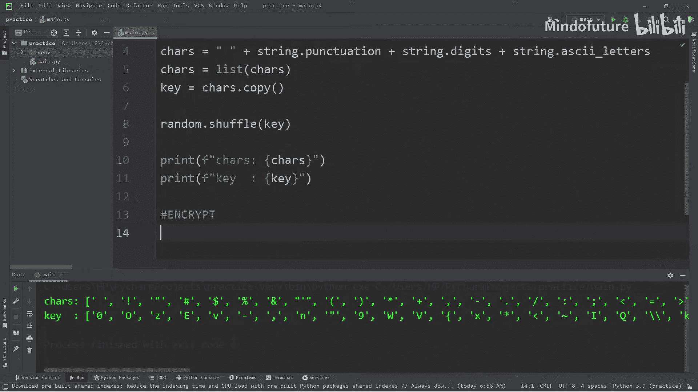

Plain text is the original message。Plain text equals。We will accept some user input。

Enter a message to。And cry。Sippher textext is the name of the encrypted message。

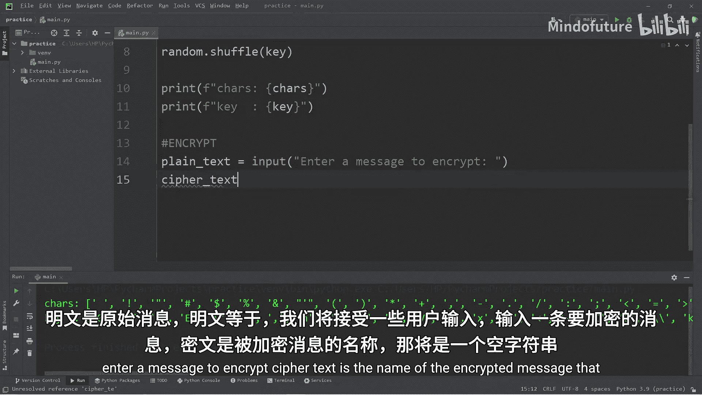

That will be an empty string。Okay， let's say a user types in a message。

 enter a message to encryptI like pizza。It's a very important message。

Every instance of a character within my plain text。

 I will refer to the key and replace that letter with a different one。 For example， any Z's。

 I have two Z's in this program。Will be replaced with， let's see。Capital B。

Every time we run this program， though， it's going to shuffle the key。

 So it's not going to be consistent。 What we're going to be doing is iterating over every letter in our plain text。

For every letter in plain text。Strings are iterable。

Find the index of every letter from our plain text within our list of characters。

Let's assign a variable index， index equals。Take our list of chars。 Use the index method。

We are looking for that letter， whatever letter we're currently on。Then， return an index。

Then refer to our key， get whatever letter is at that same index。

So we will append that to our cipher text， it's currently an empty string。Spertext plus equals。A key。

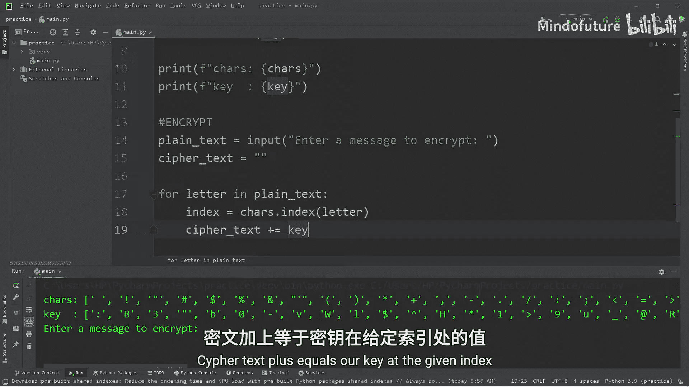

At the given index。Our cipher text should be the encrypted message。 Now， let's print it out。Print。

 I'll use an up string。Original message。Let's print our plain text。Then our encrypted message。

Print our ciphertex string。Let's take a look so far。Enter a message to encrypt。 I like pizza。

Then here's the new encrypted message。 Every instance of a character within my plain text was replaced with another。

 So， for example， and E Z's were replaced with E。 I have two E's within this encrypted message。

If I were to run this program again， it would likely be different。I like pizza。

And here's my new encrypted message。My Z's were replaced with semicollonons this time for every letter in our plain text。

 get the index of each letter。 Then refer to the key。 Add the new character to our encrypted message。

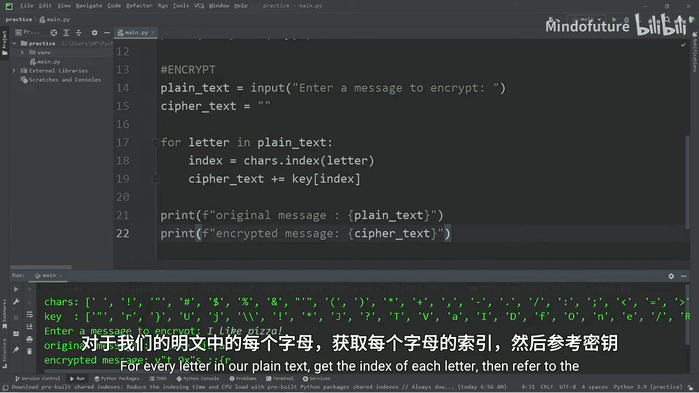

It's probably best for us not to display the characters and the key。 So let's hide those。

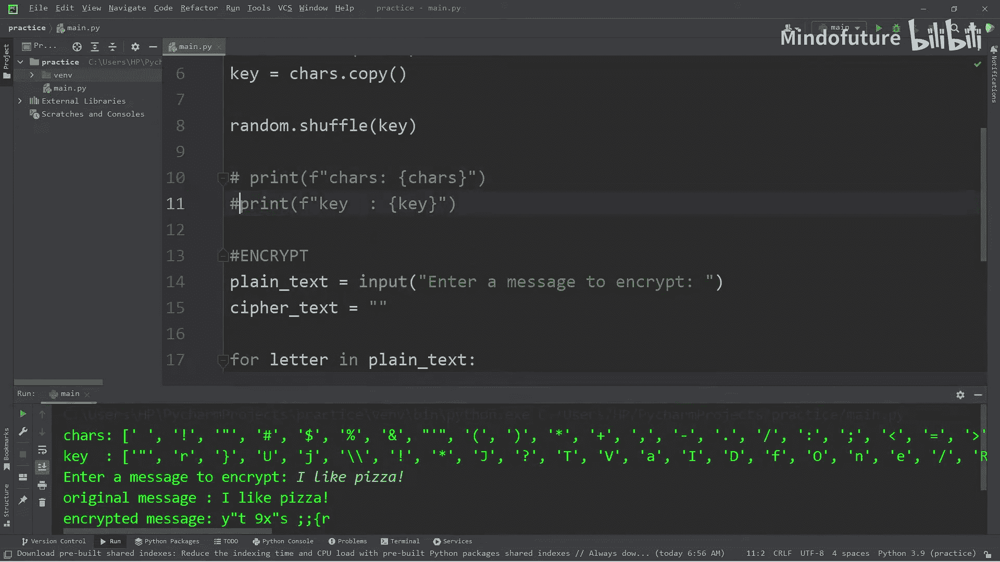

We will be reusing this key for decryption。Now to decrypt the message。

 let's copy this section of code。

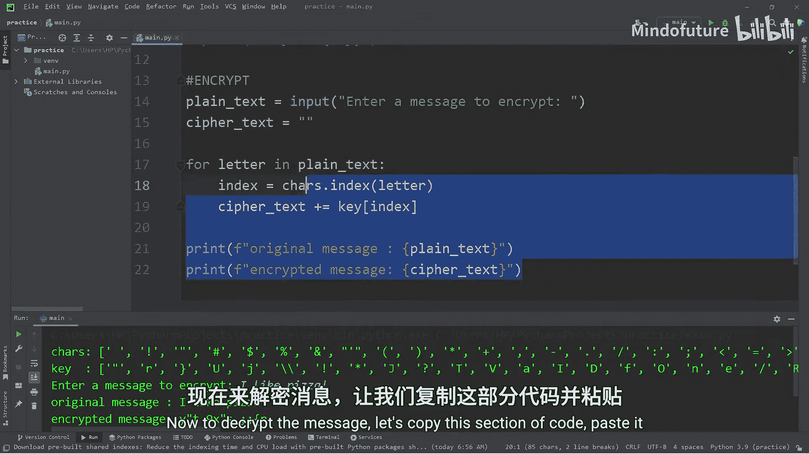

Paste it。We are now decrypting。We will ask for some cipher text， then reset our plain text。

For every letter in our cipher text。Refer to our key。App panda character to our plain text。

Within our list， chars add a given index。

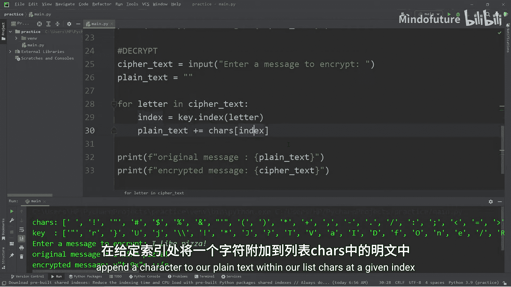

We will display our encrypted message。Followed by the original message。

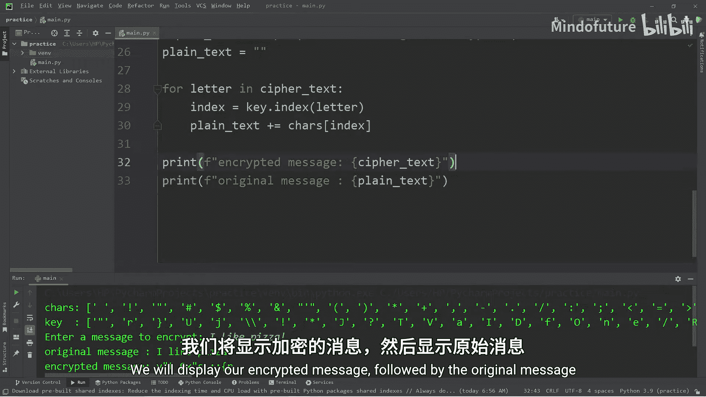

Let's try it one last time。 enter a message to encrypt。I like tacos。Here's my original message。

 then the encrypted message。If I were to decrypt the encrypted message。

 it should give me my original message。I will type in these characters， exactly。Hit enter。

And here is my message decrypted。 I like tacos。

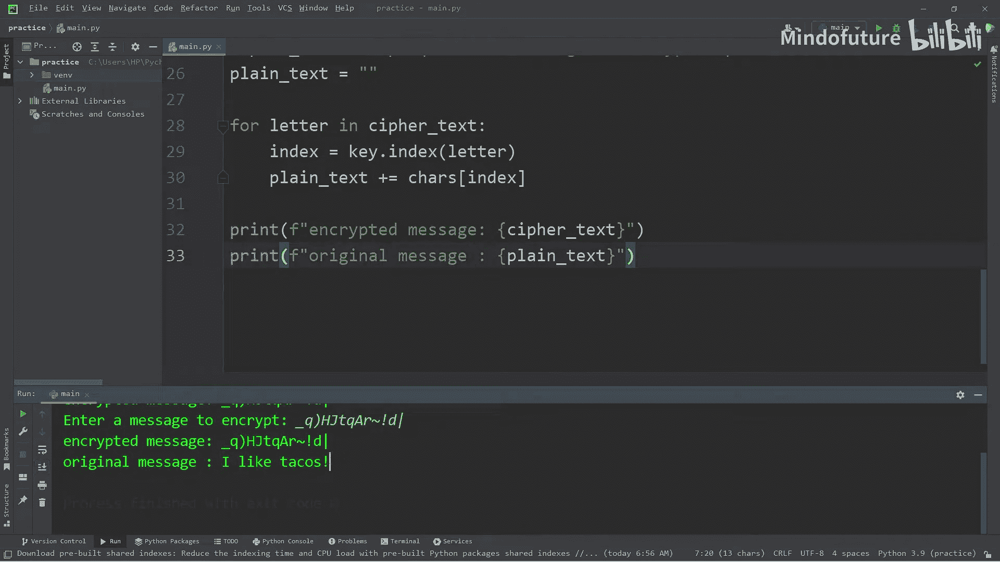

All right， everybody。 So that is a substitution cipher encryption program for beginners。

 When I was at university， I did turn this program in for a final assignment for a cybersecurity class。

 and I did get an A on it， so maybe it'll help you。 And well， yeah。

 that's an encryption program for beginners in Python。

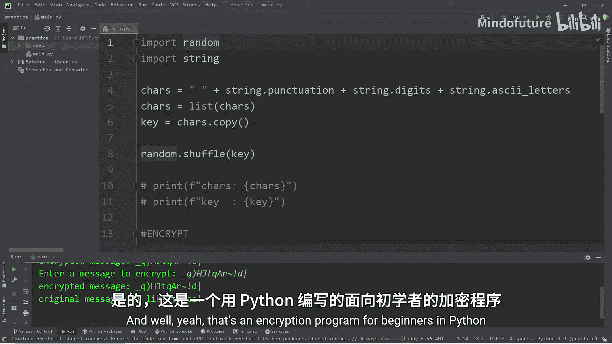