# Python超全入门教程-p32-P32-Functions-in-Python-are-easy--BV1fcdLYXEw9_p32-

yEverybody， today， I need to explain functions。 Think of a function as a block of reusable code to invoke a function。

 You place a set of parentheses after the function name to invoke it。 Here's a scenario。

 I need to sing happy birthday three times。 I know it's a weird example， but it makes a lot of sense。

 Just trust me on this。 If I need to sing happy birthday three times。

 I would write something like this。 I'm going to create my own version of the happy birthday song。😊。

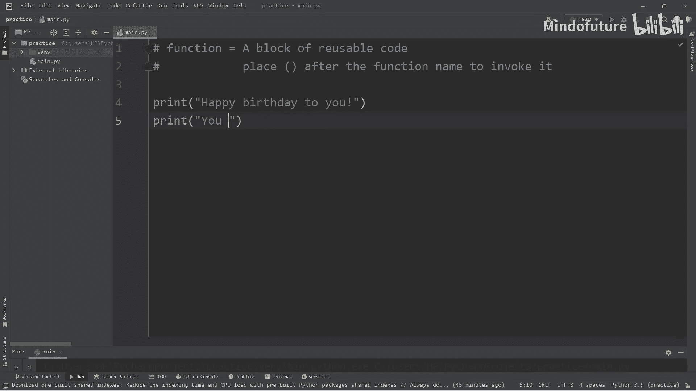

This is one verse， if I need to repeat this code three times without using functions。

 I could either repeat this code。

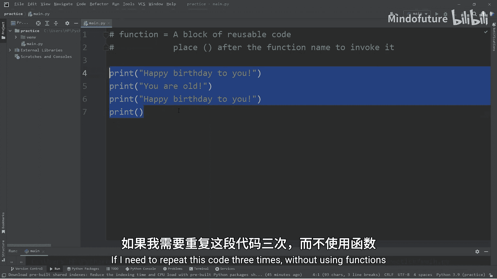

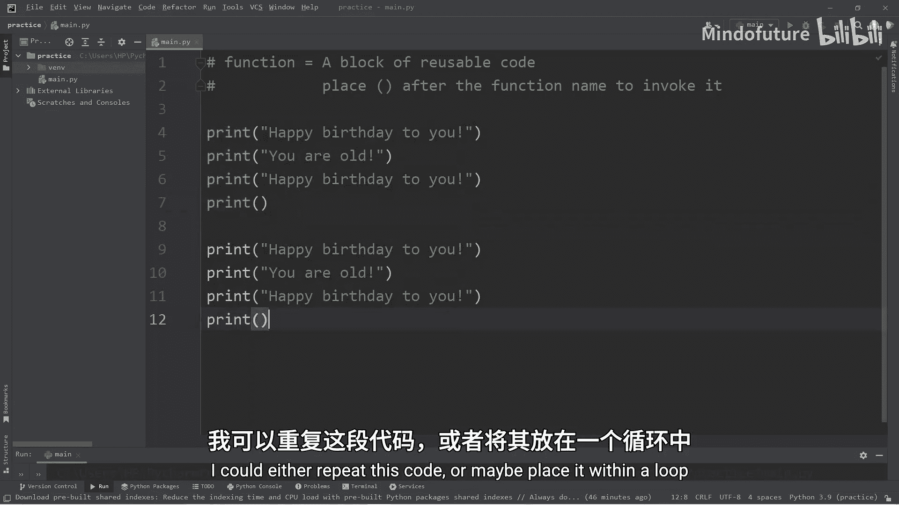

Or maybe place it within a loop。So here's my happy birthday song three times。

 But there's a better way of handling this。 That doesn't involve repeating our code or using loops。

 What if I could write this code once， then reuse it whenever I need to That's where functions come in。

 to define a function。 you would type D， E F。 Then a unique function name。 Let's name this function。

 the happy birthday function。 Add a set app parentheses， a colon。

 Any code that belongs to the function， you'll want to indent underneath。

 Then to invoke this function。 I would type the name of the function， happy birthday。

 Add a set app parentheses。😊。

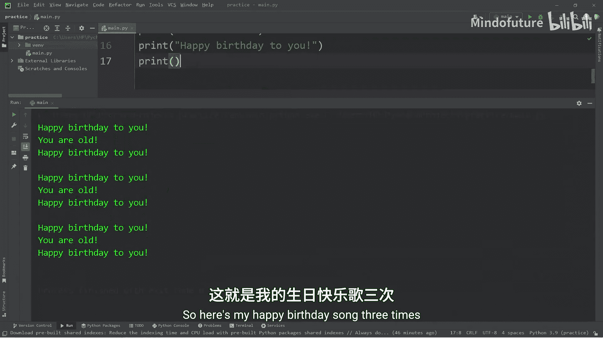

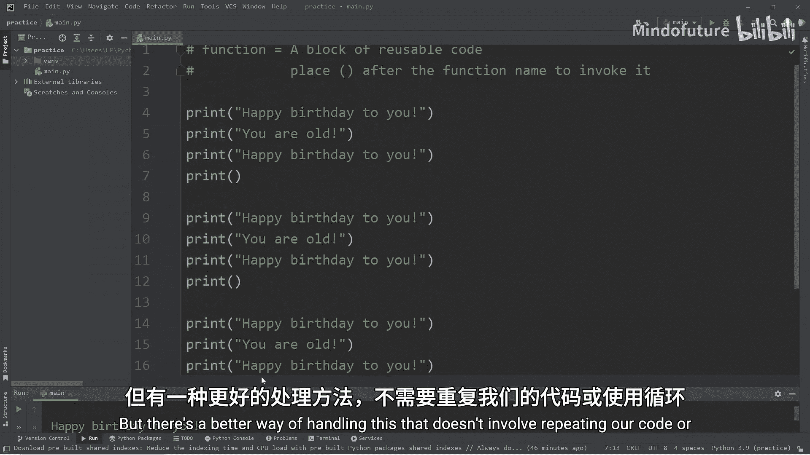

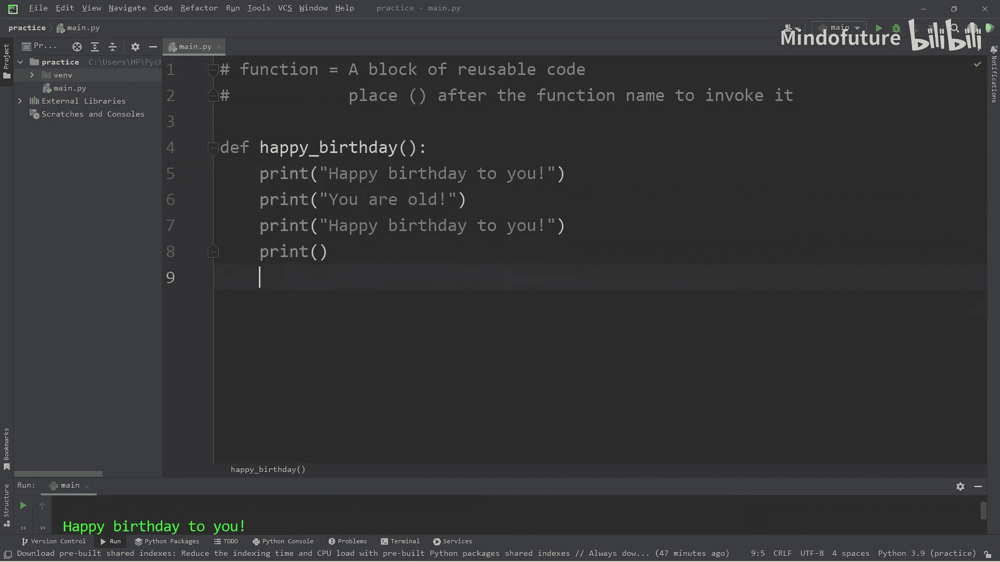

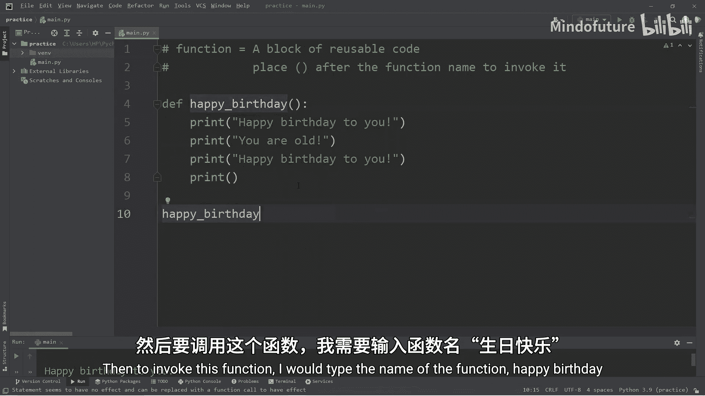

And that's it。When you invoke this function， you will execute this code once if I need to execute this code three times。

I would just call it two more times。Happy birthday， happyapp birthday。

 happyapp birthday to invoke a function。 You type the function name。 Then add a set of parentheses。

 I like to think of the parentheses as a pair of telephones talking to each other。

 You call a function to invoke it。 Hey， happy birthday function。 Execute your code with functions。

 You are able to send a data directly to a function using one or known as arguments。

 You can send values or variables directly to a function。

 place any data within the set of parentheses。 I'll send my function， a first name。

 Any data you send a function are known as arguments。

 but you need a matching set of parameters that are in order。

 What exactly is the data we're sending in。 Well， it's a name。

 I will add one parameter to my happy birthday function。 I will name this data name。

 A parameter is kind of like a temporary variable that's used within a function。

 I'm going to replace this instance of you with a name。 I will use an F string。😊。

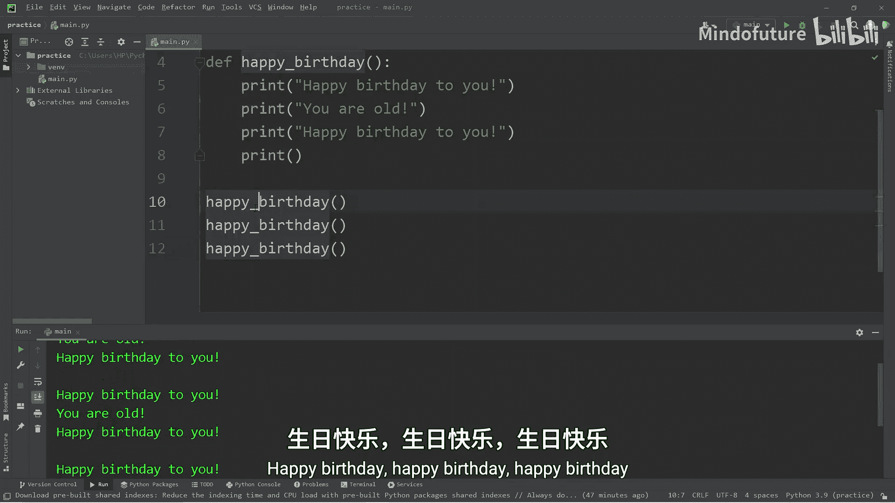

Replace you with a placeholder。 I will add my parameter name。So happy birthday to bro。

We could pass in some other names。What about Steve。

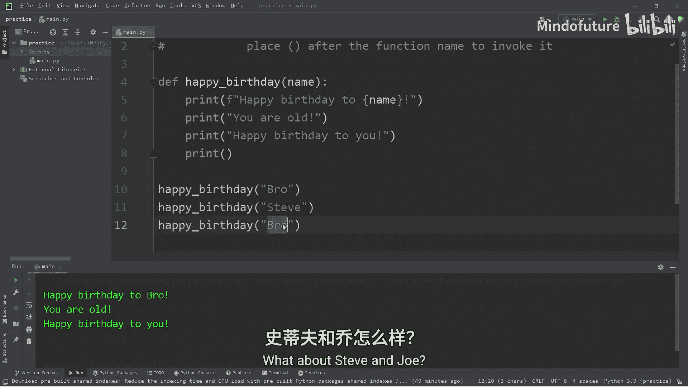

And。Joe。Here we are。 Happy birthday to bro。 Happy birthday to Steve。 Happy birthday to Joe。

 When you invoke a function， you can send more than one argument。 Let's send an age this time。😊。

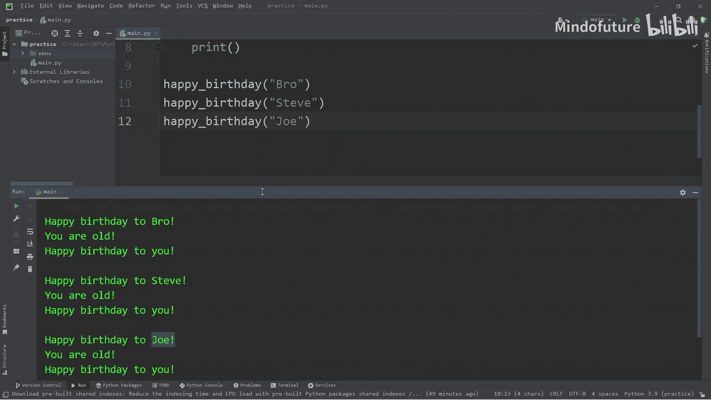

I'll send 20。30。And 40。

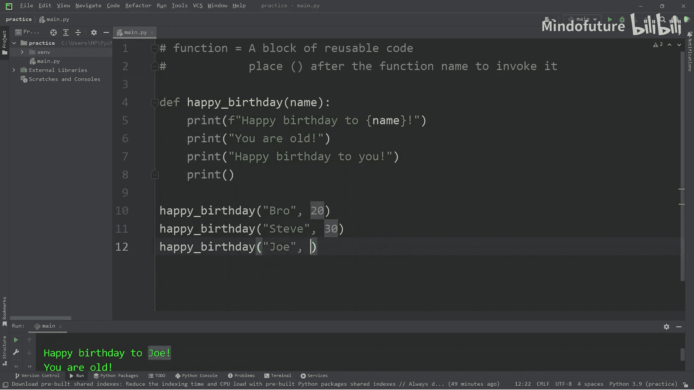

But when I run this， we have an error。 We're passing in two arguments。

 but our function is set up only to take one。 I would need a matching number of arguments to invoke this function。

 We will need two parameters。 We have a name， and we have an age。Then let's use this age。 You are。

 Let's make this line enough string。Age。Years old， let's try that again。

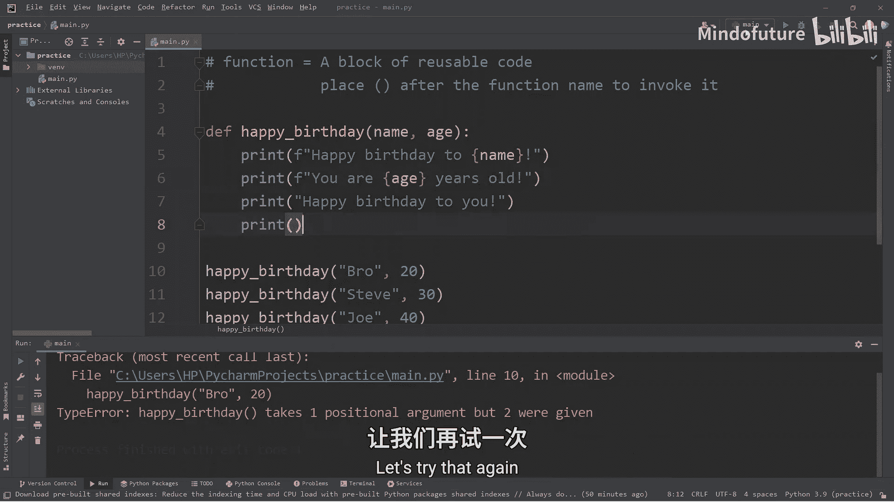

Happy birthday to bro。 you are 20 years old。 Happy birthday to Steve。 You are 30 years old。

 Happy birthday to Joe。 you are 40 years old。 When you invoke a function， you can pass in some data。

 Those are known as arguments， but you'll need a matching set of parameters。 The order does matter。

 Let's see what happens when I switch these two parameters。 Age then name。😊。

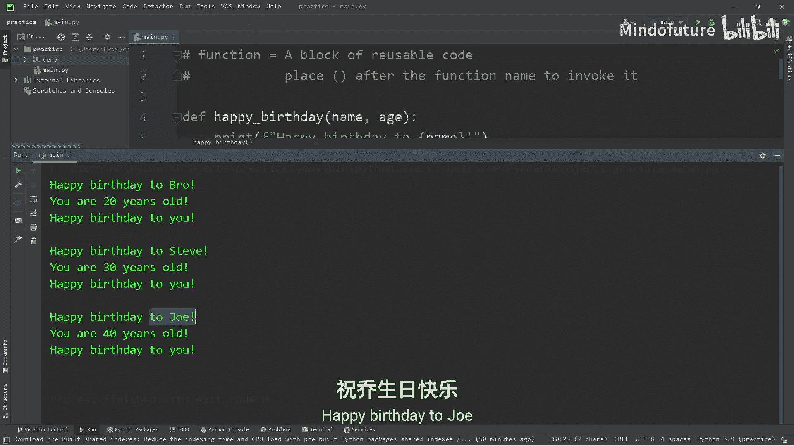

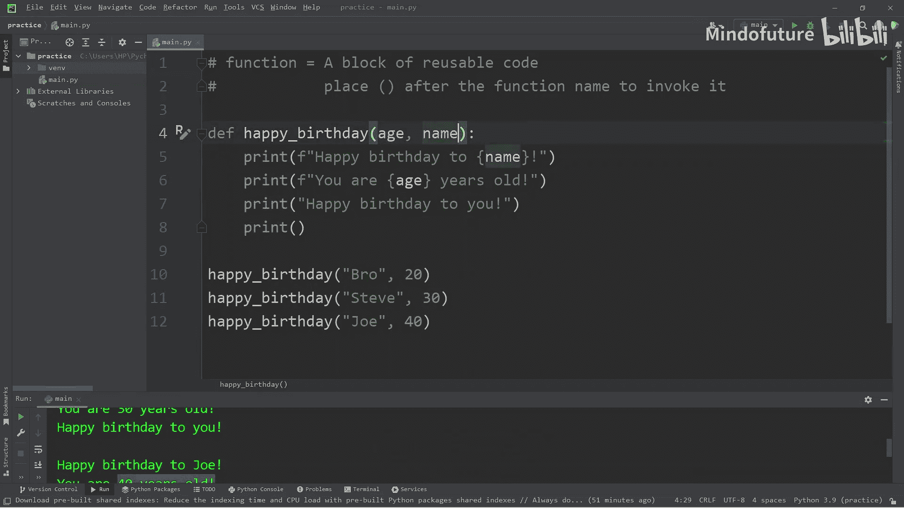

Happy birthday 2，20。 You are bro years old。 Happy birthday 2，30。 You are Steve years old。

 Happy birthday 2，40。 You are Joe years old。 So the position of the parameters does matter。

 Same thing goes with the arguments。 You also could name these parameter。 something unique。

 Maybe X and Y。 Happy birthday 2 X。 You are Y years old。😊。

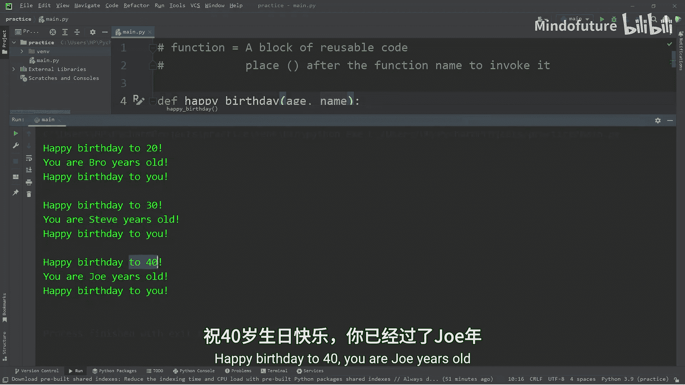

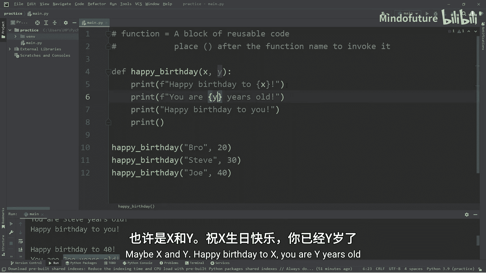

That's also valid。 Let's try another example。 I'm going to create a function to display an invoice。

There will be three parameters， a username。And amount。And a due date。Let's print。Hello。

I should make this an up string。Username。We'll use another F string。Your bill of。Amount。

Let's precede this placeholder with the unit of currency。I will also add a format specifier。

 point2 F。Is do。On our due date。

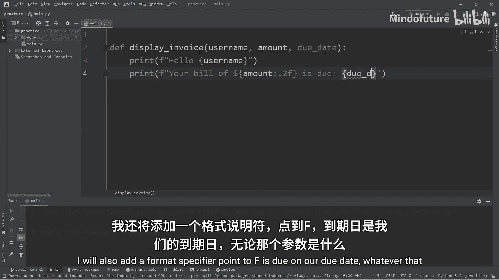

Whatever that parameter is。To invoke this function， we will type the function's name。

 add a set of parentheses， a user name， an amount and a due date。Let's make up some username。

An amount， I guess $42。50， I'm just making up a number here。Then a due date， the 1 January， I guess。

Here is my invoice。 Hello， bro code。 here Bill of $42。50 is due on January 1。

 Let's change these arguments。Joe Schmo is the username。

 He owes $100 and one penny due on 1 February or January 2。

 depending on how you read dates in your region。Hello， Joshmo。

 your bill of $100 and1 cent is due on one slash 2。 That's another example。 Now。

 we need to explain the return statement。 Return is a statement that is used to and a function and send a result back to the caller。

 Here's an example。 We have a variable Z Z will equal。

 We invoke a function to add two numbers together， such as the numbers  one and 2。

 When we invoke a function， we can send some data back after adding one and 2。

 we will send the result， which would be 3， Then this value can be assigned to a variable。

Then we can print whatever Z is， So let's create some functions。

Let's create a function to add two numbers together。The parameters will be x， and y。Let's say， Besy。

Equals。X plus y。 Then we will return。Our value， Z。So I'm not going to print Z directly right now。

Let's subtract X and Y。Subtract Z equals x minus y returned z。Multiply。

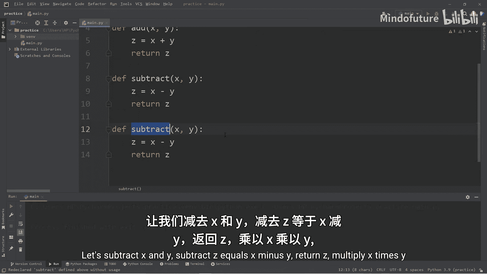

X times y。

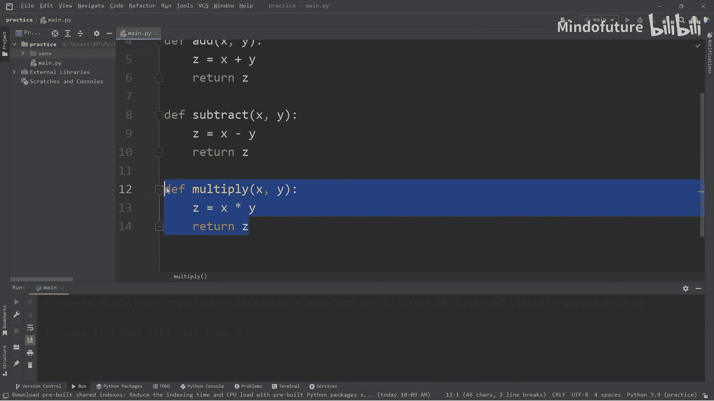

That divide。X divided by y return Z。 Let's invoke our add function， Pass in two numbers，1 and 2。

Then I'm going to print the result。After adding these two numbers together。The result is3。

What about subtract。Subtract1 and2。 The result is negative  one。Multiply。The result is two。

Then divide。1 divided by 2 is 0。5。 After we resolve this function， a value is returned。

 Just imagine that after we finish this function， this function becomes whatever is returned，3。

 this function becomes negative 1。This function becomes 2。 This function becomes。0。5。

Let's write something a little more complex。We will create a function to create a full name。Create。

Name。We'll need two parameters for a first name and a last name。 I'll name these first and last。

What do we want to do within this function， Let's capitalize the user's first name。

 First equals first dot capitalize method。Then do the same thing with the last name。Last equals last。

 dot capitalize。Then I'm going to return the user's first name， plus their last name。

Then I'll add a space in between their first and last name。This is also valid。

Outside of the function， let's create a full name variable that invoke the create name function。

 So this function is going to capitalize the first last name for us。I'll type in my first name。

All lowercase， same thing with my last name。Then let's print our full name。

And here is my full name variable。 We sent our functions some arguments。

 We have some parameters set up。 We took those values， made them uppercase。

 then concatenated these strings together， then return them as a single string。

 Let's try this with a different name。Sppongeebob。Square pants。Spgebob now has a full name。

 The first and last names are now capitalized using the return statement。

 You can return some data back to the place in which you call a function。 Well， everybody。

 that's a function。 It's a section of reusable code to call a function。

 You type the functions name add a set of parentheses。 You can send a function。 Some data。

 which are known as arguments。 but you'll need a matching set of parameters。

 You also do have the option of returning some data back to the place in which you invoke a function。

 We'll be using functions along in the future， but we will get more practice with them。

 And those are functions in Python。

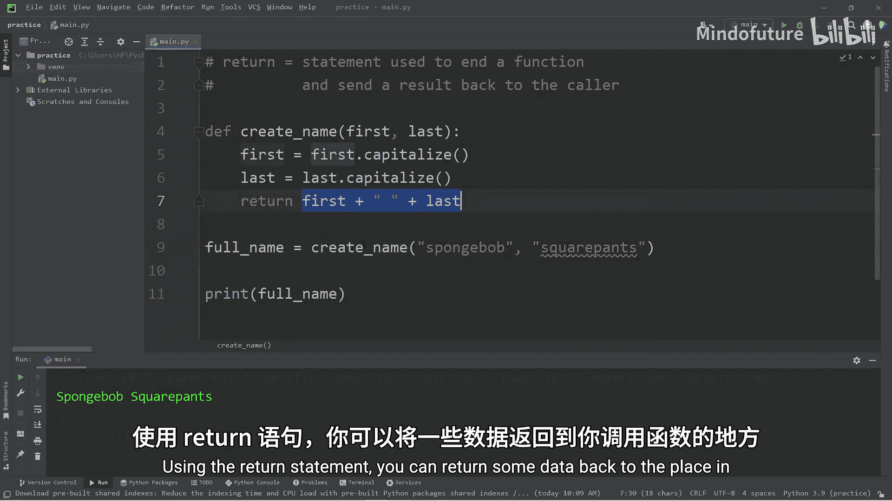

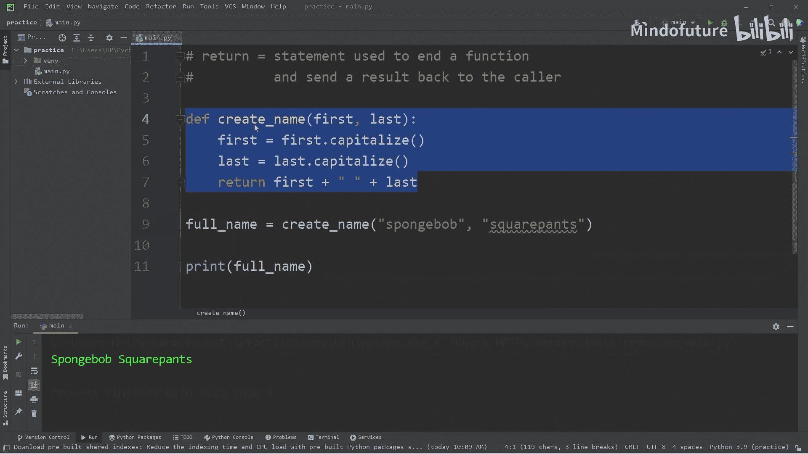

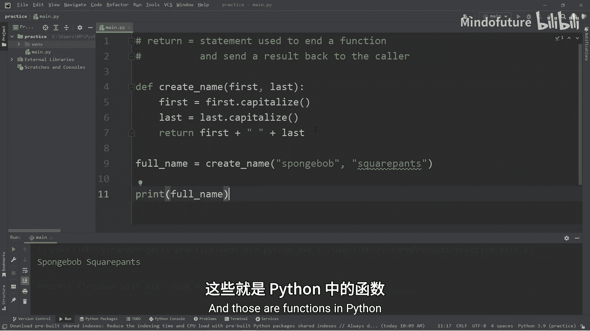