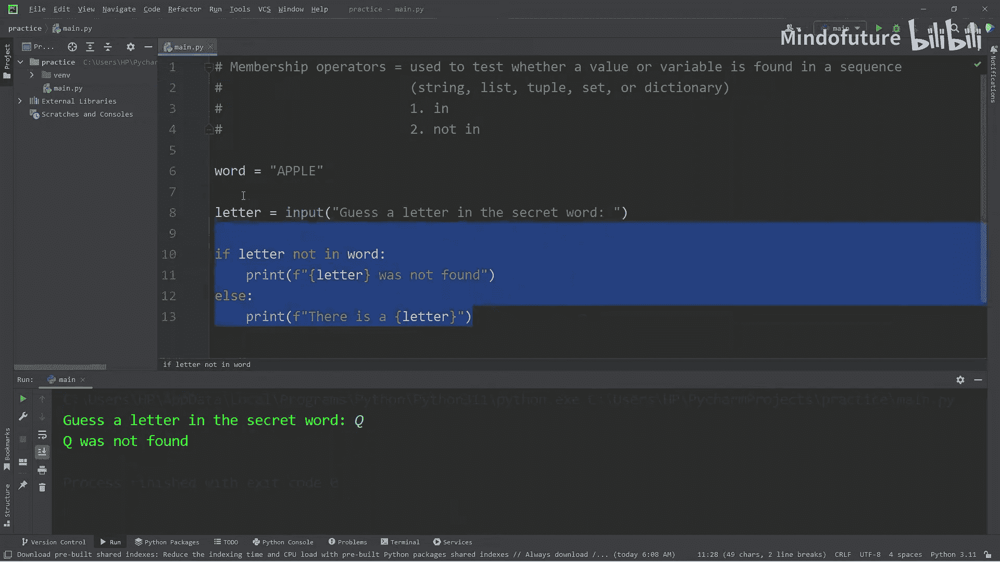
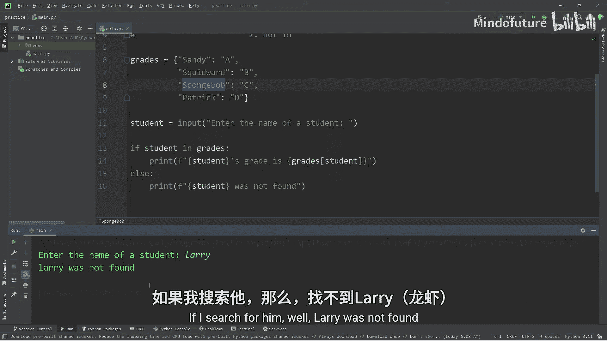
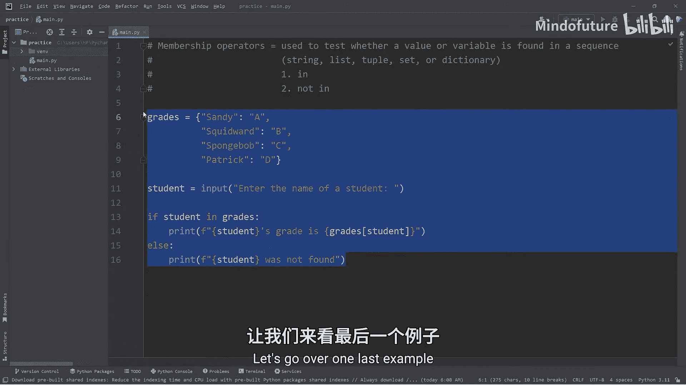
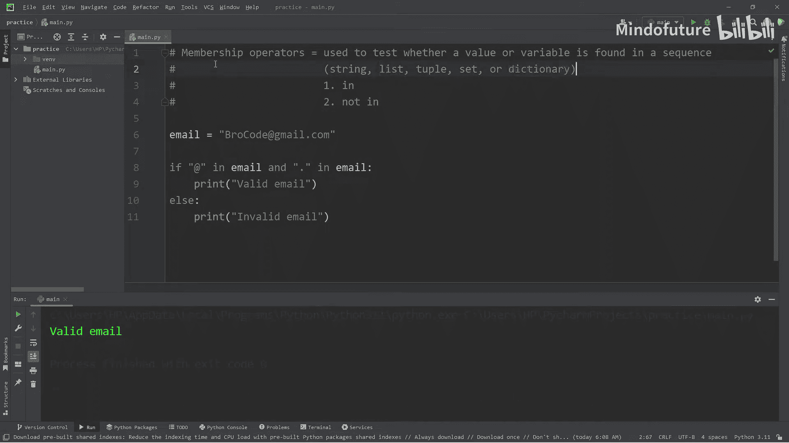

# Python超全入门教程-p37-P37-Learn-Python-MEMBERSHIP-OPERATORS-in-8-minutes--BV1fcdLYXEw9_p37-

Hello again。 So today， I got to talk about membership operators in Python。

 They are the operators in and not in。 They're used to test whether a value or a variable is found within a sequence。

 which include， but are not limited to strings， lists， tuples， sets or dictionaries。

 Here's an example。 I'm going to create a word， a secret word。Let's say Apple。

I'm going to turn this into a game。 I will have a user guess a letter。 I will accept some user input。

Guess a letter。In the secret。Word。What I would like to do is check to see if my letter is found in my word。

 I can write the following statement。If our letter in our word。

In is going to return a Boolean value of true if that letter is found or false if it's not。

So if our letter is found， I'm going to print the following statement， I'll use an F string。

There is a at a placeholder， insert our letter。Else， let's print。I'll use an up string。Our letter。

Was not found。Let's test this。Guess a letter in the secret word， I will guess a capital A。

So all these letters are uppercase， do take note of that。Is there an A。There is an A。

Let's guess a letter that's not within this word。Such as Z。Z was not found。

The in membership operator will test to see if a value or a variable is found within a sequence。

If it is， it returns true。 If not， it returns false。Or for the inverse， you could say not in。

If letter is not in word。We would have to flip these statements around。

If this value or variable is not found in this sequence， it returns true， otherwise false。

 So it does the opposite of n。Guess a letter of the secret word。 I there an E， There is an E。

Is there a queue， Q was not found。Depending on the statement you're trying to write。

 you can use either in or not in， whichever makes more sense in that context。

Let's go over another example。We were searching for a value or a variable found within a string。

Let's try a set list， tuples and sets are going to behave similarly。 I will create a set of students。

For a set， you need a set of curly braces。Let's add a few student names。Such as Sponongebob。Patrick。

And Sandy。I will have a user type in a student to search for。We will accept some user input。

Enter the name of a student。We're going to check if。Our student。Is in。Our sequence of students。

If in returns true， let's print the following。I'll use enough string， insert our student。

Is a student？Else， we will print。I'll use an up string。Insert that student。Was not found。

Enter the name of a student。Let's search for SponongBob。 SpongBob is a student。

Enter the name of a student， let's attempt sququiidward。Squiid word was not found。

And much like the first example， we can do the opposite。

See if a value or a variable is not in a sequence。We would have to switch these statements around。

Enter the name of a student is Sandy a student。Sandy is a student。

Enter the name of a student Is Larry a student。 Larry was not found。Now we'll cover dictionaries。

I will create a dictionary of grades。Student grades， like a grade book。

Let's say that the student of Sandy。She will be a key。Has a value of a。Squiidward。

The keyquiid word has a value of B。SppongeBob， he is also a key。Sponggeboob has a grade of sea。

Then Patrick。Patrick has a grade of D。Here is my dictionary of grades。

Then we'll search for a student。 Student equals input。Enter the name of a student。We'll check if。

 let me close this。If our student。Is found within grades。Then I will print the following。

We're looking for keys。 Is there a matching key， If we find that student。

 I'll make this enough string。Let's display the associated value of that key。Student。Students。Gade。

Is I'll add a placeholder。Once we find a student， we have to get that value at the given key。

To do that， we'll take our dictionary of grades。At index of student。

This will retrieve the value at a given key。If we don't find a student。

 we'll output'll put the following。Again， I'll use an F string。Student。Was not found。

So now if I search for a student such as Sponongebob， we're given a grade。

 we're given the value at that key that we're searching for。Let's test Sandy， Sandy's great as A。

Squidward。Squiidwards grade as B。And Patrick。Patrick's great as D。 But Larry is not a student。

 If I search for him。

Well， Larry was not found。Let's go over one last example。

We're going to create a variable of email。 It's going to be a string。 type in whatever your email is。

Brow code at gmail。com。I would like to see if this email is valid， does it contain at？😡，And a period。

I will write if our value of at that character。Is in our email。And a period。Is in email。

We have two conditions。Check if at is an email and check if a period is an email。 If so。

 it's a valid email。Then we'll print。Valid email。Else， we will print。Invalid email。Is my email valid。

 That email is valid。I'll get rid of the app。Invalid email。

I'll get rid of the period following Gmail。That email is also invalid。In this example。

 we're checking two conditions。If this value is found within this sequence and this value is found within the sequence。

All right everybody， so those are membership operators in and not in。

They will return a boolean based on whether a value or a variable is found within a sequence。

 which include， but are not limited to strings， lists， tuple sets or dictionaries。 And well。

 everybody， those are membership operators in Python。

