# Python超全入门教程-p38-P38-Learn-Python-LIST-COMPREHENSIONS-in-10-minutes--BV1fcdLYXEw9_p38-

Hey， what's going on， everybody。 So in today's video， I got to explain list comprehensions in Python。

 A list comprehension is a concise way to create lists in Python。

 They're compact and easier to read than traditional loops。 Basically。

 you have to follow this formula for every value in something that's iterable。

 meaning you can loop through it。 Check some condition。 Then do this expression。

 So let me give you an example with using a traditional loop。

 Then you'll be able to see why list comprehension is useful。

 We're going create a list and double the numbers1 through 10。😊，Doubles equals an empty list。

Using a traditional for loop。We will say for every value， let's say x。In range 1 through 11。

 Remember that in the range function， the second number is exclusive。 This will give you the numbers。

1 through 10。For the first iteration， x is going to be 1， then2，3， all the way up until 10。

 so we'll iterate 10 times。During each iteration， I'm going to take my list of doubles。

 Use the built in append method。 We will append。X， during each iteration。

 that's going to be the value times 2。So if I were to print my list of doubles， here's the result。

We have the numbers 1 through 10， all doubled 2，4，6，8，10，12，146，1820。

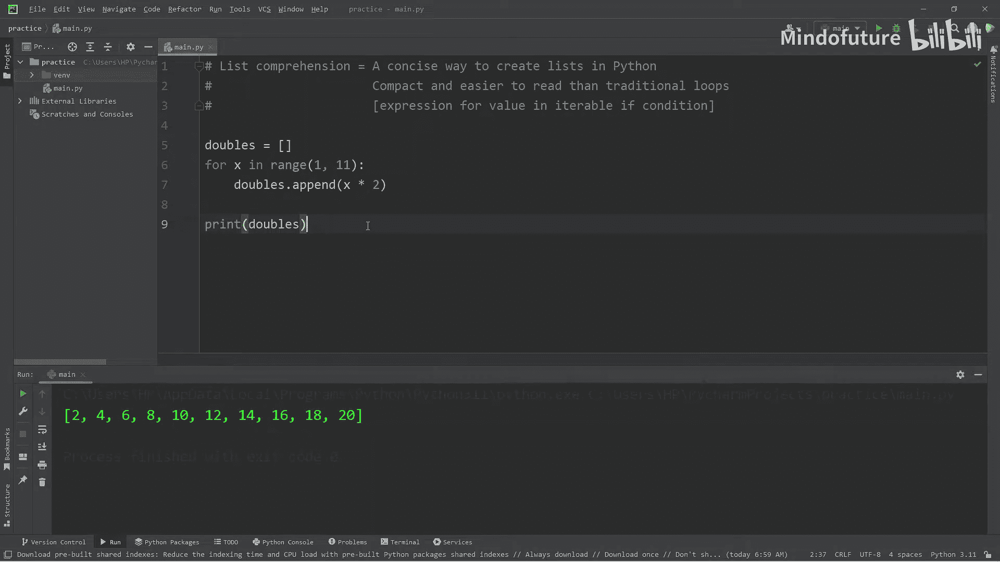

So this is a lot to write。 We can use a list comprehension to make this code more compact and easier to read。

 Here's how。

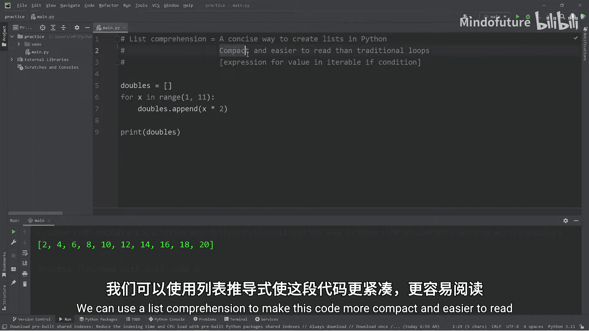

We need a name for this list。 Let's say doubles equals an empty list。Within our list。

 we'll follow this formula。We have an expression for value， initerable， and optionally。

 we can check a condition。 We'll do this in exercises later on in this topic。

 We'll begin with for every value。 Let's say x。In our iterable， our iterable is going to be a range。

1 through 10。Again， for the first iteration， X will be  one。 Then the second iteration。

 X will be 2 all the way up until 10。 During each iteration， what would we like to do with x。

 our value。 Let's take x， multiply it by 2 and return it。Then if I was to print my list of doubles。

We have the numbers 24，6，8，10， 12， 1416， 1820。For every value in this iterable， do this。

 multiply it by two。 This is a list comprehension。 It's a concise way to create list and Python。

 We'll go over a few exercises。So this time， we will triple each number。

 We'll create a list of triples equals。 Let's say this time for every y in range。

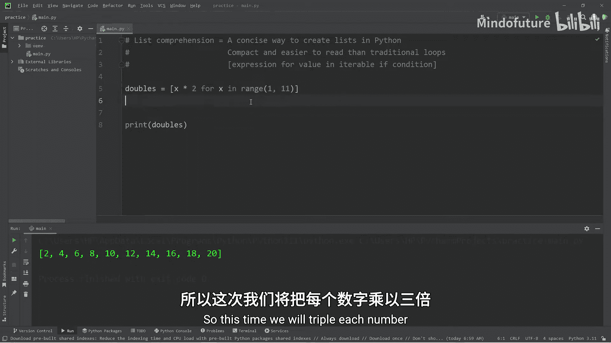

1 through 10。So we have the right 11。Take y and multiply it by3。

Then we will print our list of triples。3，6，9，12，1518， so on and so forth。 Let's square each number。

We'll create a list of squares。For every Z in range 1 through 10。To square a number。

 we take that number。

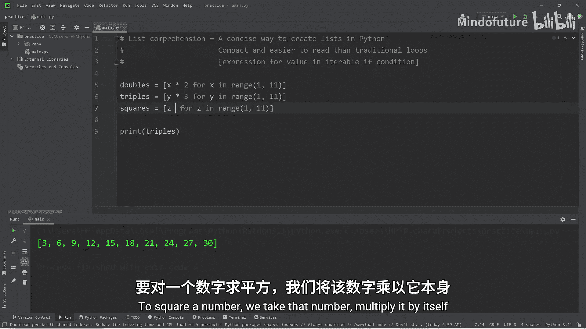

Multiply it by itself。So the numbers1 through 1 squared。Is 1，4，9，1615，36，49，64，81，100。

So 10 times 10 is 100。Now we're going to work with strings。We'll create a list of fruits equals。

 Think of some fruit。 These are all going be strings， apple， orange。在哪呢？Coconut。

I'm going to take each string in this list and make it uppercase。We could assign this to a new list。

 such as uppercase fruits。Or we can simply just reassign it just to keep it simple， I'll reassign it。

So again， we're following this formula。I'd like to begin with the four value in iterable portion。

For every fruit in our iterable of fruits。What do we want to do。

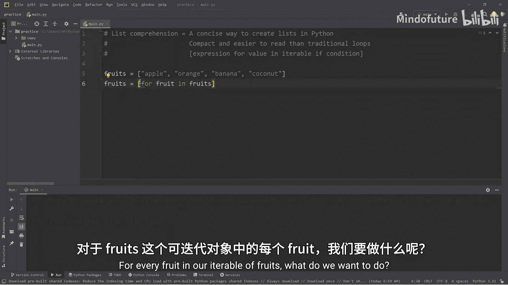

Well， let's take each fruit。 Take each fruit， use the built in upper method to make an uppercase。

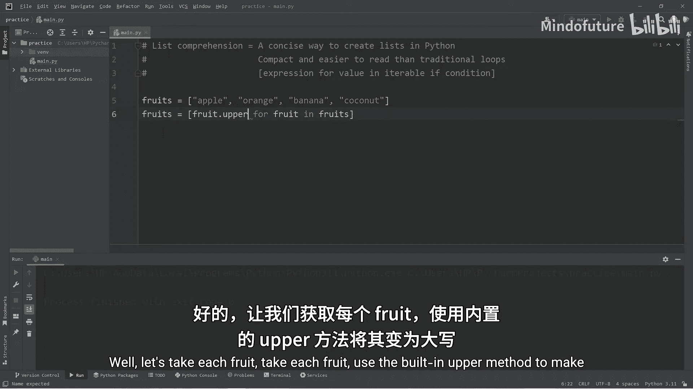

Then， I'm going to print。My list of fruits。Each string in this list is now all uppercase。

You could even cut down on one of the steps with our iterable of fruits。 I will place this list。😡。

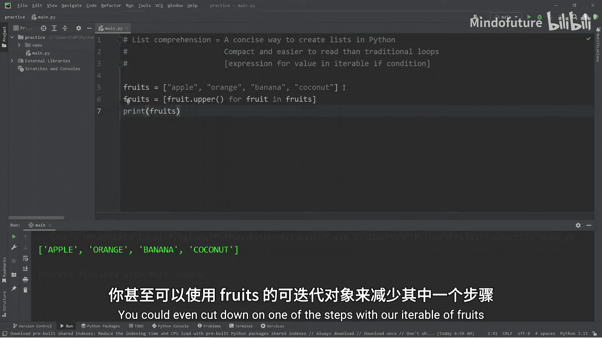

And this does work， too， although I do find this a little more difficult to read。

 but you can take either option。

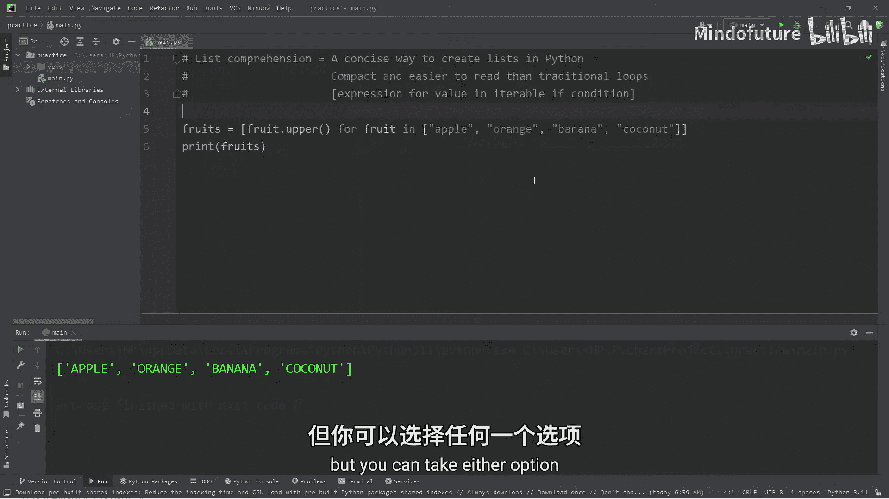

How about instead of making each string uppercase， we'll take the first letter of each string。

 then put it within a new list。

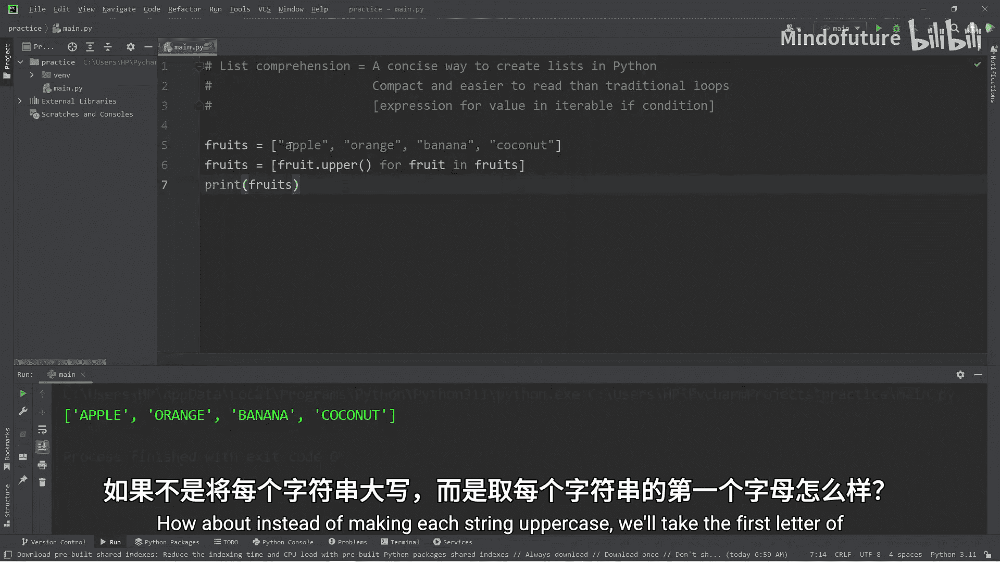

So let's take each fruit at index of 0。 That will give us the first letter。

 We'll place it within a new list of。Fruit， chas， meaning characters。Here's the result， AOBC。

For every fruit in our list of fruits。Return the first character of each string。A， OBC。

Now we'll work with conditions。We'll create a list of numbers， both negative and positive。

Numbers equals， let's say，1， negative 2，3， negative 4，5， negative 6。

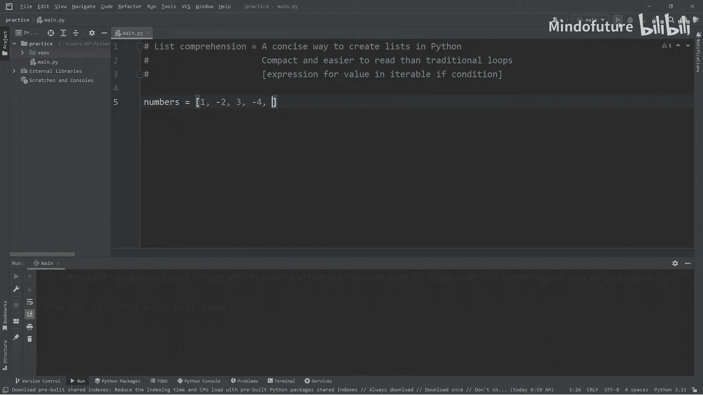

We'll create a list comprehension to create a new list where all of the numbers are positive。

Our new list will be positive nus。Equals， we write a list comprehension。For every， let's say numb。

In numbers。We'll write a condition。Return this number， if are none。Is greater than or equal to0。

We do need an expression。If we're not modifying each value， we can just return。The value of numb。

During this exercise， we're more focused on the if condition， rather than the expression。

 If our value of numb meets this condition， simply return it and place it within this new list。

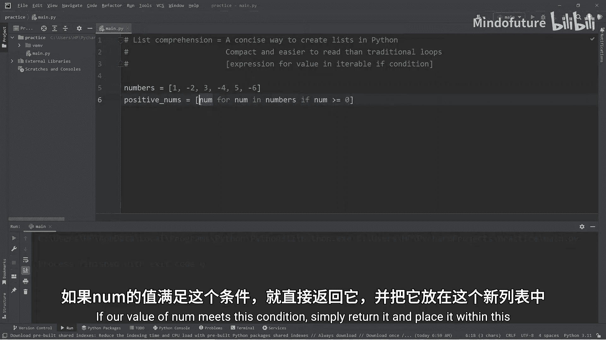

Let's print our list of positive numbers。And we have 1，3，5。Let's do this with negative numbers。

 I'll just copy what we have and change a few things around。This list will be negative numbers。

Negative nu。For every nu in numbers， check this condition。 Check to see if nu is less than 0。 If so。

 return that number。Let's print our list of negative numbers。Negative 2， negative 4， negative 6。

Let's check to see if there's any even numbers。Even nus equals。For every numb in numbers。

 check to see if our numb。Is divisible by 2。 And we can do that with the modulus operator。

 followed by  two。 The modulus operator will give you the remainder of any division。

 If our number is even number modulus 2 will equal 0。If it's even， this is going to equal 0。

 if it's odd， it's going to be1。We're not modifying our value。 We're just going to return our number。

Our list of even numbers should be negative 2， negative 4， negative 6。Let me add one more value。

 Let's add。Positive 8。Negative 2， negative 4， negative 6， positive8。Maybe we'll add one more。

Negative 7。Okay， let's find any odd numbers。Let's copy this line of code。

 replace even numbers with odd numbers。If nu， modulus 2 is equal to one。

That means that number doesn't divide by two evenly。 Then we'll print our odd numbers。1，3，5。

 negative 7。 All these numbers are odd。

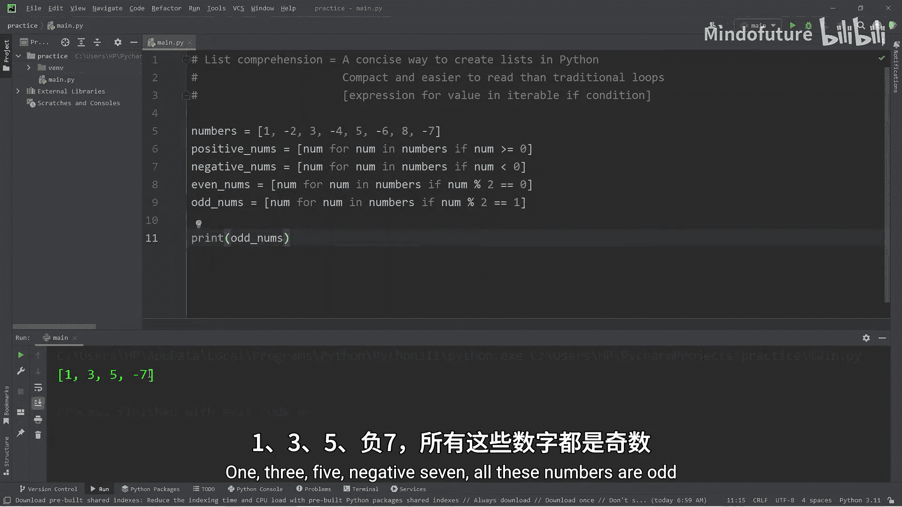

Here's the last exercise。

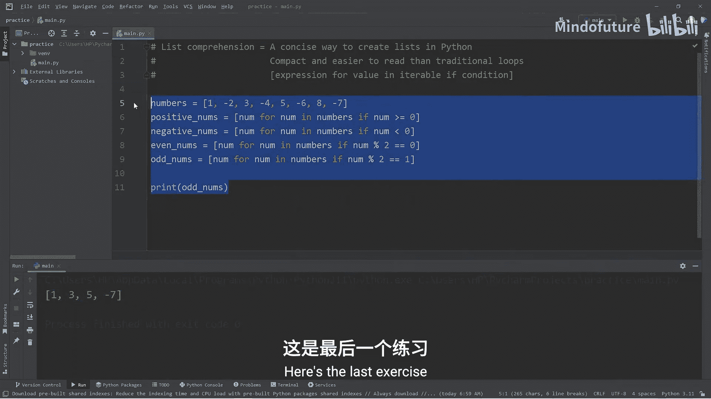

We'll create a list of grades。

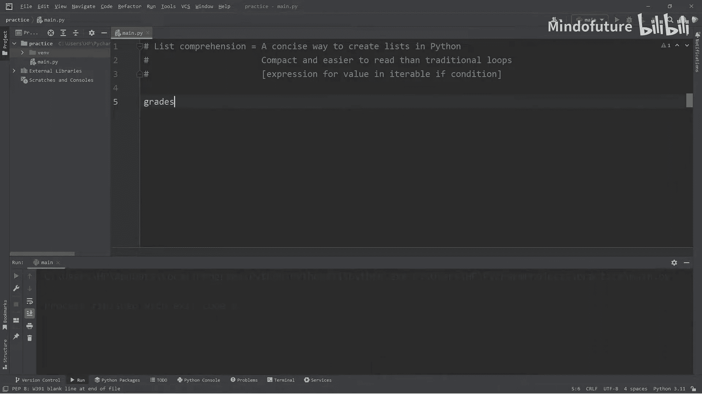

We'll create a new list of any grades that are considered passing， meaning they scored 60 or above。

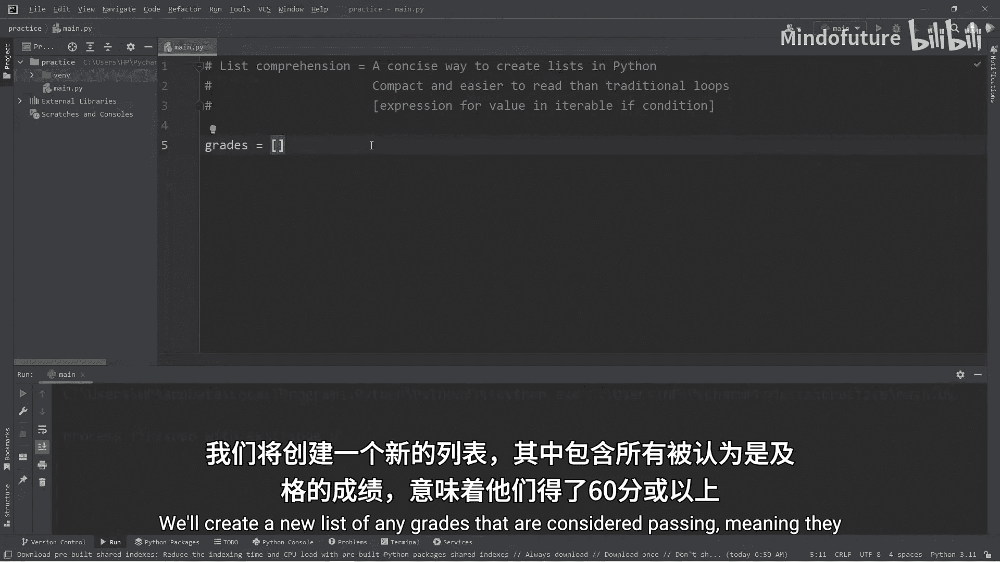

So let's say one student has a grade of 85。Another with the 42。79。90。56。61。Let's say， 30。

I will create a new list of passing grades。Equals again， follow this formula。

For every grade in grades。Check our condition。If our grade is greater than or equal to 60。

 we will return the current grade。Then let's print our list of passing grades。That will give us 85。

 79，90 and 61。All of these grades are greater than or equal to 60。Al right， everybody。

 So that is a list comprehension。 It's a concise way to create lists in Python。

 They're compact and easier to read than traditional loops。Remember。

 for every value in your iterable， optionally， you can check in condition。

 You can write an expression to modify that value if you choose and return something。

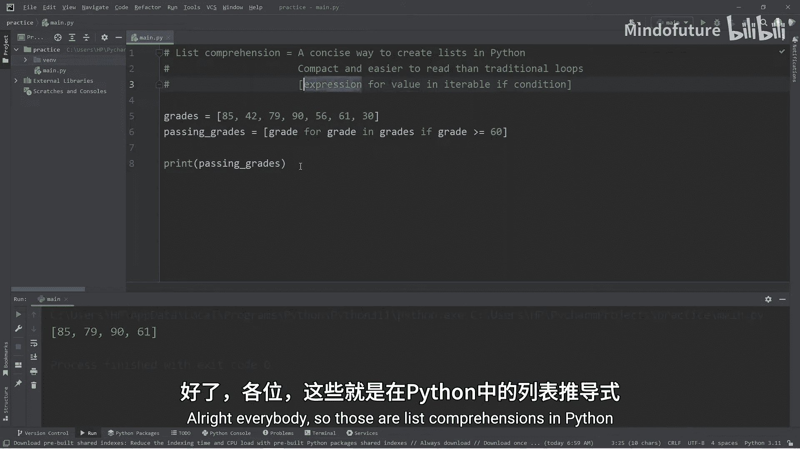

Al right， everybody。 So those are list comprehensions in Python。

