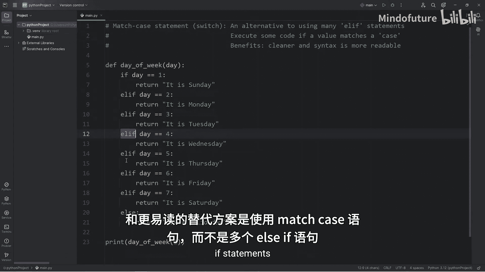
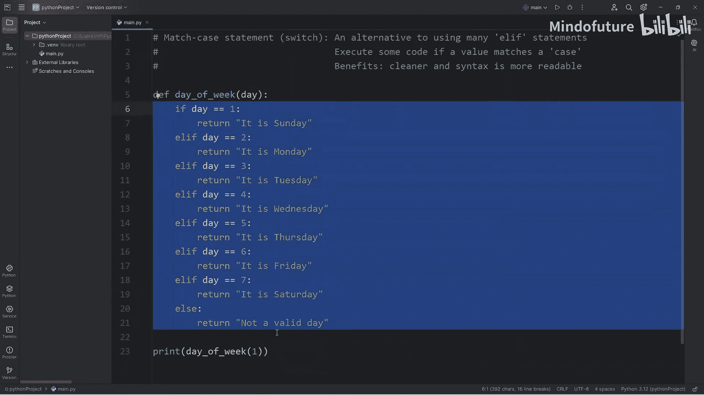
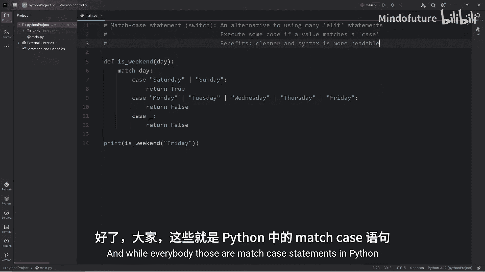

# Python超全入门教程-p39-P39-Learn-Python-MATCH-CASE-STATEMENTS-in-5-minutes--BV1fcdLYXEw9_p39-

Hey everybody， so today I'm going to explain match case statements in Python。

 If you're familiar with other programming languages， this is also known as a switch。

 Match case statements are alternatives to using many Elif statements。

We execute some code if a value matches a case。 The benefits of using a match case statement is that they cleaner and the syntax is more readable In this sample program。

 I have a function。 There is one parameter。 A day day will be a number。 Ily， a number one through 7。

 depending on this number will return a string corresponding to the day of the week。If day equals1。

Then it is Sunday。2， it is Monday， all the way up to 7。Where it will be Saturday。

I do have an else clause if we pass in something that's not valid。Like pizza。Pizza is not a day。

 but it really should be not a valid day。 A cleaner and more readable alternative is to use a match case statement instead of many Elsif statements。

Here's how I'm going to take my if and many elsesif statements。

And enclose them within a match case。Match。Case。😡，The case is going to be the value we're examining。

 the case will be day。Colon。We're going to examine our value of day against matching cases。

We're going to replace if day equals with the following， just simply case。

So let's do that with each of these statements。If you have an else clause。

 you're instead going to have a case of underscore。

And underscore in a match case statement is a wild card。

 We will perform this case if there are no matching cases。

This case would function as the L statement。Here's what we're working with now。

If I pass in one and return the day of the week， we would get some day。2。Would be Monday 3。Tuesday。

7even。Is Saturday， and then let's try that day of pizza。That is not a valid day。

A match case statement is an alternative to using many Els Siif statements。

 I find this much easier to read than the many Els statements， both would technically function。

Let's go over a second example。We will create a function of is。Weekend。We have to pass in a day。

This time， our day is going to be a string， such as Monday。

The value for each case instead of a number is going to be a string。

If our day matches a case of Sunday。Let's return。 How about a Boolean of true。

 We're checking to see if it's the weekend。If our day is equal to a case of Monday。

Then we will return false。Let's do this with the other days。 I'm going to fast forward the video。

We will call the function of is weekend， then pass in a day of the week， such as Monday。

So is Sunday the weekend。That is true。Monday。That is false。Saturday。That is true。

 And we do have a wild card case if there are no matches。Is pizza a day of the weekend。

 That is false。There is a way we can modify this match case， too。

 We tend to be repeating ourselves a lot。 The days Monday through Friday， all return false。

We're going to use the or logical operator， which is represented with a vertical bar。If the case。

Of Saturday。Or Sunday， return true。If the case is Monday。Or Tuesday。You can get rid of that。

Or Wednesday。Or Thursday。Or Friday。Then we will return false。We can keep our wild card case。

So is Saturday。Part of the weekend。That is true。Is Monday。False Sunday。True。Friday。Pauls。And pizza。

We have our wild card case that gives us false。All right， everybody。

 So those are match case statements。 They're similar to switches and other programming languages。

 They're an alternative to using many elsesif statements。

 We execute some code If a value matches a case。The benefits is that the code is cleaner and the syntax is more readable。

 And well， everybody， those are match case statements in Python。

