# Python超全入门教程-p40-P40-What-are-Python-modules--BV1fcdLYXEw9_p40-

Hello， friends。 It's me again。 Today， I'm going to explain modules。

 A module is just a Python file containing code you want to include in your program。

 You use the import keyword to include a module。 You can use built in modules or create your own。

 Sometimes it's useful to break up a large program in reusable separate files for a list of all the modules found within the standard Python library。

 You can use the help function。 Passen the word modules， and then we would need to print this。😊。

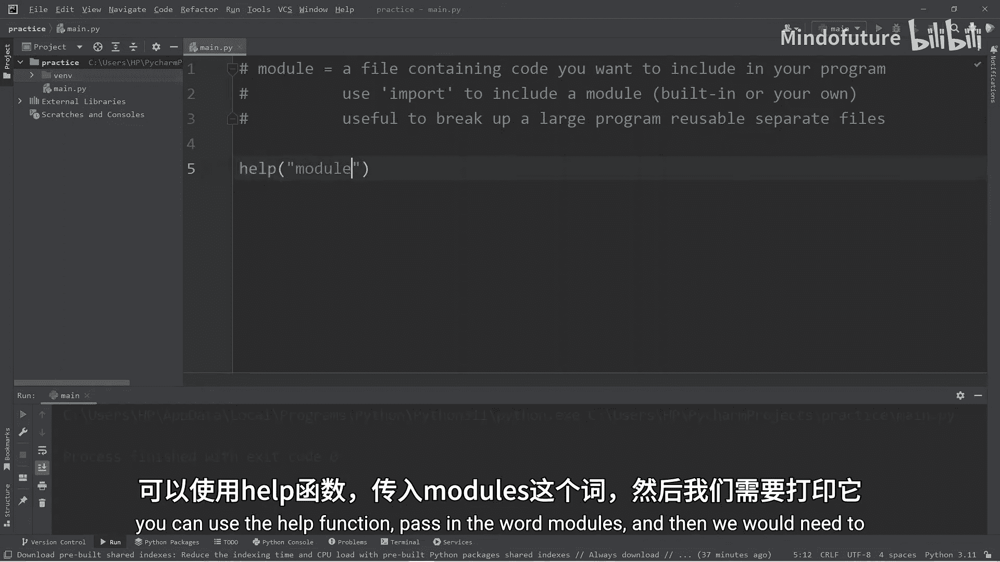

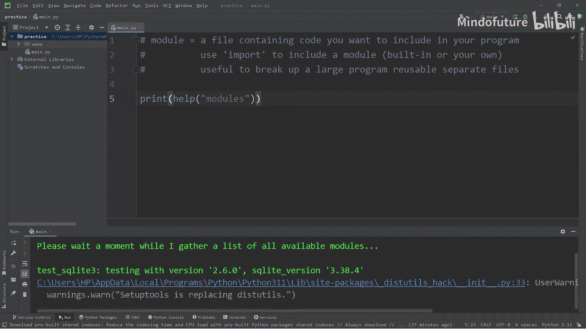

Here are many of the different modules available to you。 A few you may recognize would be math。

 string time。 One of my favorite names of a module is the pickle module。 Unfortunately。

 it doesn't have anything to do with pickles。 It's used for serialization to list all of the different variables and functions found within a module。

 You can place that name of the module within the help function。

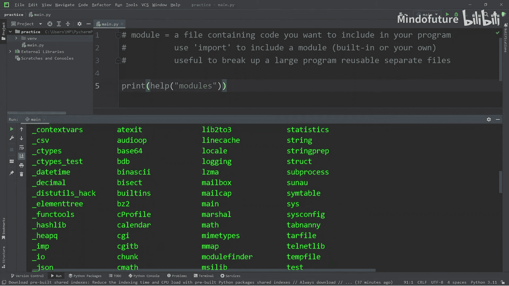

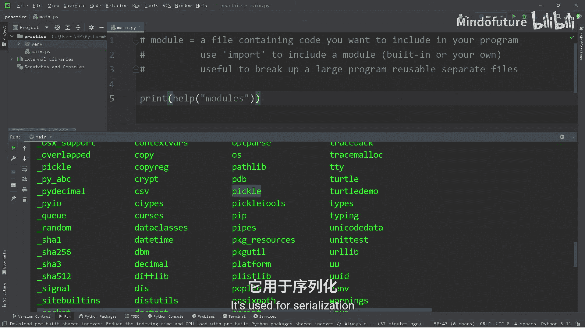

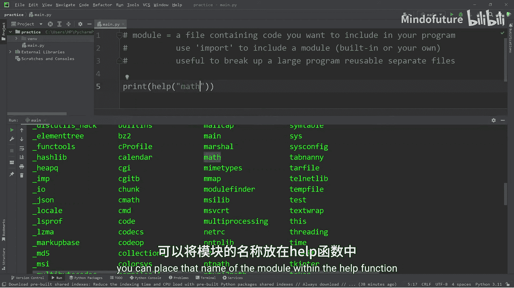

For example， with the math module， here are a few different variables we would have access to and a few different functions。

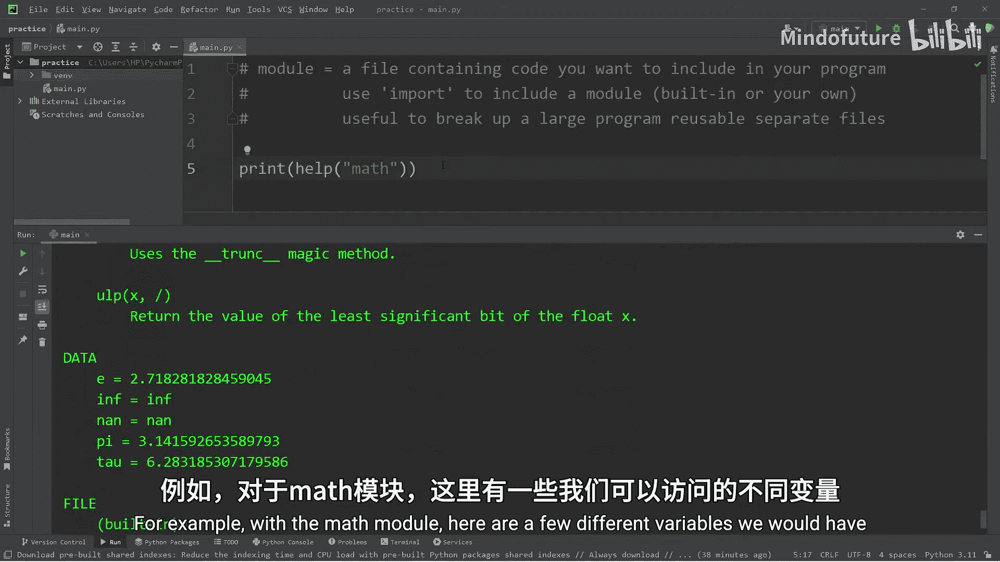

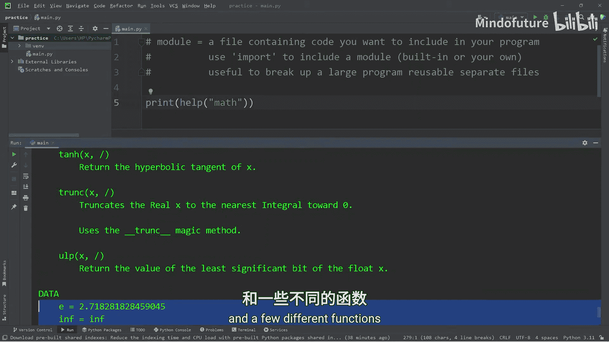

To include a module， we would type import the name of the module。 for example， math。

 I now have access to everything found within the math module。

 including those variables and functions to access those variables and functions。

 I would normally type the name of the module dot the name of the variable or function， such as pi。

 Then let's print this。😡，Pi from the mathth module。

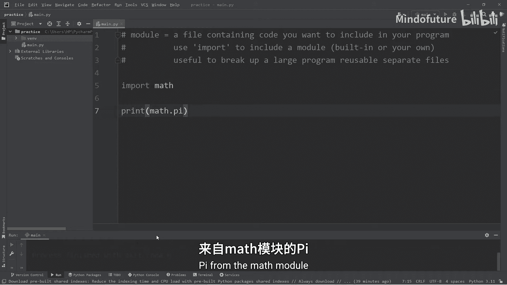

Is 3。14 and some change。 Another way to import is to type import the name of the module as you can give your module a nickname and alias。

 whatever you think of， such as M M short for math。 We would no longer refer to this module as math。

 We would refer to it as our alias， M。Using an alias would reduce some of the typing you have to use if you have a very long module name。

 Another way to import is to use from the name of the module， importm something specific pi。

 for instance。You would no longer need the module name。From math import pi。

 pi would be included within our name space。 However。

 I tend to not use from import as much just because it's possible there could be name conflicts。

 Here's an example。 Let's say from math import E。 E is an exponential constant。E is 2。71。

 What if I was to create a program where we have four variables named A， B， C， D， A equals 1。

 B equals 2。 C equals 3。 D equals 4。 Then I'm going to print。

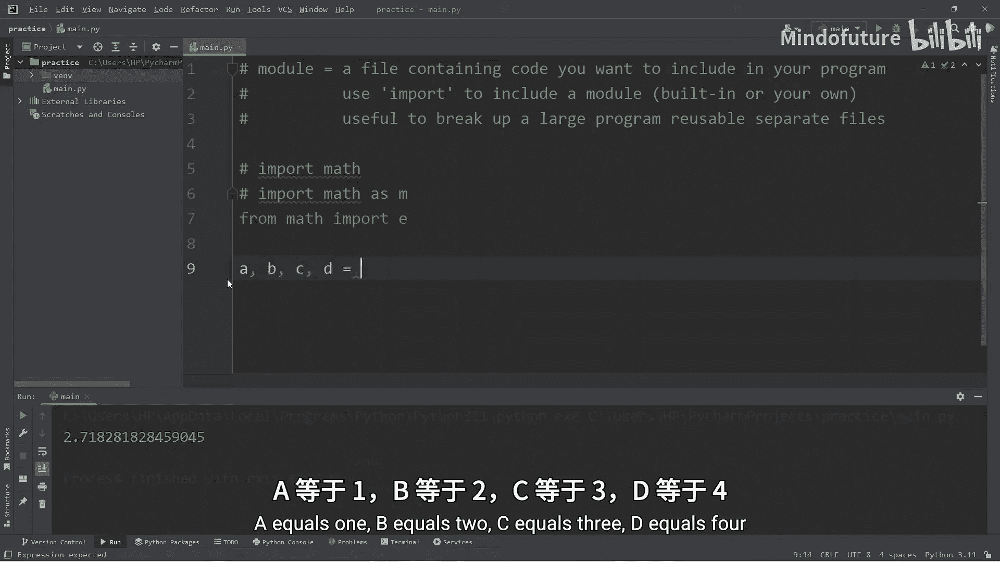

E from the math module。To the power of a。

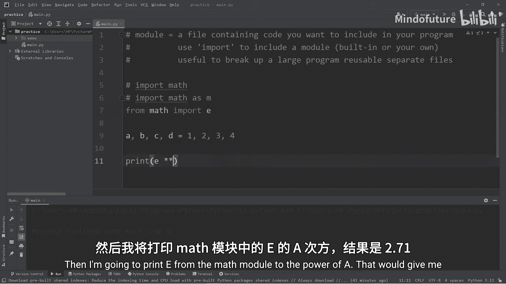

That would give me 2。71。Then let's do this with BCcND。E to the power of B， E to the power of C。

 E to the power of D。Here are the results， let's say we have a different variable E。E will be5。Then。

 I will print。E to the power of E。We have imported E from the math module when we have declared all of these variables。

 I have unintentionally reassigned E from the math module without realizing it。

All my results are now different， and it's possible you may not realize it。

 I like to be more explicit。 I'm going to import math。

 If I'm using a variable or function from a module。

 I much prefer to prefix that variable name or function with the name of the module in which it's from math dot E to the power of a to the power of B to the power of C to the power of D math dot E to the power of our variable E。

😡。

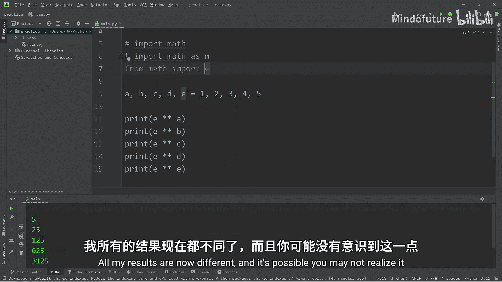

And these results are to be expected now to create a module。

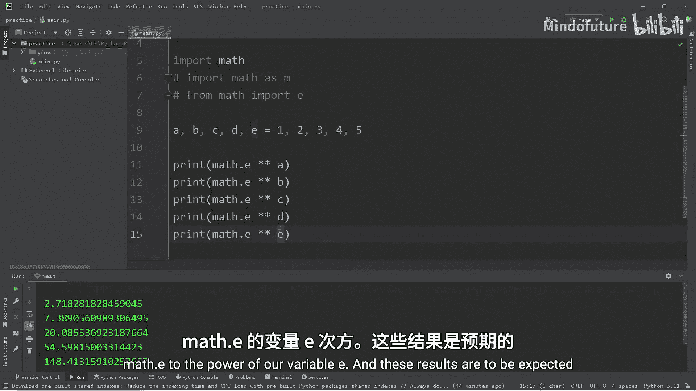

What we're going to do is right click on our project folder， go to new Python file。

 think of a module name， maybe example， then click Python file。We now have two tabs。Main and example。

 declare whatever you would like within this module。 Let's create our own variable。 pi。 Pi equals 3。

14159。 Then a few functions。 Let's create a function to square an argument that's passed in。

 Define square。 We will accept an argument which we will name X。Then return X to the power of 2。

Let's define a cube function。 We will accept one argument， then return x to the power of three。

Maybe a circumference function。 Def circumference。We will accept a radius。

Then return two times pi times radius。Then an area function to calculate the area of a circle。

We will accept a radius as an argument。Then return pi times radius to the power of2。All right。

 here is our example module。Within our main Python program， let's import the name of our module。

 which we named example。 we now have access to everything within this module。

I'm going to declare a variable result and set it to the name of my module， dot pi。

Then I will print the result。Which is 3。14159。Let's utilize the square function result equals example dot square。

 Let's square 3。Which is 9。Let's use the cube function。That would be 27。Circuumference。

That would give me 18。8。Then area。That would be 28。2。 That's how to create your own module。

 It can be useful at times to separate your program into individual files。 All right， everybody。

 In conclusion， a module is just a file containing code。 You want to include in your program。

 You use import to include a module。 You can use built in modules or create your own。

 If you do need a list of the modules available to you。 Again， you can use the help function。

 Then pass in the word modules。 And well， everybody。

 that's how to get started with modules in Python。

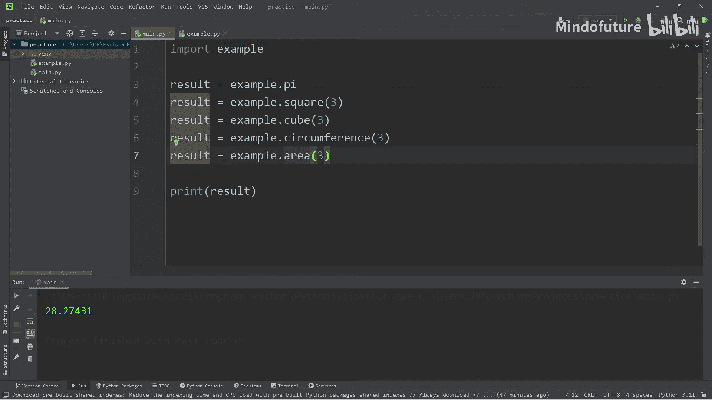

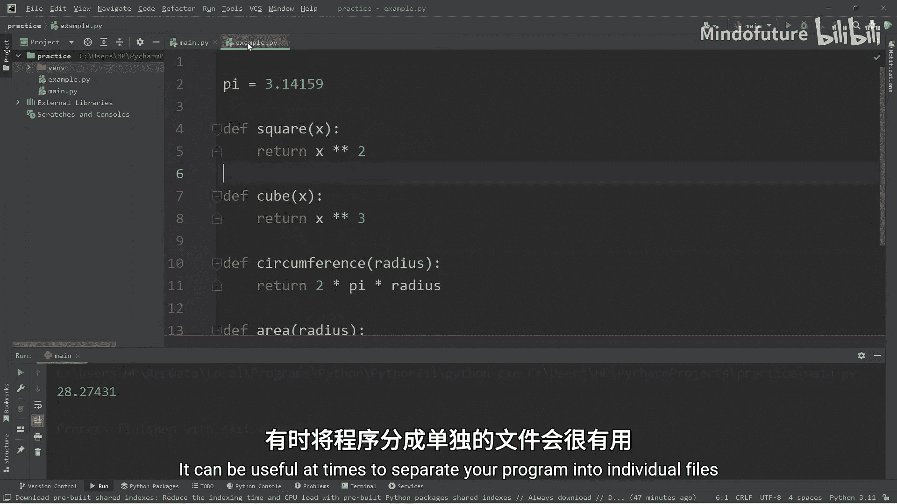

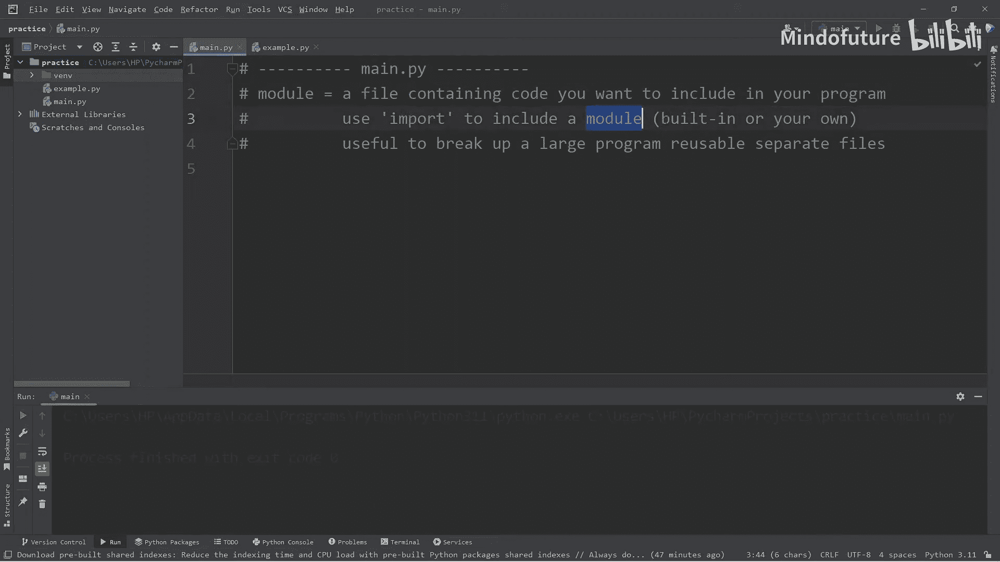

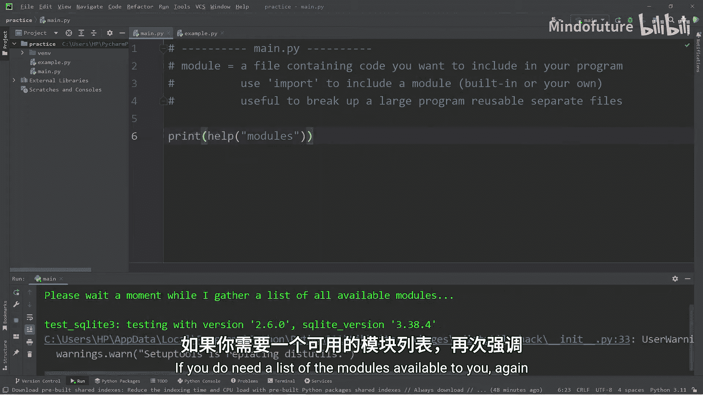

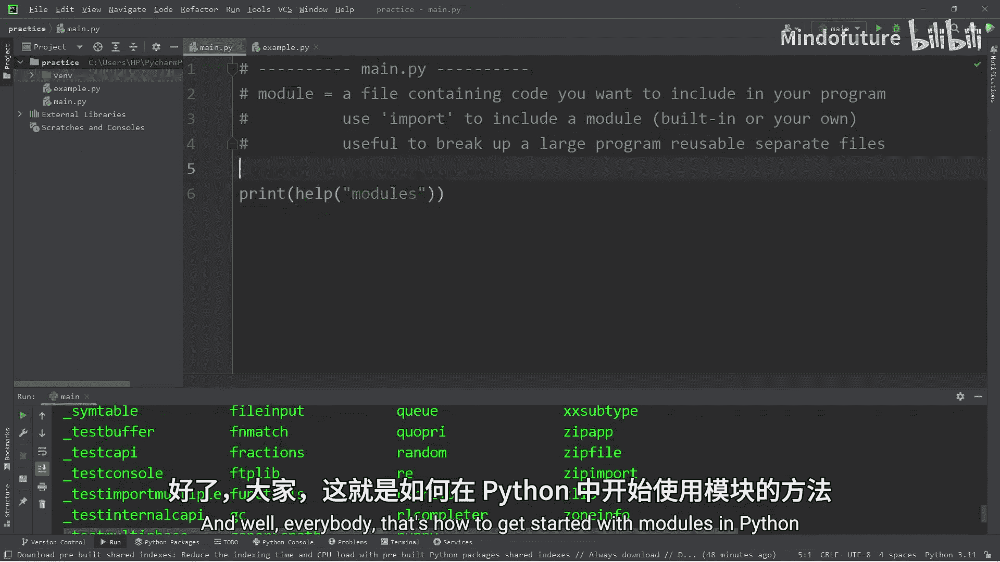