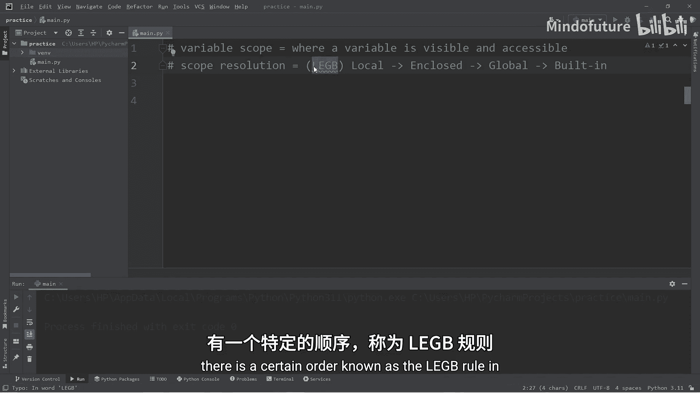
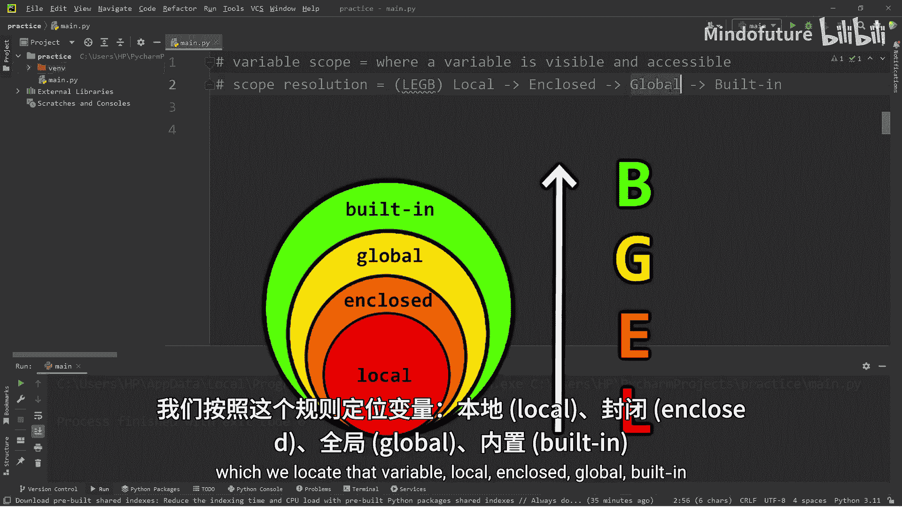
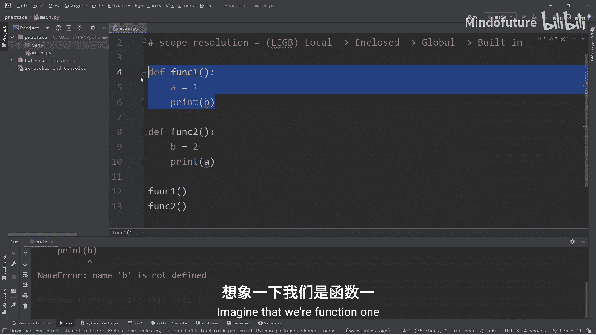
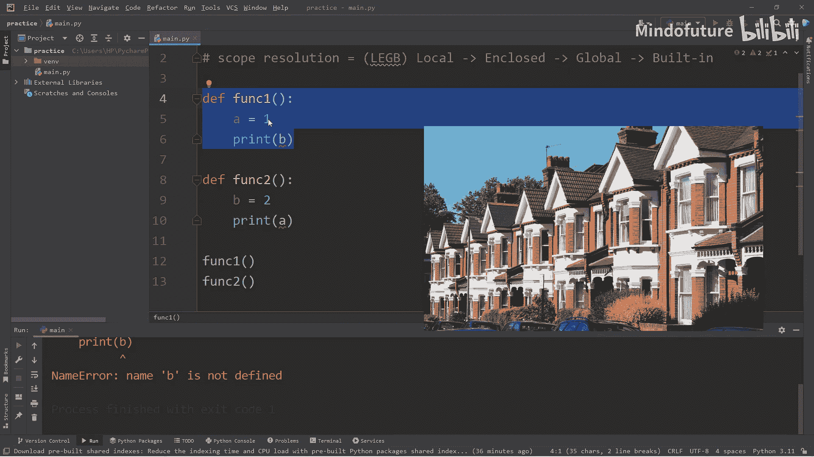
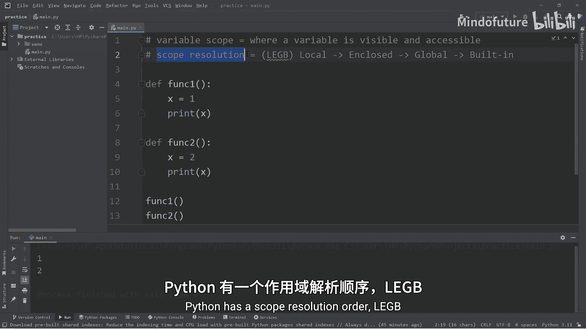
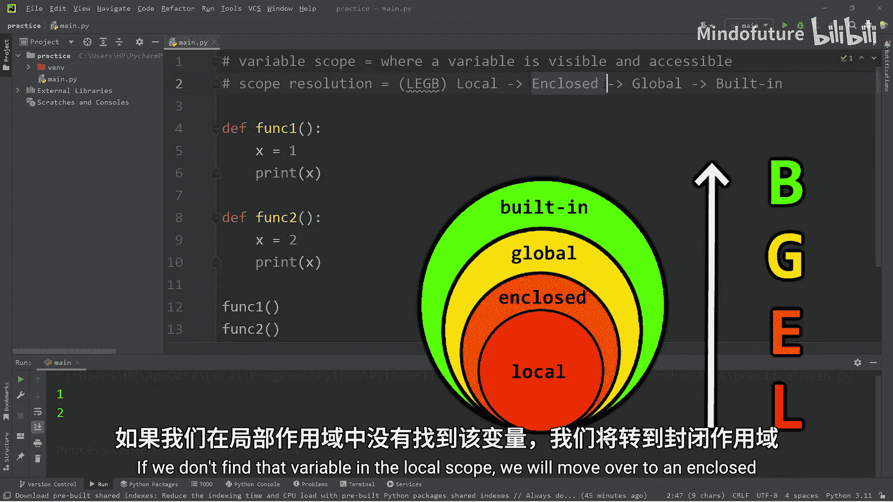
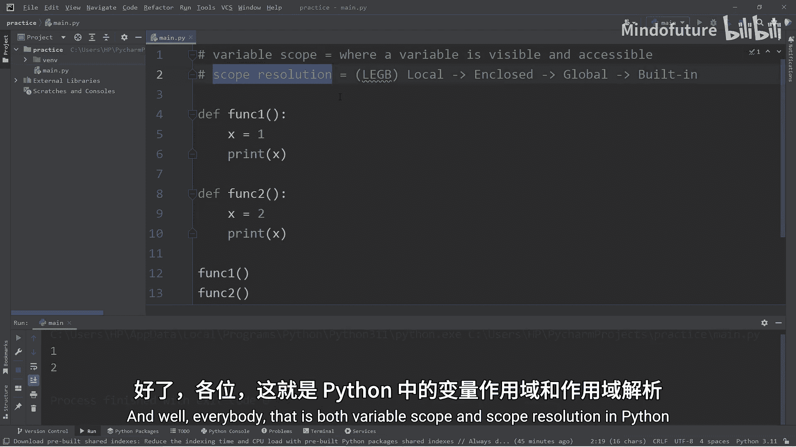

# Python超全入门教程-p41-P41-What-is-Python-scope-resolution--BV1fcdLYXEw9_p41-

Hey， friends， It's me again。 Today。 I'm going to explain both variable scope and scope resolution。

 Va scope is where a variable is both visible and accessible with scope resolution。

 When we're using a variable， there is a certain order known as the L E GB rule in which we locate that variable。

 local enclosed， global built in。 We'll get to this momentarily。 Let's begin with variable scope。

 I have two functions， function 1， function 2， within function 1， A equals 1。

 then we print a within function 2， B equals 2， Then we print B。 If I were to invoke these functions。

 Let's invoke function 1。😊。

Then function 2。We would print one， then two variabless declared within a function have a local scope。

 Vaable A is local to function 1。 variableable B is local to function 2 Within function 1。

 If I were to print B and function 2， if I were to print a。We would run into a name error。

 Name B is not defined。 And the same thing would apply with a Funs can't see inside of other functions。

 Imagine that we' function 1。 This is our house。 We can see everything that's going on inside of our house。

 but function 2 is our neighbor's house。 We can't see what's going on inside of our neighbors house。

 We have no idea what B is with function 2。 function 2 has no idea what a is。

 That's where variable scope comes in。 It's where a variable is visible and accessible。

 Funs can't see inside of other functions， but they can see inside of their own function。

 That's why we sometimes pass arguments two functions so that our functions are aware of them。

 using this concept。 We could create different versions of the same variable。

 Let's rename A to be X and B to be X as well。

Then I will print x。We have two different versions of X。

 a local version of x found within function 1 and a local version of x found within function 2。

 When we utilize a variable， we will first look to see if there's any local instance of that variable。

 If there isn't， we would move to the enclosed scope。 with an enclosed scope。

 One example is when you have a function declared within another function。

 I'm going to place function 2 within function 1。 This is allowed in Python。

 This is a more advanced concept。 We'll cover this more in the future。

 So I'm going to eliminate this print statement。Let's get rid of function 2。At the end of function 1。

 we will invoke function 2。Like I said， it's pretty complex。 We won't be using this until much later。

 Within function 2， If I was to print X， we would use the local version or x equals 2。

If I was to eliminate this variable declaration。We would use the enclosed version instead。

 where x equals one。 There's an order of operations。 Use any local variables first。

 then enclosed variables。 We're printing X within function 2。

 Since X wasn't found within the local scope。 We would use X within the enclosed scope。

 But like I said， that's a more advanced topic， You should at least be aware of it。

 Let's move on to the global scope。 Global meaning outside of any functions。

I will eliminate these variable declarations。Within function 1， we're printing X。

 and within function 2， we're also printing X。 I will declare a global version of x。

 where x equals 3。X is outside of any functions。When I run this program。We're printing three twice。

 once for function 1 and once for function 2。 There's no longer a local version of x for both of these functions。

 If there were， we would end up using these local versions instead， function 1， prints 1， function 2。

 prints 2， If there's no local version， as well as no enclosed version。

 we would move on to the global version where x equals 3。 Last in our order is built in。

 I think what we'll do， though， is from math import E E is an exponential constant。

I'm going to print what E is。E is 2。71。E is built in。 I will create a function to print E， define。

Function1。All I'm doing is printing E。Then we should invoke it。Invoke function 1。

If I was to set E to be a different value， like3， what we're doing technically is creating two different versions of E Vas can share the same name as long as they're within a different scope。

 We have a built in version of E and a global version of E。 If I was to print E Now。

 it would print my global version， because using the L E G B order。

 We would first look for any local version of E， then enclosed version， than global。

 which we do have one of， then lastly built in。Al right， everybody。 So in conclusion。

 variable scope is just where a variable is both visible and accessible。

 Python has a scope resolution order。 L E， G B， if we're using a variable。

 we will first look in the local scope for that variable。

 If we don't find that variable in the local scope， we will move over to an enclosed scope。

 Then global， then built in。 We will have more practice with this in the future。 And well， everybody。

 that is both variable scope and scope resolution in Python。😊。

