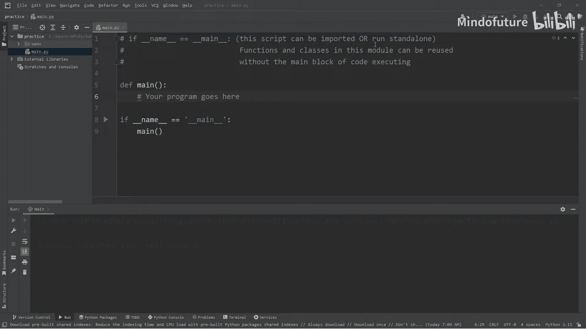
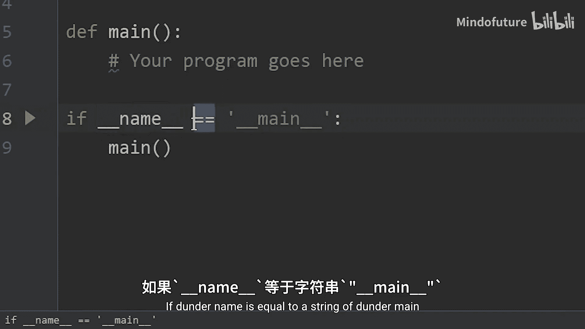
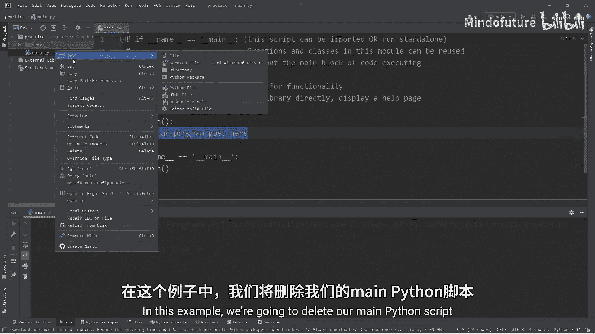
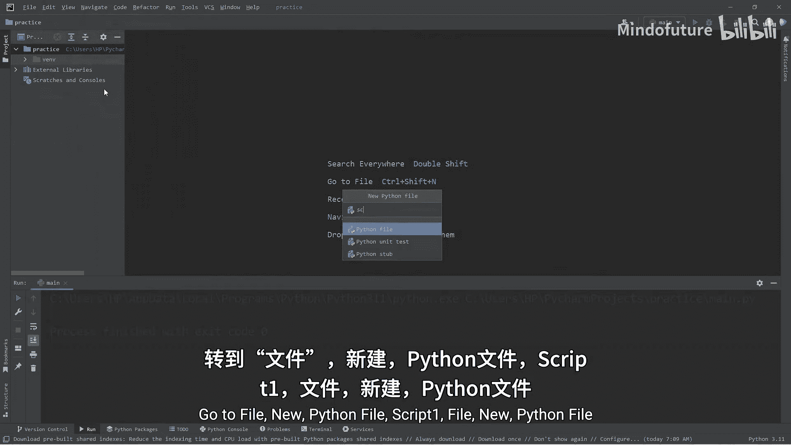
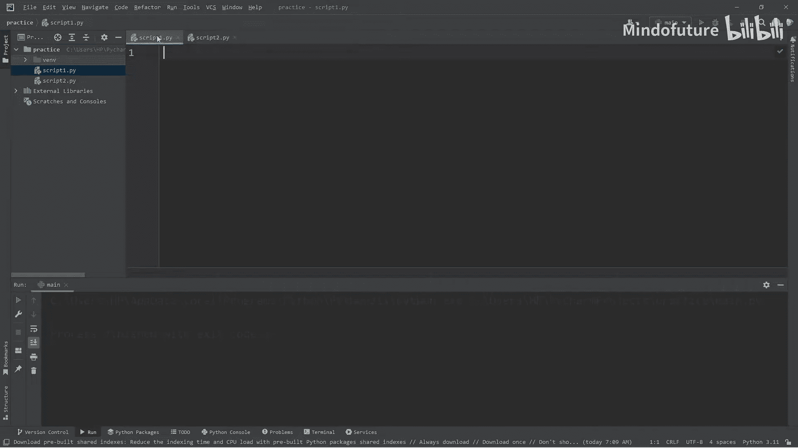
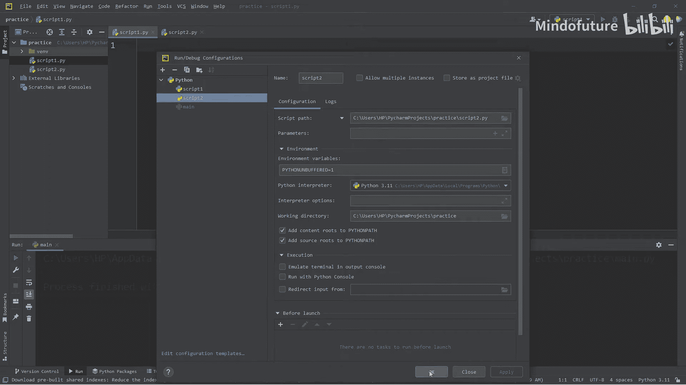
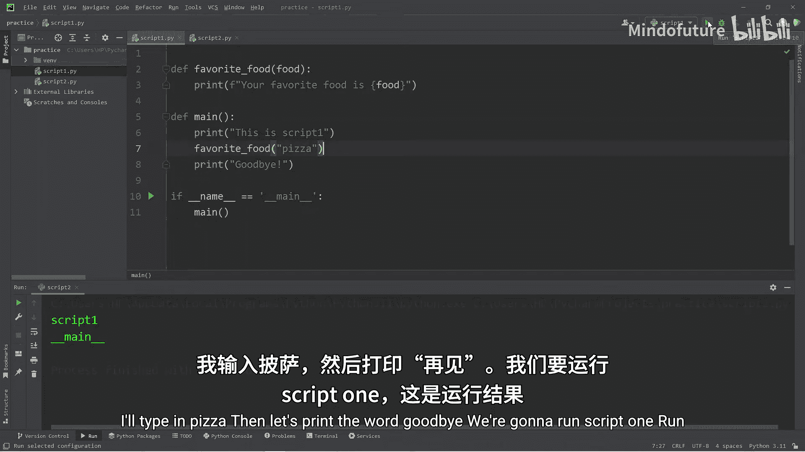
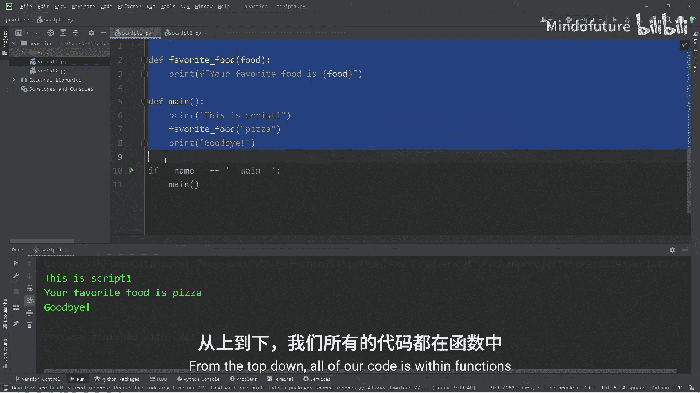
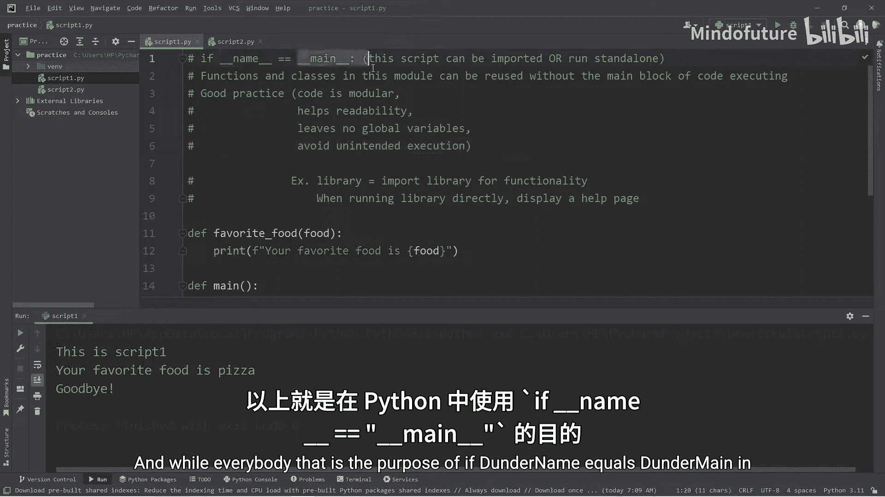

# Python超全入门教程-p42-P42-if-name-==-main-for-Python-beginners--BV1fcdLYXEw9_p42-

Everybody， so today， I got to talk about this if statement。

 If Dunder name is equal to a string of Dunder main。 When you see this if statement。

 it's usually followed by a call to a function named main or something similar。

 A majority of the driving code behind a program is usually found within some sort of main method when you see this if statement。

 basically speaking， it means that this script can be imported， or it can run standalone。

 Funs in classes in this module can be reused in other programs without the main block of code running。

 Sometimes you would like the functionality of a program without executing the main body of code。

 A good example could be a library。 In a Python library。

 we would like to import some of the useful functions， such as the math module。

 But if we were to run that library directly instead of importing it。

 we could instead display a help page。 But if we're importing that library。

 we don't necessarily want to display that help page only for running it directly in many python。

On scripts， you'll see the statement of if Dunder name is equal to main。

 If we're not running this program directly， don't do it。 In this example。

 we're going to delete our main Python script。 Be sure to recreate it at the end of this topic。

 in case I forget to mention that。

We will create two new scripts， go to file， new Python file。

Scrt 1。File， new Python file。Scrt 2。We have to add new run configurations for script 1 and script 2。

 So if you go to the top， go to run， edit configurations。

We will add a new run configuration， select Python。Select a new script path to script 1。Okay。

 apply again， we have to do this with script 2 add Python。Select a script path of script 2。 Okay。

 apply， then O。

Using the drop down menu， we can select which run configuration we would like。

 Would we like to run our main Python file， but we have deleted it。Do we want to run script 1？

Or script 2， for the time being， we'll select script 1。Within script 1， if I was to print。Then。

 call the di function。Their remaining directory。Python has all of these built in attributes。

If you're not familiar with object oriented programming for now， think of an attribute as a variable。

 Dunder name is a special type of variable。 Dunder meaning double underscore。

 If I was to print what's contained within Dunder name。We would receive a string of Dunder main。

That's why in a script， you may see the statement。If Dunder name。Is equal to a string of dunder main。

If so， then you usually call a function named main to start your program。I'm going undo that。

So let's import script 2。From script to import。Everything asterisk means everything。Within script 2。

 I will print。Dunder name。 And we'll see what's within it。Again， I'm running script 1。

Within script 2。Dununder name is equal to a string of script 2， the name of the Python script。

However， within script 1， Dunder name is equal to a string of Dunder main。

 This means I am running script 1 directly。 Let's delete this import。Then go to script 2。

 import script 1。From script 1。Import asterisk， meaning all。

We're now going to change our run configuration from script 1 to script 2。

 We are running script 2 directly。Now， Dunder name within script 1 is the name of the Python script。

 script 1。Dununder name within script 2， is now Dunder main。

So by adding this if statement of Dunder name。Is equal to D Ma。

We can check to see which file is being run directly。If D name equals D main。

 we will call a function of main。To contain the main body of our program。

 But we need to define this function， define main。Our main function will contain the majority of our Python code。

 Anything that's not already within a function。So， let's print。This is script1。Then。

 we'll define another function。Of favorite food。We will have one parameter of food。

Let's print the following message。I'll use enough string。Your。Favorite food is at a placeholder。

 Add our parameter of food。Within our main function， let's call the favorite food function。

Pass in your favorite food as a string。 I'll type in pizza。Then let's print the word， goodbye。

We're going to run script 1。

Run it。 Here's the result。From the top down， all of our code is within functions。

 We skip over it because we're not calling it quite yet。

 The first thing we do in this program is check this if statement。

 If Dunder name is equal to Dunder main。

Are we running this program directly， which we are。 We're running script 1。 If so。

 call the main method to start the program。We print this as script 1。 Your favorite food is pizza。

 goodbye。Now， I'm going to go to script 2。Delete our print statement。

Change the run configuration to script 2 and run it。 Nothing should happen。 That's good。Now。

 if we were missing this if statement of if T name is equal to main。Then we delete our main function。

Here's what would happen。We're importing script 1， but we're running script 2。This is script 1。

 Your favorite food is pizza。 Good bye。 I don't want this code to execute。

 We're not running it directly。 That's why we have that， if statement。If T name is equal to main。

 I only want to run this code if we're running it directly。

So what we'll do with Sc 2 now is define a function。Of favorite。Drink。

 there is one parameter of drink。I will print。 Use enough string。Your favorite drink is。

 I'll add a placeholder。 We'll add our parameter of drink。 Let's print the message。This is script 2。

We will call from script 1。The favorite food function。Pass in your favorite food。This time。

 I'll say sushi。Let's call our favorite drink function。Favorite drink。 I'll pass in。咖啡。Then。

 we will print。Goodbye。Okay， we are running script 2。This is script 2。 Your favorite food is sushi。

 Your favorite drink is coffee。 Good bye。We're running script 2。

 but we're importing the functionality of the favorite food function from script 1。

 Sometimes from another Python script， you want to borrow something。

 but you don't want to run the main body of code directly。

 I just want to borrow this function from script 1。 and that's it。

Scrip 2 can be run as a standalone program， but I can't import it without this body of code running。

 I can add that if statement， if T name。Is equal to a string of Dunder main。

If we're running this program directly， execute this code。So let's call a function of main。

Define main。Then place the main body of code within it。If I run script 2， we have the same message。

So by adding this if statement of if name is equal to main。

This script can be run as a standalone program， or it can be imported。

 A more practical example of this could be a Python library。

 You can import the library for functionality。 But if you run the library directly。

 you could instead display a help page。 It is good practice to include if Dunder name equals Dunder main。

 It makes your code more modular helps with readability， leaves no global variables。

 and avoid unintended execution。 And while， everybody。

 that is the purpose of if Dunder name equals Dunder main in Python。

