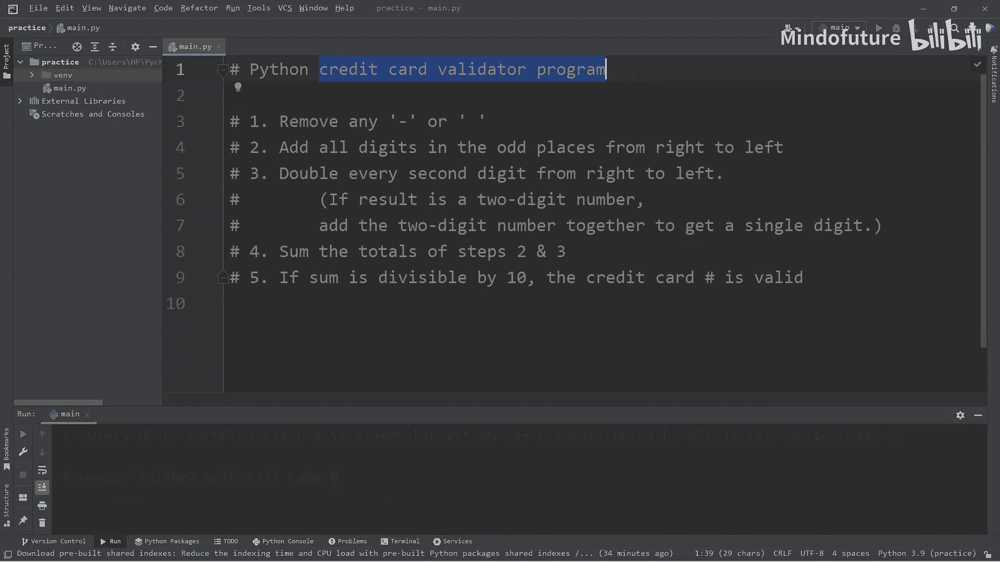
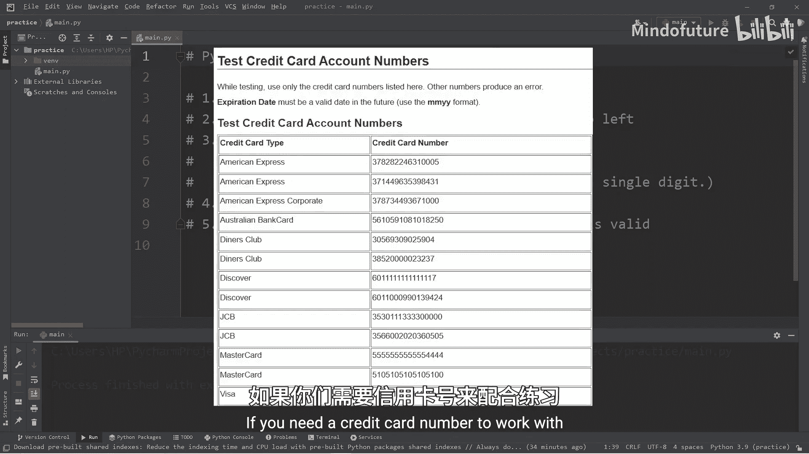
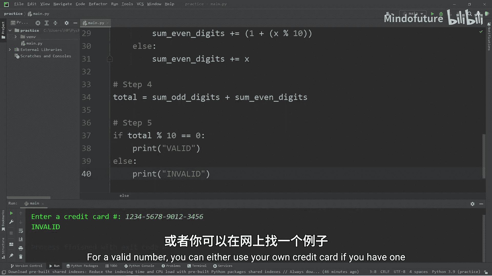
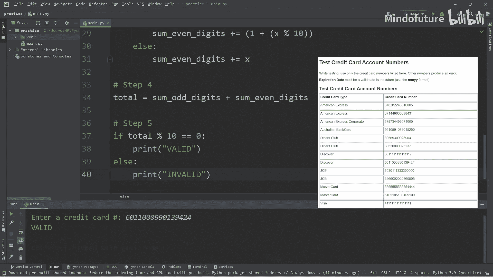
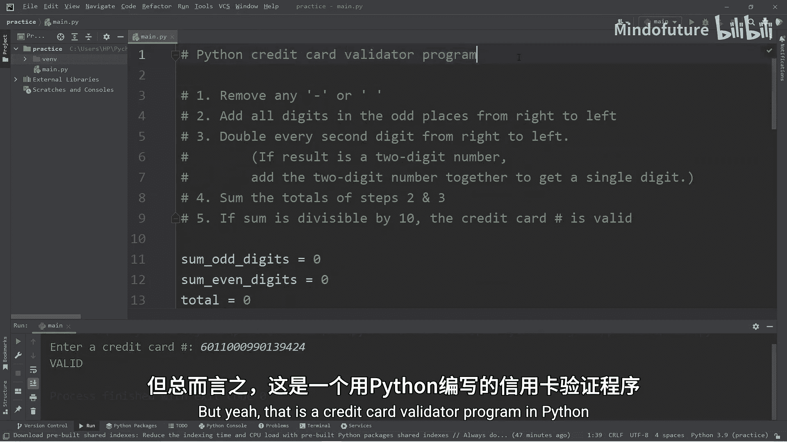

# Python超全入门教程-p43-P43-Credit-card-validator-in-Python--BV1fcdLYXEw9_p43-

yEvery in today's topic， we'll be creating a credit card validator program in Python。

 It sounds intimidating， but it's actually not that bad。 Oh。

 I almost forgot if you need a credit card number to work with。

 you can always look online for test credit card account numbers。 I've listed the steps here。

 After accepting some user input， What we'll need to do is remove any dashes or spaces that the user may enter in。

 to check if this number is valid， we will add all digits in the odd places from right to left。

 Then we will double every second digit from right to left。 All of the even numbers basically。

 If the digit doubled is now a two digit number。 Add the two digit numbers together to get a single digit。

 After doubling all your even digits add them together to create a sum of even numbers。 sum。

 the totals of steps 2 and 3。 If the sum is divisible by 10。 the credit card number is valid。😊。

We'll tackle this program step by step。Let's declare all of the variables we'll need throughout our program。

 We'll need to hold the sum of all the odd digits from right to left。

 I'll store that within a variable， named sum odd。Digits。I'll set that equal to be 0。Then。

 we will sum。The even digits， I'll set that to be 0 as well。

 Then I will declare a variable named total to store the total。All right。

 now let's begin with step one。I'll just add a comment。Step 1。We will accept some user input。

Well store that within a variable named card number。Equals input。

Willll ask the user to enter a credit card number。We're not going to type cast this number。

 We will keep the user input as a string for now， at least we'll need to remove any dashes。

 We can do that by reassigning our card number equal to card number。

 Then use the built in replace method of a string。We will replace any dashes with。An empty string。

Just temporarily， I'm going to print our card number just to be sure that we remove the dashes before continuing。

So enter a credit card number。 I'm just going to make up a number，1，2，3，4，5，6，7，8，9，0，1，2， dash 3，4。

5，6。 Yep， and all the dashes have been removed。Now。

 if the user types in any spaces to separate each of the four digits， let's remove those two。

We will reassign card number equal to card number。 Use the built in replace method。

 replace any spaces with an empty string。 Let's try this again。I'll enter in my card number。

 but separate each group of four digits with a space。All of the spaces are gone。Now。

 with the following steps， we're going to be summing the digits from right to left。

 I think the easiest way to do this is to reverse our string。And that's fairly simple in Piyth。

We will take our card number， reassign it equal to card number。 Use the indexing operator。

There's going to be no beginning index or ending index。But we will set the step to be negative 1。

 This will reverse our string and reassign it。 Let's test it。1，2，3，4，5，6，7，8，9，0，1，2，3，4，5，6。Yeah。

 and our string is not reversed。So that completes step 1， we no longer need to print our card number。

 We will move on to step 2。Step 2 states that we need to add all digits in the odd places from right to left。

Well a string is iterable。 We can use it within a for loop。4 x in our card number。

We will need every second digit。There's no beginning index or ending index。

 but we will set the step to be 2。 We will iterate over every second digit within our card number。

 X will store each digit temporarily， so we will take our variable。Some odd。Digits。

Equals some odd digits plus x。 But we can simplify this to some odd digits plus equals x。

There's one more thing we need to do for step 2。 I'll demonstrate。

Let's type in our credit card number。 I'm just making up a number， again。

So we have an unsupported opera brand and type。We're iterating over a string X is technically a string。

We would want to type cast x as an integer。Let's try that again。

 just to be sure everything works fine。Okay， yeah， there's no problems。That will complete step 2。

Let's move on to step three。Step 3 states that we will double every second digit from right to left。

 If the result is a two digit number， add the two digit number together to get a single digit。

With the for loop，4 x in our card number。We will iterate over every second digit。

Set the step to be 2。 However， we will begin at the second digit， which has an index of one。

X will store the current digit。 Let's reassign x to B。X times 2。Ca we're doubling every second digit。

 However， we would need to typecast X as an integer。

Because it's currently a string to see if x is a two digit number， we can easily use an if statement。

 If x is greater than or equal to 10。If x is greater than or equal to 10。

 it should technically be a two digit number， right， because 10 is a two digit number。

 So if x is a two digit number， we'll need to split that number， then add them together。

 Let's take some。Even。Digits。Plus， equals。X， modulus 10。

 That would give you the remainder of any division。Then， add one。

The largest that x can be in the scenario is 18， because the largest a single digit can be is 9 in our credit card number。

 So 9 times 2 is 18。18 modulus 10 would give us 8。 We would split that number to get 1 and 8。

 then add those two numbers together to get 9， so else。X must be less than 10。 If that's the case。

 we would take some even digits。Plus equals whatever x is。That completes step 3。

 Let's move on to step4。Add together both the sum of the odd digits and some of the even digits。

Total equals。Some odd digits， plus some even digits。Then step 5， step 5。

If our total is divisible by 10， it's a valid number。If。Total modulus 10。Is equal to 0。Then， print。

Valid。Else。Print。Invalid。And that should complete our program， let's test it。

Enter a credit card number， I'm just going to make up something。So this is an invalid number。

For a valid number， you can either use your own credit card if you have one。

 or you could find a sample online。

I'll just use the first one that I find。Oh yeah。 that number is valid。 just for good measure。

 I'll test another。Yep， that one is also valid。 All right， everybody。

 I thought this would be a good project for us to work on。

 It helps us get used to working with strings and loops as well。 But yeah。

 that is a credit card validator program in Python。😊。

