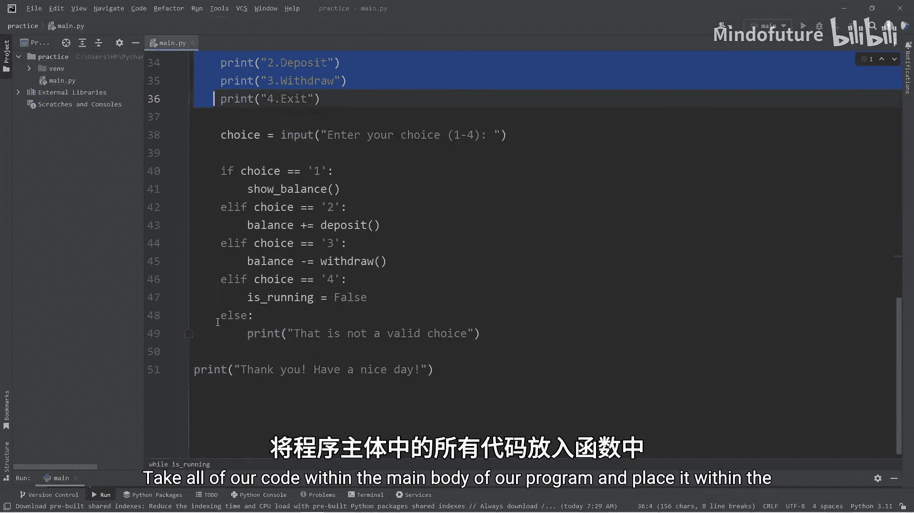
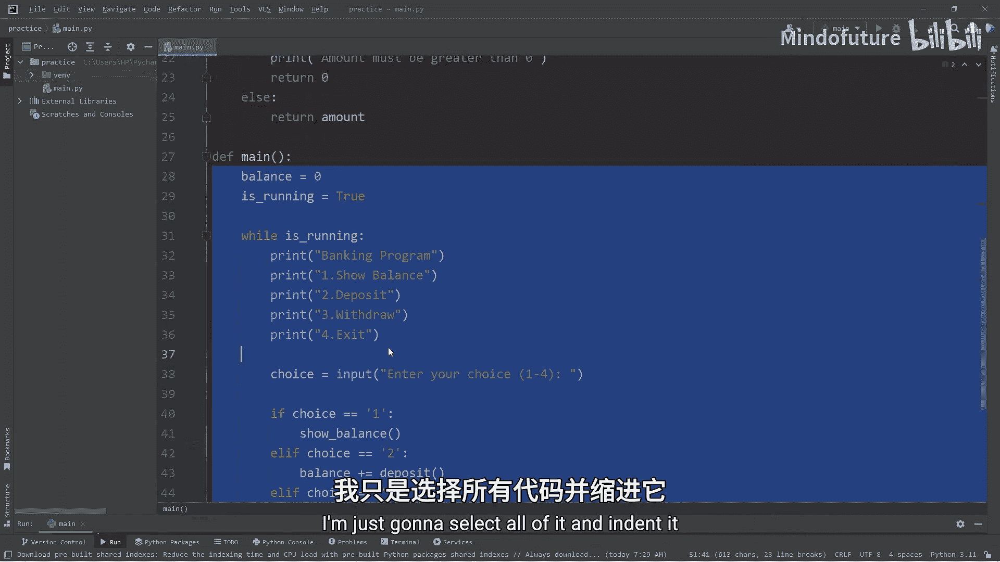
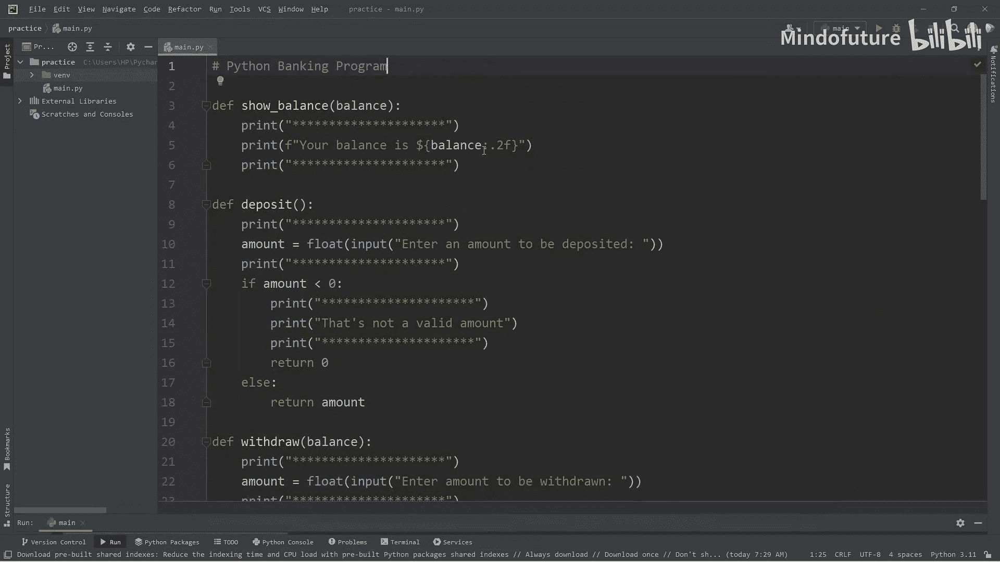

# Python超全入门教程-p44-P44-Lets-code-a-beginners-Python-BANKING-PROGRAM--BV1fcdLYXEw9_p44-

Hey， what's going on， everybody。 So in this video， we're going to create a very simple banking program using Python。

 This is meant to be more of an exercise to get us used to working with functions。

 when creating a project， I like to divide that project into smaller sections and handle them one at a time。

 So we'll do that by declaring all the functions we'll need first with the banking program。

 We'll need to show a user their balls。 We'll define a function to show。😊，Balance。For the time being。

 Ill write pass just as a placeholder。We'll need to make a deposit， define。Deposit。Big withdrawal。

Define。Withdraw。Near the end of this project， we will be creating a main function and placing the main body of our code within it。

We'll handle that near the end just to contain everything。

 We have our three functions with our banking program， we'll need to show a balance， make a deposit。

 or make a withdrawal。What are some variables we'll need。 Well， we'll need a balance。

Which I will set to be 0 initially。 I will also create a booleion of is running。 This will be true。

 If at any time we set is running to be false， we'll exit the program。

So with the majority of our code， we'll place it within a while loop， while is running。

You can check to see if this is equal to true。 But since this is a boolean， that's not necessary。

We will just say， while is running。If is running becomes false， we'll exit the wild loop。

Within our while loop， we'll print some sort of welcome message。Let's print。Baing。Program。

Then list some options。Let's print one。S。Balance。2。Deposit。3。Will be withdraw。4 will be。Exit。

Afterwards， we will set a choice variable to equal some user input。Input。Enter your choice。

1 through 4。We encouraging a user to type in a number 1 through 4 to select an option。

 Do they want to show their balance， make an deposit， make a withdrawal or exit。We'll add a few。

 if and elsesev statements。 Let's check to see if the user's choice。Is equal to one。

 And that is a string of one。 Our user input is a string data type unless we were to type cast it to something else。

 If our choice is equal to one， we will call the function to show balance。Else， if our choice。

Is equal to 2。We will make a deposit by calling the deposit function。Else， if choice is equal to 3。

We will call the withdraw function。Else， if choice is equal to 4， that means we would like to exit。

So we need to exit this while loop。 We can do that by setting our variable of is running。

Is this program running equal to be false to exit。If somebody types in some input， that's not valid。

We can handle that， with an else statement。Else， let's print。That is not a valid choice。Okay。

 let's see what we're working with currently to test everything。

 We haven't written anything within these functions yet。 Show balance， deposit or withdrawal。

So we can type one。2。3。And for to exit。Processed finished with Exocode 0。

 so we can't exit the program。 We just have to select option for。With this L statement。

 this will execute if we type in something besides the numbers 1 through 4。

 because there's no other options left。 So to test that。En to your choice1 through four。

 I'm just going to type the word poo。That is not a valid choice。

So we know that the L statement is working。Once we exit the while loop， let's print a message。

That says。Thank you。Have a nice day。If I was to type 4 to exit， we should exit the program。

 Thank you。 Have a nice day。Let's make that H capital。Now。

 we'll work on our functions beginning with show balance。 Currently， these two variables are global。

 We don't need to pass them as a parameter to these functions， quite yet。

We will be enclosing all of this code within a main function。 We'll handle that later， though。

So with show balance， all we're going to do is print。 I'll use enough string。Your。Balance。

Is at a dollar sign or other unit of currency of your choosing at a placeholder there。

Our balance variable。And let's see what we have。I will type 1 to show balance。Your balance is $0。

I'll display our balance with two decimal places after。

I will add a format specifier after balance colonon。2 F will add two decimal places。

We covered format specifiers in a previous topic。So if I were to run this again， type 1。

 we show $0 and0 cents。Were displaying two floating point， decimal places。

Now we need to make a deposit。 That will be the next function。

We will define a local variable of amount equals， except some user input。

Enter an amount to be deposited。Again， when we accept user input， it's a string。

We'll type cast it to a number， a floating point number。

 because we have to include it dollars and cents。Willll add some checks， though。

 after accepting some user input。If our amount is greater than 0。

 we don't want anybody to make a negative deposit。Let's print。That's not a valid。Amount。Else。

 we are going to return。Our amount。 So this function is going to return something。So within our else。

 if statement， we will take our balance。Plus， equals the deposit were being returned with。

This will add our deposit to our balance。 B plus equals deposit。Let's try it。Let's show our balance。

 Our balance is $0。We'll make a deposit of $100， exactly。Again。

 we'll show our balance after making the deposit。Your balance is $100。

Let's attempt to deposit negative money。We'll select two to make a deposit。

will deposit negative four hundred twenty and sixty nine cents，That's not a valid amount。

So we have a problem。 We have a type error， unsupported operaand for float。And none type。

 So within this statement。Within， if， within our deposit function， we're not returning anything。

Let's just return 0。 We have to return something。 And within this if statement。

 we didn't return anything previously。 We'll either return 0 or return a valid amount。

Let's try this again。Let's make a deposit。I will attempt to deposit negative $420。69。

That's not a valid amount。 Our programs not crashing。 That's good。Now。

 we'll attempt to make a valid deposit。$50。1 cent。Then show my balance。

 Your balance is $50 and1 cent。 Okay， that is the deposit function。

We'll work on the withdraw function， next。We will create a local variable of amount。

 except some user input。Enter amount to be。Withdrawn。Our user input is going to be a string。

 We will type cast it to be a floating point number。We need to check to see if。

Our amount we're trying to withdraw。Is greater than our balance。

Users shouldn't be able to withdraw more money than what they have in their bank account。

If the amount is greater than our balance that we have， we will print。Insicient funds。

Else if the amount somebody is trying to withdraw is less than 0。We will print a different message。

Amount must be greater。Then，0。Else， we will return。Our valid amount。

So with our if andulsive statements， we do need to return something if we take one of these routes。

We will return 0。We're not making any changes。Within our else， if statement。

 where we select choice 3， we are going to take our balance。Minus equals the withdrawal amount。

Let's test this。Baning program。Let's show our balance。Our balance is zero。

We'll make a deposit of $100。Show my balance again。 Your balance is $100。

Let's press 3 to withdraw money。Enter amount to be withdrawn。1 cajillion dollars。Insufficient funds。

 Y， no kidding。Let's attempt to withdraw money again。

We shouldn't be able to select a negative amount， negative $420。69。Amount must be greater than 0。

Let's enter in a valid number this time。 I would like to withdraw $49。99。That has appeared to work。

 We'll show our balance again。 Your balance is now $50。1 cent。Then we can exit by pressing4 to exit。

Thank you。 And have a nice day。The last few changes I'm going to make is that I'm going to enclose all of this code。

 our main portion of code within a main function just to encapsulate all of our variables and help with readability。

We will define a function of main。Take all of our code within the main body of our program。

And place it within the function。 I'm just going to select all of it， and indent it。

At the end of our program， we need to call a main function to run it。

If you're familiar with the statement of if Dunder name。Is equal to a string。Of Dunder Maine。

That means this program can be imported or run standone。

It is good practice to include this if statement。 We discussed this in the previous video。

If we're running this program directly， execute the main function。However。

 are variables of balance and is running。 They're now enclosed within this local scope。

 These other functions have no idea what these variables are， of balance。

So we need to pass in our balance to those functions of withdraw and show balance。

When we show our balance， we have to pass in our variable of balance。Same thing with withdraw。

Then set up those parameters。Within show balance， we will have one parameter of balance。

The same thing with withdraw。The last thing I'm going to do is add a little bit of text decoration around my program just to make it look nice。

So I will print a bunch of asterisks。It's not necessary， but I think it'll look nice。

Let's add some text decoration before and after the title of banking program。Also， before our choice。

Basically， whenever we print anything。We'll add some text decoration。Let's do that with show balance。

Our deposit。And within withdraw。Okay， let's run this one last time。Baanking program。

 Let's show our balance。Your balance is $0， we'll make a deposit。$100 and1 cent。

Show our balance again。 Your balance is $100 and1 cent。We will withdraw money。

En turn out to be withdrawn。$1000。Insufficient funds， let's try that again。 Let's withdraw $50。

Show our balance again，$50。1 cent。Then press4 to exit。 Thank you。 And have a nice day。Al right。

 everybody， that is a simple banking program you can write using Python。

