# Python超全入门教程-p45-P45-Lets-code-a-beginners-Python-SLOT-MACHINE--BV1fcdLYXEw9_p45-

Hey， everybody。 in today's video， we're going to create a beginner's slot machine program using Python。

 This project's meant for beginners。 So let's get started when creating a project。

 I like to break up that project into different sections。 Then tackle them one at a time。

 So with the slot machine， what are some of the different functions we'll need。 Well。

 we'll need to spin a row。 We'll define a function to spin。😊。

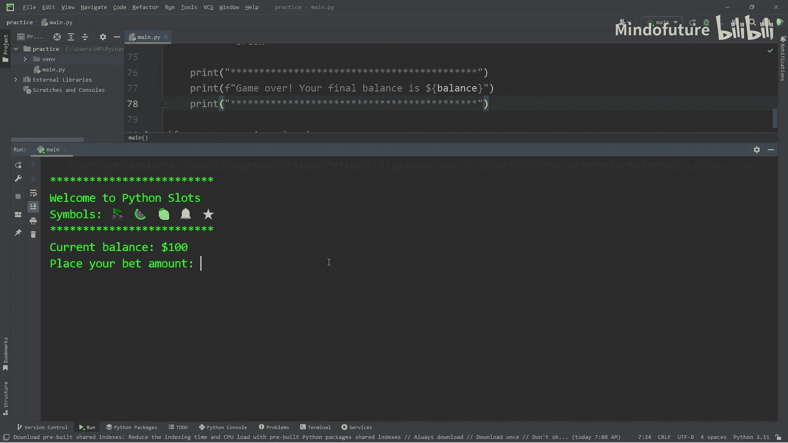

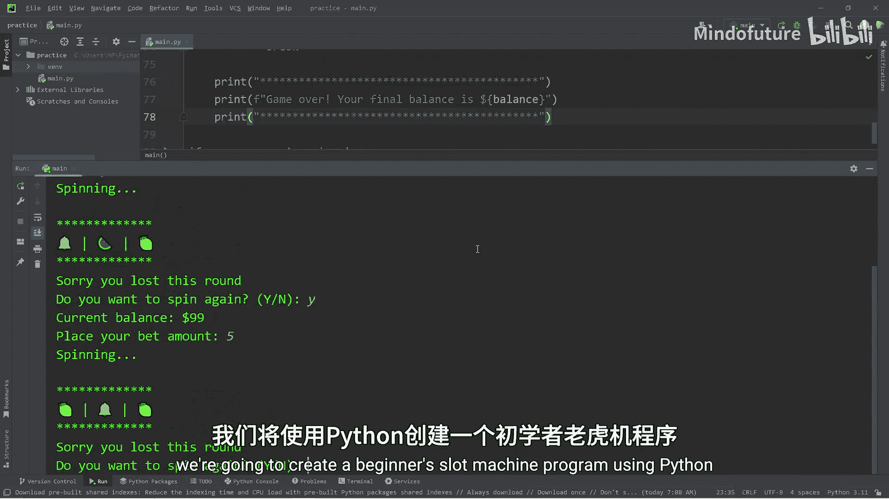

Re。As a placeholder， I'll write pass。 We'll return to this function later。

 We need to display or print the row。Print row。If somebody gets matching symbols on the slot machine。

 we need to give them a payout。We'll create a function to debt payout。 in this function。

 we'll calculate what that payout is going to be。But again， we'll get to that later。

We'll write the majority of our code within a main function。

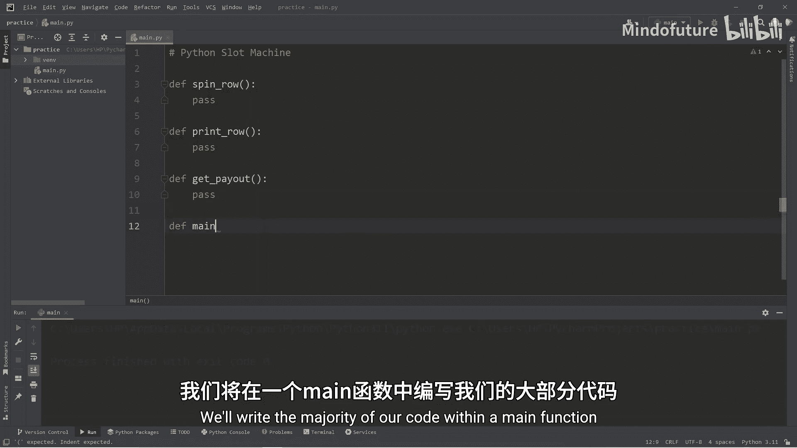

At the end of this program， I will add the if statement of if Dunder name is equal to a string。

Of Dununder Maine。Then we will call the main function， which drives our code。

This program can be imported or stand alone。 It is good practice to add this if statement。

 A majority of the code we're going to write is going to be within our main function。

 So within our main function， let's declare the variables we'll need throughout this program。

We will need a starting balance， which I will just name balance。 We will start with 100， as in $100。

We'll need to display some sort of welcome message。 Let's print something。We will print。 Wele to。

 Let's name our game， Python slot。Just for some flavor， I'm going to add some text decoration。

 just a bunch of asterisks。I think it'll look cool， but you don't have to。Let's display our symbols。

 we're going to use。Symbols， I'll add some emojis。 We'll use emojis in this program in place of images。

 If you're on windows， you can hold down the window key， plus semicolon。

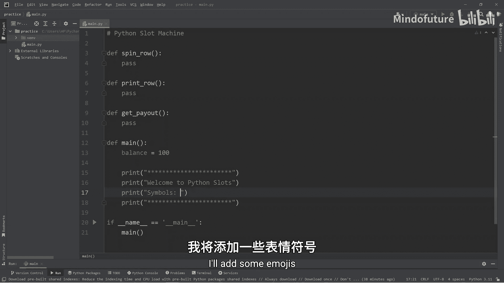

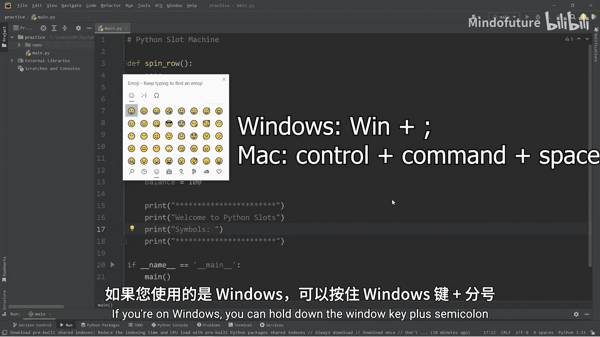

Let's add a cherry。 You typically see a lot of fruit in slot machines。A watermelon。A lemon。

There's also a lot of bells， for some reason。But we'll add those。And a star。

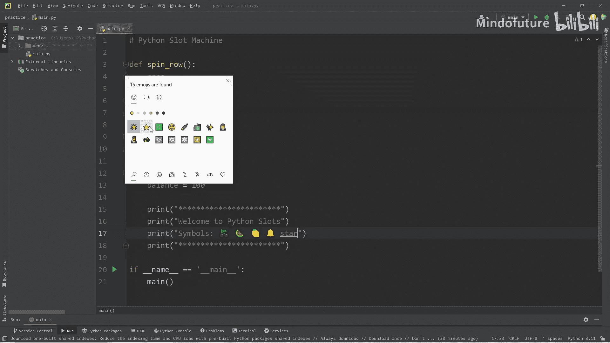

Let me just align everything。

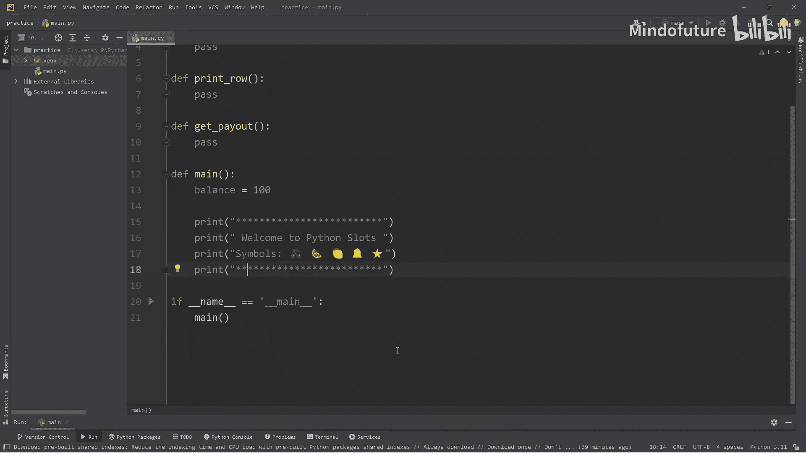

Let's do a test run。Welcome to Python slots。Let me make one adjustment。Okay， I'm happy with that。

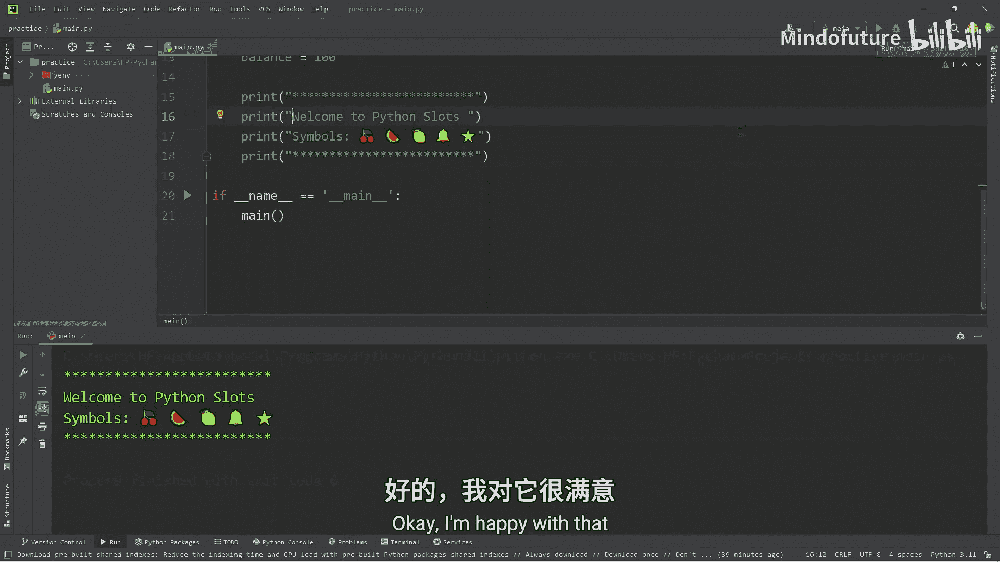

So after our welcome message， we'll continue playing this game while our balance。Is greater than 0。

 While we still have money， We can continue playing。 We will print。 I'll use an up string。

Current balance。Coll in space， I'll add a placeholder。 pick a unit of currency。

 I'll pick American dollars。Then we will display the user's balance。

We will prompt the user to enter in their bet， which we will assign to a variable of bet。So， input。

Place your bet amount。

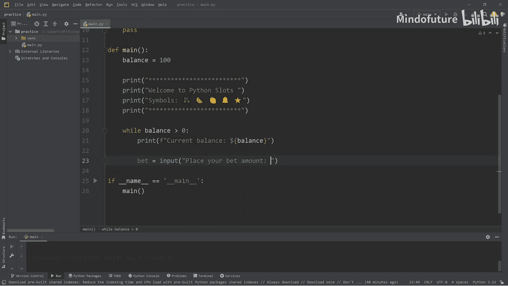

Let's do a test run。Welcome to Python slots。 current balance，$100。 place your bet amount。😊。

We won't deduce the bad amount from the balance quite yet。

 I just want to be sure that we can enter in something $1。Good，$10，$100。

What if somebody types in a word like pizza。We need to prevent that input， and correct it。

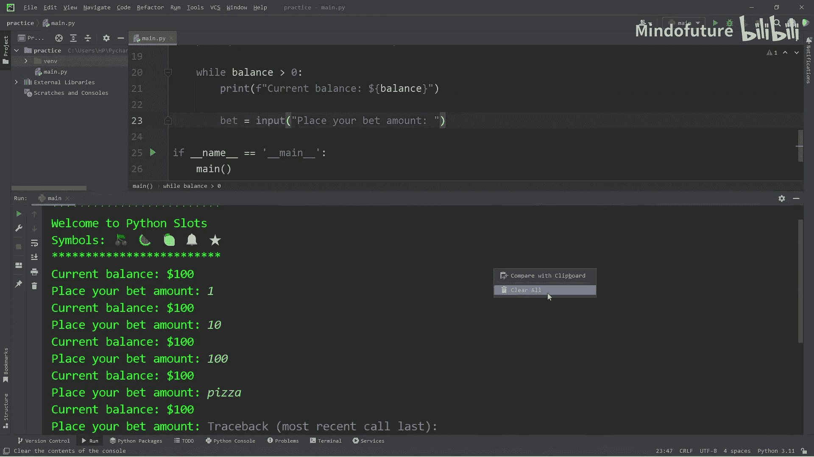

We'll check if take our bet。 Use the is。Digit method。

Is our bet a digit If somebody types in a word like pizza。We need to tell them that's not valid。

 So this will return true if our bet is a digit， but we're going to use the not logical operator。

 If our bet is not a digit， then do this。We will print。Please， enter a valid number。

Followed by the continue keyword， the continue keyword will skip the current iteration of this loop and start from the beginning。

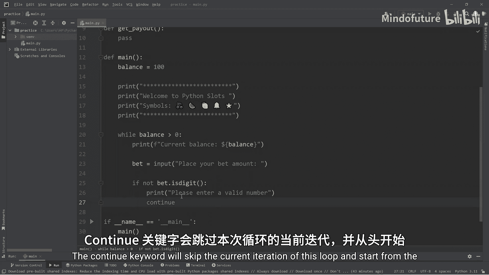

Let's test it。

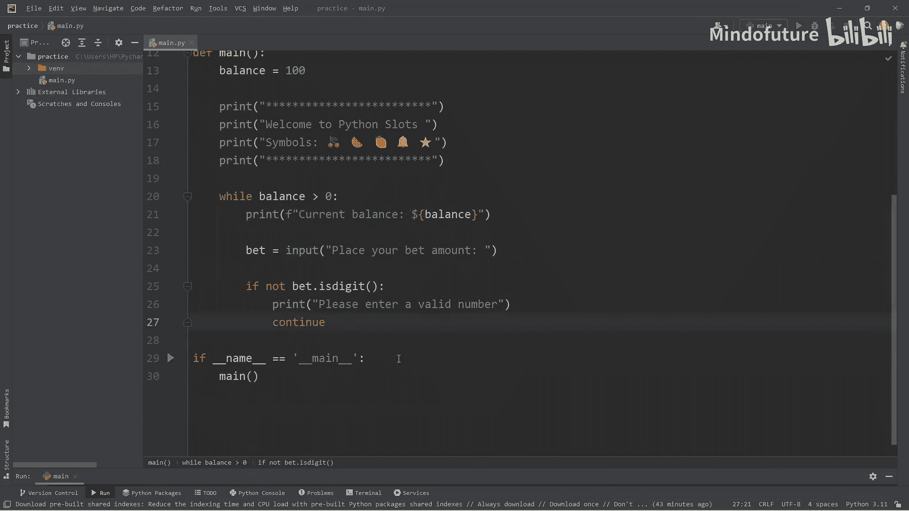

Place your bet amount， pizza。Please enter a valid number。 We have our current balance again。

 Place your bet amount。 I'll type in one。Okay， we did not get that message of。

 please enter a valid number。 This bet of $1 is valid。

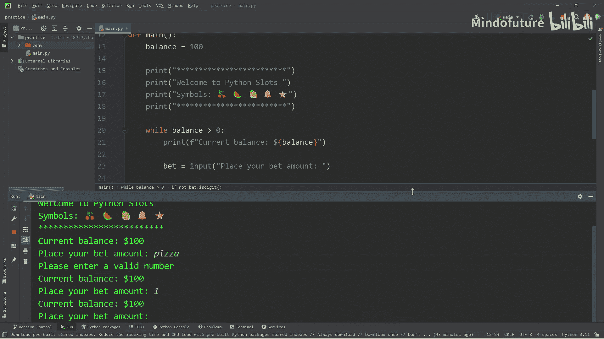

So if our bet is a digit， we'll convert it to be an integer using typecasting。

 because when you accept user input， it's a string。 It has the string data type。

Let's reassign our bet。Type cast our bet as an integer。

Then we will check to see if our bet is greater than our balance。

 People can't bet money that they don't have。If the bet。Is greater than the current balance。

If that is greater than balance， we will print this message instead。Insicient funds。Then continue。

If somebody tries to bet negative money or no money， well add this statement。

If be is less than or equal to 0。We will print。Bet must be greater than 0。And continue。

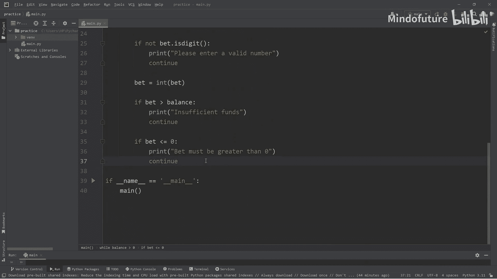

If all these checks pass， if our bet is not a digit。

 If our bet is greater than our balance or if our bet is greater than 0。

 we will take our original balance。

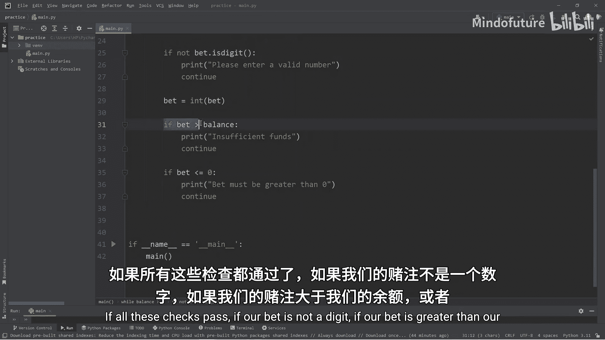

Minus equals our bet to subtract it。Let's do a test run。

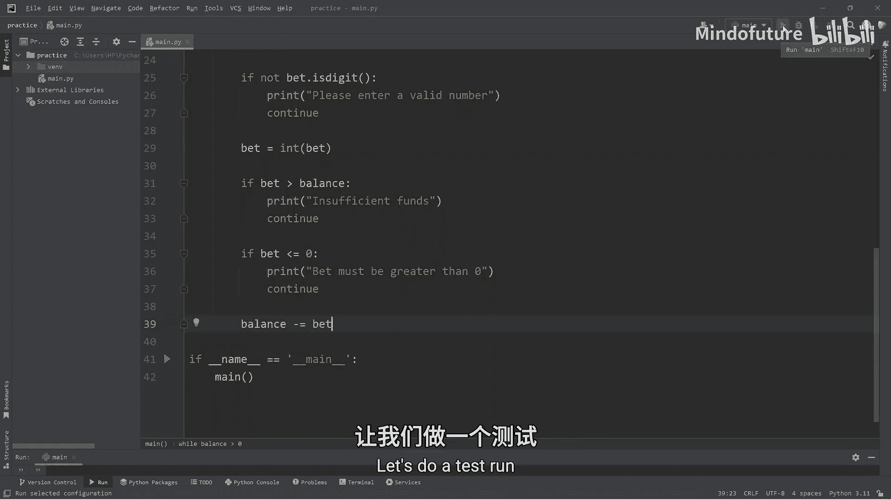

Place your bet amount。Pizza。Please enter her a valid number。 I will bet。1 cajillion dollars。

Insufficient funds。Yeah， no kidding。0 dollars。Bet must be greater than 0。What about $1。

 Our bet should be subtracted from our balance。 Let's try 10。 We are now down to 89。Let's bet。

$90 insufficient funds。89。

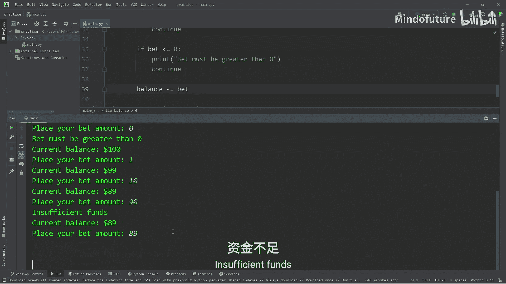

And that has appeared to work。Once we subtract our bet from our balance。

 we will call the function to spin row。This function is going to return a list。

 which we will assign to be row。Row will be a list using the spin row function。

 We have to generate three random symbols and return them within a list。

We'll work on the spin row function， next。Within our spin row function。

 we will declare a list of symbols。Add your symbols。But these need to be strings。

Make sure they're all comma separated。There we go。 This is where list comprehensions can come in。

If you don't know what a list comprehension is， here's an alternative。

 We will declare an empty list of results。This is an empty list。

We need a for loop to generate three random symbols。 We could say4。Symbol。In range 3。

This for loop will iterate three times。During each iteration， let's take our empty list of results。

Use the append method。We will append a random dot choice。Among our symbols。

So we need to import the random module。Will do so at the top。Import random。

We're telling the random module to pick a random choice from this list of symbols。

Then we will append them to our empty list of results。After we escape the for loop， we will return。

Our results。It's a list。Now， a much better option is to use a list comprehension。 Yours how。

It's going to be a lot more concise。 We will return a list within the list。

 We will write a list comprehension for every， let's say， symbol。In range 3。There is no condition。

What do we want to return during each iteration。Access the random module。 Use the choice method。

Then pass in our symbols。Symbol isn't used in this example。

 What you may see people do is use and underscore as a placeholder。Basically。

 what we're saying is for every iteration in range 3， return a random symbol。

 That's all we need for the spin row function。Going back， we have our list of row。 Afterwards。

 I am going to print it to test it。

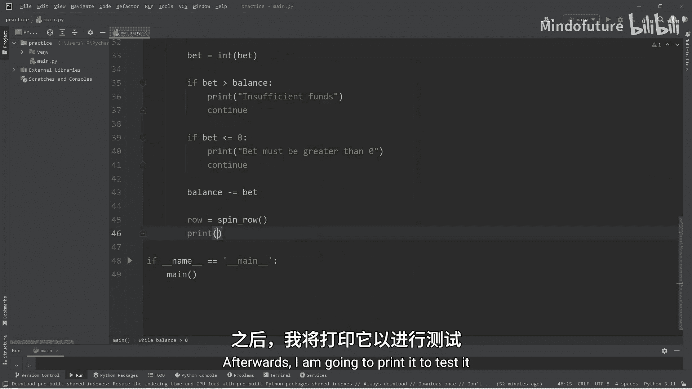

Print row。And we should have three random symbols， after making a bet。All right。

 it looks like it's working。

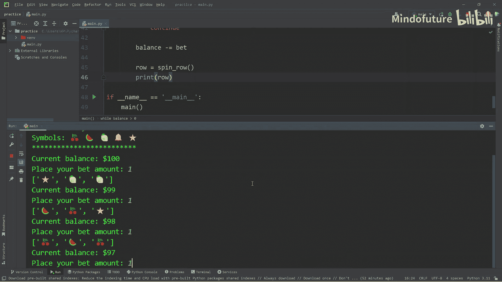

We'll make a few changes， though。

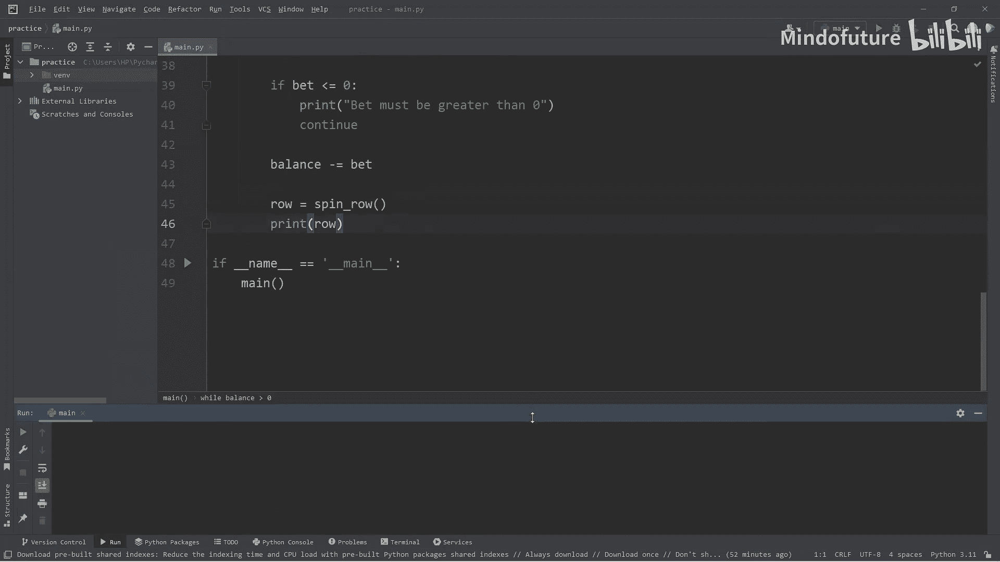

Instead of printing our row。I'm going to print。The word。Spinning。

I will add a new line character just to give us some space。 like after this word of spinning。

 Then we will call the print row function。We'll pass in one argument。 R row。

 That's returned to us after we spin the row。

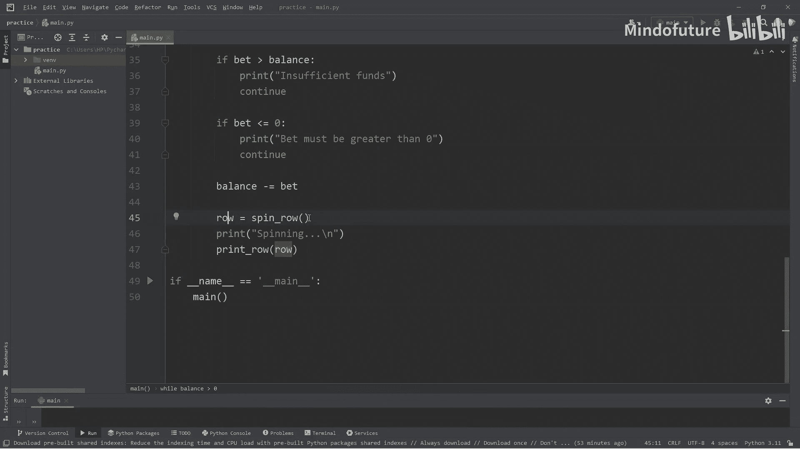

So going to our print row function， we need to set up one parameter。 Our row that we receive。

 It's going to be a list。 One easy way to print the elements of a list is that we can print。

 pick some sort of separator for each item in the list。 For example， I'll just print a space。

 with strings。 There are built in methods。 We will use the join method。

Then pass in our list or other iterable。 Basically， what we're saying， using the join method。

 we're going to take our iterable。 In this case， our list， joinin each element by a space。

 a space character。 Here's the result。

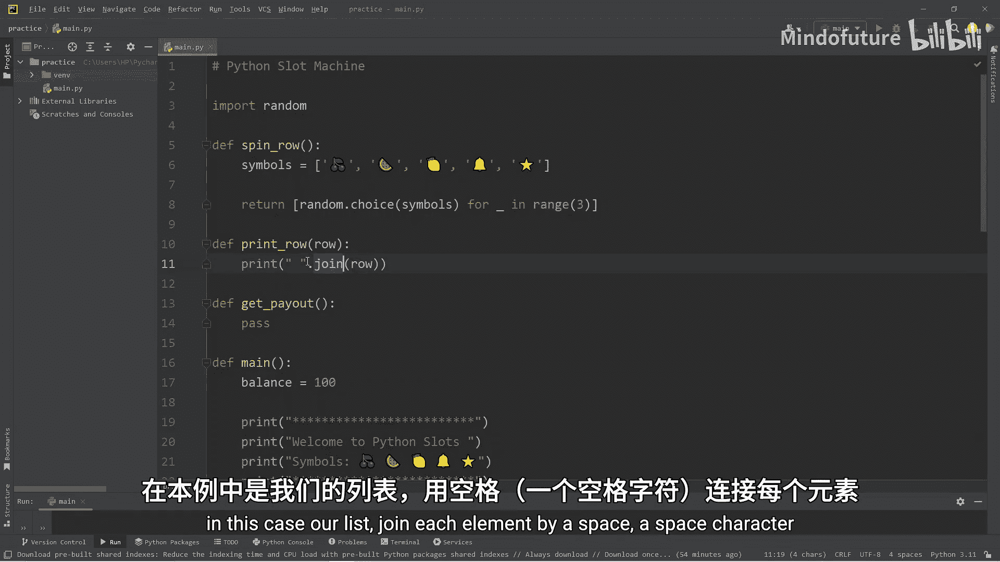

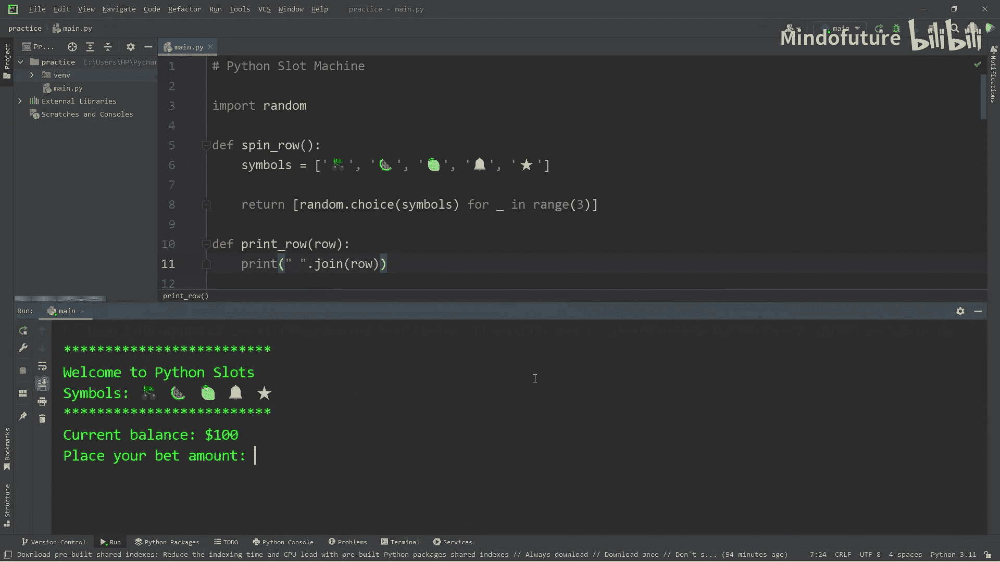

We have three symbols。You could join them by a different character。I'll add a vertical bar。

And to your better amount $1。 Now， we have a vertical bar between each of these symbols。

 We could include more than one character。 I'll add a space before and after this vertical bar。

 just to space things out。I think that looks a lot better。And you don't have to。

 but I'm going to add some text decoration before and after。 I'll add a bunch of asterisks。

Let's see what we're working with。Not bad。So every time we make a bet， we get a new set of symbols。

Now， what if all three symbols match， We need to calculate a payout and give it to the user。 goes。

 well， they won。

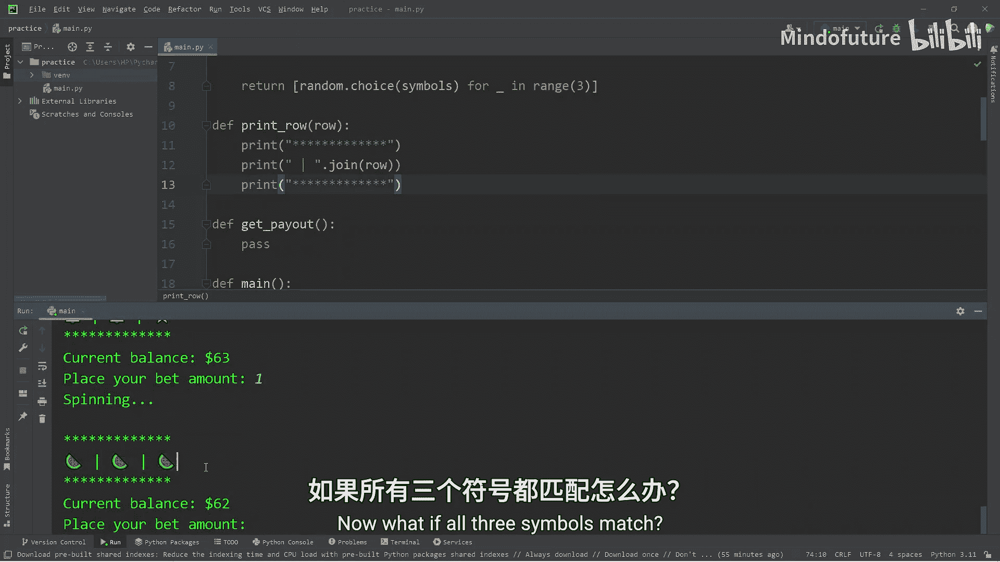

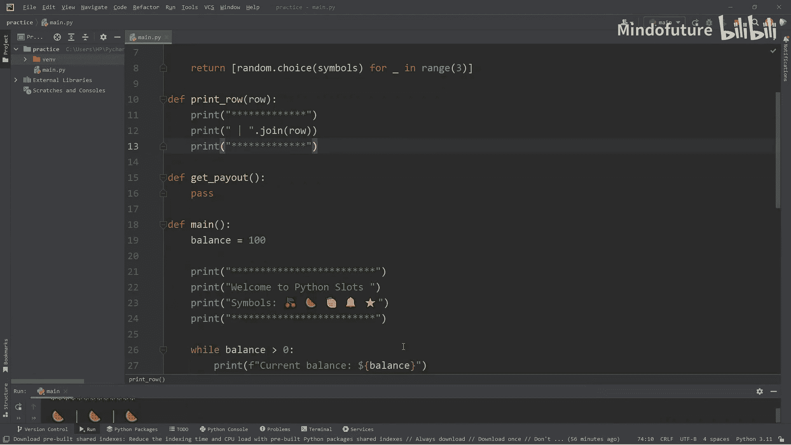

So after we print our row， we will call the get。Payout function， but we will pass in our row。

 It's a list and our bet。 How much did we bet， We will be returned with a payout。

Which we will add to our balance。Let's go to the get payout function。

We're sending two arguments to our get payout function。A row。And a bet。

We have to check to see if each element in our row is all the same。 Is it all the same character。

 We can do that within a statement。If our row at index of 0， that's going to be the first symbol。

Is equal to row。At index 1， that's the second symbol is equal to row。At the second index。

 And that's the third symbol。 If all three symbols match。

 we have to return the bet multiplied within our if statement， we will add another if statement。

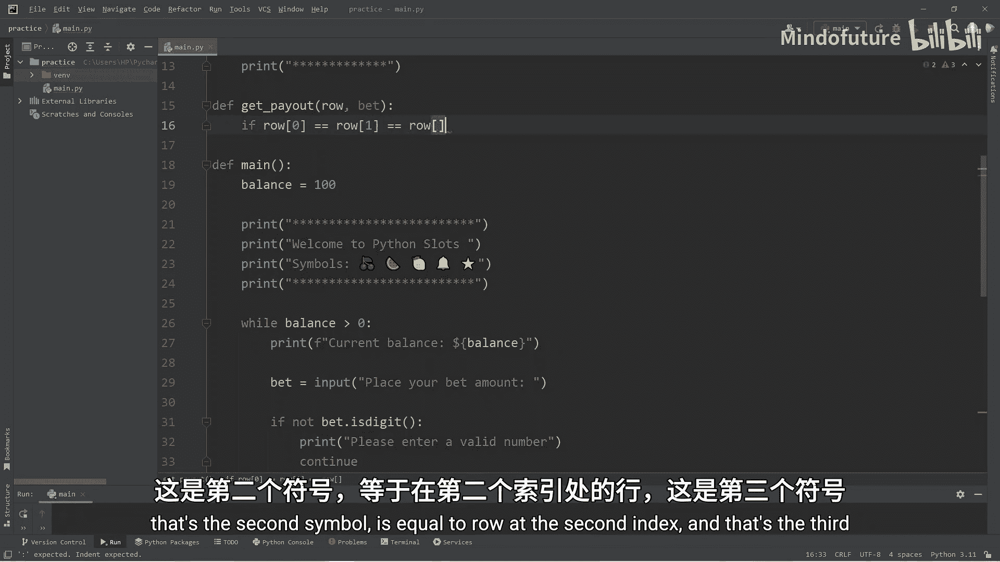

I will check to see if our row at index 0。Is equal to our first symbol。Of chry。

Be sure to place it within quotes， because it's a string。Now。

 the reason I'm only checking if row at index 0 is a cherry emoji。

 All these symbols are going to be the same。 If we're within this if statement。

All of these symbols are going to match。 We only need to check one of them。 It could be 0，1 or 2。

But I'll just add 0。 They're all going to be the same regardless。 If somebody has all cherries。

 we will return their bet。Times 3。Or some other amount， you can make the payouts higher or lower。

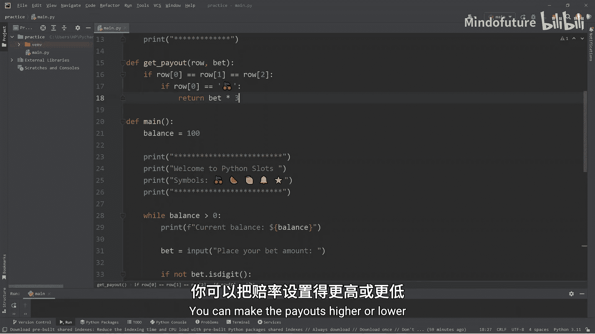

Else， if row at index 0。Is equal to a watermelon。

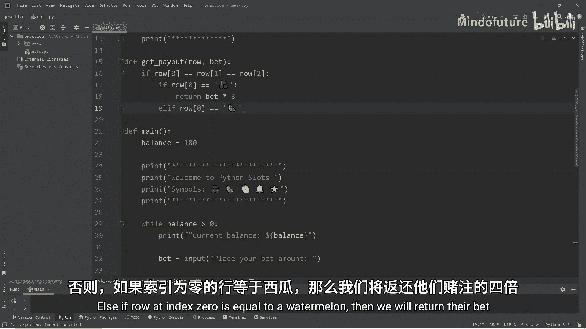

Then we will return there。 but times 4。So watermelons are worth more than cherries。Else， if Roe。

At index 0。Is equal to a lemon。We will return there， butt times 5。Else， if row at index 0。

Is equal to a bell。Let's give them。 times 10。Return， be times 10。Else， if row at index 0。

Is equal to a star。 That's worth the most。We will return their bet， times 20。

Make sure we're not within our if statement any more。

 If all three symbols don't match within our list， we don't want to give the user anything。

 They lost that spin。 We will return 0。That's all we need for the get payout function。

Scrolling back down。After receiving a payout， its return to us from this function。

 We'll check to see if our payout is greater than 0。That means they want to spin。I will print。

I'll use enough string。You 1， I'll add a placeholder。 Prece this with a unit of currency。

 I'll use dollars。Will'll display the payout。Else， if they did not receive a payout。

 that means they lost that spin。We will print。Sorry， you lost this round。Then， take our balance。

This is our original balance plus equals our payout。 In most cases， the payout is going to be 0。

 But if the user win something， we will add that to the balance。

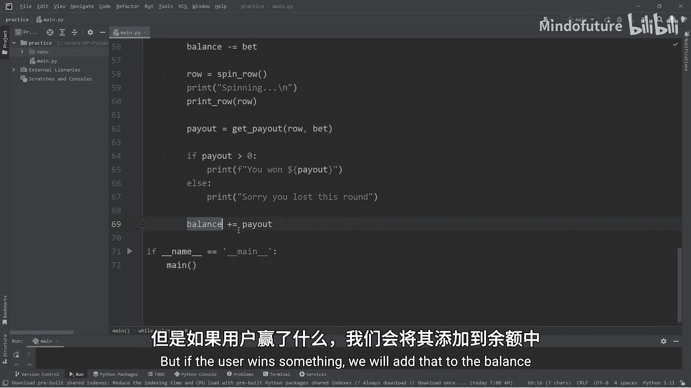

Okay， let's do a test run。I will bet $1。 Sorry， you lost this round。My current balance is 99。

Let's bet again。I'll just keep on doing this until I win。

We're going to lose more times than what we win。Okay， see， I got all bells。It says you won $10。

 Once somebody runs out of money， we want to stop them from playing， or if they would like to exit。

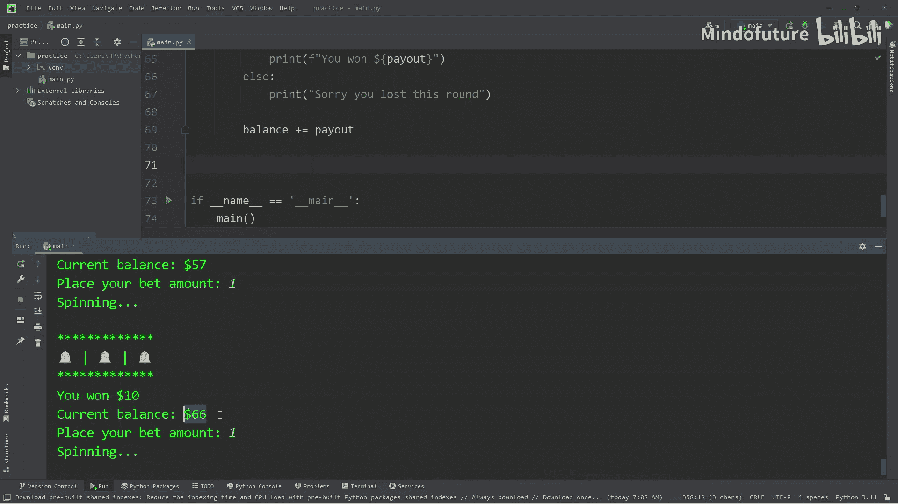

We'll create a variable of play again。We will accept some user input。Do you want to spin。Again。

Will'll add why for yes， slash n for no。If our variable of play again does not equal。

A character of capital Y。 Then we will break to break out of this loop。Let's do a test run。

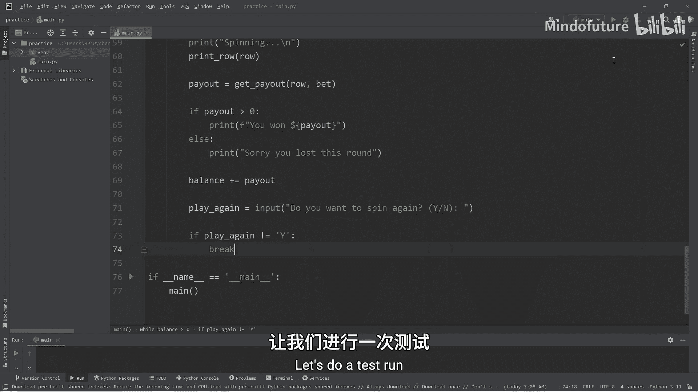

And to your bad amount， I'll just bet a dollar。Do you want to spin again。

 If I type in anything besides a capital， Y， we will exit。I will type in， no。

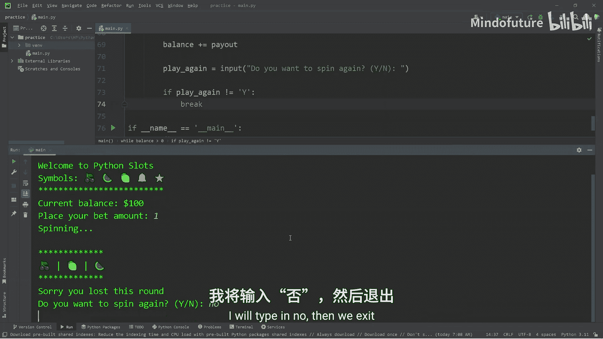

Then we exit。And to your better amount， I'll bet a dollar。 If somebody were to type in a lowercase。

 Y that doesn't register。 We'll make an uppercase by following our input with the upper method to make an uppercase。

Place your bet， a dollar。Hey， I won。 I won $3。Do you want to play again， I'll type in a lowercase。 Y。

 Yes， I would like to play again。But I did not hold shift in order to make this a capital Y。

That will still register。And our current balance is $102。 We're ahead， currently。

Place your bet amount。 I'll bet $10。We lost this round。I will press N。

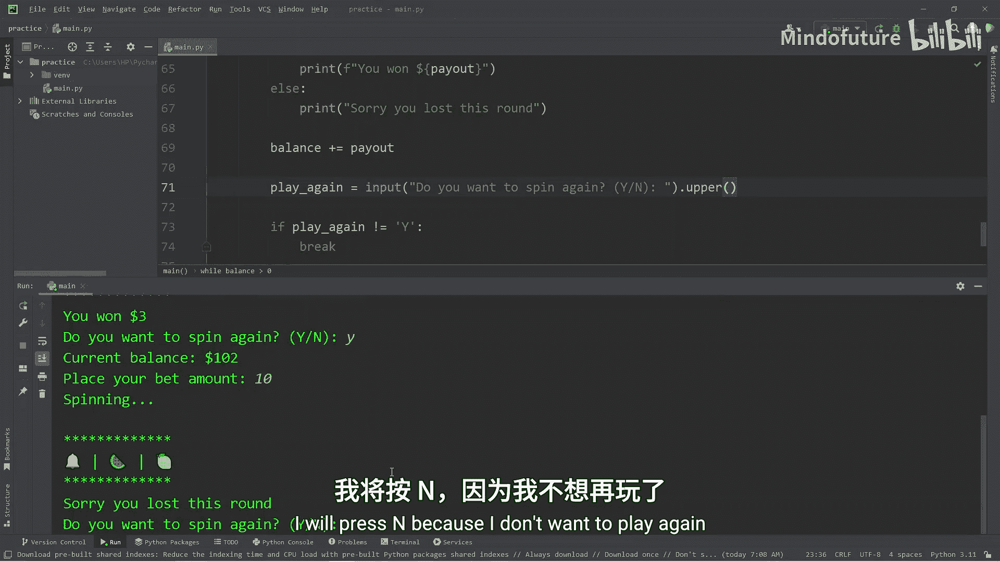

Because I don't want to play again。 Then we exit。So at the end of our program。I will print。

I'll use enough string。Game over。Your final balance is， I'll add a placeholder。

 Pick a unit of currency。 I'll pick dollars。Display our balance。

Then I'll just add some text decoration before and after to make it all look nice。

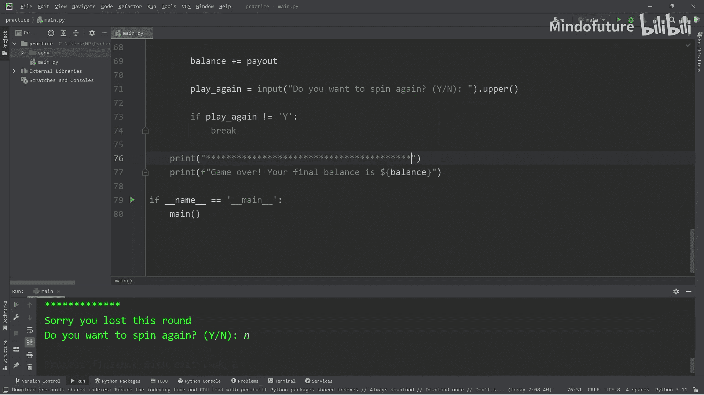

Okay， let's play this one last time。

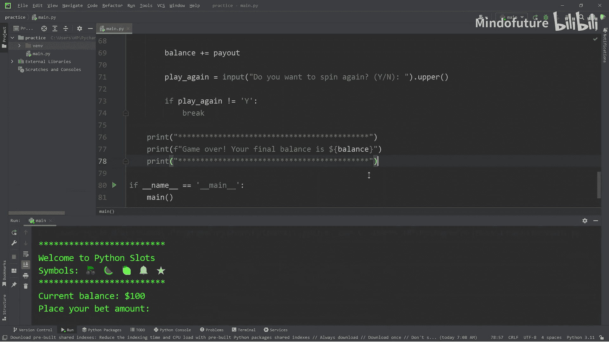

And to your better amount， I'll bet a dollar。 Sorry， you lost this round。 Do you want to spin again。

 Yes， I do。I will bet $5。You lost spin again。 Yes， I will bet 10。20。Again， I'll bet 20。I keep losing。

I'm running out of money， Gu。 Hey， I won $10， though。 Do you want to spin again， No， game over。

 your final balance is $13。 That's why you shouldn't gamble。

 You tend to lose more money than what you gain。

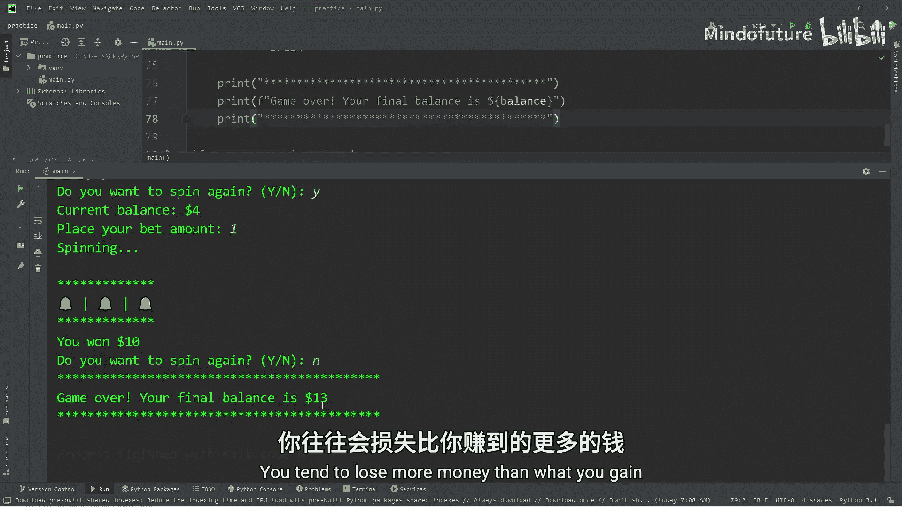

Al right， everybody， so that is a slot machine program you can write using Python。

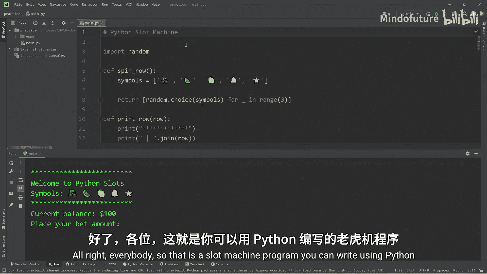