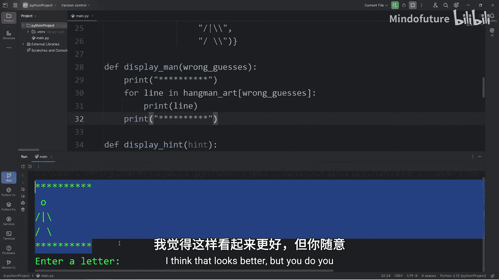
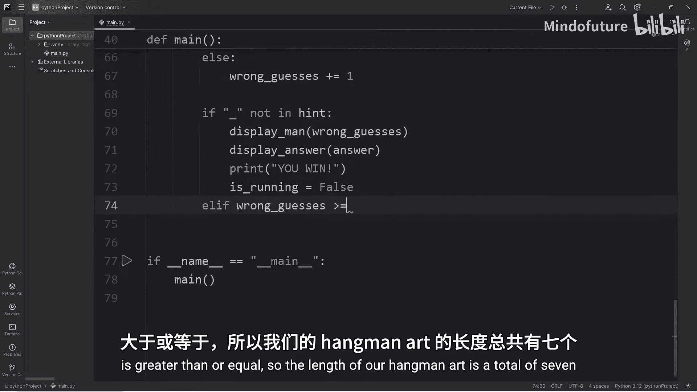
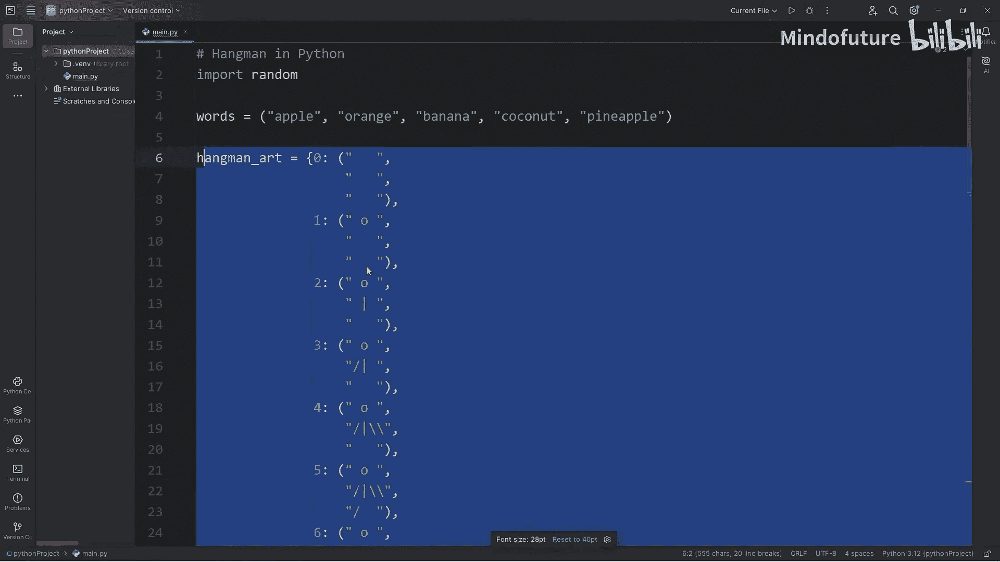
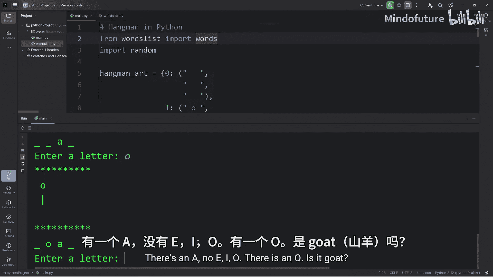
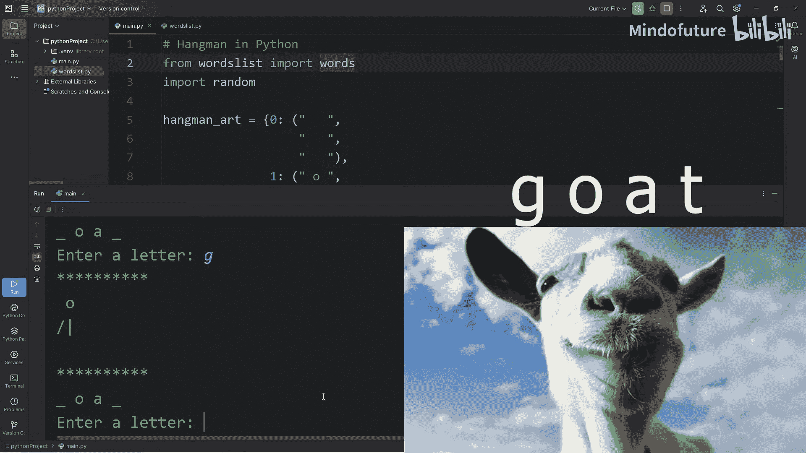
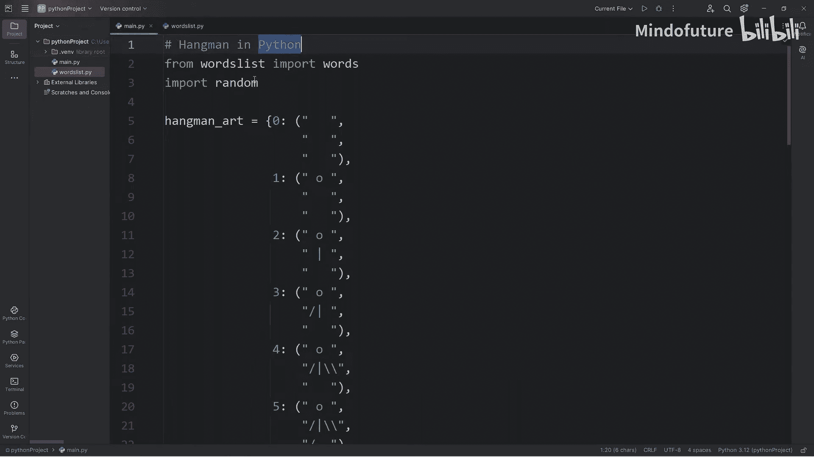

# Python超全入门教程-p46-P46-Lets-code-a-HANGMAN-GAME-in-Python--BV1fcdLYXEw9_p46-

Well， it's up， everybody。 So in today's video， we're going to create a game of Hangman using Python。

 I thought that this would be a good mini project for us while learning to code。

 it is important to create small projects as you go along。

 Here's one that we can make together When creating a project。

 I'll like to declare the various variables and data structures I'll need first。

 followed by the functions I'll need for this game。 We will need a set of words。😊。

One of these words is going to be chosen at random。 So let's create a few words。I'll add some fruit。

Apple， orange。Banana。Coconut and one more。Pineapple。Using the random module， let's import that。

Import random。Using the random module， we will pick one of these words at random。

We won't be able to see what it is， but we can guess what the word is one letter at a time once we reach six incorrect guesses。

 we lose the game before each guess， we will display some ASII art， which I will name as Hman art。

This will be a dictionary， a dictionary where each key value pair contains a tuple。So， this is a。

Dictionary。Of we'll have a key。Which will be a number and a tuple。

The key is going to represent the incorrect number of guesses。 So we'll start at 0。

 We will display a tuple， which will contain some may art。 Then let me just copy this。

For one incorrect guess， we'll display some different ASCI art。

I'll just put each on a new line for readability。So we're going to go all the way up to six。

Once we hit six incorrect guesses， we lose the game。

Each key corresponds to the number of incorrect guesses。Once we reach 6， we lose the game。

 Each tuple that corresponds to the incorrect number of guesses， we will display a certain image。

 If you would like， feel free to look in the description of this video。

 If you would like to copy this to save you some time。 Each tuple will consist of three rows。

3 strings。For no incorrect guesses， where incorrect guesses is zero。We will display nothing。

 We can't see our hangman person。For one incorrect guess， we will display their head。

For two incorrect guesses， we will display their head and the main torso of their body。

 which will represent with a vertical bar。Let me copy this one。For three incorrect guesses。

 we will display their left arm represented with the forward slash。With four incorrect guesses。

 we will display their right arm。However， if you use a backslash。

 that's an escape sequence within a string， you have to use double back slashes。

To literally print a backslash。So with five incorrect guesses。

 we will display their left leg of the person。Then once we reach 6 in guesses。

 we display the full person。 That's when we lose the game， When we see the entire person。

That's some ASCI arch that we can use。So let's test it just to be sure that everything is working fine。

I will print。My hangman art。At the key of zero to represent no incorrect guesses。Okay。

 so when we display this person， we're going to have to use some sort of loop。For every， let's say。

 line。In Hangman art。At index of zero for zero incorrect guesses。I will print。Each line。

With no incorrect guesses， we don't display anything。 That's correct。

We can't see the person and that's okay。So with one incorrect guess。

 display the dictionary where the key is one。That displays the person's head。Two。

 two would be the main torso of their body。3。Their left arm。four。Their right arm。Five。

 their left leg。And six， their right leg。Once we see the entire person， we lose the game。

So we can delete these two lines of code， we no longer need them。

 we know that our dictionary is working。I'm going to zoom out a little bit following our dictionary we'll declare the various functions we'll need throughout this program。

 We will define a function to display。Man our hangman。There will be one parameter。Wrong guesses。

And then for the time being， a right pass。 We'll fill in this function later。When we display our man。

We need to know the number of incorrect guesses。To display the right image。

We have a display man function。And a display。Hint function。We will have a string of hint。

Then I'll write pass for now。Our hint is going to be a list。

 A list of underscore characters for each letter that we guess right will flip one of those underscores to be a letter。

 If that letter is correct。 I'll create a function。Of display， answer。Within this function。

 we will display the correct answer， either when we lose the game or win the game。

And I will write pass。We will create a function of main。

To contain the main body of code of our program。Again， I'll write pass for now。

I'll add the following if statement。If Dunder name。Is equal to a string。Of duerma。

If we are running this file directly， I would like to call the main function to start the program。

All right， let me zoom out。This will be the main skeletal structure of our program。

Import the random module， we have our set of words。

 we'll be importing more from a separate file near the end of this video。

 we have a dictionary where the key is a number to represent the number of incorrect guesses。

And a tuple to display some ASII art。 We have four functions。 display our man， display the hint。

 display the answer and the main function to contain the main body of code。All right。

 let's work within our main function。Within our main function， we will create a variable of answer。

 What is the correct answer that we have to guess， I will access the random module。

 call the method of choice， then pass in our set of words。

One of these words will be chosen at random。Let's test that。 I will print our answer。

 just temporarily。We should get a random word。Apple， apple， pineapple， apple。

 I guess it really likes apple for some reason， there we go， we have orange。

 we are choosing a word at random。We no longer need this print statement。

 looks like everything is working fine。Now we'll display our hint。😡。

Our hint is going to be a list of underscore characters。I need the number of underscore characters。

To equal the number of characters in one of these words。That is chosen at random。

So I could multiply my list by the length using the length function of my answer。

So let's print our hint。To see what we're working with。With my selected word。

 we have how many underscores 1，2，3，4，5，6，7。 Okay， we have a different word，1，2，3，4，5。

That is probably Apple， it has five characters。Alright， so that's our hint。

 It's a list of underscore characters。 When we guess a letter， if it's correct。

 we'll fill in one of the underscores with that correct character。

We need to keep track of the number of wrong guesses。We'll create a variable of wrong guesses。

Set that equal to be zero when we start the game。We're going to keep track of all of the incorrect guesses that we've made。

 We will create a set of guests。Letters。For an empty set， we'll call the set function。

 Normally in Python， you can't create an empty set with just a set of parentheses。

 We have to use the set function。Then I will create a Boolean variable of iss running。

Set that to be true。While our game is running， continue playing， once we lose or win the game。

 we will switch this to be false to exit the game。We will keep this as true when we initially run this program after we declare the variables we'll need within the main function。

We'll create a loop， a while loop。While is running。

 We don't need to say while is running is equal to true。

 We don't necessarily need to create that comparison。 We can just say while is running。

 while this is true， continue doing some code。So what would we like to do？

Let's call the function of display Man。But we have to pass in the wrong number of guesses。

Call our function of display Man Pass in our variable of wrong guesses when we begin the game。

We would like to display one of these images。Then we will display our hint。

 then we'll call the function to display our hint。Pass in our hint。

 that was the list of underscore characters to represent the answer we have to guess。

We will create a variable of guests and accept some user input。

Will prompt the user to enter a letter。Just in case a user types in a character， that's uppercase。

Let's add the lower method to make it lowercase。So let's fill in our display man function。

There's not a lot to write here when we call this function。

We need to display one of these images based on the wrong number of guesses， one of these keys。

Within the display Man function。We'll create a four loop for every line。In my Hangman art。

 this dictionary。At the key of wrong guesses， this will be a number0 through6。

Depending on what this number is。I will print each line。Print each line。Of that tuple。

Let's see what we're working with。 We'll do a test run。So we are displaying no person。

 we can't see them。For testing purposes， I am going to change wrong guesses to be one。

We're displaying their head， too。Displays their body。3。Displays their left arm。4。Is their right arm？

5ve。Their left leg。And 6。Is their full body， That's when we lose。

Now you don't necessarily need to do this， but I'll add some text decoration before and after。

I'll add just a bunch of asterisks before and after。I think that looks better， but you do you。

 let's be sure to set wrong guesses back to zero。

After we display our Hman， we have to display the hint。 What's the clue we're trying to solve？

So we will call our display Hi function and pass in our list of Hi。

So within the display hint function， let me zoom out， I will print the following。

Between each character within our hint， each underscore， we will display a space character。

Strings have a built in join method。We'll call that。 then pass in our hint。

For each character within our hint， join it by an empty space。So now when we do a test run。

We are displaying an underscore to represent each character。Each is separated with the space。

While we're here， we'll fill in the display answer function。

 we just have to copy this line of code from display hint， replace hint with answer。

And that's all we need for the display answer function。

 So let me test that real quick After displaying our hint， temporarily。

 I will display our answer just to be sure that it's working。一ep。

There's our hint and there's our answer that we have to guess。Okay let's delete this line of code。

 we don't want to display the answer。I was just testing it。

So the user is going to be able to type in a letter to guess。Such as A， for example。

Once we guess a letter， if that letter is found within the hint， if it's one of these characters。

 we need to switch that underscore to be one of those characters。

So we'll write the following if statement。If our guess。Is in。Our answer。In is a membership operator。

 If this letter is found within our string of answer， we're going to create a loop。

 We will create a loop that will iterate once for each character within the answer。

But we don't know the length of the answer because Python will choose it at random。

So let's say for every index， we can shorten this to I。For I in range。The length of my answer。

Let's say the word is Apple。The length of the word apple has five characters。 This would return 5。

For I in range 5， then we will iterate five times。Willll iterate this loop once for the number of characters within my answer。

 We'll check during each iteration， if our answer at index of I。During the first iteration。

 that will be 0， then the second iteration， it will be  one， then 2， so on and so forth。

 Strings are iterable。 If our answer at index of I is equal to our guess if there is a match。

 if we guess the correct letter。Then we're going to take our hint。At that given index of I。

And set that equal to be our guess。Looks like this if statement is outside of the while loop。

 I am just going to indent it by one somewhere within it。Okay， let's do a test run。

I'm going to guess the letter A。Yes， we have one a。Let's do something that's probably not in here。Q。

Okay， so there were no matches， we don't end up doing anything。So what is this word probably。

This should be the word orange。So let's guess O。R。And。Yi。Gi。All right， we know that it works。

What if somebody types in some input that's not valid？Before checking if that guess is correct。

 we'll do some input validation。What if the user types in a whole word like pizza？

We want the user to only guess a single character， not many characters。We'll add the following line。

If the length。Of our guests that we type in。Does not equal one。

Then I will print the following message。Let's say。Invalid input。

Then we will use the keyword of continue to skip this loop。Continue。Okay， enter a letter。

 I will type the word pizza。We get this message of invalid input。

 We skip that loop's current iteration。I will guess A， there are two A's。I will type banana。

And again， we get invalid input， we have to guess one letter at a time。

What if somebody types in a number like one？We would like to prevent that。

So within this if statement。I would like to execute this code。

If our guess is not an alphabetical character， I can add the following。Or not take our guess。

Dot use the is。Alpha method。If our guess is an alphabetical character。This returns true。

If it's not alpha medicalical character， it's false。So we are checking。

If this is not an alphabetical character， we execute this code。Let's try this again。

 I will type in one。Invalid input。42069。Invalid input。Let's say we guessed the letter A。

What if we type in a letter we have already guessed， I will guess A again。

If they already guessed a letter， I don't want that to count， we'll skip the current loop iteration。

I'll add another if statement。If。Our guess。Is in。Our set of guest letters。

Then I will print the following。I'll use enough string。Our guess。Is。Already。Guest。Oh。

 one thing I'm forgetting。Once we check that our guest is not within our guest characters。

 we'll take our guest letters。This is a set。Add the guess。

We're keeping track of the letters we have already guessed。So I will type， let's guess A。

 We have1 a if I were to guess A again。We get that message of A is already guessed。

And then be sure to add continue。To skip the current loop iteration。All right。

 now going down to this if statement， if guess is in our answer。

If we guess a character that's incorrect， we will take our variable。Of wrong guesses。

Incremented by one， wrong guesses plus equals1。Let's do a test run。I will guess A。There is an A。

What about Q？There is no cue。 We display our dictionary， where the key is one。

 We display that ASci art。R， is there an R， Yes， there is an R。This is probably orange。

I would like to be sure when you display the entire person。 I will guess some wrong characters。

We know that that works。Now we need a win condition。

 if we guess all of the correct characters and display the entire word， we'll work on that next。

If there are no underscore characters。Not in our hint。

This will be true if there are no underscore characters in our hint。If underscores not in hint。

We'll call our function of display man。Pass in the wrong number of guesses。Call the function。

Of display。Answer。Pass in our answer。We will print。The text of you win。

Then set our Boolean variable of is running equal to be false。Let's win this time。

I already know that this word is probably pineapple。Let's get something incorrect。There we go。

We have two wrong guesses， but we have correctly guessed the word pineapple， you win。

And we exit the program。What if we lose， I'll add the following if statement。Else if。

A variable of wrong guesses。Is greater than or equal。 So the length of our hangman art。

Is a total of seven。

There are seven total keys。But once we hit 6， we lose the game。With this ulsev statement。

If the length。Of our hangman art。The length of our Hayman art is going to be seven。

So we are going to subtract one for6 for a total of6。

Once our wrong guesses is greater than or equal to6， that means we lose the game。

We will call the display Man function。Pass in the wrong number of guesses。

Display what the correct answer should have been。 Dis answer， Pass our answer。We will print。You lose。

Then take our Boolean variable of is running， set that to be false。A'llus incorrect letters。There。

 the word was cocoanut。 We have6 incorrect guesses。 We display the entire hangman。

The correct answer was coconut， you lose。If you would like to import a larger variety of words。

 we could create a separate Python file for that。 So within our project folder。

 we will create a new Python file。I will name this Python file， words。List。

 this will be a Python file。Let's take our set of words。Cut it。😡。

I'll add a note that these are words for。Hangman， game。Words will be a set。

I recommend looking online for a very large set of words that we can use。

 Then just copy and paste them within here。 While browsing online。

 I found an extensive list of animals that I can use。So here are all the possible words for my game。

So from my main Python file， I have to import this module of words list。

From the module of words list。Import words。And now I have a greater variety of words I can use。

 Let's run this one last time。This word has four letters。 I'll guess the vowels。There's an A。No E。I。

O， there isn't O。Is it goat？

Nope。Tee。R。Bor。All right， the word was bore。 you win。All right everybody。

 so that is a game of Hangman that we can create using Python。

