# Python超全入门教程-p47-P47-Learn-Python-Object-Oriented-Programming--BV1fcdLYXEw9_p47-

Hey， everybody。 So we have finally made it to Python object oriented programming。

 This is a very important topic In Python， an object is a bundle of related attributes and methods。

 attributetris are similar to variables to describe what the object has。

 So look around you right now。 You are surrounded by different real world objects next to me。

 I have a phone a cup and a book Each of these objects can have different attributes to represent it。

 For example， an attribute of the phone next to me could be version number I could set that to be 13 is on could be another attribute is the phone powered on or not。

 that could be true or false。 or even a price。 I have a cup next to me。

 What liquid is within the cup In this case， coffee。 What's the temperature of the cup。

 I the cup empty is empty or even a book。 What's the title of the book。 That could be a string。

 How many pages does the book have。 Page could be another attribute。😊。

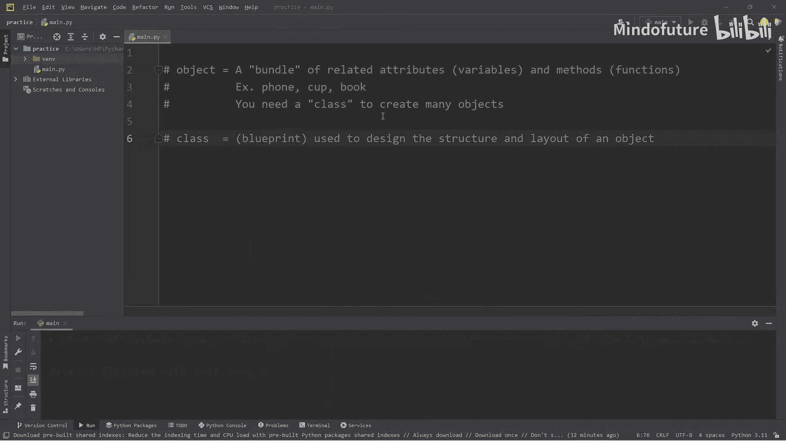

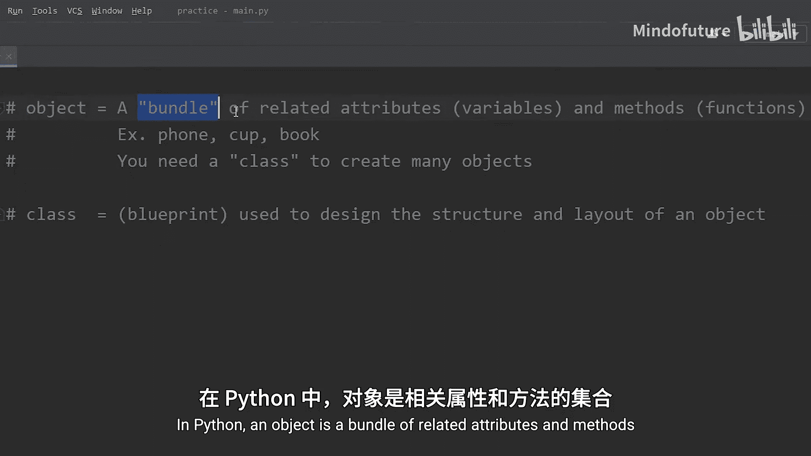

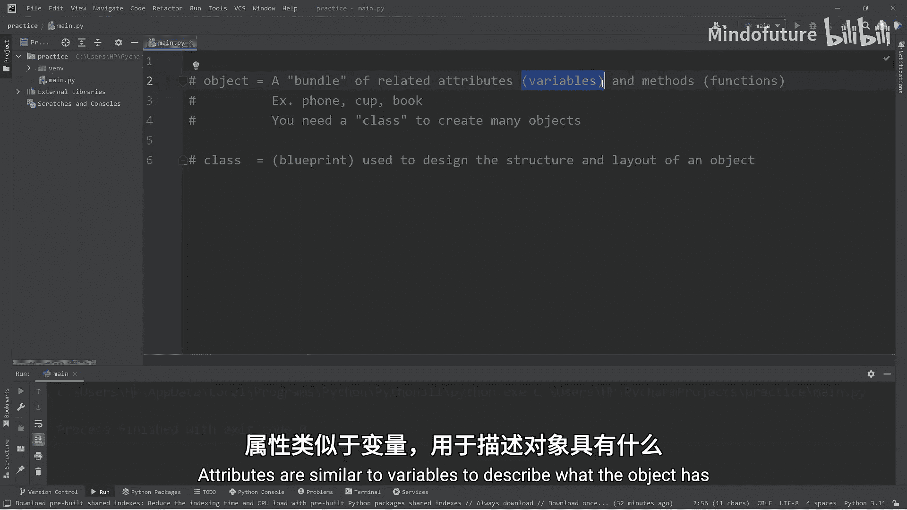

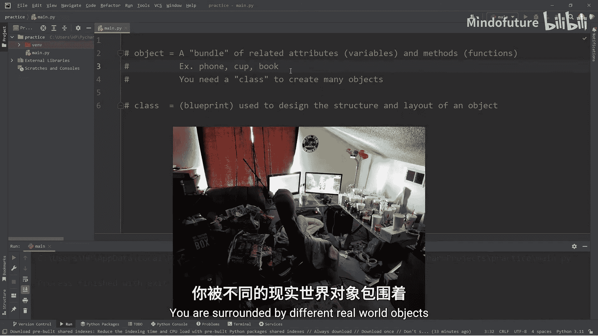

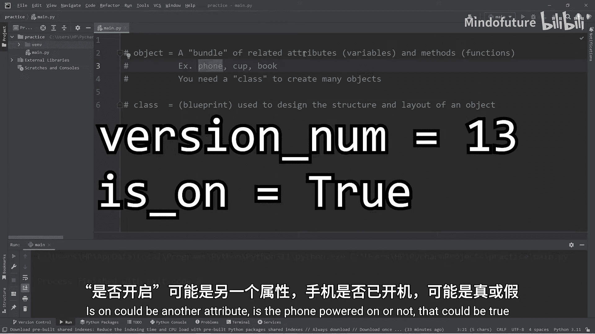

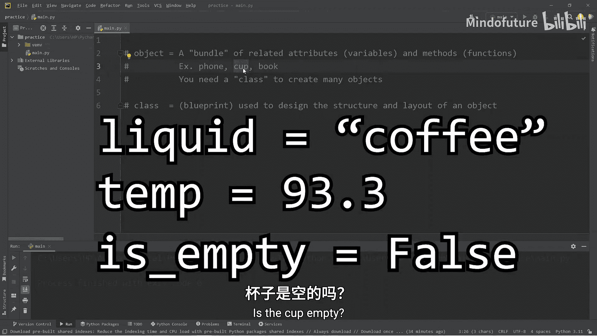

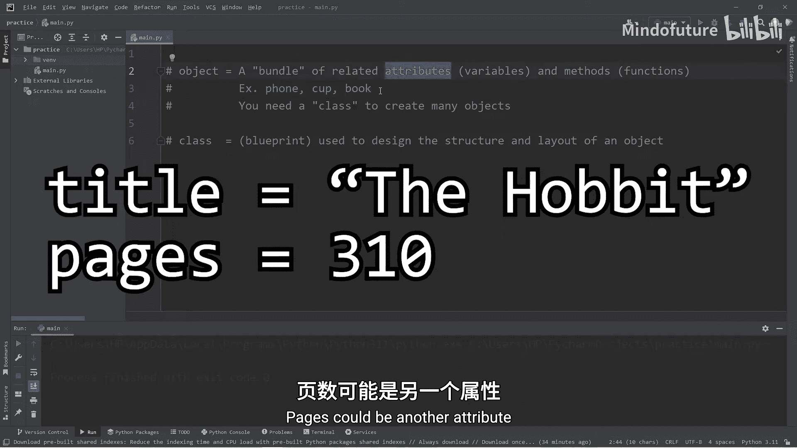

Now， objects also have the capability to do things。

 They have methods which are functions that belong to an object。

 People mix up functions and methods all the time。 They're technically different Even when teaching。

 I tend to make that mistake calling a method a function and a function a method。

 Usually people know what you're referring to， though。

 A method is a function that belongs within an object。 What are some actions。

 These objects can perform with the phone。 You can make a call or receive a call。

 turn the phone on or turn the phone off。 Those could all be functions。 with a cup。

 you could fill the cup drink from the cup or empty the cup with a book you can open the book read the book and close the book。

 An object is a bundle of related attributes and methods they can represent real world items to create many objects will need to utilize a class。

 A class is a type of blueprint。

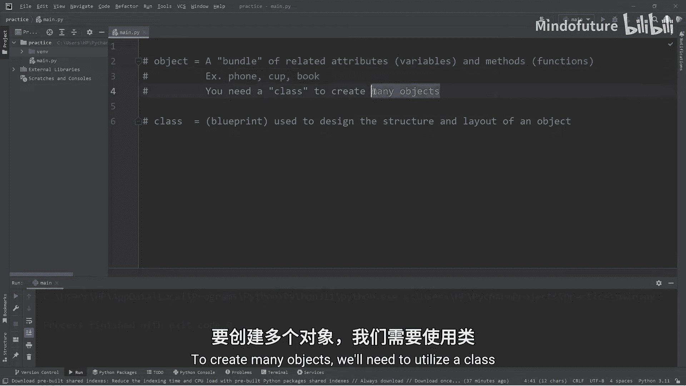

Used to design the structure and layout of an object。 We need to design what our objects have。

 their attributes， and what they can do， their methods。 We will create a class of car。

 We will create some car objects。

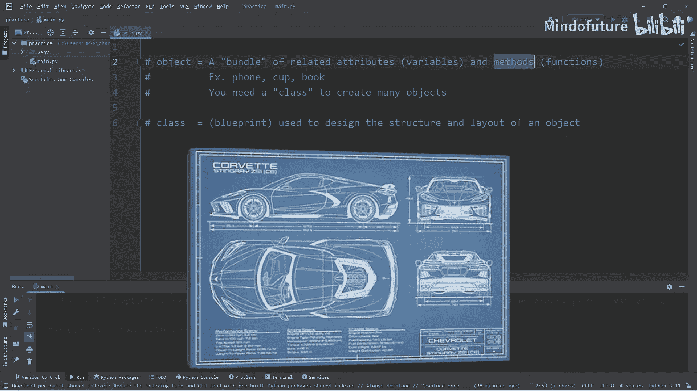

Class car。To construct a car object， we need a special type of method called a constructor。

 It works similarly to a function。 We will define a function。Of double underscore in knit。

 meaning initialize， double underscore again， and then follow this with a set of parentheses。

This is our constructor method。 We need this method in order to construct objects。

 It's a dunder method， Dunder meaning double underscore。 That's a future topic。

 I don't want you to be overloaded with information right now。

 All you need to know is that we need this method in order to create objects。

 This method behaves similar to a function。 We need to set up the parameters。

 Se is already provided to us。 self means this object we're creating right now。

 This car So what are some attributes that a car should have。

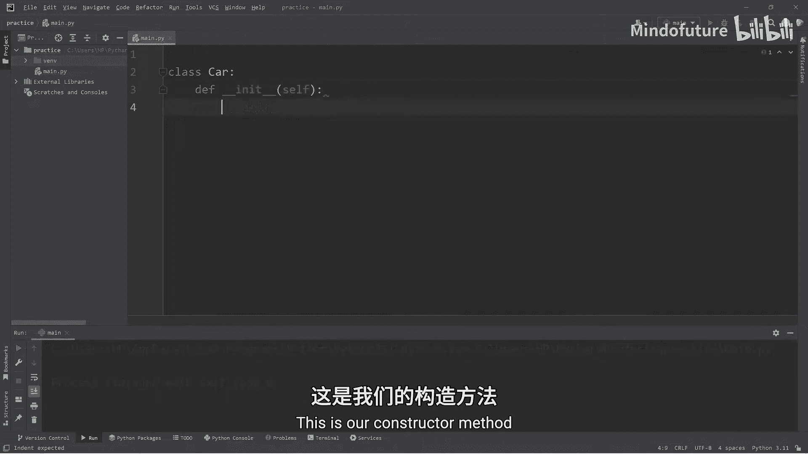

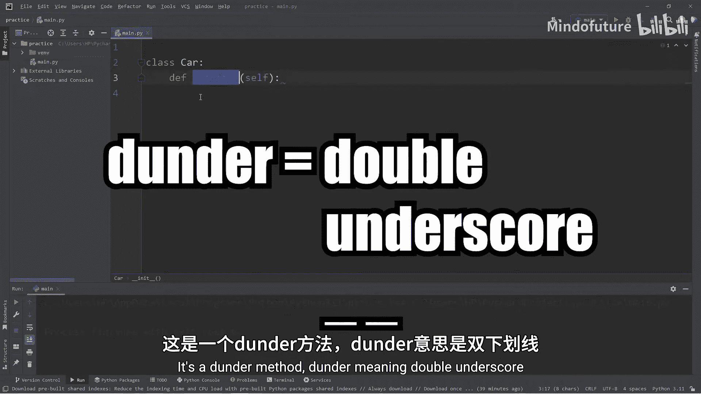

A model。That could be a string， like a BMW。A year， That could be a number。A color。

Let's add a booleion of for sale。 Is the car for sale or not， That's true or false。

To assign these attributes， we're going to access self。Self dot， the name of the attribute。

Self dot model equals the model we receive。These are parameters。 When we receive the name of a model。

 we will assign it to this object。Let's do this with year self dot year equals year。

Self dot color equals color。Self dot for sale equals for sale。

 This is an example of a few attributes that a car might have a model， year， color。

 And if it's for sale or not represented by a booleion。 Now， to construct a car object。

 we need a unique name for this car。 Let's just say car 1。Car 1 equals。Take the name of the class。

Add a set of parentheses to invoke the constructor。

 We're going to do this almost exactly like a function。 We have parameter set up。

 We need to send a matching number of arguments。 Se is provided to us behind the scenes automatically。

 We need a model， year， color。 And if it's for sale or not。So pick a car of your choosing。

I'll pick my favorite car。The model will be a Mustang for the year。

 I'll go with the recent year of 2024。A color。 I'll pick red。Is the car for sale。 I like this car。

 So no， I will set that to be false。 Make sure false is capitalized。

Let's see what happens if I attempt to print our car object of car 1。

What we're given is the memory address of this car object where it's located。

 But I would like one of the attributes located at this memory address。

 Instead of printing the object itself， we're going to access one of the attributes found within this car。

 We will follow the name of the car with a dot。 This dot。

 It's known as the attribute access operator。 I would like the model of car 1。

That would give me Mustang。Let's access the year。 Take the name of the car。 car 1， dot the year。2024。

Followed by the color。Car 1， dot color。Red。Car 1， is it for sale。 We print that。That is false。

Now let's create a second car。We're going to reuse this class to create a second car。

 We will create car 2。Equals car will pass in some different arguments。A corvette。

The year will be 2025。The color will be blue。 Is this car for sale。 Let's say that is true。

Instead of accessing Car1's attributes， let's access Car2's attributes。That would give us。A Corvette。

 the year is 2025。 The color is blue for sale is set to true。Or even a third car。

Car 3 equals a new car。We will pass in a string。Of charger。The year 2026， the color will be yellow。

Is this car for sale， Let's say that is true， as well。Then I will print car 3's attributes。

The model is charger。 The year is 2026。 The color is yellow。 for sale is set to true。With classes。

 they can take up a lot of space for better organization。

 You can place them within a new Python file。 So let's cut our class。

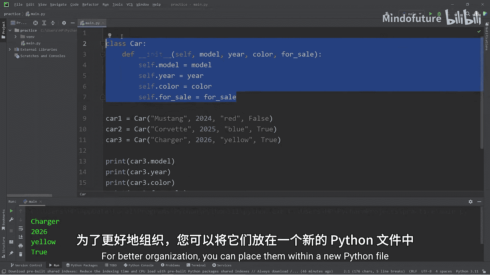

And we will create a new Python file within our project folder， file new。

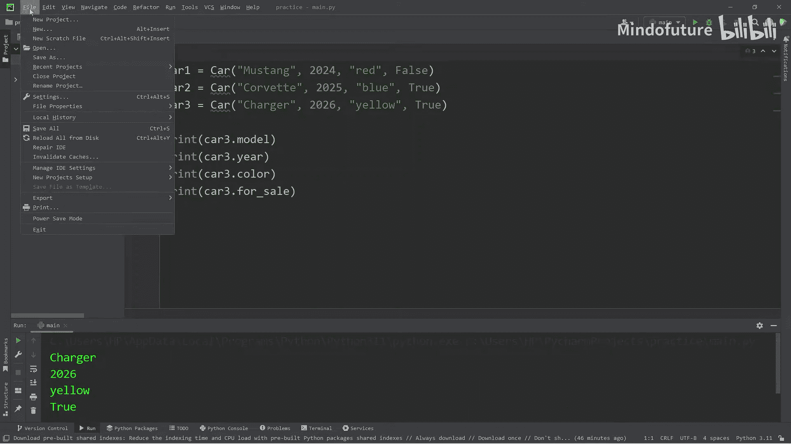

Python file， the name of this Python file is going to be all lower case car。

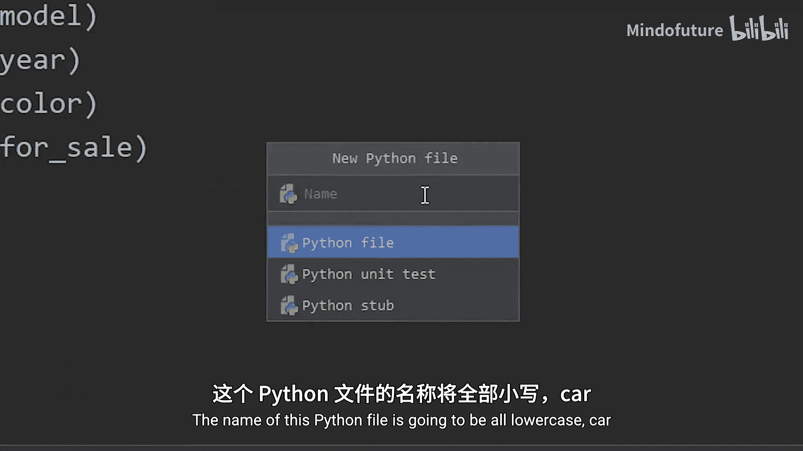

Then， we will paste。The class that we cut originally。Class car， which has a capital C。

So from our main Python file， we're going to import our car file， our car module。

From the name of the module， car import， the name of the class car。 Then when I run this program。

 nothing should change。We should still have access to all of our car objects。

You could either keep your classes within your main Python file or import them if you would like to organize things。

Let's talk about methods。 Methods are actions that our objects can perform。Within our class。

 we will define a method。Of drive。Self is going to be provided to us。

When we invoke the drive function， let's print。You drive the car。What other things can cars do？

Let's stop。We will print。You stop the car。Let's take car 1， access the drive method。

You drive the car。 Car 2 also has a drive method。 You drive the car。 Sam thing with car 3。

You drive the car。Let's access the stop method。Car1 dot stop。Car2。top。And Carth do stop。

These methods are identical for each car object。Instead of printing the word car。

Let's insert the model of the car。 I will convert these print statements to F strings。

Instead of the word car， let's add a placeholder。Let's add self dot model。

Self is referring to the object we're currently working with。Use the attribute access operator。

 followed by the name of the attribute。Let's also do this with the stop method。Self dot model。

Let's take car 1， Use the drive method。You drive the Mustang car 1。Dot stop。You drive the Mustang。

 You stop the Mustang。Let's do this with Car 2。You drive the corvette。 You stop the corvette。Car 3。

You drive the charger。 You stop the charger。Now， within our F strings， let's also insert。

 let's insert the color。I'll add a placeholder， self， dot color。Do this with stop， as well。Self。

Dot color。You drive the yellow charger。 You stop the yellow charger。Car 1。You drive the red Mustang。

 You stop the red Mustang Car，2。You drive the blue Corvette。 You stop the blue Corvette。

 Let's add one last method。Let's create a method to describe our car。

 We'll print the details of the car。Let's print。 I'll use enough string。Add three placeholders。

Let's print self dot year。Followed by self dot color。Then， self dot model。We'll take car 1。

 Use the described method that we created。Describe car 1。 Car 1 is a 2024 red Mustang。

 Describe car 2。Car 2 is a 2025 blue Corvette。Car 3 is a 2026 yellow charger。Art everybody。

 So those are objects in Python。 An object is a bundle of related attributes。

 Attributs are variables that an object has and methods， Me are functions that belong to an object。

 They define what this object can do。 And while everybody。

 that is a summary of object oriented programming using Python。

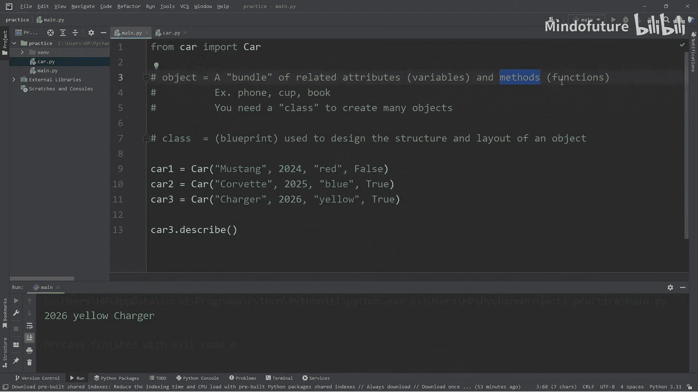

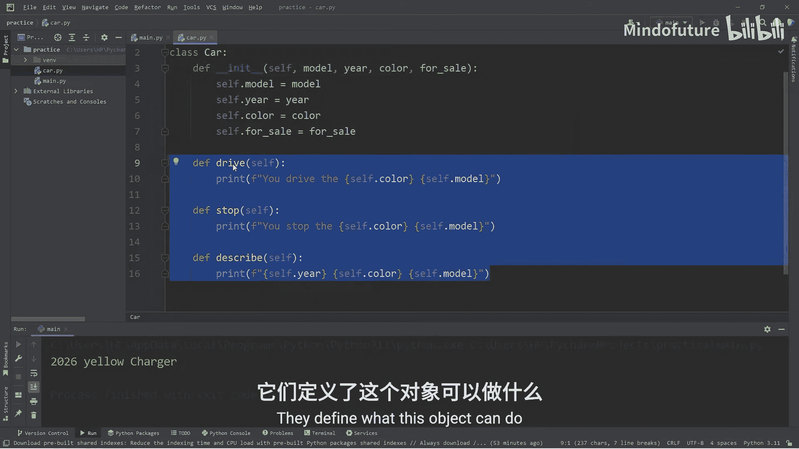

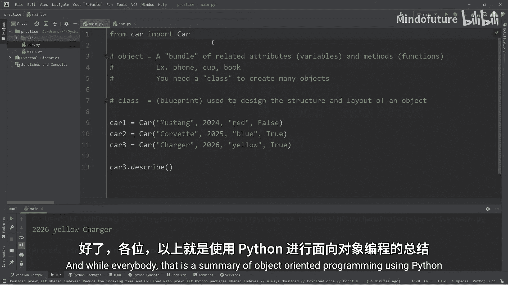