# Python超全入门教程-p49-P49-Python-INHERITANCE-in-6-minutes--BV1fcdLYXEw9_p49-

What is going on， everybody。 So today， I got to talk about inheritance in Python。

 Inheritance allows a class to inherit the attributes and methods from another class。

 much like how a child in real life can inherit traits from a parent by having a class inherit attributes and methods from another class。

 This helps with code reusability and extensibility。 In this example。

 we're going to create an animal class。 The dog， cat and mouse class will inherit attributes and methods from the animal class。

 We will create a class of animal。😊。

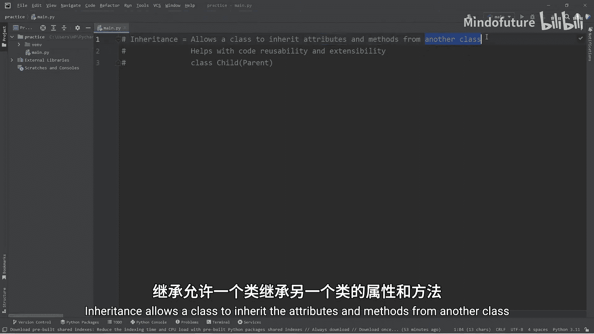

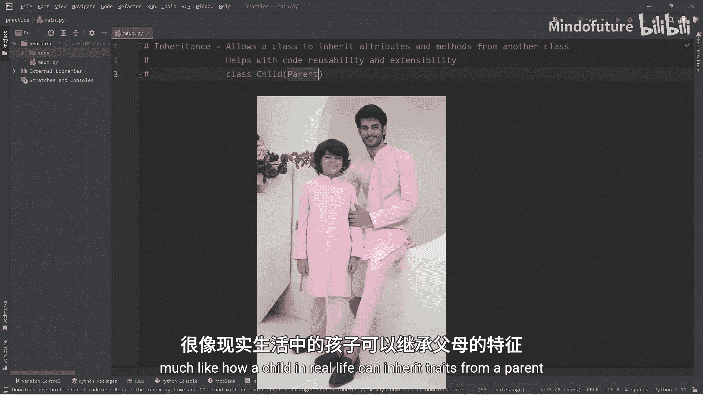

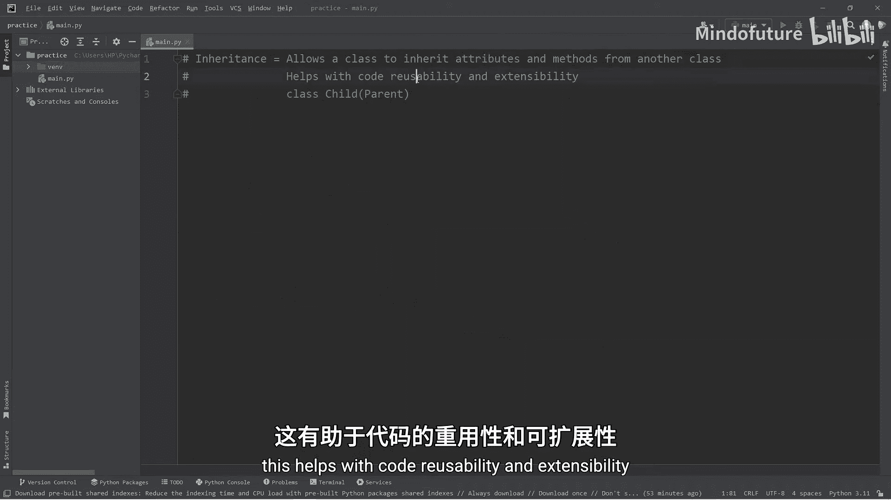

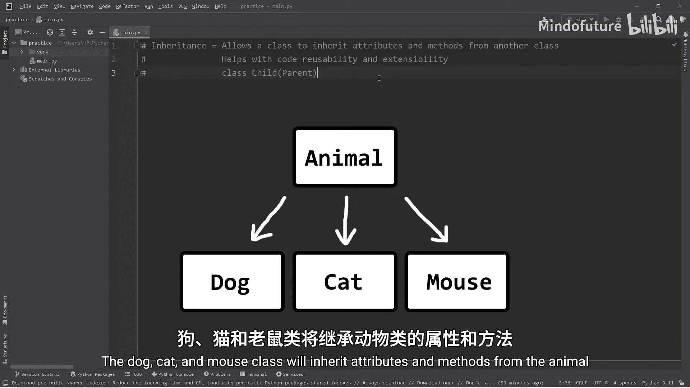

Then I will define the constructor。When we construct an animal object， let's pass in a name。

It's not required， but it might be good for this example。

We will assign the attribute of name equal to the name we receive。

Let's also add an attribute of is alive。 Whenever we create an animal。

 we will set there is a live attribute to be true。And that is a capital T。All animals can eat。

 define， eat。We will print， using enough string。At a placeholder， self dot name。

 the name of this animal is eating。All animals should be able to sleep， Def sleep。Print。

 I'll use enough string。Insert。Self dot name is sleeping。

And that is all we need for the animal class。Let's define class， dog。

For a child class to inherit the attributes and methods from another class。

 after the class name that's going to inherit。 we need to add an inheritance list with the set app parentheses。

 Then list the name of the class we're inheriting from the parent。

 the dog class is going to inherit all of the attributes and methods of its parent， animal。

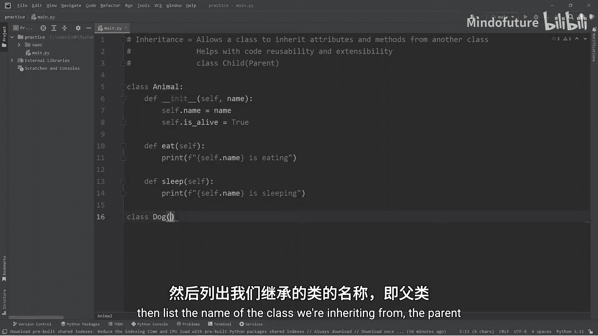

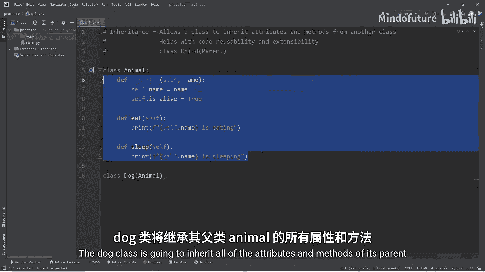

For the time being， as a placeholder， I'll add a pass just to demonstrate this。

Class cat is also going to inherit from animal。And class mouse will also inherit from animal。K。

 I will collapse this for now。 We'll create a dog object。 Do equals dog。

 then pass in a name for this dog， because we have one parameter set up of name。

This dog will be named。Scoby， as in Scooby do。Cat。Equals called the cat constructor。

This cat will be named Garfield。And mouse。Mouse equals mouse。Our mouse will have a name of Mickey。

Even though there's nothing within this dog， cat or mouse class。

We should still have these attributes， and these methods。If you inherit the animal class。

 you should have a name attribute and is a live attribute set to true you can eat and you can sleep。

 Let's print our dog's name。 dog dot name。Sooby。Print dog dot is alive。Our dog is alive。

 That is true。Let's have our dog object use the eat method。Scoubby is eating。And sleep。

 dog dot sleep。Scoia sleeping。Let's replace dog with cat。The name of the cat is Garfield。

 Garfield is alive。 Garfield is eating。 Garfield is sleeping and mouse。

Replace any instance of cat with mouse。Our mouse's name is Mickey。 Mickey is alive。 Mickey is eating。

 Mkey is sleeping。

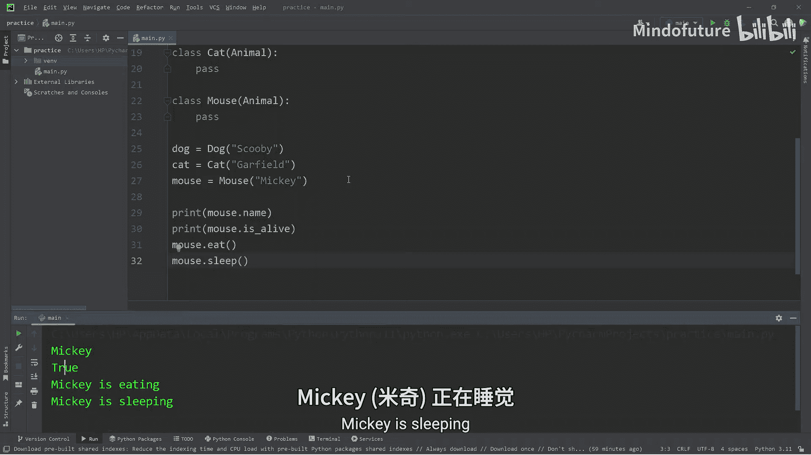

Even though these children classes are empty， we're still inheriting these attributes and methods from its parent of animal。

 This is convenient because you don't need to copy and paste these attributes and methods for every single class。

 For example， if I were to copy these attributes and methods and paste them。

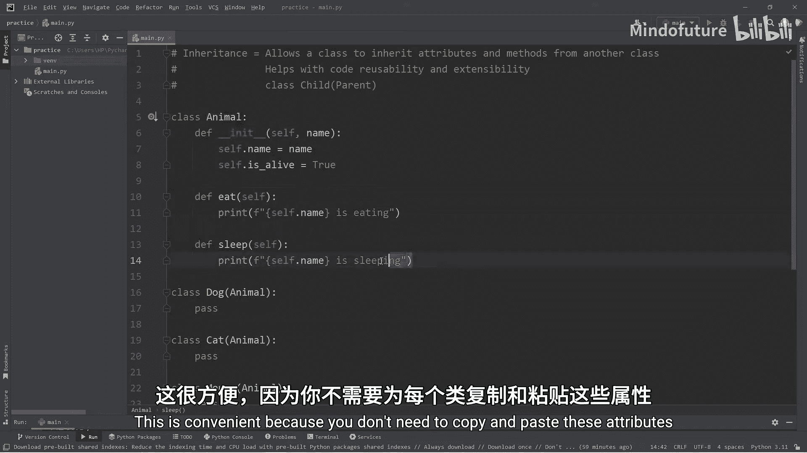

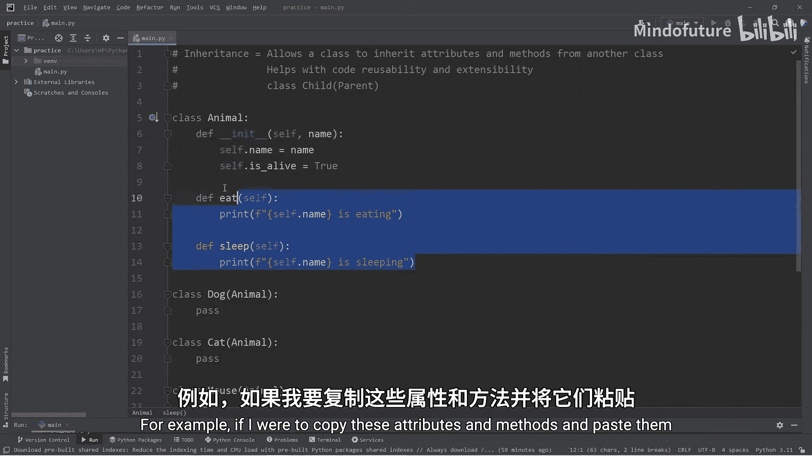

Well， we have a lot more code to write。 And as a consequence。

 if I need to make a change to one of these methods。

 I would have to do that to every single instance of this method。 For example。

 let's replace is sleeping with is asleep。 Well， now I need to find every single sleep method and change it manually。

It's not too bad if you only have a few classes， but imagine if you have hundreds of classes。

 that's going to take a lot of work。It's a lot easier to write the code once and then reuse it。

 And I only need to make that change in one place rather than make that change many times。

 So let's change is sleeping， too is。Asleep and see if that works again。Mickey is asleep。

Let's replace mouse with dog。Scoby is asleep， not only that， but with children classes。

 they can have their own attributes and methods that are different from one another。

So dogs have all these attributes and methods， and they can speak。Let's create a speak method。

 and I will print a unique message for dogs。Worth。Cats will also have a speak method。

 but it's going to be different。Cats will， Miao。Thenhan for a mouse class， they will squeak。

Let's have our dog speak。Wof。Let's have our cat speak。Miao and our mouse。Squeak。Al right， everybody。

 So that's an introduction to inheritance。 Inheritance allows a class to inherit attributes and methods from another class。

 Much like in real life， a child can inherit traits from a parent。These are also known as sub。

And super classes。Which is a topic for another day。

 Inheritance helps with code reusability and extensibility。

 If all of these children classes inherit these attributes and methods from another class。

 we only need to write that code once and not copy it for every single class that needs it。

 We can write and change the code in one place for better reusability and extensibility。 And while。

 everybody， that is an introduction to inheritance in Python。

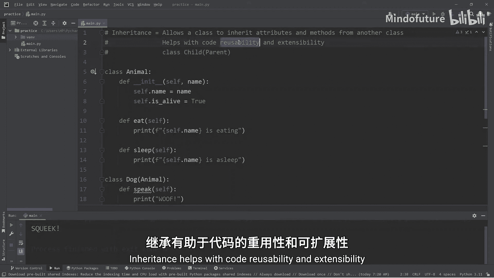

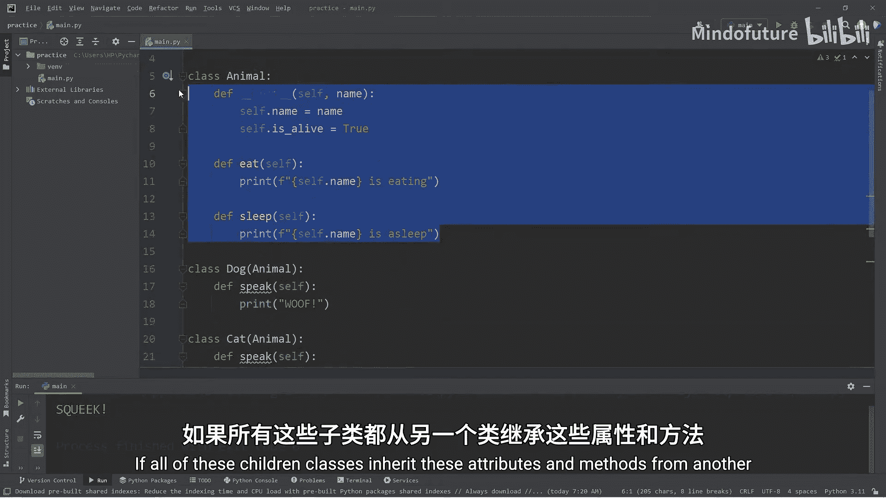

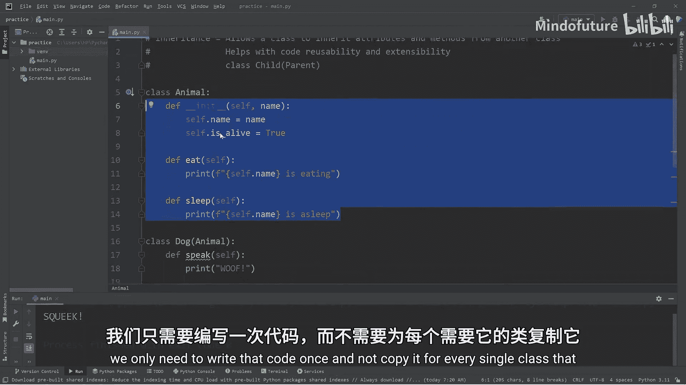

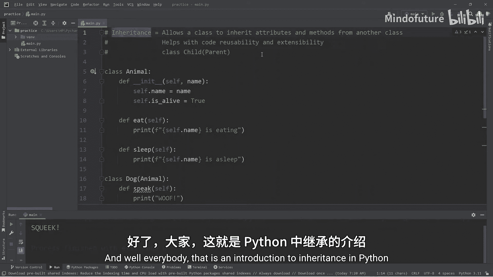