# Python超全入门教程-p50-P50-Python-MULTIPLE-INHERITANCE-is-easy--BV1fcdLYXEw9_p50-

Everybody， So today， we got to talk about both multiple and multi level inheritance。

 We'll begin with multiple inheritance。 That's when a child class inherits from more than one parent class。

 For example， a class of C can inherit the traits from both class A and B in Python。

 you can have more than one parent Multile inheritance we'll talk about near the end of this topic。

 So in this example， we're going to create two parent classes。 Prey。I'll write pass for now。

And predator。We'll create a class of rabbit。A class。Ahawk。Then， class fish。Rabbit。

 hawk and fish are going to be children classes。 Prey and predator will be parents。

If one of these classes rabbit， hawk or fish inherit from prey， they get the ability to flee。

We will define a method of flea。All we'll do in this example is print the following text。

This animal is fleeing。If you're a predator， you get the method to hunt。Define hunt。We will print。

This animal is hunting。Rabbits， they will inherit from the prey class。

 They're typically not predators， except that one rabbit and Monty Python in the holy grarail。

 That's the exception。 Rabbit will inherit the prey class。Then it gets access to a flea method。

Haws are predators。 They will inherit the predator class。

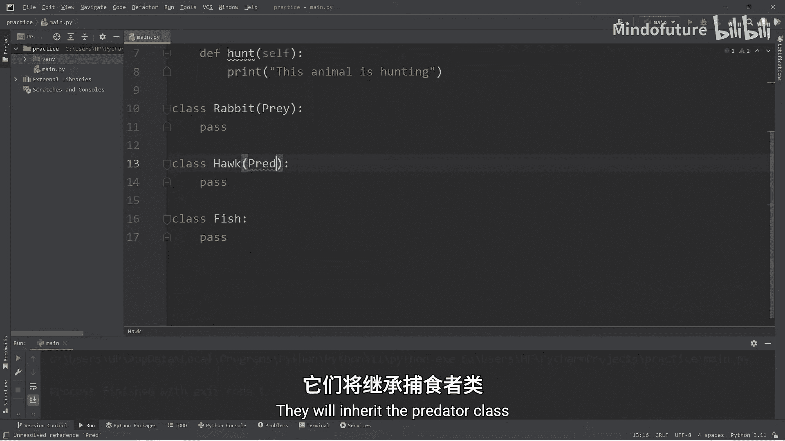

Now， fish。They will hunt smaller fish and flee from bigger fish。 You can consider fish。

 both prey and predators， so they will inherit both glasses。 We will use multiple inheritance。

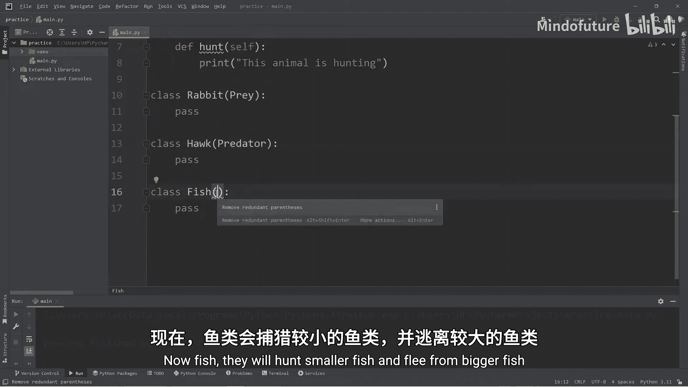

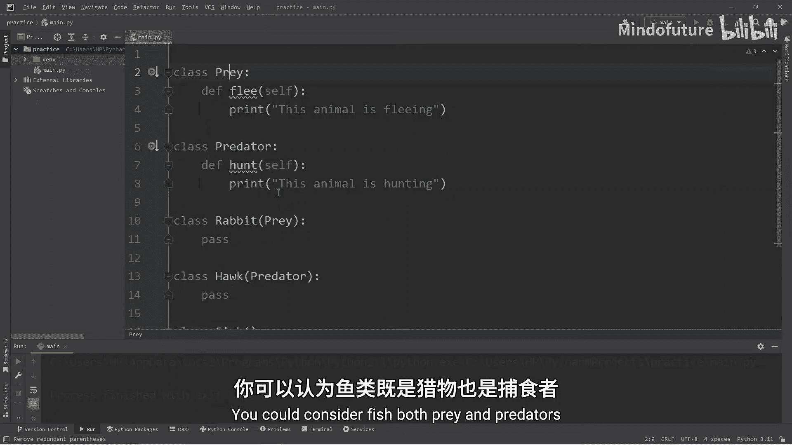

They will inherit everything from the prey class and the predator class。Now， let's see if this does。

 in fact， work。 Now， we'll create a rabbit object。 Rabbit equals rabbit。

 There are no parameter set up。 We don't need to send any arguments to the constructor。

Hawk equalshawk。And fish equals fish。So let's take our rabbit object。

 and they should have a flea method。 Rabbit dot flea method。 This animal is fleeing。

 but they do not have a hunt method because they're not predators。Rabbit object has no attribute。

 hunt。Haws can hunt。Theirre predators。They inherited that method。 This animal is hunting。

 but they can't flee。 They're not prey。Hawk object has no attribute flea。Fish can do both。

They inherit from the prey class， and the predator class。Fish dotfullyea。This animal is fleeing。

Fish dot hunt。This animal is hunting。

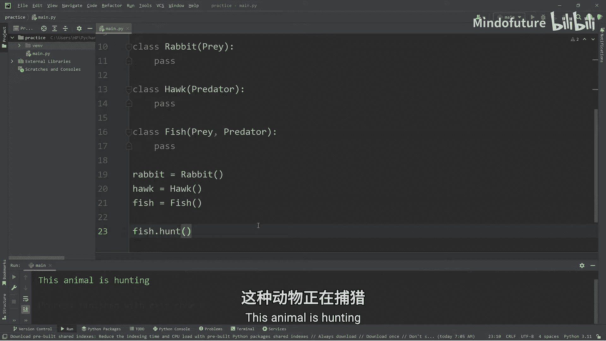

Children classes can inherit for more than one parent， which is what we did for fish。

 They are both prey and predators， whereasas in rabbits are just prey。 Hawks are just predators。

 If you need to inherit from more than one parent， you just add that additional class to the inheritance list。

With multi level inheritance， a parent can inherit from another parent。We will create a class。

Of animal。And for now， I'll write pass。Pray and predator are going to inherit from the animal class。

 So we need to add animal to each inheritance list。Let's say， if you're an animal。

You get a method to eat。 All animals will eat。

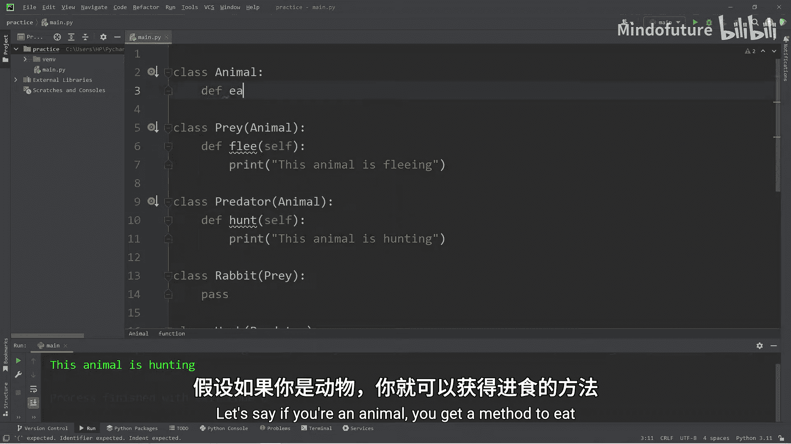

Print。This animal is eating。And you can sleep。Define sleep。Print。This animal is sleeping。

So think of rabbit， hawk and fish as children classes。

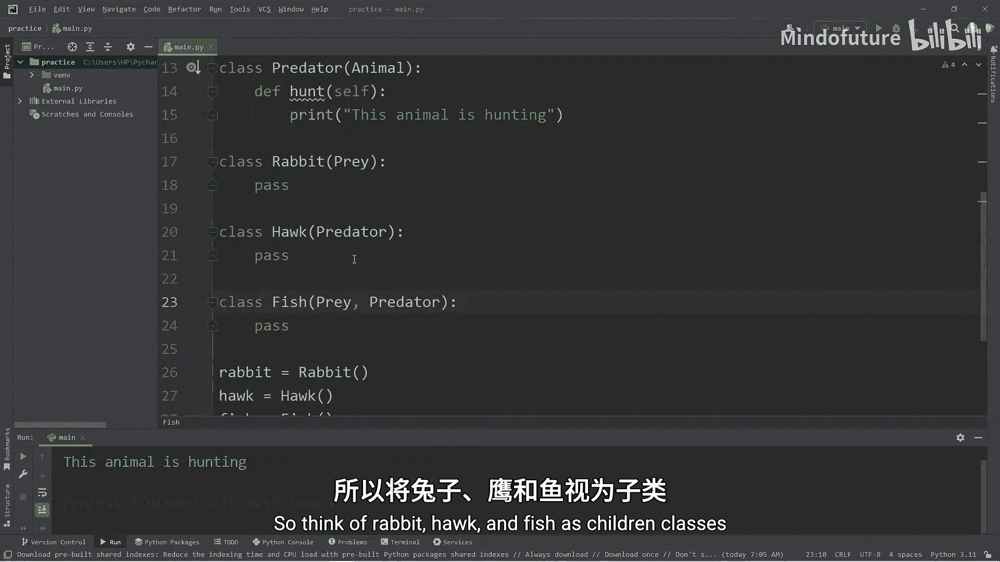

Pray and predator are those classes' parents。And animal is the grandparent。

 Pray and predator will inherit everything that the animal class has。

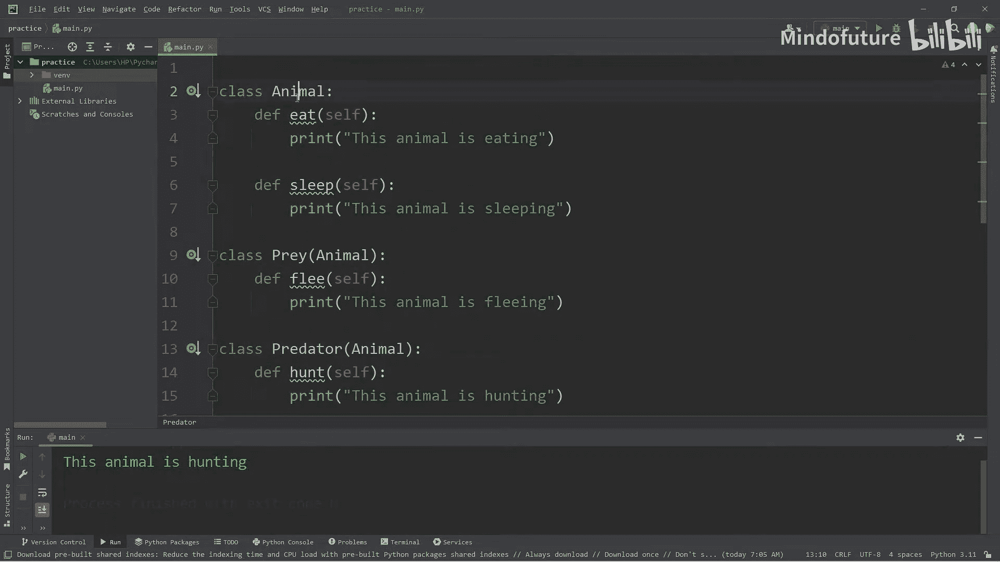

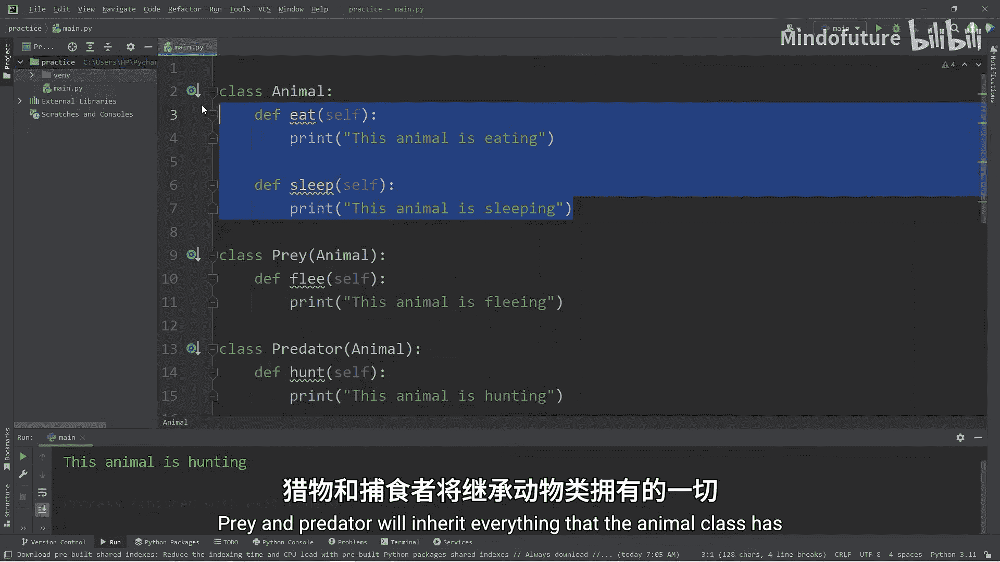

Rabbit hawk and fish will inherit everything the prey and predator classes have。 So now。

 our rabbit hawk and fish classes should have the ability to eat and sleep。 And we'll test that。

 Rabbit dot eat。

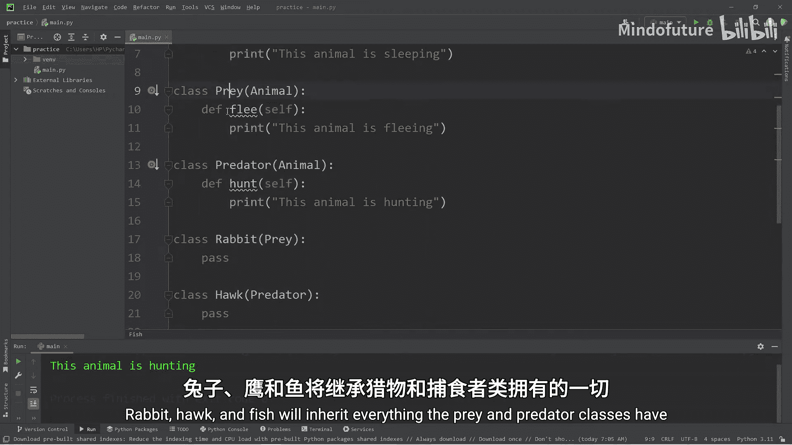

This animal is eating rabbit， dots sleep。This animal is sleeping。 Let's check out fish。Fish dot eat。

This animal is eating fish Dot sleep。This animal is sleeping。Okay。

 we're going to expand upon our example a little bit。Let me zoom out。

Each of our objects is going to have a name。 Our rabbit will have a first name of bugs。

 Hawk will be Tony， as in Tony Hawk。Our fish will be Nemo。Within our classes。

 we don't have any constructor set up。In which class should we assign the name attribute。

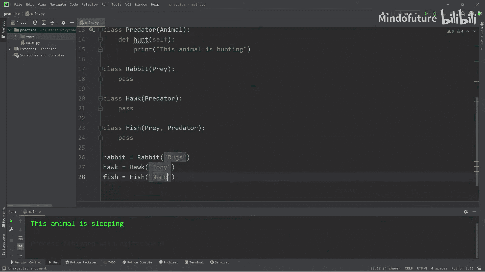

Let's do so within our animal class。So we will define a constructor。To assign these attributes。

We will receive a name。Will' assign self dot name equals name。

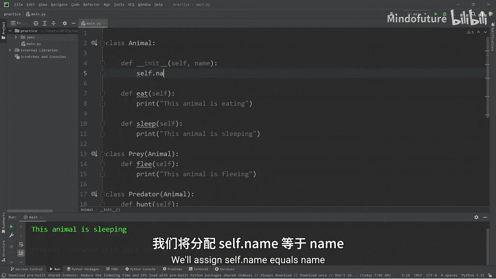

Now， with these other classes， if you're not assigning any attributes or if you don't need any other initialization logic。

 you don't need a constructor。

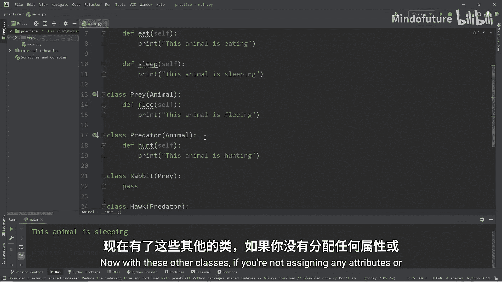

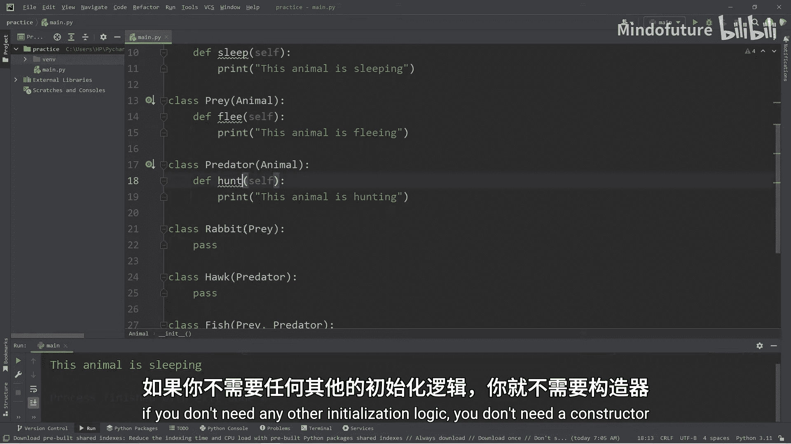

Will implicitly use the constructor We inherit from the parent。

Let's convert each of these print statements to an F string。Replace animal with self。Dot name。

Now let's have our rabbit。Use the eat method。Oh， we should get rid of this。There we go。

Bugs is eating。Rabbit dot sleep。Bugs is sleeping。Rabbit dot flee。Bugs is fleeing。

 Let's check out our hawk。 Hawks don't have a flea method because their predators not pray。Let's eat。

 Tony is eating。 Let's sleep。Tony is sleeping。 Let's hunt。Tonyius hunting。Let's check our fish， next。

Our fish can eat。 Nemo is eating。 Our fish can sleep。Nemo is sleeping。 They can flee。Nmo is fleeing。

Addd Hunt。Nmo was hunting。Okay， everybody， that is both multiple and multi level inheritance。

With multiple inheritance。A child can inherit from more than one parent class。

You just add each additional class to the inheritance list。With multile inheritance。

A child can inherit from a parent， which inherits from another parent。 Class C can inherit from B。

 where class B inherits from a。Think of C as the child， B as the parent， and A as the grandparent。

 C will have all the attributes and methods even available within the grandparent class of a。

And well， everybody， that is both multiple and multile inheritance in Python。

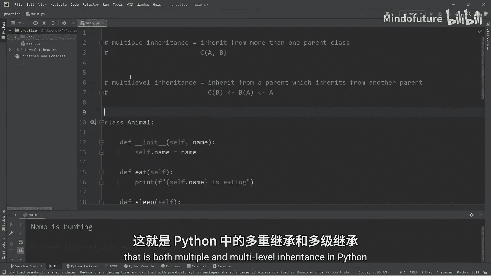