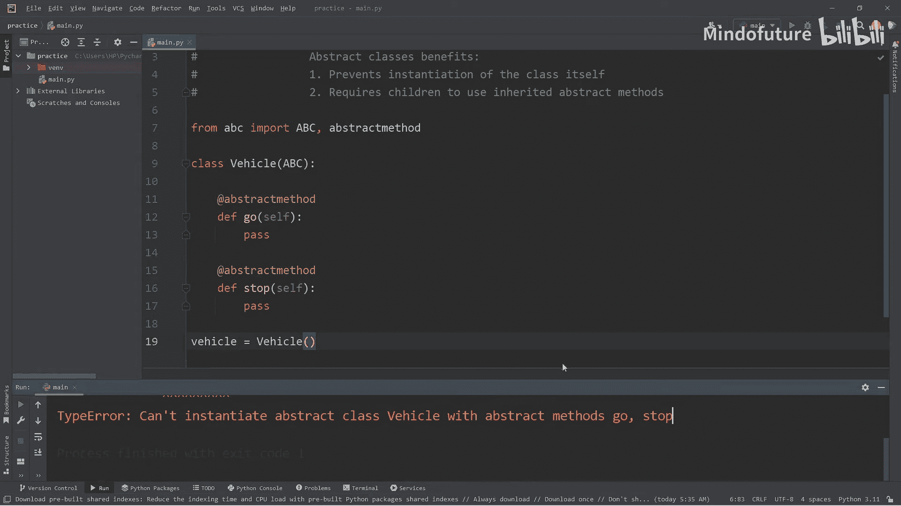
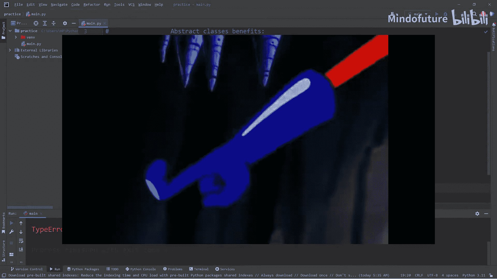
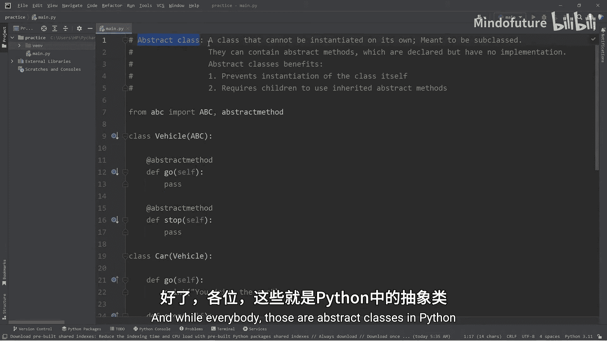

# Python超全入门教程-p51-P51-Learn-Python-ABSTRACT-CLASSES-in-7-minutes--BV1fcdLYXEw9_p51-

Hey， everyone， welcomee back。 So today， I got to talk about abstract classes in Python。

 An abstract class is a class that cannot be instantiated on its own。

 Abs classes are meant to be subclass。 They're supposed to be parents to children classes。

 They can contain abstract methods which are declared， but have no implementation。

 Abs classes have a few benefits。 We can't create an object from the class that's abstract。

 Abs classes， you could say， are incomplete。 We don't want to create an object that's incomplete。

 Also， any children that inherit from an abstract class。 If there's any abstract methods。

 We have to implement them。 So let me give you a demonstration。We're going to create a class。

A vehicle。For now， I'll write pass to work with abstract classes， we'll need to import ABC。

ABC meaning abstract base classes。We need。Import ABC。All capital meaning abstract based class。

As well as abstract method。So my vehicle class， it's going to be an abstract class。

We will inherit from ABC， the abstract based class。

 I don't want myself or any other developers to be able to create a vehicle object。

 I will make this vehicle an abstract class。 Also， I can add some abstract methods。

These methods will be inherited by its children。To declare an abstract method。

 we need to use a decorator at。Abstract method。So what should all vehicles be able to do， Let's say。

 go and stop。If you're a vehicle， you can go。With abstract methods， we declare them。

 but we don't define them。 We'll define them within each of the children classes that inherit from vehicle。

Let's create another abstract method。Abstract method。Define， stop。If you're a vehicle， you can stop。

All right。 We have finished our abstract class， a vehicle。

 just to demonstrate that we can instantiate an object from this class。

 Let's attempt to do so and see what happens。 I will attempt to create a vehicle object。

 vehicle equals vehicle。And then run this。Type error can't instantiate abstract class vehicle with abstract methods。

 Go and stop。 This is good。 This is what we want。 Our vehicle class isn'tcomplete。

 We don't want to accidentally make a vehicle object。 If we were。

 it's kind of like the invisible boatmobil from Sponongebob。 Instead。

 we will create some children to inherit from this class。

So now we will create a class。Of car， which will inherit from vehicle。 Car is the child。

 Vehicle is the parent。But we are receiving a warning Class car must implement all abstract methods。

What we're saying is， hey， if you inherit from the vehicle class。

 you need to include these abstract methods， so I'm not going too currently。

 let's just see what happens。I will attempt to create a car object。And run it。

Type error can't in shape abstract class car with abstract methods， go and stop。

If a class is inheriting from a parent， that's abstract， and there's abstract methods。

 We have to finish defining those methods。So within our car class， really。

 I'll just copy this because I'm lazy。Our method is， go。 We will print。You drive the car。

 We also need stop。I will print。You stop the car。Okay， let's see if this works。

This has run with no problems。 I will have my car go。Then stop recalling the go method。

 then the stop method。 You drive the car。 You stop the car。

Let's create a few more children for the vehicle class class。Motorcycle。

Will inherit from the vehicle class。Again， we have to implement the abstract methods found within the parent。

 Go and stop。Forgo。I will print。You ride the motorcycle。Then with stop。You stop the motorcycle。

Motorcycle equals motorcycle， we're calling the constructor。Then I will have our motorcycle。Go。Then。

 stop。You ride the motorcycle。 you stop the motorcycle。Allright， last example。

 let's say we create a boat class。Which will inherit from the abstract class， a vehicle。

I will include a go method。Where I will print。You sail the boat。

But I will forget to add a stop method because I'm not paying attention。

Let's attempt to create a boat。Well， what the heck is this。

 Type error can instantiate abstract class boat with abstract methods。 stop。

 Then I'll look over my code and see， oh， I forgot to include a stop method with including abstract methods within a parent。

 It acts as a set of checks and balances。 All vehicles should be able to go and stop。

 if I forget to define one of these methods。 Well， we'll receive a type error。 if we didn't。

 I may not have noticed that we're missing a method。 So now we need to include that stop method。

I will print。You anchor the boat。This seems to have run with no problems。I will have my boat go。

And stop。You sail the boat。 You anchor the boat。All right， everybody。 So those are abstract classes。

It's a class that can't be instantiated on its own。 We can't create any objects from this class。

 We don't want to because it's well incomplete。 They're meant to be subclassed。

 They can contain abstract methods which are declared。 but we don't finish defining them。

 We define them within the children classes。 In this example， car， motorcycle and boat。 And while。

 everybody， those are abstract classes in Python。

