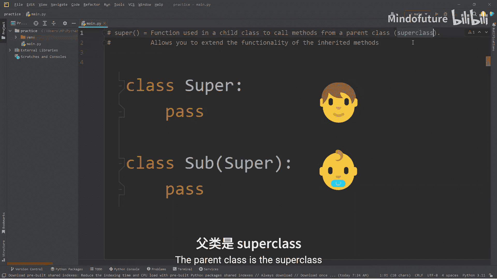
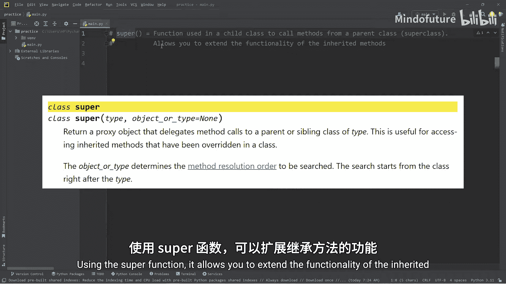
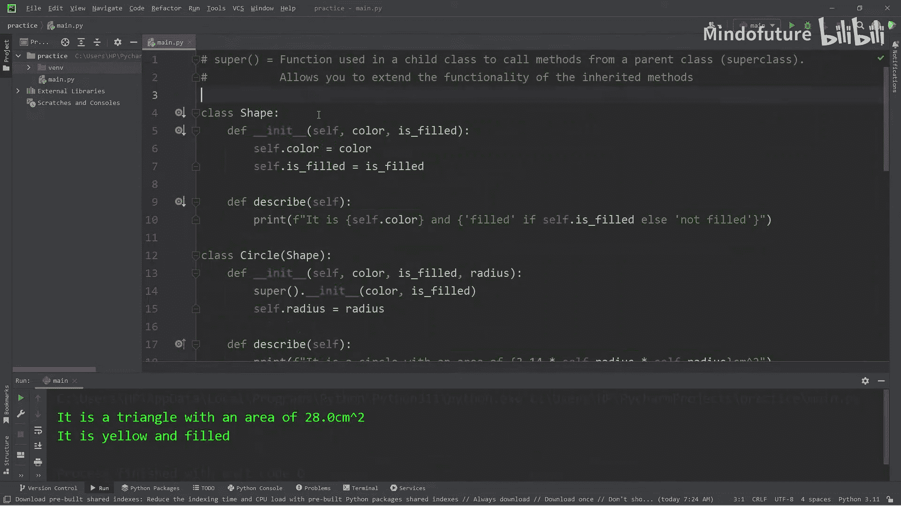

# Python超全入门教程-p52-P52-SUPER()-in-Python-explained--BV1fcdLYXEw9_p52-

Everybody。 So today， I got to talk about the super function in Python。 Super is a function。

 It's used within a child class to call methods from a parent class。 The child class is the subclass。

 The parent class is the super class。 Hence why this function is named the super function。

 using the super function。 It allows you to extend the functionality of the inherited methods。

 Here's an example。 We' create a few shape objects。 We'll need to set up the classes。 though。

 We'll have class circle。😊。

For the time being， I'll just write pass。 We'll fill it in later。Class square。And class。Triangle。

For each of these classes， in order to instantiate objects， we'll need a constructor。

 We will define our constructor， our inni method。When creating circles。

 what sorts of attributes should a circle have， Let's say a color。 What's the color of the circle。

Is it filled or not。Filt will be another attribute。And a radius。Then let's assign these。

Self dot color equals the color that we receive。Self。Dot filled。The equals filled。

Self dot radius equals radius。Let's do this with the square and triangle。 Really。

 I'll just copy our constructor and paste it。Squares don't have a radius with a square。

 The width and the height are the same。 Let's replace radius with width。

We'll also keep the color and filled attributes。Self dot width equals width。Now， with triangles。

Again， let's copy our constructor。 We'll need a width and a height。Self dot height equals height。

So with programming， we try not to repeat ourselves if we don't have to。

 What do all of these classes have in common。They all share the attributes of color。And filled。

The ways in which they are different is that circle has a radius attribute。 Square has a width。

 Triangle has a width and a height。 If we have to make any changes to one of these attributes。

 we would have to do so manually。 For example， let's replace filled with is filled。 Now。

 I need to look throughout my code for any instance of filled and replace it with is filled。

It's a lot of work， and I might make a mistake。Such as here and here。

 it's better to write your code once and try and reuse it。

 So that's where inheritance and the super function can come in handy。

 We're going to take the attributes of color and is filled and place it with an parent class。

 These children classes will inherit those attributes。So class， what do they all have in common。

 They're all shapes， class shape。And for now， I'll right pass。

Circle is going to inherit from its parent of shape。That also applies with square and triangle。

We'll set up a constructor for shape。Define。In't it。We will pass in the color， and is filled。

Then we will assign these attributes。Self dot color equals color。Self dot is filled。Equals is filled。

We don't need to manually assign these attributes within each of these constructors for the children。

Instead， what we have to do is within the constructor for each of these children classes。

 we have to call the constructor for the parent， also known as the superclass of shape。

So we will eliminate these two lines of code。Use the super function。

Dot called the constructor of the parent。And that is the Dunder init method。

But we need to pass in the color that we receive。And is filled。 This will be a booleion。

Then let's do this with the square class。And the triangle class。We still need radius for the circle。

 width for the square， width and height for the triangle。

 We're going to call the super function to take care of whatever our attributes all these types of shapes have in common。

 such as color and is filled。 Now， let's see if this works。 Let's construct a few objects。

 We will create a circle named circle。Called the constructor for circle。 We have to pass in a color。

 a boolean if it's filled or not， and a radius。So for the color of the circle， let's say red。

Is filled。 Let's say that is true。And a radius of 5。

You could even use keyword arguments for better readability， although not necessary， but for clarity。

 let's say color equals red。Is filled equals true。Radius equals 5。Let's see if this works。

I will print。Our circles， color。It is red。Print our colors。Is filled attributee。The circle is filled。

 That is true。And the radius。Print circle。Dot radius。The radius of the circle is 5。

We could even convert this to an F string。I'll add a placeholder。Then， add centimeters。5 cm。

Let's construct a square object。Square equal square。Well need a color is filled and a width。

 I'll just copy what we have and make a few changes。Replace radius with， with。The color will be blue。

Is filled will be false。 The width will be 6。 We don't need a height because squares haven' an even width and height。

 If we ever need the height， we can assume it's the same as the width。 in this case，6。

Let's check out our square。Square dot color， square dot is filled。 square dot width。

Our square is blue。 It's not filled in。The width is 6 cm。Let's create a triangle object。

Triangle equals triangle。Pass in our arguments。The color will be yellow。Is filled will be true。

The width will be 7。And the height will be 8。Let's print our triangle's color。 Is it filled。

 its width， and its height。Our triangle is yellow。 It's filled in。 The width is 7 cm。

The height is 8 cm。So that's how you can use the super function to reuse the constructor of a parent class。

 We don't need to manually assign each of these attributes within each of the children classes。

 We can do that in just one place。 When we refer to super。

 imagine that we're replacing this with the parent class name， such as shape。

That might be a good way to think of it。Use the constructor of the parent class of shape and pass these arguments in。

What you could do as well， is extend the functionality of a method。 So within our shape class。

 let's create a method of describe。We will describe the attributes of this shape。We will print。

Use an up string。When we want to describe our shape， let's say it is at a placeholder self dot color。

 What is the color of this shape。And is it filled or not。And at a placeholder。

 we'll use a ternary operator， print， filled。If self do is filled， is true。Else， we will print。

Not filled。Each of these types of shapes， circle， square and triangle will have access to a described method。

Let's attempt to use it。Take our circle， use the describe method that's inherited。

It is red and filled square。It is blue， and not filled。Triangle。It is yellow and filled。

So then we also have method over writing。 What if we create a similar method of describe within circle。

 square and triangle， Let's do that。Define。A described method。Within our circle。

 let's calculate the area。 What's the area of the circle， I'll use an f string。 It is a circle。With。

An area of then we' calculate the area， given the radius。To calculate the area of a circle。

 we can take a pi。 I'll just say 3。14， just to keep it simple。

Times the radius squared self dot radius， times self dot radius。

If I were to call the describe method， will we use the appearance version of describe。Or the child。

So， let's take our circle。Use the describe method。The result。It is a circle with an area of 78。5。

 I should really add cm squared after that。Centims squared。This is called method over writing。

 If a child shares a similar method with a parent， you'll use the child's version and not the parents。

 This is method over riding。 If you would like to extend the functionality of a method from a parent。

 you can use the super function。 Not only do I want to use the describe method of the child。

 I would also like to use the describe method of the parent。So within this function。

 we will use the super function。 access the described method of the parent。

What we're doing is extending the functionality of the described method。

It is a circle with an area of 78。5 cm squared。 The circle is red， and it's filled。

Or you could change up the order。Let's use the parent classes described method and extend the functionality with our own print statement。

It is red and filled。 It is a circle with an area of 78。5 cm squared。

Let's finish this with the square and triangle classes。

 I'll copy what we have for the describe method， within the circle class。

But we'll make a different calculation。Describe the square。 It is a square with an area of。

Take self dot width。Times， self thought with。The height and the width are going to be the same if it's a square。

Then describe our triangle。It is a triangle。With an area of width times height。

 we have a height in this case。Divided by2。We've already described our circle。

 Let's describe our square。It is a square with an area of 36 cm squared。 It is blue and not filled。

 Let's describe our triangle。It is a triangle with an area of 28。0 cm squared。

 It is yellow and filled。I right everybody， that is the super function。

 It's used in a child class to call the methods from a parent class， also known as the super class。

 It allows you to extend the functionality of the inherited methods within a child class。

 you could use it within a constructor to assign any attributes that all of its siblings have in common。

 such as color or if that shape is filled When used within any other method。

 you can extend the functionality of that method。Not only are we printing this message from the parent。

 We tacking on another print statement before that。And well， everybody。

 that is the super function in Python。

