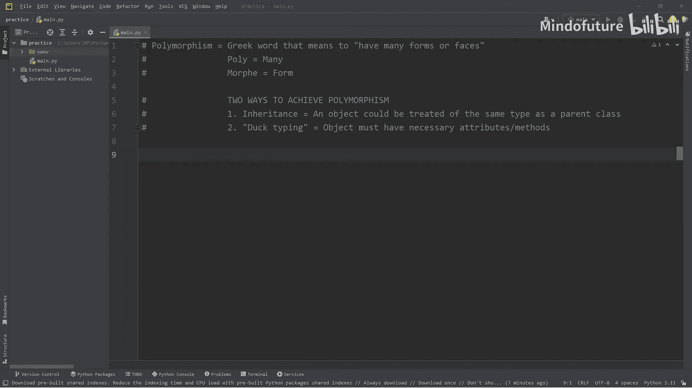
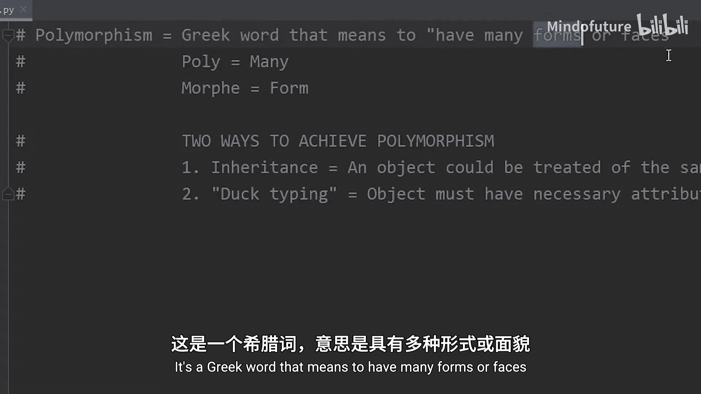
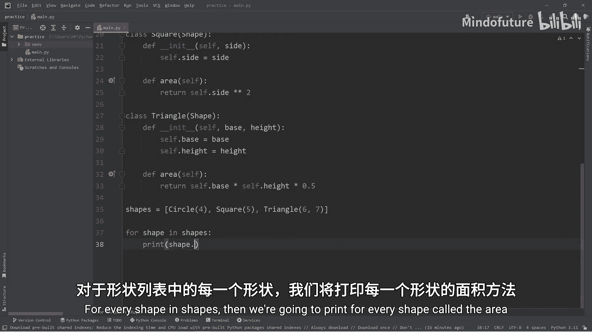
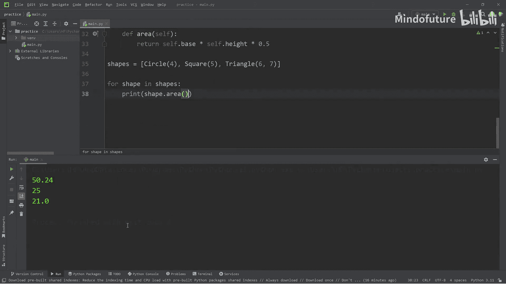
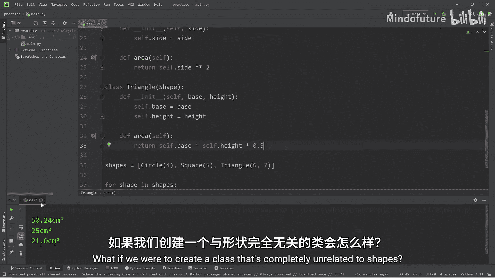
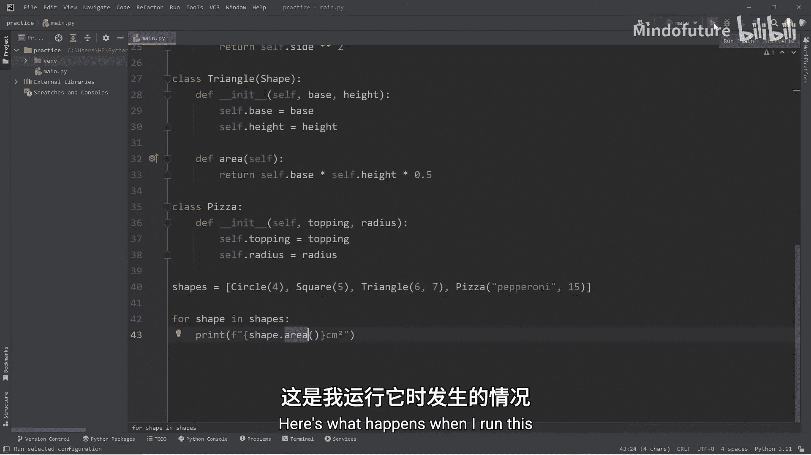
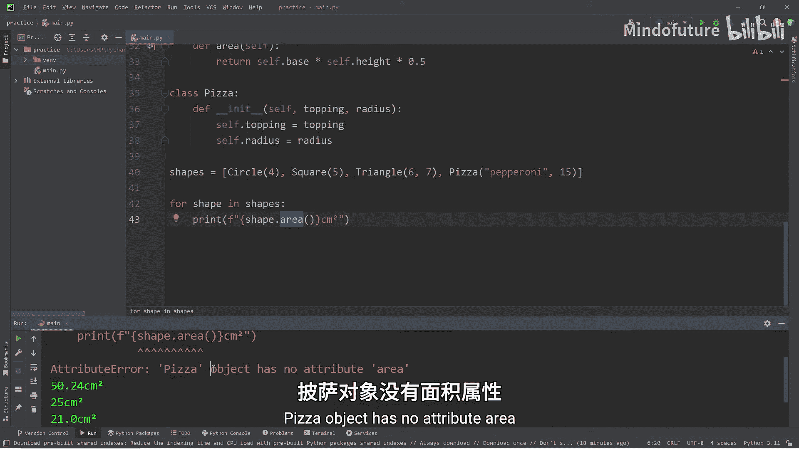
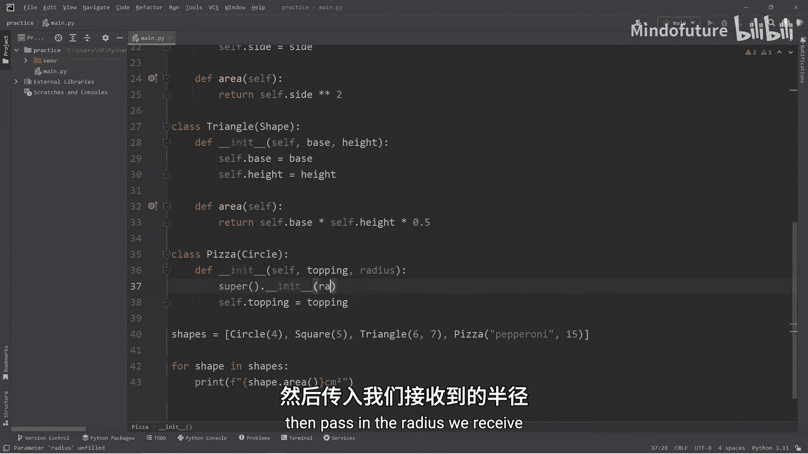
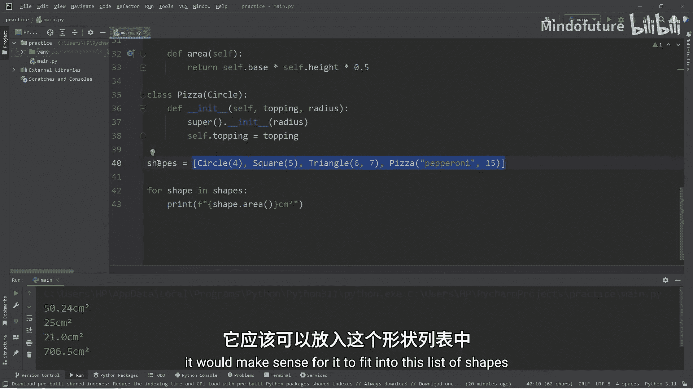
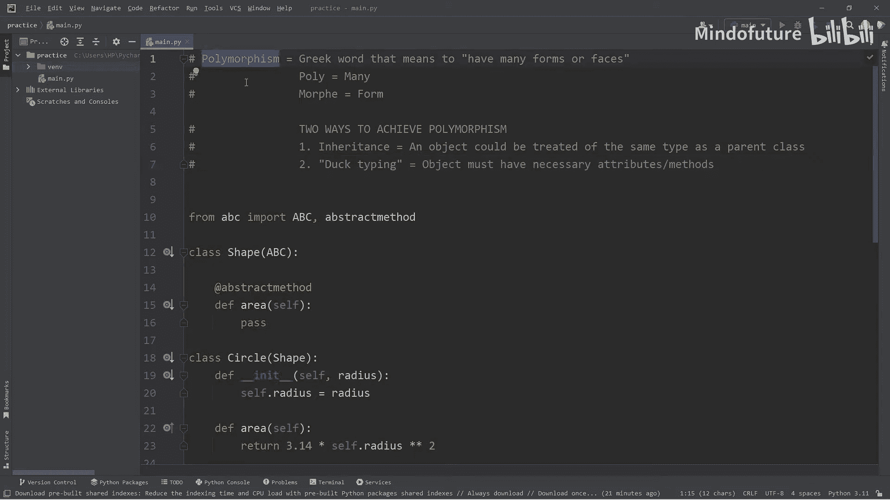

# Python超全入门教程-p53-P53-Learn-Python-POLYMORPHISM-in-8-minutes--BV1fcdLYXEw9_p53-

What is going on， everybody。 So today， I got to talk about polylymorphism in Python。

 Polymorphism is a programming concept。 It's a Greek word that means to have many forms or faces。

 Poly means many Mor means form in programming and object can take one of many forms。

 There's two ways to achieve polymorphism。 One is through inheritance。

 an object could be treated of the same type as a parent class。 There's also duck typing。

 which we'll talk about in the next topic。 In this video， we're more focused on inheritance。

 What we'll do in this video is create a class。

Of shape。We'll right past as a placeholder。We will create a class of circle。

 which will inherit from shape。Again， writing pass。Class square。Inherits from shape。Class triangle。

Which inherits from shape？If I was to create a circle object， circle equal circle。

Our circle identifies as a circle， and since our circle class inherits from the shape class。

 our circle is also considered a shape。 It has two forms。 It's a circle and it's a shape。

 but our circle isn't a square or a triangle。 that could also apply to our square class。

Our square is a square。 Our square is also considered a shape。

 but our square is not a circle or a triangle。 Those are two possible forms for our square。

 It's a square and a shape。 So let's say we would like to create a list of shapes。

 What do they all have in common。 Well， they're all shapes。

 A descriptive name for this list would be shapes。 equalals an empty list。

I will instantiate a circle object。A square object。And a triangle object。

Our circle is a circle and a shape。 Our square is a square and a shape。

 Our triangle is a triangle and a shape。 Each of these objects has two forms or two faces。

 Let's fill in some of these classes。😊，Let's say that with our shape class。

 we will define an area method， define area。I'm going to turn this into an abstract method。

 I'll just right pass。To work with abstract classes， we need to import that from ABC。

Import capital ABC。As well as abstract method。Preceding the area method。

 I will add a decorator of abstract method。 Our circle， square and triangle classes。

 They're all considered shapes。 They inherit from this class。

 We need to define an area method for each， since they're all considered a shape。

 Every shape has an area with our class of circle， Let's define a constructor。Define in knit。

We will pass in one argument。 A radius。 What is the radius of the circle。

 assign an attribute of radius equals the radius we receive。Let's do this with square。Define。In it。

One parameter。The length of a side。Self dot side， equal S。Then triangle。Define。In it。

We have two parameters， base and height。Self dot base equals base。Self dothe。Equals height。All right。

 now let's finish defining these area methods for each class。We will return。3。14 times。

Self dot radius。To the power of two。So given a radius， that's how to calculate the area of a circle。

Then with our square。Define area。We will return。Self。Dot side to the power of two。Then。

 with our triangle。Define area。Return。Self dot base， times， self dot height。Times 0。5。

Now we have to pass in some arguments for our circle we need a radius， I'll pick four。For the square。

 the length of a side will be 5。Then our triangle， the base will be 6。 The height will be 7。

We're going to write a loop to iterate through our shapes， for every shape。In shapes。Then。

 we're going to print。For every shape， call the area method。

And that would give me these numbers。

If you would like， you can format the output。I'll just use enough string。I'll add centimeter squared。

Much better。What if we were to create a class that's completely unrelated to shapes？

I will create a class of pizza。I will define a constructor。To construct a pizza object。

 we need a topping。And a radius， what is the radius of the pizza？Self dot topping equals copyping。

Self dot radius。Equals radius。Within my list of shapes， I'll add a pizza object。

But I have to pass into a topping such as pepperoni。And what is the radius of the pizza， Let's say。

 15 cm。 So our pizza， our pizza class， doesn't have an area method。

 Here's what happens when I run this。

We get an attribute error。 Pizza object has no attribute area。

Our pizza object is considered a pizza， but it is not considered a shape。

 It does not inherit from the shape class at the top here。You know what a pizza is circular。

 It could be considered a circle。 So how about this， Let's take the pizza class。

 It will inherit from the circle class。And within our circle class。

We're already assigning the radius to the radius attribute。

So instead of doing that here within the constructor for our pizza class。

Let's call the superconstructor super， which refers to the parent。Use its constructor。

Then pass in the radius we receive。

Let's see if this works now。That does。 Here is the area of our pizza。Our pizza is considered a pizza。

 it inherits from the circle class， so it's also considered a circle and our circle class。

Inherits from the shape class。Our pizza has three forms。 Our pizza is considered a pizza。

 It's also considered a circle， and it's also considered a shape。

It would make sense for it to fit into this list of shapes。

 because our pizza also identifies as a shape。 So that's polymorphism。 everybody。 It's a Greek word。

 meaning to have many forms or faces。 polyly meaning many morph meaning form in Python。

 there's two ways to achieve polymorphism。 One through inheritance。

 An object could be treated of the same type as parent。 And there's also duck typing。

 which we'll discuss more the next topic。 Stay tuned for that。 And well， everybody。

 that's polymorphism in Python。

