# Python超全入门教程-p55-P55-Learn-Python-AGGREGATION-in-6-minutes--BV1fcdLYXEw9_p55-

Hey what's going on everybody， So in today's video I'm going to explain aggregation in Python Aggregation represents a relationship where one object contains references to one or more independent objects。

 One object acts as a container， the whole which can contain other objects， the parts。

 So what we'll do in this demonstration is create an object that's going to act as a container。

 will'll create a class of library。For now， I'll write pass。Now a library can contain books。

 we will create a class。Of book。We'll be creating book objects。

 which we will add to our library object。 The library object is going to act as the whole。

 The container。 The books are the independent parts。 A library can exist without its books。

 and the books can exist without the library。 That's the main difference between aggregation and composition。

 These classes are independent of one another。 They can exist without each other。

 With our class of books， We need a constructor。

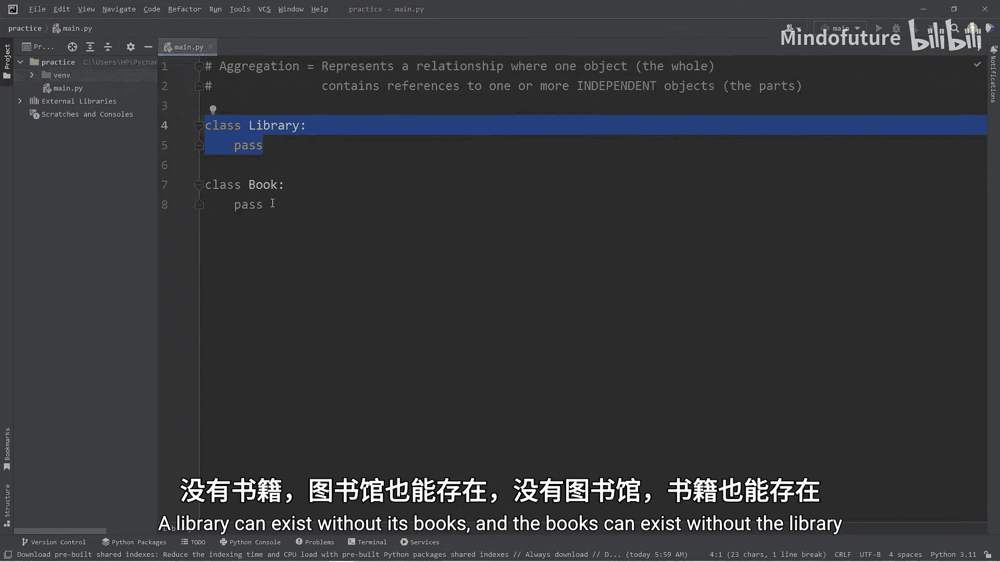

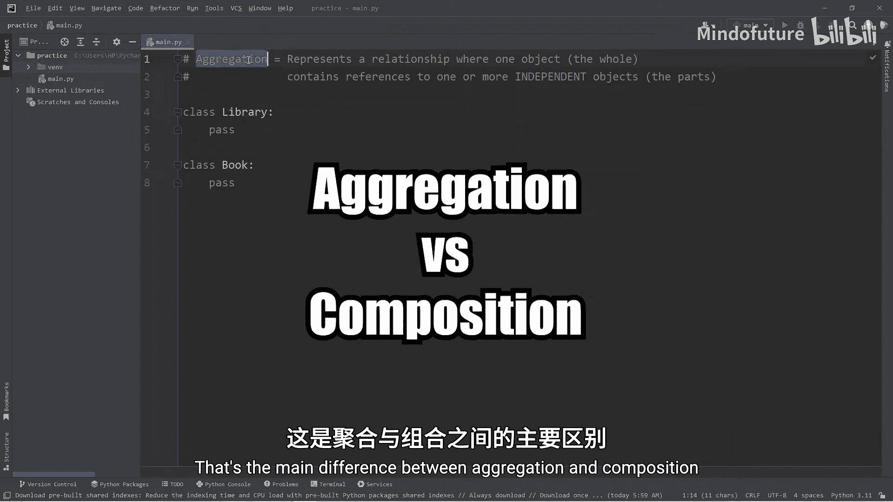

We will define our constructor。If we create a book。We need a title。And an author。

We will define a title attribute equals the title that we receive。

And self dot author equals the author that we receive。 That's all we need for the book class。

Now with the library class， we will also need a constructor。Define， isn't it。For our library。

 we need a name for the library。 For example， the New York Public Library。

Self Don name equals the name that we receive。Let's construct our library object first。

Library equals library， We need to pass in a name for this library。Let's say New York。Public library。

So this should run with no problems。Then we'll create a few books。Let's say， book one。

Equals called the book constructor。 We have to pass in a title and an author。 So pick a few books。

 I will pick Harry Potter， happy， Harry。Harry Potter。And the philosopher's stone。

 but I don't want to type the whole title。 Let's just say Harry Potter dot dot， dot。

The author of this book is JK Rollling。Okay， let's create another book。Book2。Equals book。

For my next book， I'll pick the Hobbit。The author。Is J， R， R token。Then book three。Equals book。

We need a title and a author。I will pick the color。Of magic。By Terry。Pratcht。

We have no problems when running this。Our library and our books can exist without each other。

 Our books are independent。So now where aggregation comes in。

 our library object will contain our book objects。 One way in which we can handle this is that within the constructor for our library。

Let's create an attribute of books。This will be an empty list。

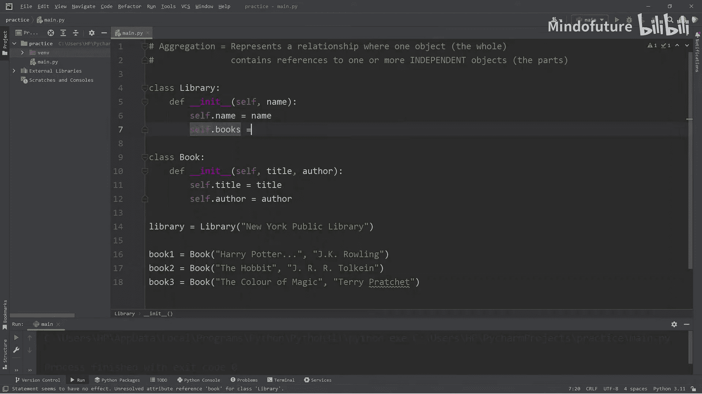

We'll need a way to add these books。To our list of books。We will define a method of add book。

But we have to pass in a book object when we call this method。We're going to access self dobooks。

 It's a list。Listists have a built in append method。We will append our book to our list of books。

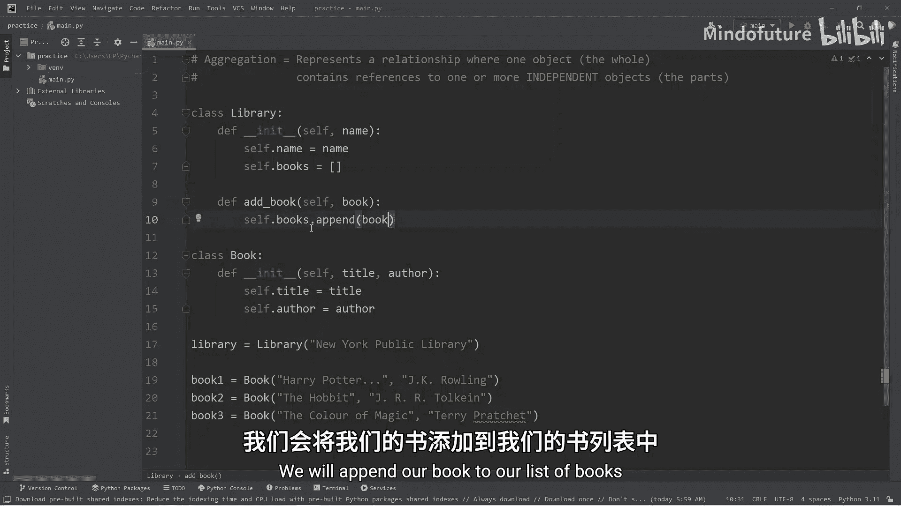

Let's see if this at least runs， We're going to take our library。

Call the add book method that we defined。Then pass in our book object of book1。

Then let's do this with book  two and book three。

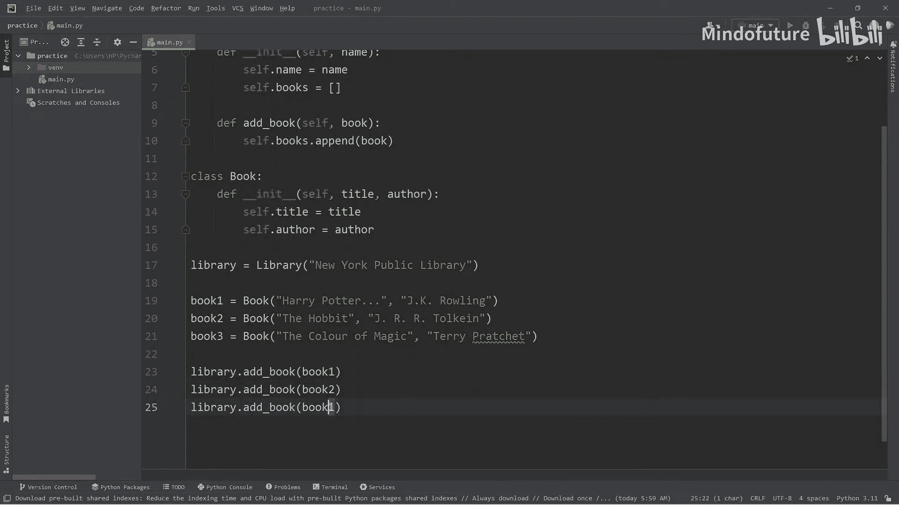

And this is run with no problems。Our books can exist independently of our library。

 our library object is just containing them， it's housing these books。Now。

 if I would like to print all the books in my library， I could create a method to do that。

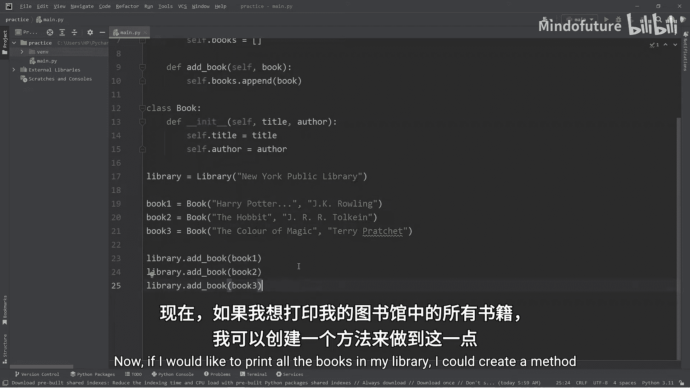

Let's define a method of list books。There will be no parameters besides self。I'm going to return。

A list comprehension。For every book in self。 bookss。Remember that books is a list。

For every book in books， let's return an F string。Where we display the book's title and the books author。

Display book。t title。The word， by。Book dot author。

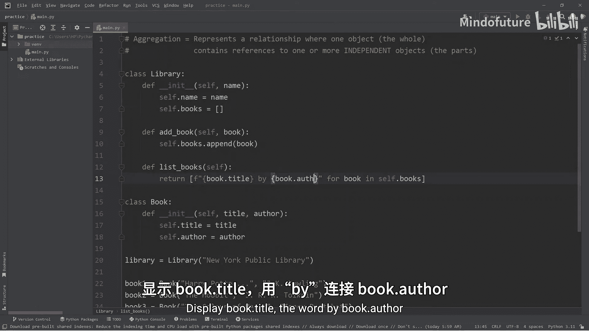

Okay， let's see if this works。 First， I'm going to print the library's name。Print。Library。

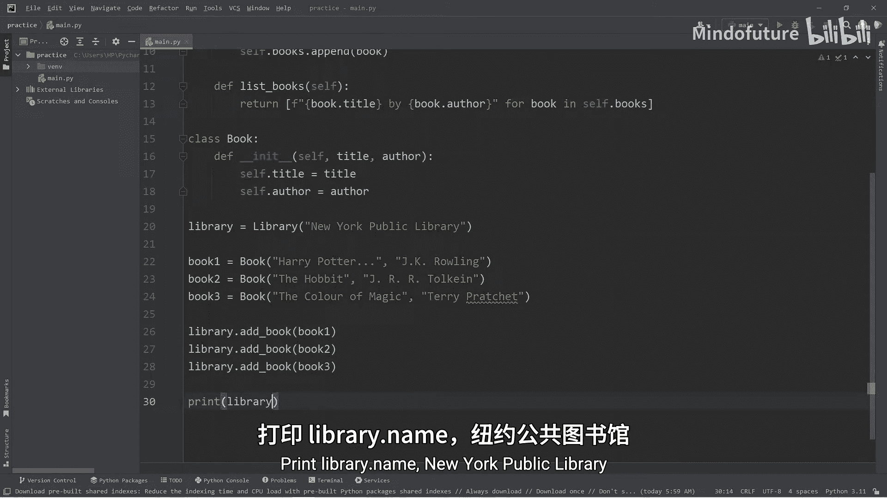

Dot name。New York Public Library。Then I'm going to print。Access the library objects。

List books method。And here's my list of books。Although I'm going to reformat this so it looks better。

I'll use a for loop。For every book。In access our library objects。List books method。

This will return a list， we can iterate through it。For every book in the list of books。

Print each book。All right， here is our library's name and each book in our list of books。

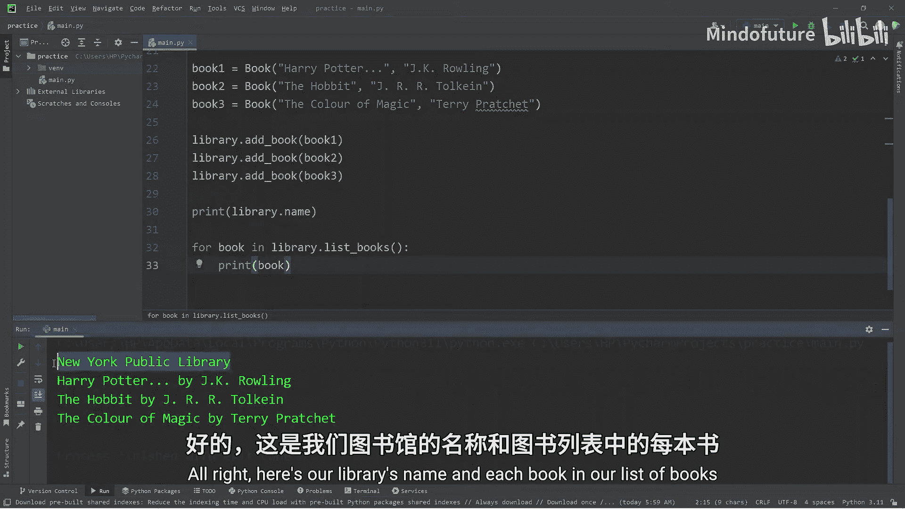

Art everybody， so that's aggregation。 It represents a relationship where one object。

 the whole contains references to one or more independent objects， the books。

 they can exist without one another， and well everybody that is aggregation in Python。

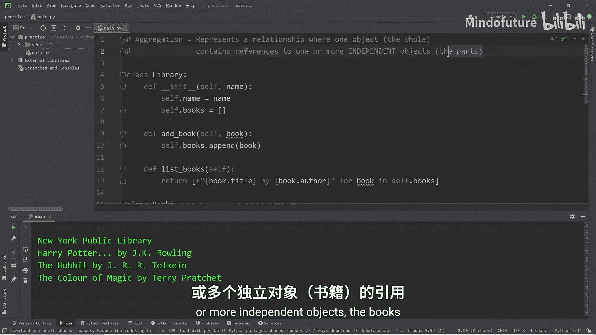

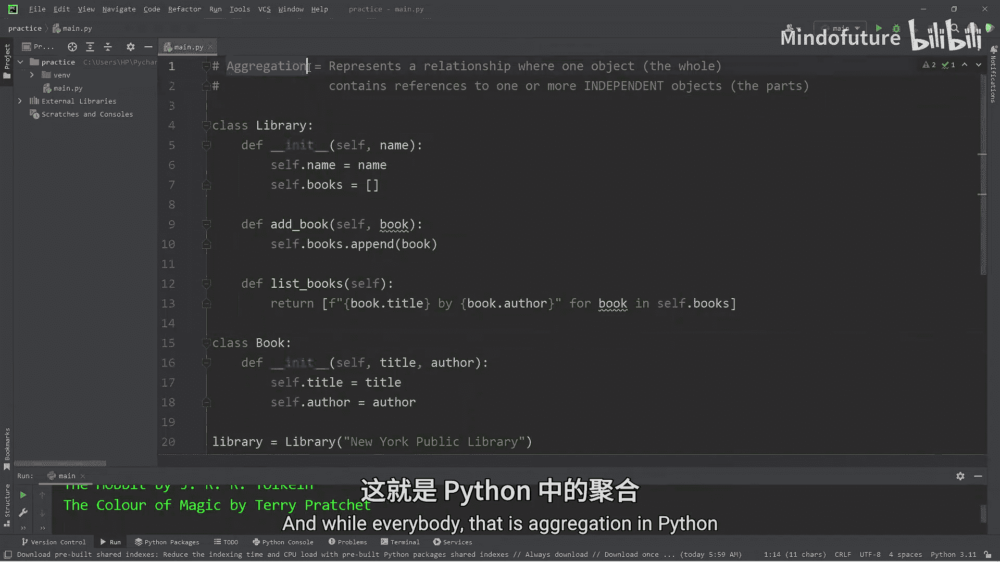