# Python超全入门教程-p56-P56-Learn-Python-COMPOSITION-in-7-minutes--BV1fcdLYXEw9_p56-

Al right， everybody。 So today， I got to talk about composition in Python。

 As we've discussed in the previous topic， aggregation is a relationship where one object contains references to other independent objects。

 They have a has a relationship。 compositionposition， on the other hand。

 is when the composed object directly owns its components， which cannot exist independently。

 They have a owns a relationship。 aggregation has things。

 compositionposition owns things kind of like your renting or your owning something In this example。

 will create three classes。😊，A class。Up engine。A class。Of wheel。

And the composed object is going to be a class car。Within our car class。

 we will construct some engine and wheel objects。 We'll begin with our engine class。

 We'll need a constructor。 We'll define that。Define， init。Let's say that with an engine。

 we need a horsepower。What is the power of the engine。Self dot horsepower attribute。

Equals the horsepower that we receive。With our class of wheel， we need a constructor define。

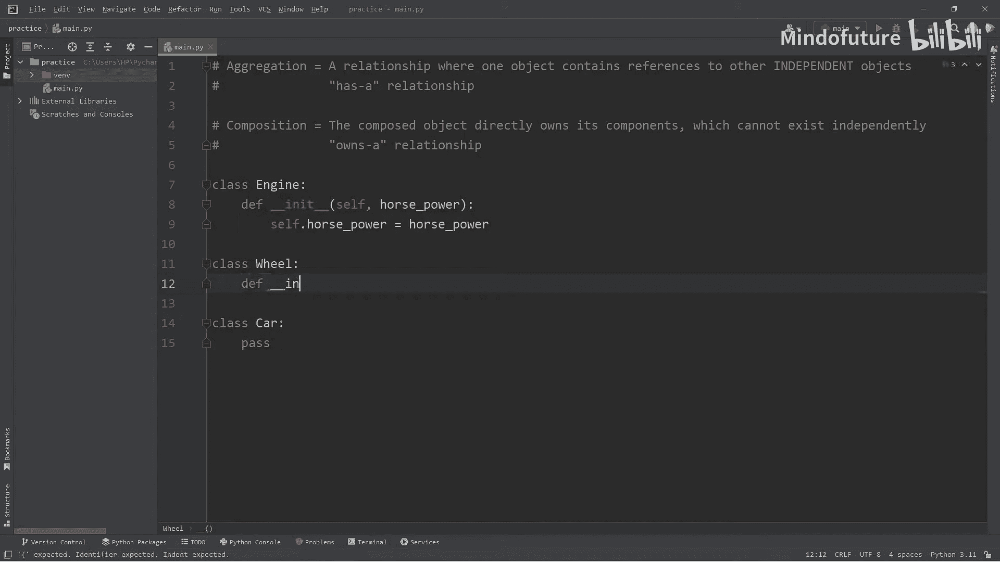

In it。Let's add a size attribute。 What is the size of the wheel。Self dot size， equal size。Okay。

 now with our car object。Now， within our car class， we need a constructor。We will need a make model。

The horsepower of the engine。

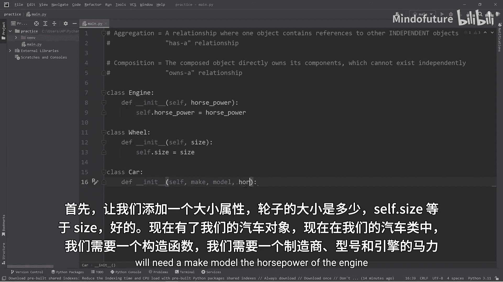

And size， we'll say wheel size。Remember that you can rename parameters to something different。

We will assign these attributes。 self dot make equals make。Self dot model equals model。

Here's where composition comes in。We will define an attribute。Of engine。Then。

 call the engine constructor。We have one argument to pass in， horsepower。

We will pass in the horsepower that we receive to the engine Conor。Then we have to set up our wheels。

Self dot wheels。Equals now to construct a single wheel object， we would call the wheel constructor。

Then pass in the wheel size。However， cars have four wheels。 We don't want just one wheel。

 so what we could do is write a list comprehension。For every wheel。

In range four to iterate four times。Let's call the wheel constructor。

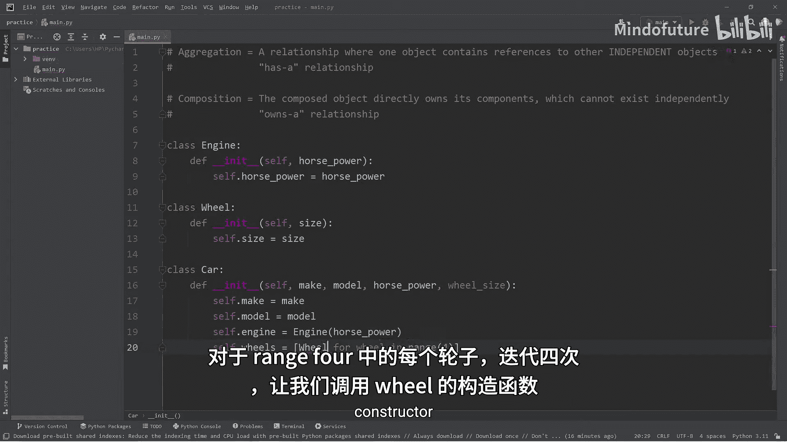

And pass in our wheel size。This list comprehension will create four wheel objects for us。

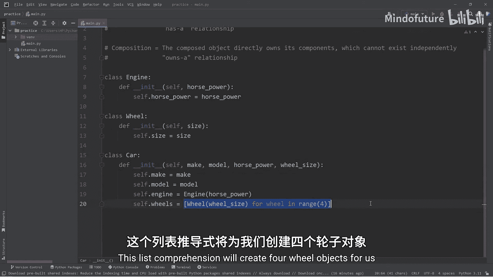

The reason that this is considered composition， we're creating engine and wheel objects inside of this class car。

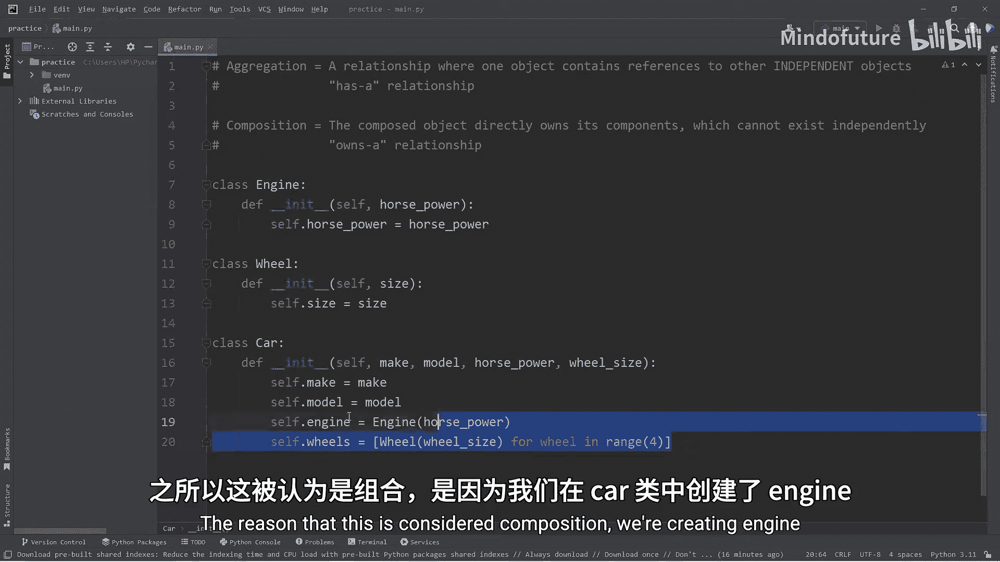

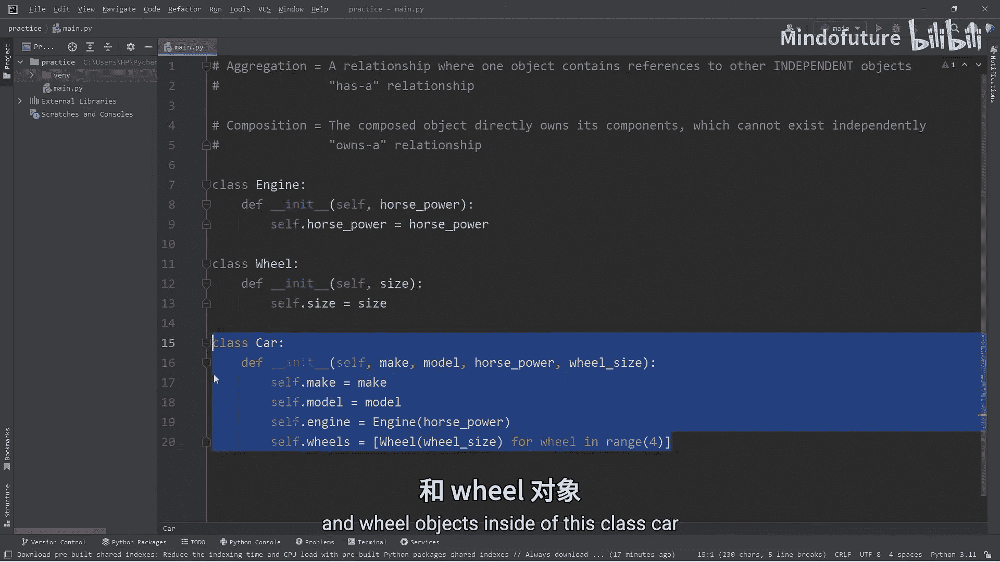

Our class car owns an engine and owns four wheels。

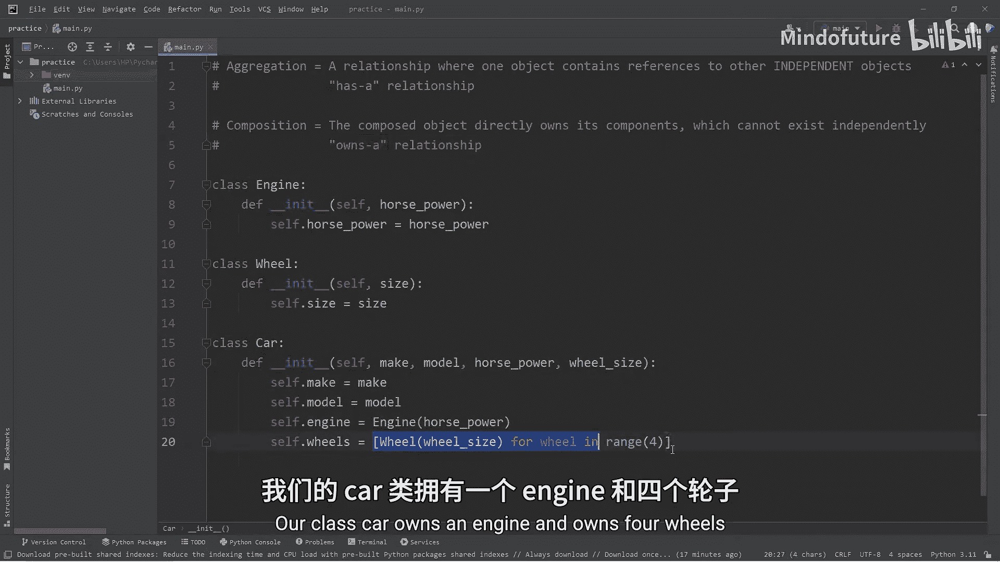

We're not creating these objects outside of the car class。

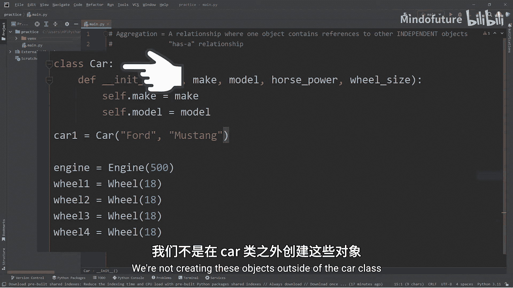

Let's create a car object。Car equals car。We need a make model， horsepower for the engine。

 and wheel size。So for my car， let's say Ford。Mustang。For the horsepower， I'll make up something，500。

For the wheel size，18 inches。Now， just to make this more explicit。

 I'm going to use keyword arguments， but you don't have to。

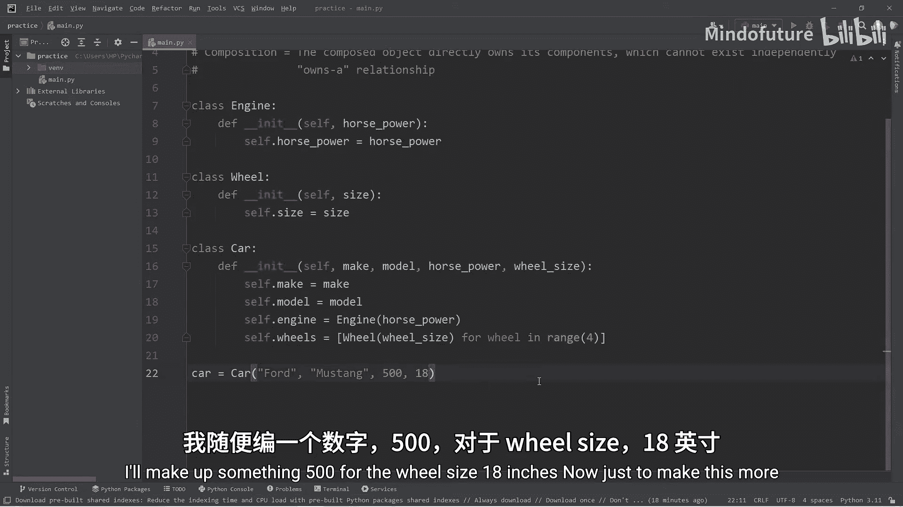

So make equals ford。Model equals Mustang。Horse power equals 500。Wheel size equals 18。

Let's create a method to display our car。 I would like the details。Define display， car。No parameters。

Let's return an F string。Let's begin with the Ma and model。 Those will be easy。Display self dot make。

And self dot model。Let's take our car object， use the display car method。

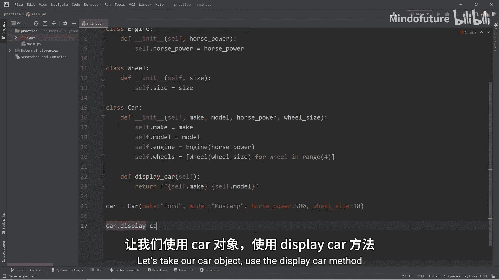

Then I got to print it， I forgot。Because we're returning a string， we're not printing it directly。

We have a Ford Mustang。Okay， let's display the horsepower。There's one additional step。

 We are accessing self， this car that we're creating。But now we need the engine。

 Let's access the engine attribute。

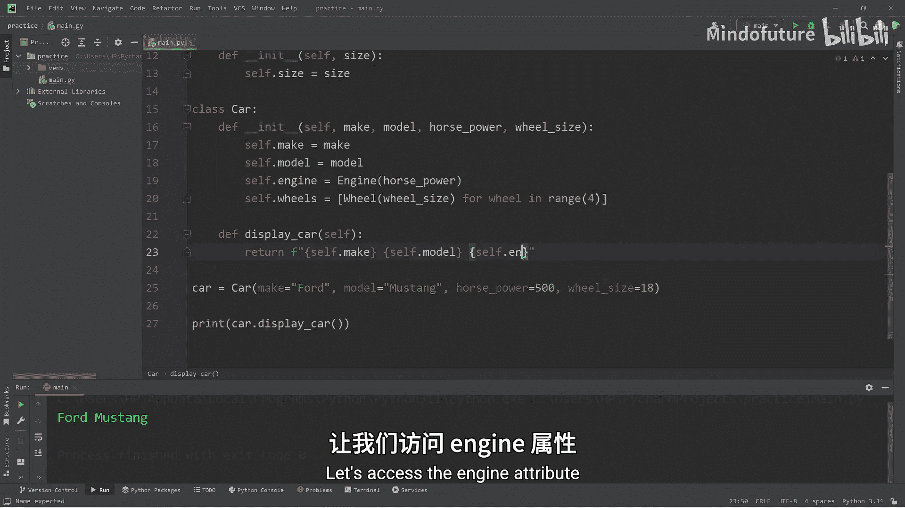

And now with our engine， our engine has an attribute of horsepower。

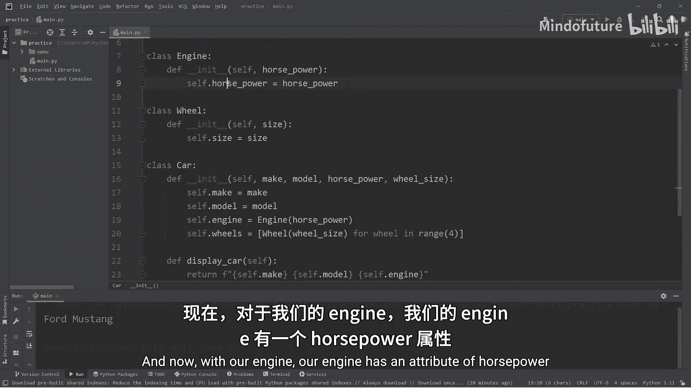

We'll use the attribute accessor， that dot， horsepower。500。I'll add H， meaning horsepower。All right。

 now for the wheels。I'll add another place hold。Access self。Access our wheels。Now our wheels。

 it's a list。I don't need all four wheels。 I just need one。If I was to take my list。

 then access the size。This is what it'll give me。List object has no attribute size。

So we need to access one of the elements of our list of wheels。

 Let's just say the first wheels at index 0， Then give me the size。18， and that's going to be inches。

All right， then let's create a second car object before we finish。We have car one。Car 2 equals car。

We need a make model， horsepower for the engine， and wheel size for the wheels。

I will pick a Chevrolet。Cvette， and I'm just going to make up some numbers。 The horsepower is 670。

 and the wheel size is 19。Let's display car2。Car2 called the display Car method。

We have a Chevy Corvette with horsepower of 670。 The wheel size is 19 inches。

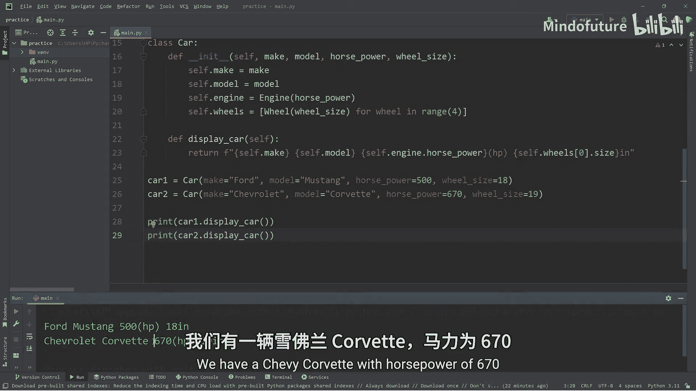

So our car class， it owns some objects。 It owns an engine， and it owns four wheels。

 That's why composition is different from aggregation。 If I were to delete these two cars。

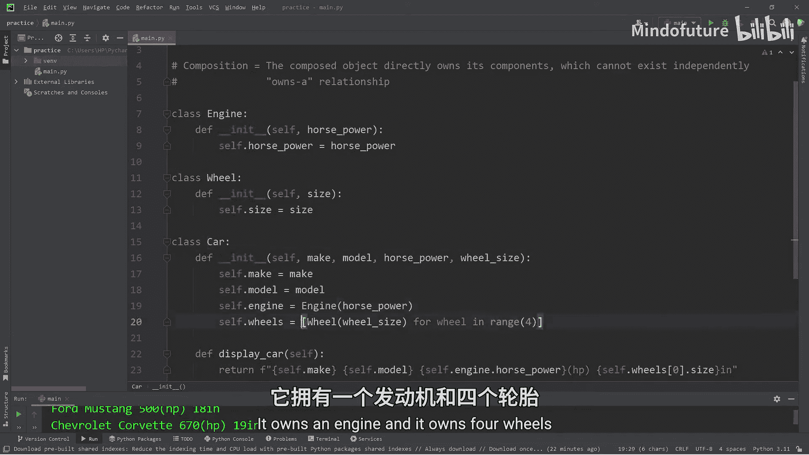

This engine and the four wheels would stop existing， whereas in our library example。

 in the last video， if I was to delete the library object， the books would still exist。

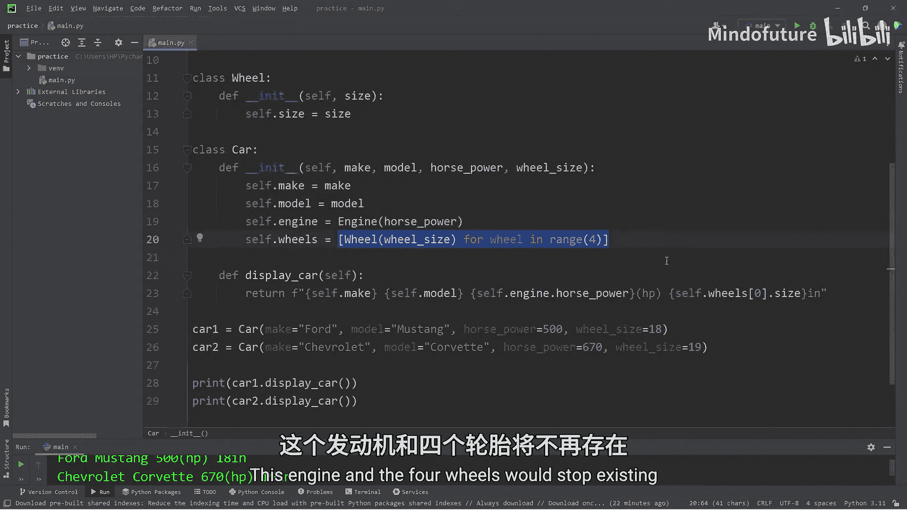

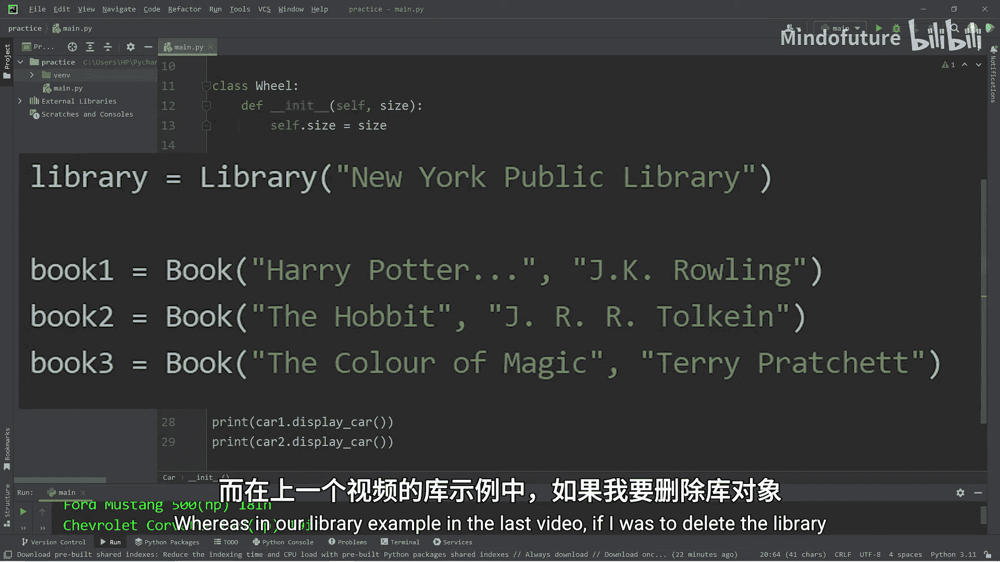

At everybody。 So that's composition。 It's where a composed object。

 Our car directly owns its components。 Our car owns an engine， and it owns four wheels。

 We're creating them within the class。 And well， everybody。 that's composition in Python。

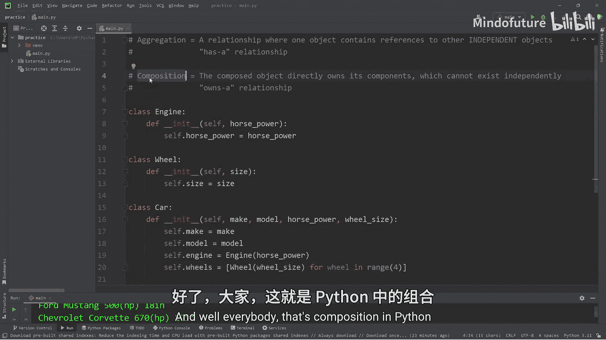