# Python超全入门教程-p58-P58-Learn-Python-STATIC-METHODS-in-5-minutes--BV1fcdLYXEw9_p58-

Hey， what's going on， everybody。 Today， I'm going to talk about static methods in Python。

 A static method is a method that belongs to a class rather than any object from that class。

 any instance， In methods were already familiar with them。

 They are methods that belong to individual objects created from that class。

 They best for operations on instances of that class， any objects， whereas static methods。

 they're best for utility functions within a class， that do not need access to class data。

 I'll demonstrate the differences between an instance method and a static method。

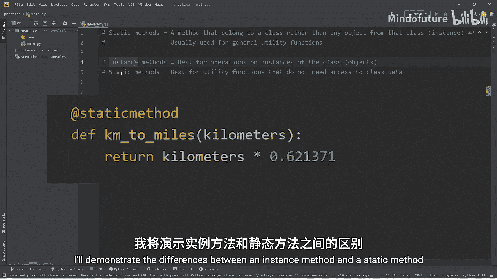

Will begin by cr a class of employee。We'll need a constructor。 Let's define that。

To create an employee object will'll need a name and a job position。We will assign self dot name。

Equals name。Self dot position。Equals position。We will create an instance method of get info。

 We will return employee info。We will return an F string。Where we will display。Self dot name。

Equals self dot position。Get info is an instance method。

 Each object that we create from this class will have their own get info method to return the information on that object。

 the object's name and the object's position。

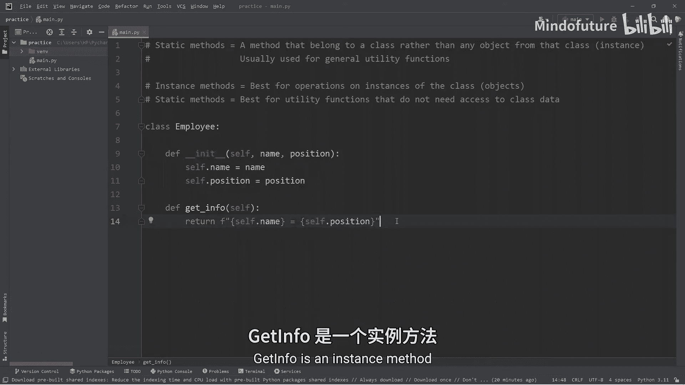

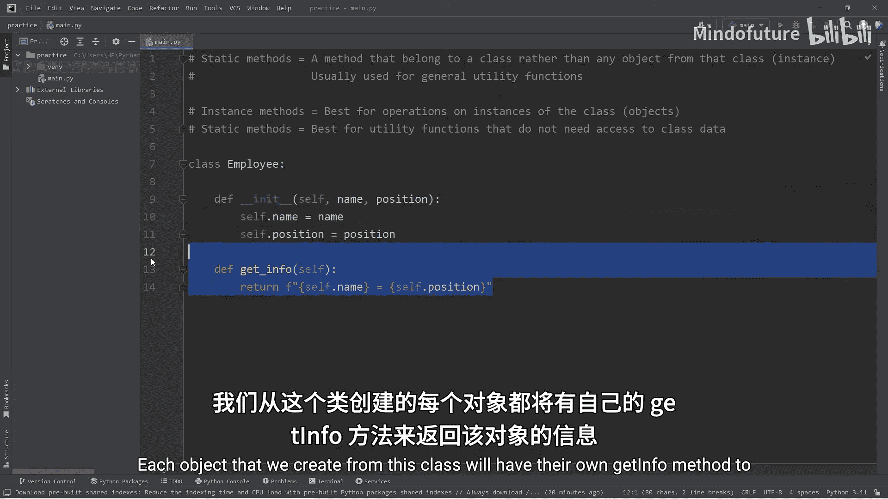

Now we'll create a static method。To create a static method， we need a decorator of static method。

Static methods are best for general utility functions within a class。

We'll define a method to check to see if a job， a position is valid， which we will name is。Valid。

Position。So static methods， they don't have self as the first argument。

 We're not working with any objects created from this class to check to see if a position is valid。

 we will pass in a job position， which I will name as position。I will create a list， of valid。

Positions。Let's assume that our company is the crusty crab。 What are some valid positions？

A manager is a valid position。A cashier。A cook， then let's say a janitor。Then， we will return。

We'll use a membership operator。Check if position that we receive。Is in our list a valid。Positions。

What we have done is that we have created a static method。

 We don't need to rely on any objects to use this method， for example。

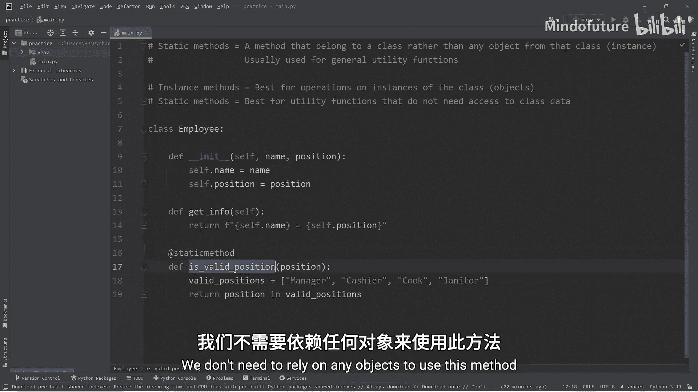

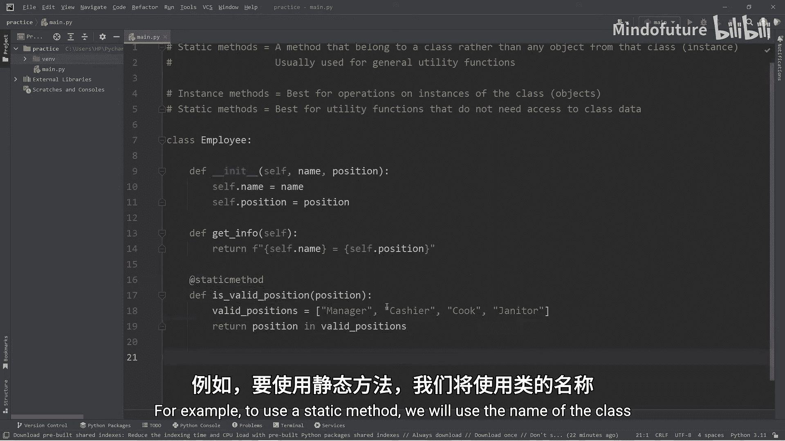

To use a static method， we will use the name of the class。

Rather than any object that we create from this class， such as this。We don't need to do that。

We type the class name。Followed by the static method。Is valid position。

Then I did set this up to accept one argument。 Let's check to see if a cook is a valid position。

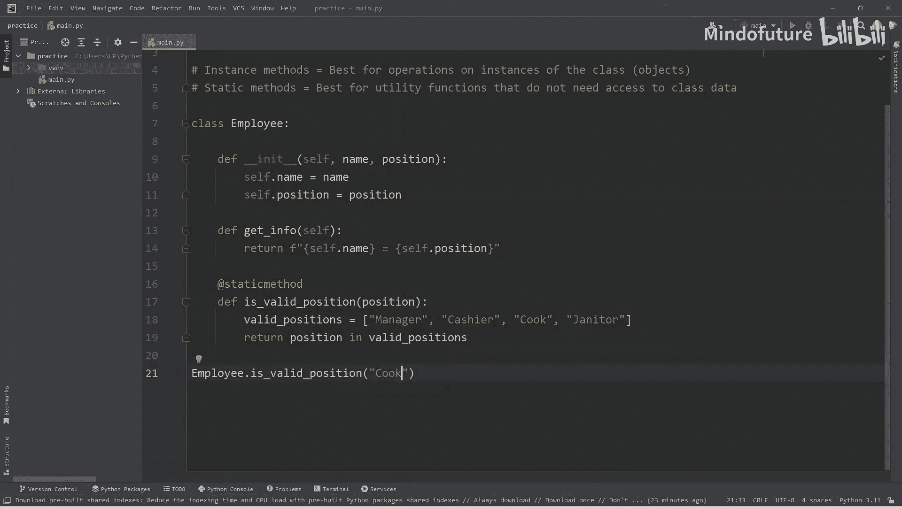

Then I do need to print this。 What is the output？A cook is a valid position。

What about a rocket scientist。That would probably be Sandy's job。That is false。

A rocket scientist is not a valid position at the crusty crab。

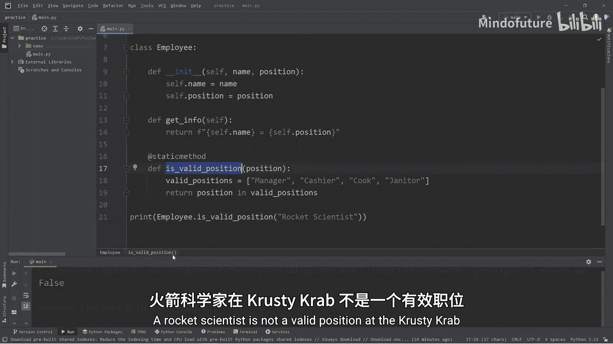

This is a static method。 It belongs to the class， not any object created from that class。Now。

 let's create a few employee objects。 Let's say， employee 1。Equals new employee。

We have to pass in a name and a job。Eugene will be the first name。 That's Mr。 Krabs。

He will be a manager。Employee2。Equals employee。Squiid word。Will be a cashier。Employee 3。

equalals employee。Employee 3 will be SpongBob。Sppongeboob will be a cook。To call an instance method。

 we have to access one of the instances of the class in order to use it。

If I want to check the info on employee 1， I will access that object， that instance。

Use the get info method。Then I need to print it。Take employee1， get the info。

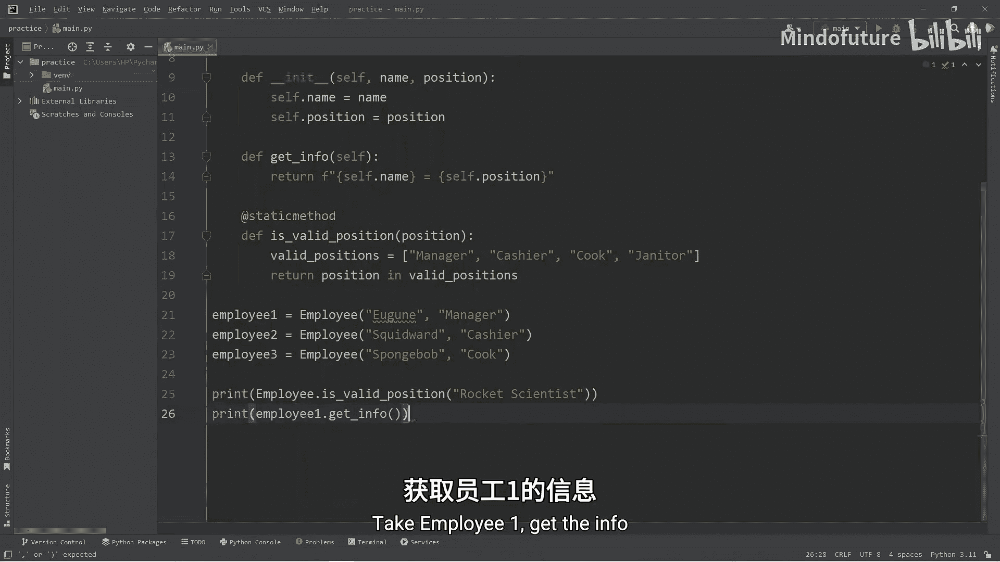

Eugene is the manager。Let's do this with employee 2 and employee 3。

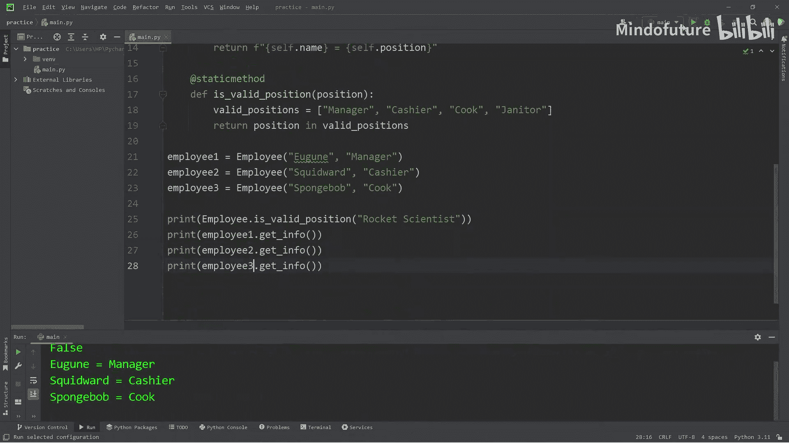

Eugene， Mr。 Krabs is the manager。 Squiidward is the cashier。 Sponongboob is the cook。

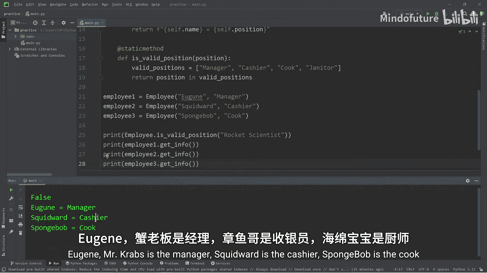

For an instance method， you access an object， then call the instance method。

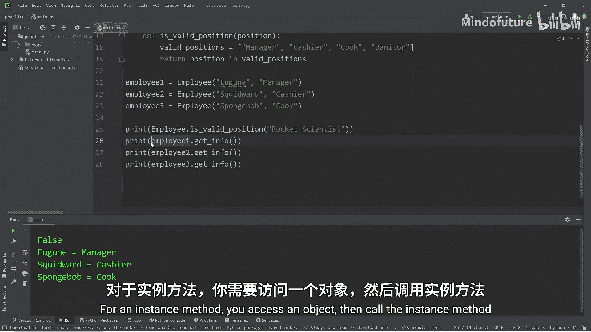

With a static method， you only need to access that class。

 You don't even need to create any objects from that class。

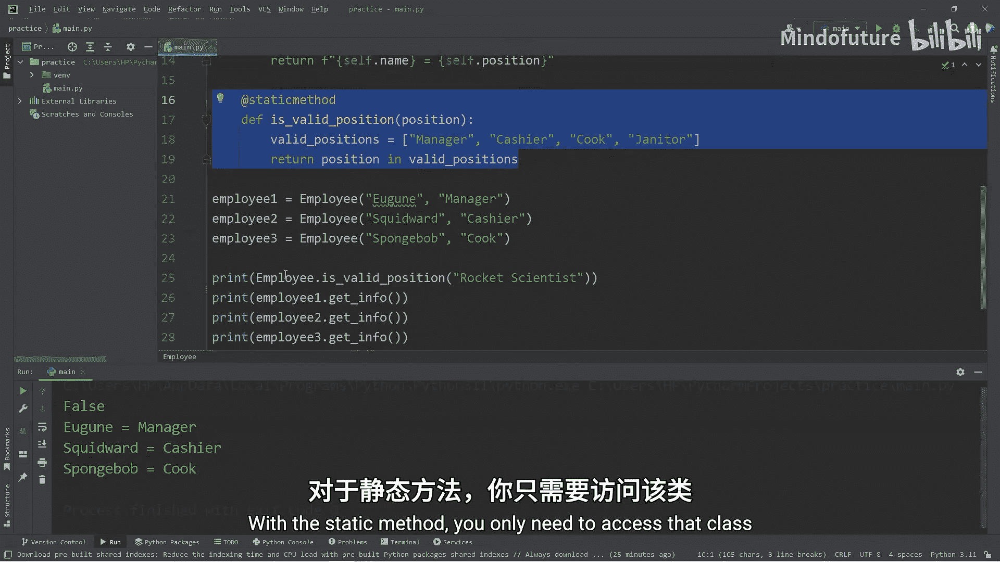

It's a general utility method。

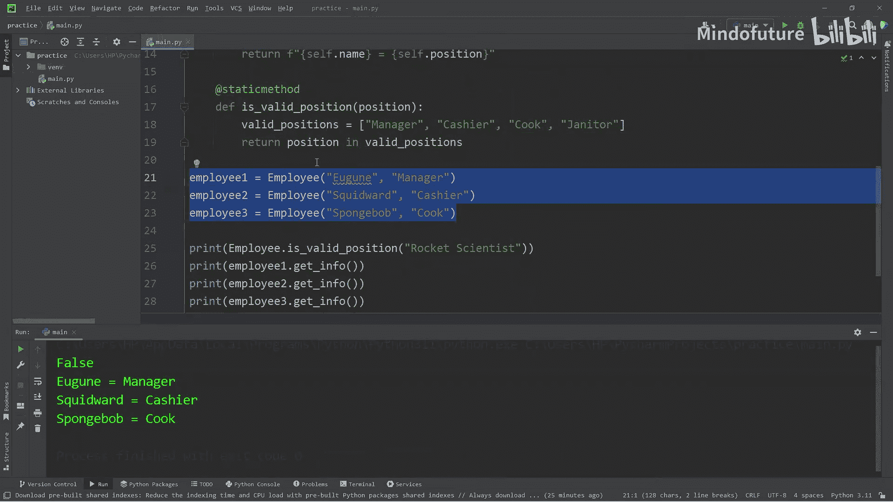

Al right， everybody， Those are static methods。 They're a method that belongs to a class rather than any objects created from that class。

 They're usually used for general utility functions that do not need access to class data。 And well。

 everybody， those are static methods in Python。

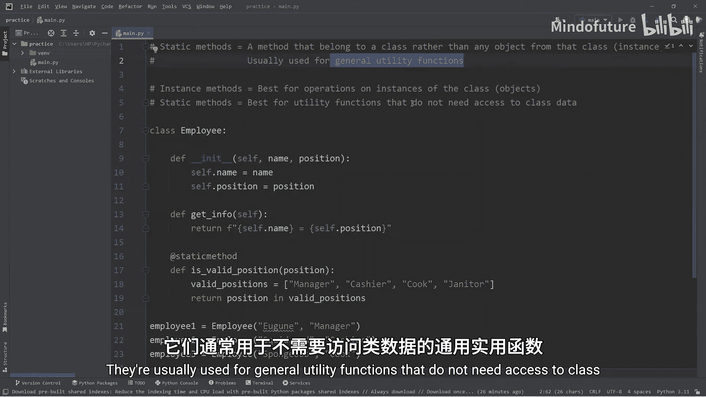

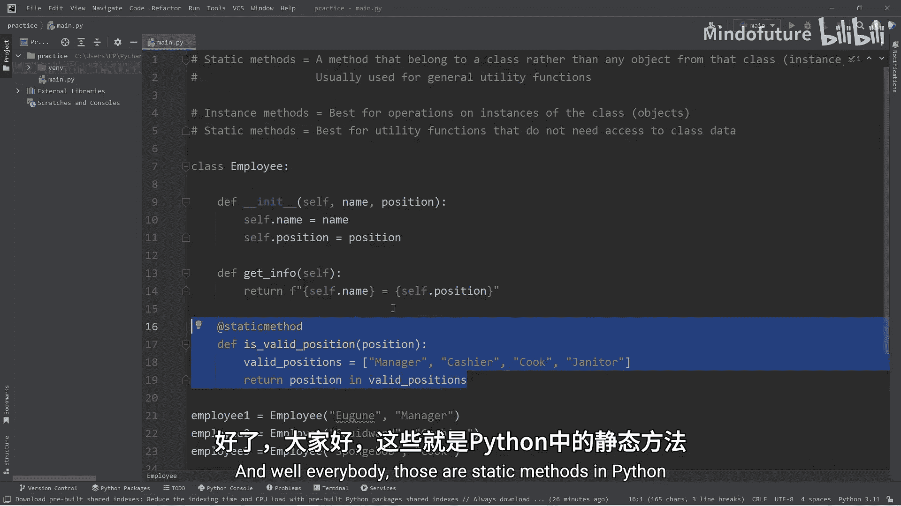