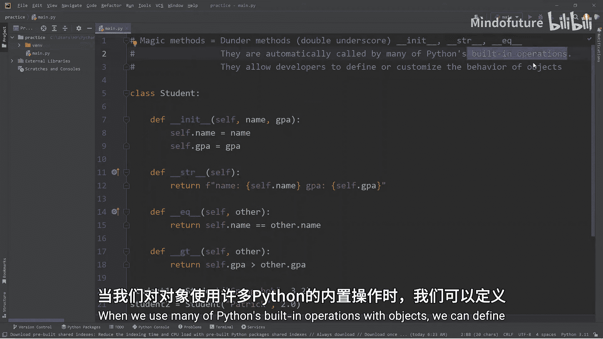
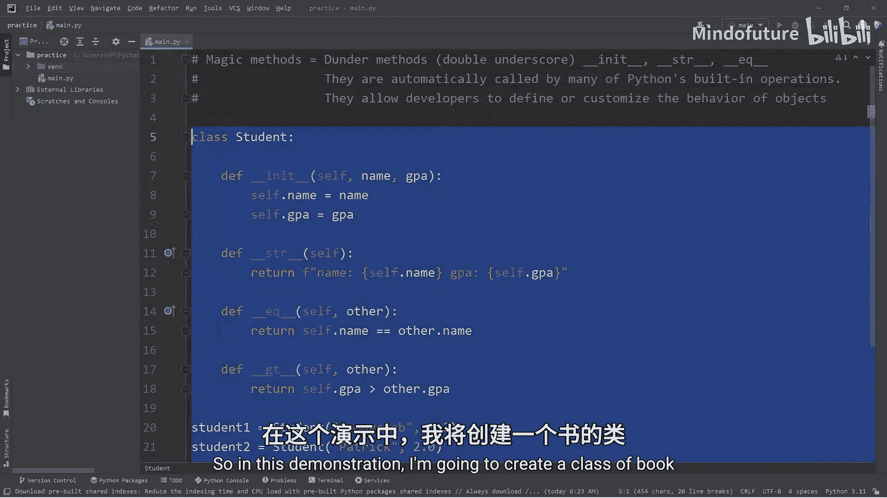
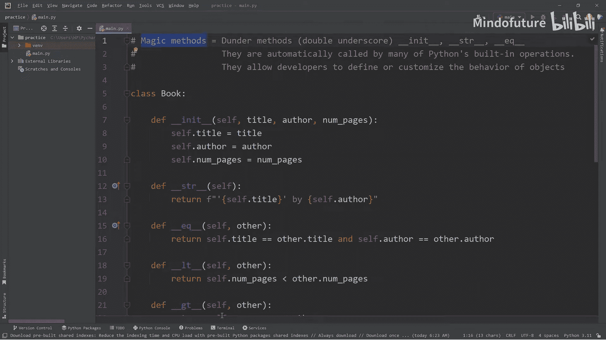

# Python超全入门教程-p60-P60-Python-MAGIC-METHODS-are-easy--BV1fcdLYXEw9_p60-

Yo， what's going on， people。 So today， I'm going to explain magic methods in Python。

 Magic methods are also known as Dunder methods， meaning double underscore。

 You typically find these within classes We're already familiar with one of them are Dunder init method。

 We have double underscores on the left and double underscores on the right。 But there are others。

 I'll cover a few of the more beginner friendly ones。

 So what these methods do is that they're automatically called by using some of Pythons built in operations。

 such as printing an object， seeing if two objects are equal greater than or less then。😊。

When we use many of Pythons built in operations with objects。

 we can define and customize the behavior of those objects。 So in this demonstration。

 I'm going to create a class of book。

We will construct some book objects。 We will define a magic method， a d method of in it。

To initialize these objects。For a book， we need a title and author。And the number of pages。

We'll say numb pages。Self dot title。Equals title。Self dot author。Equals author。

Self dot number of pages。Equals number of pages。When we call the class of book。

 we are automatically calling Dunder and knit， so let's create a book object。Book1 equals book。

We need a title， an author and number of pages。 So since we're dealing with this topic of magic methods。

 I'll pick some fantasy related books For my first book， I'll pick the Hobbit。😊，That's the title。

The author is JR，R。Token。The number of pages is 310。So for my next book。Book 2。I will pick。

Harry Potter。And the philosopher's stone。The author is JK Rollling。The number of pages is 223。

Then we have book3。For my third book， I will pick the lion。The witch。And the wardrobe。

The author is CS。S Lewis。The number of pages is 172。Okay， here are my three book objects。

When we call the class of book and pass in arguments， we will call the Dunder init method。

 It's a magic method。 It's automatically called behind the scenes。 Within this magic method。

 we can define and customize the behavior of objects。 And in this example。

 we're just assigning the attributes of title， author and number of pages。😊。

That is one built in operation of Python。What would happen if I was to print book one directly to the console？

Here's what happens。Well， we're given a memory address。Here's book 2， and book 3。Well。

 we can customize this behavior。We will use the Dunder string method。Double underscore。

 STR meaning string。 Doub underscore again。We have one parameter of self。

Instead of returning a memory address， we can customize this behavior。Let's instead。

 return an F string。I'll add two placeholders。We will display self dot title， The title of the book。

 by。Self dot author。And I'll place the title within single quotes。Now let's print book1。

We have the Hobbit by JRR Token。Let's print book 2。Harry Potter and the philosopher's stone by J。 K。

 Rollling。Ad book3。The lion in the W in the wardrobe by C。 S。 Lewis。So that is Dunder string。

 We can return a string representation of the object when we print it directly to the console。

Here's another Dunder method。 We can check to see if two objects are equal。I will print。Is book1。

Equal to book  two。That gives me false。If they were to have the same title。The same author。

And the same number of pages。Then Python would say they're not equal still。

 so let's customize this behavior。We will define a method of Dunder equals， which is just EQ。

For parameters， we have self， the first book we're examining， in this case， book1。

And other other means the other book。 We examining two objects for equality。To do that。

 we'll see if the title of two books。And the author is the same。We'll disregard the number of pages。

You can have two different versions of the same book。 They might have different font sizes。

 or the dimensions of the physical pages might be different。So we will return a Boolean value。

 We will examine if self。 that's the first book is the title attribute。

Equal to our other books title。And。Is the author of the first book。

 selflf dot author equal to our other book's author。If I were to run this， we get false。

Book1 does not equal book2， but if they have the same title。

I'm going to replace these and the same author。Then they would be equal and will disregard the number of pages。

Let's say that with this version of the Hobbit， they're using a smaller font size。

 so there's less pages。We're using Dunder equals to compare if two objects are equal。

What if I was to print。Book 2 is less than book 3。Like， what does that even mean？

And I'm just going to get rid of these two lines。Type error。

 less than is not supported between instances of book and book。

So we can't use less than on two objects， but we can customize that behavior by using Dunder less than。

 which is just L T。 We're examining one book。And the other book。Self and other。

Let's compare the number of pages。We'll compare if the pages of book 2 is less than book 3。

We will return a Boolean value。Is self dot number of pages。Less than other dot number of pages。

So now this should not give us an error。 Book 2 does not have less pages than book 3。

Another would be greater than。I'll just copy what we have。Dunder GT for greater then。

For our first book of self， is it greater than the number of pages of the other book。Well。

 that's true。 The number of pages of book 2 is greater than book 3。

Let's use Dunder add to add the pages of two books together。

 What would happen if I were to add two books together， book2 plus book 3。Well we get a type error。

 unsupported operaand for book and book。Well， to customize the behavior of addition。

We will define Gunder， add。We have self and other for the other object。

Let's add the pages together of two books。 Maybe we need a summer reading list。

 and we would like to see what the total number of pages is。I will return self dot number。

Of pages attribute， plus our other books， number of pages。That would give me 395。

 That's 223 plus 172。 Heck。 I'll even put this within enough string。Because why not？

Then I will add the word pages。395 pages。Within an object。

 we can search for a keyword within one of the attributes。

So let's find the word of lionion within book 3。To do that， I would write a statement like this。Lion。

In book 3。Type error argument of type book is not iterable。We will define。Dunder contains。

Besides self， we will pass in a keyword， a keyword that we're searching for。I will return。

Then we'll use the in membership operator I our keyword in self dot title。

 I'm looking for the word lion。 That's going to return true。 If lion is in the title of this book。

Or is our keyword。In self dot author， maybe we're searching for an author。Let's try that again。

That returns true， Lion is in book 3。However， lion is not within book 1。That's false。

Is rolling in book2。That's the author。That is true， is rolling in book 3。That is false。

That is Dunder containss。 We are searching for a keyword， in an object。Now。

 we could search for a key given an object for book1。

 we'll use the index operator and look up an attribute。Let's get the title of book 1。

The default behavior is that we get a type error Book object is not subscriptable。

So to customize this behavior， we will use Dunder get item。Besides self。

 we have one parameter of key。We're accessing book attributes by indexing。With this object。

 return the value at this key。 What's that attribute。We will check if our key that we receive。

Is equal to title， which it is in this case。We will return self dot title。

 What's the title of the book。So that would give me the hobbit。Here's book2。And book 3。

What if the key is author。None， we didn't set that up yet。If key is equal to author。Then return。

 self dot author。The author of Book 3。Is C S Lewis。Two is JK Ro。Book 1 is JR R。 token。

What about number of pages， numb pages。Well， we're not set up for that yet。

I'm going to turn this into an Elsive statement。Else， if key。Is equal to nu。Pages。

Then we will return self dotm。Pages。The number of pages in book1。Is 3，10。Book two is 223。

Book 3 is 172。What if there is no key， otherwise， if there is no matching key。

I'll add an out statement。Let's return。An F string。Key placeholder。

Are key that we pass in as an argument。Was not found。What do books not have？Well。

 they don't have audio， I guess， unless it's an audio book。Is there a key of audio in book 3。

There is not key audio was not found。And I'll place that within single quotes。Much better。 Alright。

 everybody。 So those are magic methods， also known as Dunder methods， meaning double underscore。

 They are automatically called by many of Python's built in operations。

 They allow developers to define or customize the behavior of objects when we use those built in operations。

😊，And well， everybody， those are magic methods in Python。

